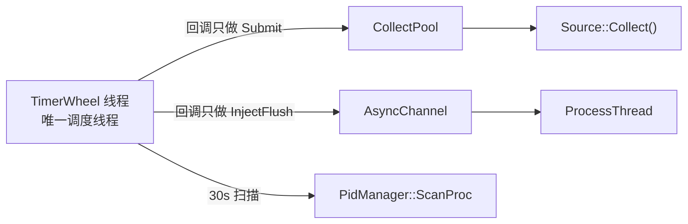
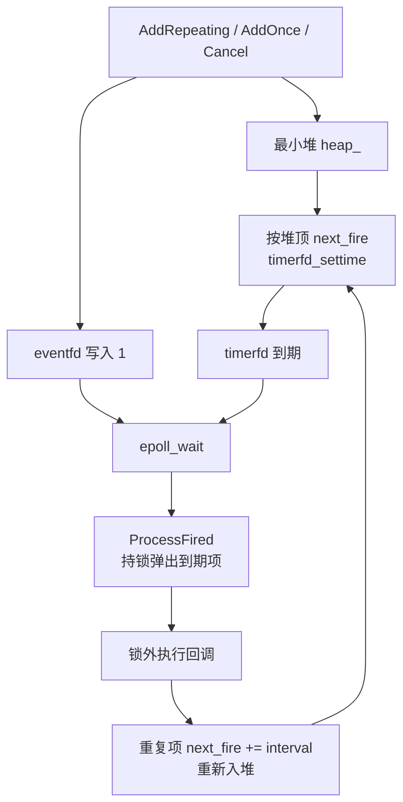
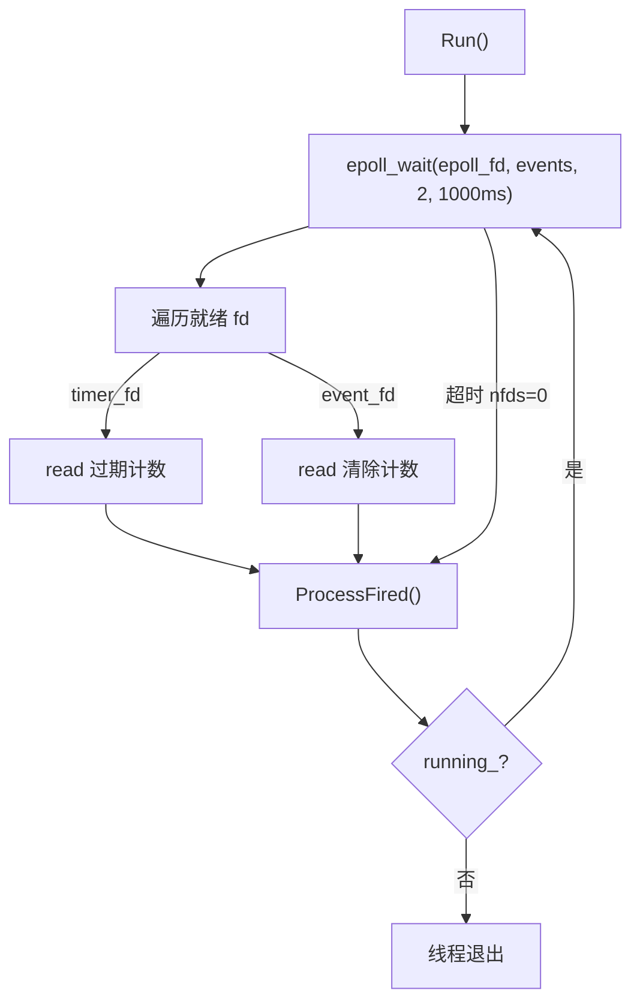
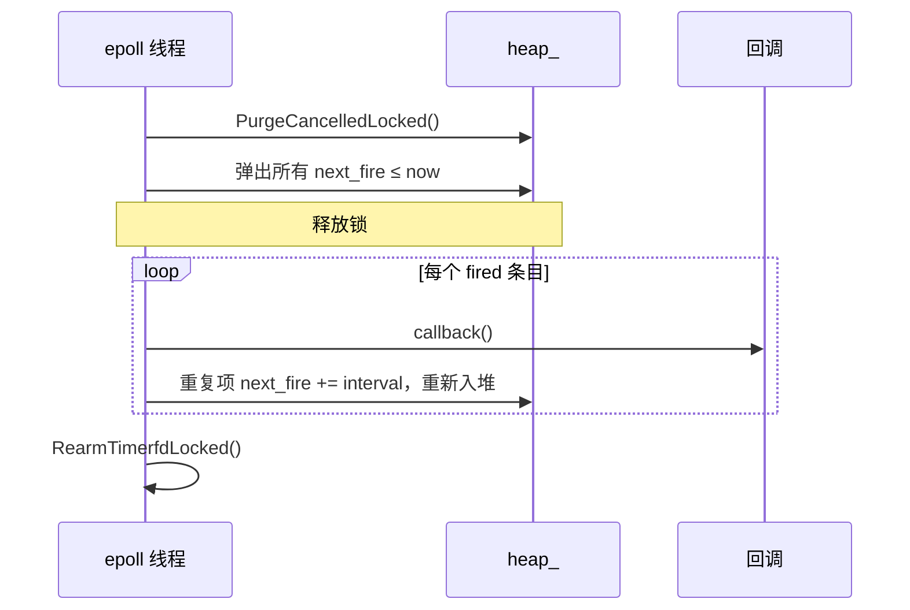
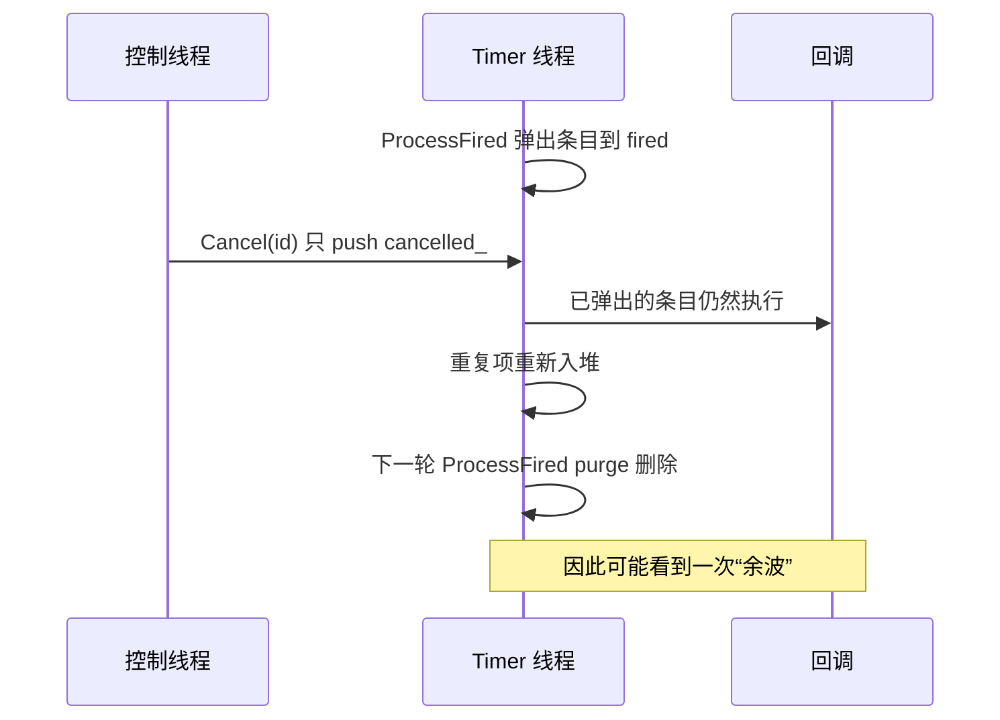

# 02-03 TimerWheel 定时调度器

> 先澄清归属：`TimerWheel` **不属于某条 Pipeline**，而是 `InfrastructureManager` 持有的全局单例成员。Pipeline 只通过宿主注册的定时回调被驱动，自己不创建任何定时器。

本篇回答：它为什么叫 Wheel 却不是时间轮？一次到期到底发生了什么？重复定时器为什么会“追赶”？`Cancel()` 之后为什么还可能看到回调？

返回 [Pipeline v3 总览](./index.md)。

## 1. 心智模型：只调度，不执行

TimerWheel 的职责只有一句话：**在正确的时间，把轻量任务交给别人。**

<div style="overflow-x: auto; margin: 1.5rem 0;">



</div>

因此回调里**不能**做以下事情：

- 直接调用 `Source::Collect()`（应提交到 CollectPool）
- 解析符号、读文件、做网络 I/O
- 长时间持有锁
- 在回调里调用 `TimerWheel::Stop()`（会 join 当前线程）

一个长回调会阻塞同一个 TimerWheel 上的所有其他定时器。

## 2. 名字与实现

类名是 TimerWheel，但当前实现**不是分层时间轮**，而是：

```text
timerfd（内核定时器）
  + eventfd（外部唤醒）
  + epoll（同时等待两者）
  + std::priority_queue（最小堆，按 next_fire 排序）
```

<div style="overflow-x: auto; margin: 1.5rem 0;">



</div>

## 3. 三个内核对象

| 对象 | 创建方式 | 作用 |
| --- | --- | --- |
| `timerfd` | `timerfd_create(CLOCK_MONOTONIC, TFD_NONBLOCK \| TFD_CLOEXEC)` | 按堆顶时间触发；单调时钟不受校时影响 |
| `eventfd` | `eventfd(0, EFD_NONBLOCK \| EFD_CLOEXEC)` | 注册/取消/停止时唤醒 `epoll_wait` |
| `epoll` | `epoll_create1(EPOLL_CLOEXEC)` | 同时监听 timerfd 与 eventfd |

`Run()` 中 `epoll_wait(..., 1000)` 的 1 秒超时是兜底：即使 fd 事件丢失，也会周期性检查一次堆。

## 4. 数据结构

```cpp
struct TimerEntry {
    uint32_t id;
    std::chrono::steady_clock::time_point next_fire;
    std::chrono::milliseconds interval;
    Callback callback;
    bool repeating;
    bool operator>(const TimerEntry& o) const { return next_fire > o.next_fire; }
};

using Heap = std::priority_queue<TimerEntry, std::vector<TimerEntry>,
                                 std::greater<TimerEntry>>;
```

| 成员 | 类型 | 说明 |
| --- | --- | --- |
| `heap_` | 最小堆 | 堆顶是最近到期的条目 |
| `cancelled_` | `vector<uint32_t>` | 待清理的定时器 ID |
| `mutex_` | `mutex` | 保护堆与取消列表 |
| `next_id_` | `uint32_t` | 从 0 开始递增 |
| `fires_total_` | `atomic<uint64_t>` | 累计执行的回调次数 |
| `running_` | `atomic<bool>` | 调度线程是否运行 |

## 5. 注册、取消与唤醒

### 5.1 AddRepeating / AddOnce

```cpp
uint32_t AddRepeating(std::chrono::milliseconds interval, Callback cb) {
    std::lock_guard<std::mutex> lock(mutex_);
    uint32_t id = next_id_++;
    heap_.push({id, steady_clock::now() + interval, interval,
                std::move(cb), true});
    RearmTimerfdLocked();
    Wakeup();
    return id;
}
```

`AddOnce` 的区别只是 `interval=0`、`repeating=false`。

**没有参数校验**：`interval=0` 或负值不会被拒绝。`interval=0` 会导致 `next_fire=now`、回调后 `next_fire += 0`，从而持续立即触发，形成忙循环。

### 5.2 Cancel 只记录

```cpp
void Cancel(uint32_t timer_id) {
    std::lock_guard<std::mutex> lock(mutex_);
    cancelled_.push_back(timer_id);
}
```

`Cancel` **不** `Wakeup()`，也**不** `RearmTimerfdLocked()`。真正的删除发生在下一次 `ProcessFired()` 开头。

这意味着：

- 如果当前没有其他事件，最多要等 `epoll_wait` 的 1 秒超时才清理。
- 已经被弹出到 `fired` 数组的回调，`Cancel` 无法撤回。
- 重复定时器在回调结束后会先重新入堆，下一次 purge 才被删除，因此可能多执行一次。
- `ActiveTimers()` 在 purge 之前仍把已取消条目计入。

### 5.3 Wakeup 与 eventfd

```cpp
void Wakeup() {
    uint64_t val = 1;
    write(event_fd_, &val, sizeof(val));
}
```

`eventfd` 是计数器，写入后 `epoll_wait` 立即返回；`Run()` 必须 `read` 清零，否则下次不会再次触发。

## 6. 主循环

<div style="overflow-x: auto; margin: 1.5rem 0;">



</div>

即使 `epoll_wait` 返回 0，也会执行一次 `ProcessFired()`，这是 1 秒兜底检查。

## 7. ProcessFired 的精确步骤

```cpp
void ProcessFired() {
    auto now = steady_clock::now();
    std::vector<TimerEntry> fired;

    {
        std::lock_guard<std::mutex> lock(mutex_);
        PurgeCancelledLocked();                 // 1. 清理取消项
        while (!heap_.empty() && heap_.top().next_fire <= now) {
            fired.push_back(heap_.top());       // 2. 一次弹出所有到期项
            heap_.pop();
        }
    }                                           // 3. 释放锁

    for (auto& entry : fired) {
        entry.callback();                       // 4. 锁外执行
        fires_total_++;
        if (entry.repeating && running_) {
            std::lock_guard<std::mutex> lock(mutex_);
            entry.next_fire += entry.interval;  // 5. 保持周期
            heap_.push(std::move(entry));
        }
    }

    std::lock_guard<std::mutex> lock(mutex_);
    RearmTimerfdLocked();                       // 6. 重新 arm
}
```

<div style="overflow-x: auto; margin: 1.5rem 0;">



</div>

## 8. Rearm 的三种分支

```cpp
if (heap_.empty()) {
    // its.it_value = {0,0} → disarm，timerfd 不再触发
} else {
    auto dur = heap_.top().next_fire - now;
    if (dur <= 0) its.it_value.tv_nsec = 1;   // 已过期，1ns 后立即触发
    else          set_sec_nsec(dur);           // 设置相对时间
}
timerfd_settime(timer_fd_, 0, &its, nullptr);
```

- **堆空**：`it_value={0,0}`，定时器停止。
- **堆顶已过期**：设为 1ns，促使 `epoll_wait` 立即返回，避免死等。
- **堆顶在未来**：设置剩余纳秒数。

## 9. 重复定时器的 drift 与 catch-up

### 9.1 为什么用 `next_fire += interval`

如果写成 `next_fire = now + interval`，每次回调的执行时间都会累积成漂移：

```text
周期 100ms，回调耗时 10ms：
now + interval → 实际周期 110ms，越来越慢
next_fire += interval → 长期平均周期仍是 100ms
```

代价是：当回调耗时超过周期时，`next_fire` 会落在过去，触发追赶。

### 9.2 正常情况（50ms 周期，回调 5ms）

```text
t=0    触发，回调到 t=5，next_fire=50
t=50   触发，回调到 t=55，next_fire=100
t=100  触发，回调到 t=105，next_fire=150
```

稳定，每次间隔 50ms。

### 9.3 追赶情况（100ms 周期，回调 250ms）

```text
t=0    触发，回调到 t=250，next_fire=100
       Rearm 发现 100 < now(250)，设 1ns
t=250  立即触发（补第 1 个周期），回调到 t=500，next_fire=200
       Rearm 设 1ns
t=500  立即触发（补第 2 个周期），回调到 t=750，next_fire=300
...
```

关键结论：

- **不会合并**：每个错过的周期都会单独执行一次回调。
- **不会跳到当前时间**：`next_fire` 只加一个 interval，所以会一个一个补。
- **可能永远追不上**：如果每次回调都超过 interval，队列中的“欠账”会持续增长。
- 追赶发生在**后续 `epoll_wait` 轮次**，不是在同一次 `ProcessFired` 里递归处理。

### 9.4 1 秒超时的作用

如果 `eventfd` 或 `timerfd` 的事件因某种边界情况没有被处理，`epoll_wait` 最多 1 秒后会返回 0，`ProcessFired()` 仍会检查堆。这保证系统不会因为漏掉一次 fd 事件而永久停止调度。

## 10. Cancel 的“余波”

<div style="overflow-x: auto; margin: 1.5rem 0;">



</div>

因此 `Cancel` 的正确预期是：

1. 调用后**不保证立刻停止**。
2. 已经在执行的回调会继续跑完。
3. 重复定时器可能再执行一次。
4. 要确保回调不再访问对象，必须 `Stop()` 并 join 调度线程；`Stop()` 会等待当前回调结束，但不会等待回调内部提交到其他线程的任务。

## 11. 生命周期与错误边界

| 场景 | 行为 |
| --- | --- |
| `Start()` 重复调用 | `running_` 已为 true 时直接返回 |
| `Stop()` 重复调用 | `exchange(false)` 失败时直接返回 |
| `Stop()` 后重新 `Start()` | 允许；堆与取消列表不会被清空 |
| fd 创建失败 | 构造只打日志并返回；`Start()` 只在 `epoll_fd_ < 0` 时跳过 |
| 回调抛异常 | 没有 try/catch，异常逃逸线程函数会终止进程 |
| 回调里调用 `Stop()` | 会 join 当前线程，导致死锁/异常 |
| `ActiveTimers()` | 包含尚未 purge 的已取消条目 |
| `AddOnce(0)` | 立即到期，正常执行一次 |
| 负 interval | 未校验，`next_fire` 落在过去，可能持续立即触发 |

## 12. 本项目的真实用法

### 12.1 采集定时器（CLI）

```cpp
infrastructure.GetTimerWheel().AddRepeating(
    std::chrono::milliseconds(pipeline.GetSource()->IntervalMs()),
    [&pipeline, collect_pool, busy] {
        if (busy->exchange(true)) return;
        collect_pool->Submit([&pipeline, busy] {
            auto batch = pipeline.GetSource()->Collect();
            if (batch.ok()) pipeline.Enqueue(std::move(*batch));
            busy->store(false);
        });
    });
```

这是“调度与执行分离”的标准写法：Timer 线程只做一次 `Submit`，真正采集在 CollectPool。

### 12.2 聚合刷新定时器（宿主责任）

```cpp
// 当前 CLI 没有 Aggregator，所以没有这段；SDK 使用方需要自己加
infrastructure.GetTimerWheel().AddRepeating(
    std::chrono::milliseconds(pipeline.FlushIntervalMs()),
    [&pipeline] { pipeline.InjectFlush(); });
```

Pipeline 不会自动安装这个定时器。`MaybeForceFlush` 只是 3 倍超时的兜底，不是正常刷新路径。

### 12.3 PidManager 自动发现

`PidManager::RegisterAutoDiscovery()` 默认注册 30 秒重复定时器，回调里执行 `ScanProc()`。这会在 Timer 线程上扫描 `/proc` 并重写 BPF map；PID 很多时会拉长同轮其他定时器的延迟。

## 13. 测试映射

| 测试 | 验证内容 |
| --- | --- |
| `TimerWheelAddOnce` | 一次性定时器触发 |
| `TimerWheelRepeating` | 重复触发 |
| `TimerWheelCancel` | 取消后不再触发（允许余波） |
| `TimerWheelStop` | Stop 后线程退出 |

测试缺口：没有验证 catch-up 的连续补触发；没有验证 `Cancel` 不唤醒导致的最长 1 秒延迟；没有覆盖 `interval=0` 的忙循环。

## 小结

- TimerWheel = timerfd + eventfd + epoll + 最小堆，不是分层时间轮。
- 回调在锁外执行，只能做轻量 dispatch；长回调会阻塞所有定时器。
- 重复定时器用 `next_fire += interval` 避免漂移，代价是落后时逐个补触发。
- `Cancel` 是懒惰删除，允许一次余波；`Stop` 只 join 调度线程。

## 边界与后续

- 不校验零/负 interval；调用方必须保证正周期。
- fd 创建失败没有完整上抛为 `Status`。
- 回调没有异常保护。
- `ActiveTimers()` 不是“有效定时器数”。
- PidManager 用 `timer_id == 0` 表示未注册，而 TimerWheel 的第一个 ID 就是 0；在全新 TimerWheel 上可能重复注册、无法取消。这是现有代码的一个已知边界。

返回 [Pipeline v3 总览](./index.md) · 上一篇：[事件通道与无锁队列](./02-event-channel-and-lockfree-queue.md) · 下一篇：[线程模型与调度](./04-thread-model-and-scheduling.md)
