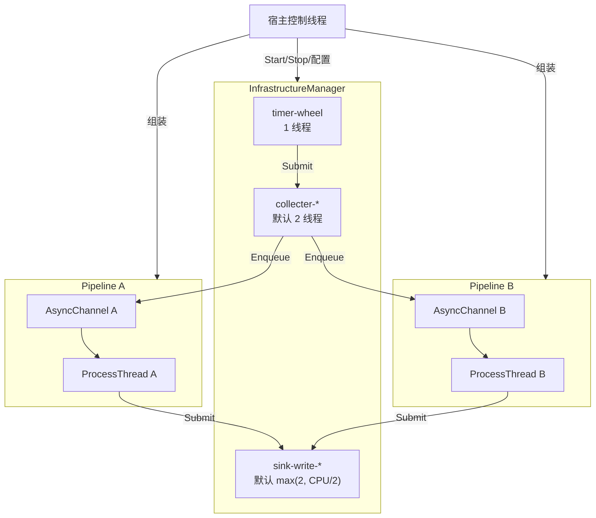
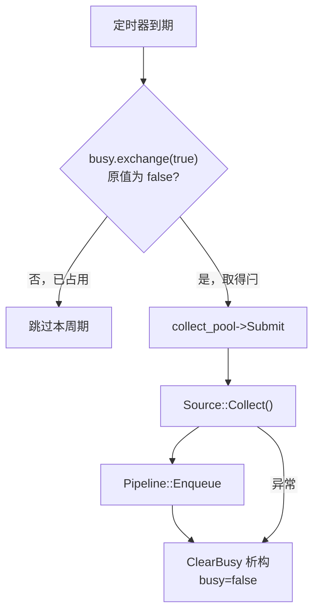
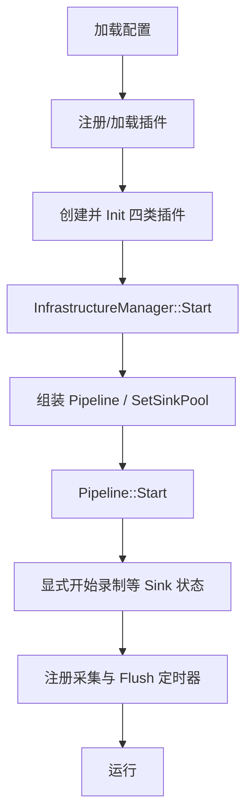
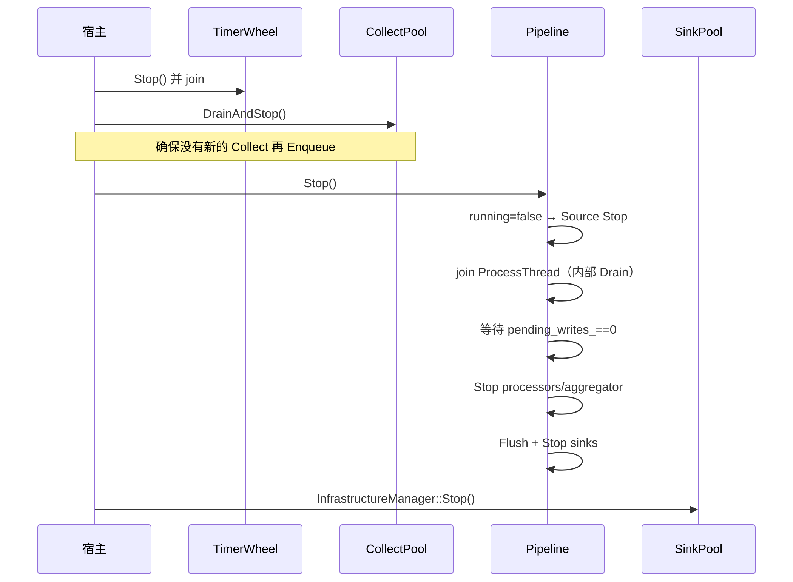

# 02-04 线程模型与调度

Pipeline v3 的性能与正确性，很大程度上取决于“什么代码跑在哪个线程上”。本篇给出完整线程清单、每类线程的阻塞边界，以及宿主必须遵守的调度契约。

返回 [Pipeline v3 总览](./index.md)。

## 1. 线程清单

<div style="overflow-x: auto; margin: 1.5rem 0;">



</div>

| 线程 | 数量 | 谁创建 | 职责 | 可以阻塞在哪 |
| --- | --- | --- | --- | --- |
| `timer-wheel` | 1 | `TimerWheel::Start` | 到期调度、执行轻量回调 | `epoll_wait`、回调 |
| `collecter-*` | 默认 2，可配置 | `InfrastructureManager::Start` | 执行 `Source::Collect()` | 采集 I/O、系统调用 |
| `ProcessThread` | 每 Pipeline 1 | `Pipeline::Start` | Processor 链、Aggregator、提交 Sink | `Dequeue(100ms)`、Processor、同步 Sink |
| `sink-write-*` | 默认 `max(2, CPU/2)` | `InfrastructureManager::Start` | 执行 `Sink::Write()` | 文件/网络 I/O |
| 宿主控制线程 | 1+ | 宿主 | 配置、组装、启停、信号处理 | 由宿主决定 |

线程数公式：

```text
总线程 ≈ 1 (Timer)
        + M (CollectPool)
        + N (Pipeline 数)
        + K (SinkPool)
        + 宿主控制线程
```

8 核机器、默认配置、1 条 Pipeline：

```text
1 + 2 + 1 + max(2, 8/2) + 1 = 9 个线程
```

`InfrastructureManager` 的默认值：

- CollectPool：`collect_pool_threads == 0` 时用 2。
- SinkPool：`sink_pool_threads == 0` 时用 `max(2, hardware_concurrency()/2)`。

注意 `ThreadPool` 自身对 0 的兜底是“至少 1 线程”，但 `InfrastructureManager` 在传入 0 时已经替换成上面的默认值。

## 2. 每类线程的规则

### 2.1 TimerWheel 线程：只做 dispatch

允许：

- `collect_pool->Submit(...)`
- `pipeline.InjectFlush()`
- 更新原子变量

禁止：

- 直接 `Collect()`
- 读文件、解析符号、写日志到慢设备
- 在回调里 `Stop()` 自己
- 长时间持锁

原因：所有定时器共享同一个线程，一个 250ms 的回调会让其他定时器全部延迟。

### 2.2 CollectPool：可以阻塞，但必须防重入

`Collect()` 可能读 `/proc`、消费 ring buffer、访问系统调用，因此放在池里执行。宿主必须保证**同一个 Source 不会重叠 Collect**。

CLI 的做法是一个 `shared_ptr<atomic<bool>> busy`：

<div style="overflow-x: auto; margin: 1.5rem 0;">



</div>

这是“跳过周期”策略，不是“排队补采”。如果一次采集耗时超过 interval，实际采样频率会低于 `IntervalMs()` 声明值。

`busy` 只保护同一 Source 的采集重入；它不协调 `PauseCollection()`、`Reconfigure()` 或 `Stop()`。

### 2.3 ProcessThread：单线程串行

每个 Pipeline 一个线程，循环执行：

```text
MaybeForceFlush
  → Dequeue(100ms)
  → std::visit(HandleData / HandleFlush)
  → 每 100 次循环同步指标
```

因此：

- Processor 链和 Aggregator 不需要内部锁（前提是插件不在其他线程被调用）。
- `sinks_` 遍历仍要取 `shared_mutex` 读锁，因为动态增删 Sink 可能并发。
- 如果走同步 Sink 路径（没有 SinkPool），`Write()` 会阻塞在这里，进而阻塞整条 Pipeline 的处理。

### 2.4 SinkPool：并发、乱序、共享

`SubmitToSinks` 为每个 Sink 提交一个任务：

```cpp
for (auto& sink : sinks_) {
    pending_writes_++;
    sink_pool_->Submit([sink, const_batch, this] {
        WriteCompletion completion{this};
        sink->Write(const_batch);
    });
}
```

因此：

- 同一个 Sink 可能同时收到多个 `Write()`。
- 不同批次的写入顺序不保证。
- SinkPool 被多个 Pipeline 共享；一条 Pipeline 的输出洪峰会占用其他 Pipeline 的写线程。
- `PendingTasks()` 只统计排队任务，不含正在执行的任务。

## 3. 采集为什么不在 Pipeline 内

Pipeline 不知道 TimerWheel 的存在，也不知道 `IntervalMs()`。它只暴露 `Enqueue()`。这样做的好处：

1. **Pipeline 可嵌入**：宿主可以用 TimerWheel，也可以用自己的事件循环。
2. **调度策略可替换**：CLI 用固定周期；其他宿主可以用事件触发或批量导入。
3. **采集错误归属清晰**：`Collect()` 失败由宿主计数，不混入 `Pipeline::ErrorCount()`。

代价是宿主必须自己做四件事：

- 读取 `IntervalMs()` 并注册定时器。
- 防止同一 Source 重入。
- 在 Stop 前停止定时器并排空 CollectPool。
- 有 Aggregator 时注册 `InjectFlush` 定时器。

## 4. 共享池的隔离与耦合

### 4.1 隔离

- 每条 Pipeline 有独立的 `AsyncChannel` 与 `ProcessThread`。
- 一条 Pipeline 的处理线程被慢 Processor 阻塞，不会直接阻塞另一条 Pipeline 的 Processor。

### 4.2 耦合

- **CollectPool 共享**：多个 Source 的采集任务争用同一组线程。
- **SinkPool 共享**：`PendingTasks()` 是全局排队数；阈值 128/256 不是每 Pipeline 配额。
- **TimerWheel 共享**：一个长回调影响所有定时器。
- **InternalMetrics 全局锁**：高频写指标会产生竞争。

## 5. 宿主调度契约

### 5.1 标准启动顺序

<div style="overflow-x: auto; margin: 1.5rem 0;">



</div>

### 5.2 标准关闭顺序

<div style="overflow-x: auto; margin: 1.5rem 0;">



</div>

关键点：

- **不能先停 SinkPool**：Pipeline 的最终 Flush 和异步写还需要它；先停会让 `pending_writes_` 永远不归零，`Stop()` 卡死。
- **不能先停 Pipeline 再停 Timer**：Timer 回调可能继续 `Enqueue` 或 `InjectFlush`。
- **不能只停 Timer 不排空 CollectPool**：已经提交但还没执行的 Collect 仍可能 `Enqueue`。
- `InfrastructureManager::Stop()` 内部会按 Timer → CollectPool → SinkPool 停止，但它不知道 Pipeline 是否完成最终输出；宿主必须先停 Pipeline。

### 5.3 对象寿命

- `GetCollectPool()` 返回裸指针，`InfrastructureManager::Stop()` 后失效。
- `GetSinkPool()` 返回 `shared_ptr`，Pipeline 持有它，因此池对象本身可以活到最后一个 Pipeline 释放。
- Collect 任务捕获的 Pipeline 引用/指针必须在任务结束前保持有效；CLI 用 `RuntimeShutdown` 保证顺序。
- Timer 回调捕获的 `this`（如 `PidManager`）必须在取消并 join 前保持有效。

## 6. 多 Pipeline

| 场景 | 行为 |
| --- | --- |
| 两条 Pipeline 各自采集 | CollectPool 中并行，互不阻塞 |
| 两条 Pipeline 各自处理 | 各自 ProcessThread 并行 |
| 两条 Pipeline 写同一个 Sink 实例 | 不应这样做；Sink 的并发契约只保证“可被并发调用”，不保证业务隔离 |
| 两条 Pipeline 共享 SinkPool | 排队数共享，一条洪峰会挤占另一条 |
| 一条 Pipeline 同步 Sink | 该 Pipeline 的 ProcessThread 被写阻塞，但不影响另一条 |

## 7. 过载时的表现

| 压力点 | 表现 | 观测 |
| --- | --- | --- |
| CollectPool 不足 | 采集任务排队，实际采样间隔变大 | 宿主自测采集延迟 |
| 通道满 | 按策略丢弃 | `ChannelDropped`、WARN 日志 |
| ProcessThread 慢 | 通道堆积 → 反压 | `ChannelSize`、`backpressure_events` |
| SinkPool 排队 >128 | 设置反压标志 | `sink_pool_pending` |
| SinkPool 排队 >256 | 整批丢弃 | `sink_drops_total`、`ErrorCount` |
| Timer 回调慢 | 所有定时器延迟/追赶 | 定时日志、`fires_total_` |

## 8. 测试映射

| 测试 | 验证内容 |
| --- | --- |
| `thread_pool_test` | 任务执行、并发、`PendingTasks`、`DrainAndStop` |
| `pipeline_shutdown_test` | 异步写完成后才 Stop Sink；共享池仍可用 |
| `stress_test` | 高容量下的吞吐与丢失率（非严格零丢失） |
| CLI `smoke_test` | Timer + CollectPool + Pipeline + 录制的完整闭环 |

测试缺口：没有验证“先停 SinkPool 会卡死”的负面用例；没有多 Pipeline 共享 SinkPool 的隔离测试；没有 Timer 长回调导致 catch-up 的测试。

## 小结

- 四类线程：Timer 调度、CollectPool 采集、ProcessThread 处理、SinkPool 写入。
- Timer 回调只做 dispatch；Collect 可阻塞但要防重入；Processor/Aggregator 单线程；Sink 可并发且乱序。
- 共享池带来隔离也带来耦合；阈值是全局排队数，不是每 Pipeline 配额。
- 关闭顺序必须是：Timer → CollectPool → Pipeline → Infrastructure。

## 边界与后续

- `Enqueue` 与 Stop 存在竞态，外部生产者必须先静默。
- `ThreadPool::Submit` 在 `DrainAndStop` 之后仍可入队，但没有 worker 执行。
- 没有每 Sink 串行队列，也没有端到端硬配额。
- `busy` 只解决采集重入，不解决 Pause/Reconfigure/Stop 的协调。

返回 [Pipeline v3 总览](./index.md) · 上一篇：[TimerWheel](./03-timer-wheel.md) · 下一篇：[处理与聚合](./05-processing-and-aggregation.md)
