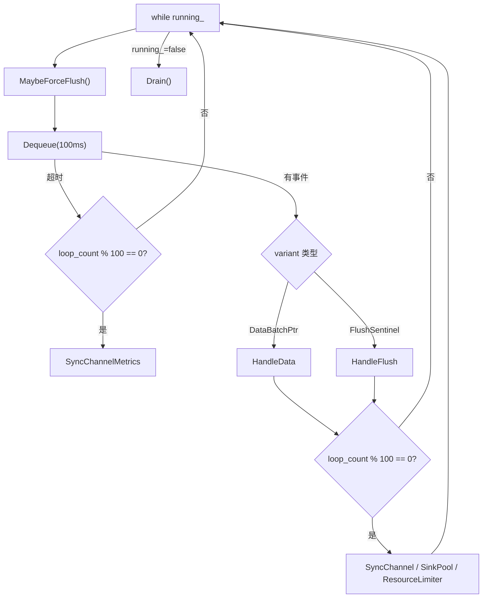
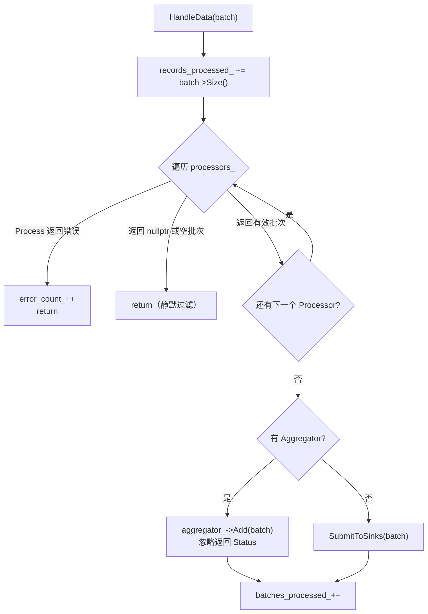

# 02-05 处理与聚合

ProcessThread 是 Pipeline 唯一“懂业务”的线程。它从通道取出事件，跑 Processor 链，决定交给 Aggregator 还是直接发往 Sink。本篇逐行走读这条路径，并澄清“聚合刷新到底由谁触发”。

返回 [Pipeline v3 总览](./index.md)。

## 1. ProcessLoop 的骨架

```cpp
void ProcessLoop() {
    uint32_t loop_count = 0;
    while (running_.load(acquire)) {
        MaybeForceFlush();

        auto item = ingest_channel_.Dequeue(100ms);
        if (!item) {
            if (++loop_count % 100 == 0) SyncChannelMetrics();
            continue;
        }

        std::visit(Overloaded{
            [this](DataBatchPtr& batch) { HandleData(std::move(batch)); },
            [this](FlushSentinel&)     { HandleFlush(); },
        }, *item);

        if (++loop_count % 100 == 0) {
            SyncChannelMetrics();
            SyncSinkPoolMetrics();
            auto usage = ResourceLimiter::Instance().Check();
            if (usage.memory_exceeded) { /* WARN */ }
        }
    }
    Drain();
}
```

<div style="overflow-x: auto; margin: 1.5rem 0;">



</div>

三个容易误读的点：

1. `MaybeForceFlush()` 在**每次循环开头**执行，即使没有新数据。
2. 指标同步不是固定时间采样：空队列时每 100 次 `Dequeue(100ms)` 超时，约 10 秒才同步一次通道指标。
3. `Drain()` 在循环退出后执行，负责把通道里剩余条目处理完，并做最后一次聚合刷新。

## 2. HandleData

<div style="overflow-x: auto; margin: 1.5rem 0;">



</div>

```cpp
void HandleData(DataBatchPtr batch) {
    records_processed_.fetch_add(batch->Size());

    for (auto& proc : processors_) {
        auto result = proc->Process(std::move(batch));
        if (!result.ok()) {
            error_count_.fetch_add(1);
            return;
        }
        batch = std::move(result.value());
        if (!batch || batch->Empty()) return;
    }

    if (aggregator_) {
        aggregator_->Add(std::move(batch));   // 返回值被丢弃
    } else {
        SubmitToSinks(std::move(batch));
    }
    batches_processed_.fetch_add(1);
}
```

### 2.1 计数口径

| 计数器 | 何时增加 | 重要例外 |
| --- | --- | --- |
| `records_processed_` | 进入 Processor 链**之前**，按输入批次 `Size()` | 被 Processor 过滤的记录仍计入 |
| `batches_processed_` | 交给 Aggregator 或 Sink 之后 | Aggregator `Add` 失败、SinkPool 过载丢弃时仍增加 |
| `error_count_` | Processor 错误、Sink 写错误、SinkPool >256 丢弃 | 通道丢弃、Collect 错误、Aggregator Add/Flush 错误不计入 |

### 2.2 Processor 的四种返回

| 返回 | 行为 | 是否算错误 |
| --- | --- | --- |
| 同一个 `shared_ptr` | 原地修改，继续 | 否 |
| 新 `shared_ptr` | 替换，继续 | 否 |
| `nullptr` | 整批过滤，直接返回 | 否 |
| `Status` 错误 | 丢弃该批，`ErrorCount++` | 是 |

`nullptr` 是“合法地没有数据”，不是失败。不要把过滤写成错误，否则会污染错误指标并可能误导宿主退出。

## 3. Aggregator 契约

```cpp
class AggregatorPlugin : public Plugin {
public:
    virtual Status Add(DataBatchPtr batch) = 0;
    virtual StatusOr<std::vector<DataBatchPtr>> Flush() = 0;
    virtual uint32_t FlushIntervalMs() const { return 10000; }
};
```

| 方法 | 调用线程 | 所有权/状态 |
| --- | --- | --- |
| `Add` | ProcessThread | 接收批次所有权；可跨批保存 |
| `Flush` | ProcessThread | 返回 0..N 个新批次；清空或保留窗口由插件决定 |
| `FlushIntervalMs` | 宿主 / ProcessThread | 只作为建议值；Pipeline 不自动安装定时器 |

接口注释写“由 Pipeline 的 flush 线程定期调用”，但**当前没有独立的 flush 线程**。正常路径是：

```text
宿主 TimerWheel → Pipeline::InjectFlush()
  → ChannelItem = FlushSentinel
  → ProcessThread 取出
  → HandleFlush()
  → aggregator_->Flush()
```

## 4. 三种 Flush 来源

```mermaid
%%{init: {"flowchart":{"useMaxWidth":false,"htmlLabels":false}}}%%
flowchart TB
    subgraph NORMAL["正常路径"]
        T["宿主 TimerWheel<br/>AddRepeating(FlushIntervalMs)"] --> IF["Pipeline::InjectFlush"]
        IF --> CH["AsyncChannel"]
        CH --> PT["ProcessThread"]
        PT --> HF1["HandleFlush"]
    end
    subgraph FALLBACK["超时兜底"]
        ML["ProcessLoop 每轮"] --> MFF["MaybeForceFlush"]
        MFF -->|"now - last_flush ≥ 3×interval"| HF2["HandleFlush"]
    end
    subgraph STOP["停止路径"]
        EXIT["running_=false"] --> DR["Drain()"]
        DR --> HF3["最终 HandleFlush"]
    end
```

<div style="overflow-x: auto; margin: 1.5rem 0;">



</div>

### 4.1 宿主定时 InjectFlush

```cpp
// CLI 没有 Aggregator；SDK 使用方需要自己注册
tw.AddRepeating(std::chrono::milliseconds(pipeline.FlushIntervalMs()),
                [&pipeline] { pipeline.InjectFlush(); });
```

`InjectFlush` 只是“尽力入队”：队列满时会驱逐一个旧条目再重试；第二次仍可能失败。

### 4.2 MaybeForceFlush

```cpp
void MaybeForceFlush() {
    if (!aggregator_) return;
    const uint32_t interval_ms = aggregator_->FlushIntervalMs();
    if (interval_ms == 0) return;

    const auto max_delay = std::chrono::milliseconds(interval_ms * 3);
    if (now - last_flush_time_ >= max_delay) {
        IL_WARN("forced flush (no sentinel for {}ms)", interval_ms * 3);
        HandleFlush();
    }
}
```

它是兜底，不是主路径：如果宿主忘了注册定时器，最迟 3×interval 会强制刷新一次。

### 4.3 Drain 最终 Flush

`Stop()` 把 `running_` 置 false 后，ProcessLoop 退出循环，`Drain()` 用 `TryDequeue()` 非阻塞取完剩余条目，然后：

```cpp
if (aggregator_) HandleFlush();
```

这保证停止时窗口里的数据至少有机会输出，但不等于“已经落盘”；之后的异步写还要等 `pending_writes_` 归零。

## 5. `FlushIntervalMs()==0` 的真实语义

接口注释写“0 表示每来一批刷一批”，但 Pipeline 的实现是：

```cpp
if (interval_ms == 0) return;   // MaybeForceFlush 直接禁用
```

因此：

- `0` 的实际效果是**关闭 3 倍超时兜底**。
- 它**不会**让 Pipeline 在每批数据后自动调用 `Flush()`。
- 宿主仍然必须注入 Sentinel，或者自己每批调用 `InjectFlush()`。
- 不要用 `tw.AddRepeating(0ms, ...)` 来实现“每批刷新”：那会让 TimerWheel 忙循环。

如果业务真的需要“逐批输出”，不要配置 Aggregator，直接走 Processor → Sink。

## 6. 窗口边界示例

假设通道中的顺序是：

```text
[A] [B] [Sentinel] [C] [D]
```

处理过程：

1. A、B 进入 Aggregator 缓冲区。
2. 遇到 Sentinel，`Flush()` 输出包含 A、B 的结果。
3. C、D 进入下一轮缓冲区。
4. 下一个 Sentinel 或最终 Drain 才输出 C、D。

如果把 Sentinel 放在 C 之后：

```text
[A] [B] [C] [Sentinel] [D]
```

那么 C 属于本轮。可见窗口边界由**入队顺序**决定，不是事件时间戳，也不是“每隔 N 毫秒精确切分”。

### 6.1 教学示例：窗口平均聚合器

> ⚠️ 教学示例：以下代码用于说明 Aggregator 接口，不属于当前仓库实现。

```cpp
class WindowAvgAggregator : public AggregatorPlugin {
public:
    const char* Name() const override { return "window_avg"; }
    const char* Version() const override { return "0.1.0"; }

    Status Add(DataBatchPtr batch) override {
        for (auto& rec : batch->records()) {
            if (auto* v = rec.GetField("value")) {
                if (auto* u = std::get_if<uint64_t>(v)) {
                    sum_ += static_cast<double>(*u);
                    count_++;
                }
            }
        }
        return Status::Ok();
    }

    StatusOr<std::vector<DataBatchPtr>> Flush() override {
        std::vector<DataBatchPtr> out;
        if (count_ == 0) return out;

        auto batch = std::make_shared<DataBatch>(DataBatch::Type::kMetrics);
        auto& rec = batch->AddRecord();
        rec.SetField(batch->InternString("avg"),
                     sum_ / static_cast<double>(count_));
        rec.SetField(batch->InternString("samples"), count_);
        out.push_back(std::move(batch));

        sum_ = 0;
        count_ = 0;
        return out;
    }

    uint32_t FlushIntervalMs() const override { return 1000; }

private:
    double sum_ = 0;
    uint64_t count_ = 0;
};
```

宿主需要为它注册：

```cpp
tw.AddRepeating(1000ms, [&pipeline] { pipeline.InjectFlush(); });
```

注意这个聚合器只保存数值，不保存 `string_view`，因此不存在跨批 Arena 寿命问题。若要在 Flush 时输出原始标签字符串，必须复制到新批次的 Arena。

## 7. Drain 的精确语义

```cpp
void Drain() {
    while (auto item = ingest_channel_.TryDequeue()) {
        std::visit(Overloaded{
            [this](DataBatchPtr& batch) { HandleData(std::move(batch)); },
            [this](FlushSentinel&)     { HandleFlush(); },
        }, *item);
    }
    if (aggregator_) HandleFlush();
}
```

- 非阻塞：只取当前队列里已有的条目。
- 如果外部生产者还在 `Enqueue`，Drain 可能取不干净；新条目会在通道销毁时丢失。
- 最终 `HandleFlush()` 会把聚合器剩余数据提交给 SinkPool，但不等待写入完成。
- “Drain 完成”不等于“所有数据落盘”。

## 8. 错误与静默边界

| 场景 | 当前行为 |
| --- | --- |
| Processor 返回错误 | `ErrorCount++`，丢弃该批 |
| Processor 返回 `nullptr` | 静默过滤，不计数 |
| `Aggregator::Add` 返回错误 | 返回值被忽略，批次视为已处理 |
| `Aggregator::Flush` 返回错误 | 静默跳过，不计数、不记录 |
| Sink 同步写错误 | `ErrorCount++`，继续下一个 Sink |
| SinkPool >256 丢弃 | `ErrorCount++`，`sink_drops_total++` |
| 通道满丢弃 | 不计 `ErrorCount`，只增 `ChannelDropped` |

这些差异会影响排障：如果 `ErrorCount==0` 但数据缺失，可能是通道丢弃、Aggregator 静默失败或 RecordingSink 未开始录制。

## 9. 测试映射

| 测试 | 验证内容 |
| --- | --- |
| `PipelineProcessorsTransformData` | Processor 链转换 |
| `PipelineProcessorErrorCountsAndDrops` | Processor 错误计数 |
| `PipelineFiltersEmptyBatch` | 空批次过滤 |
| `MaybeForceFlushFlushesAggregatorWithoutSentinel` | 3 倍超时兜底 |
| `PipelineDrainFlushesAggregator` | Stop 时最终刷新 |
| `MockAggregator` | Add/Flush 调用顺序 |

测试缺口：没有覆盖 `Aggregator::Add` 返回错误、`Flush` 返回错误的分支；没有验证 `FlushIntervalMs=0` 的语义。

## 小结

- ProcessLoop 是“强制刷新检查 → 阻塞出队 → variant 分发 → 周期同步指标”的循环。
- `records_processed_` 是输入口径；`batches_processed_` 在交给 Aggregator/Sink 后增加；`error_count_` 只覆盖部分错误。
- 正常 Flush 由宿主注入 Sentinel；`MaybeForceFlush` 和 Drain 是兜底。
- `FlushIntervalMs()==0` 关闭超时兜底，不会自动逐批刷新。
- 窗口边界是入队顺序，不是事件时间。

## 边界与后续

- `Aggregator::Add` / `Flush` 的错误不会传播。
- `InjectFlush` 可能失败，控制信号不是绝对可靠。
- `Drain` 不负责等待外部生产者静默，也不等待写入完成。
- 没有精确的“按事件时间开窗”机制；需要事件时间窗口时，应由 Aggregator 自己按 `Record.timestamp` 分桶。

返回 [Pipeline v3 总览](./index.md) · 上一篇：[线程模型与调度](./04-thread-model-and-scheduling.md) · 下一篇：[反压与过载](./06-backpressure-and-overload.md)
