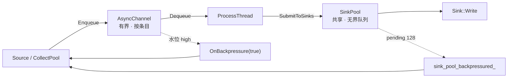
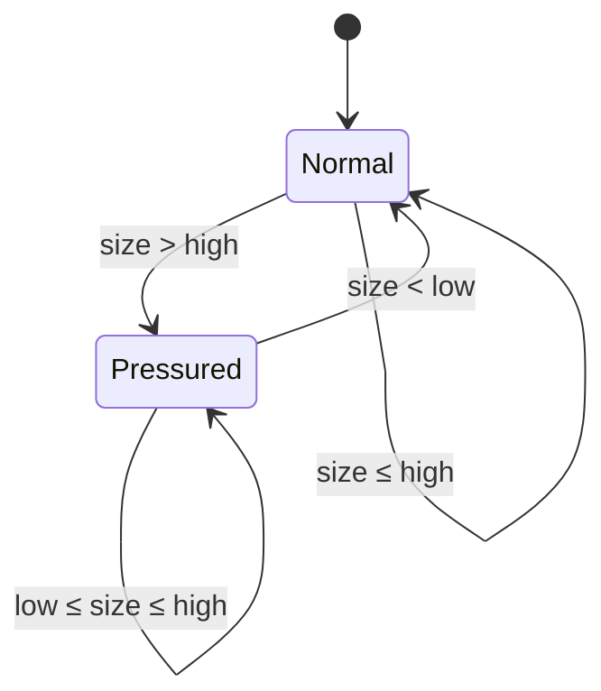
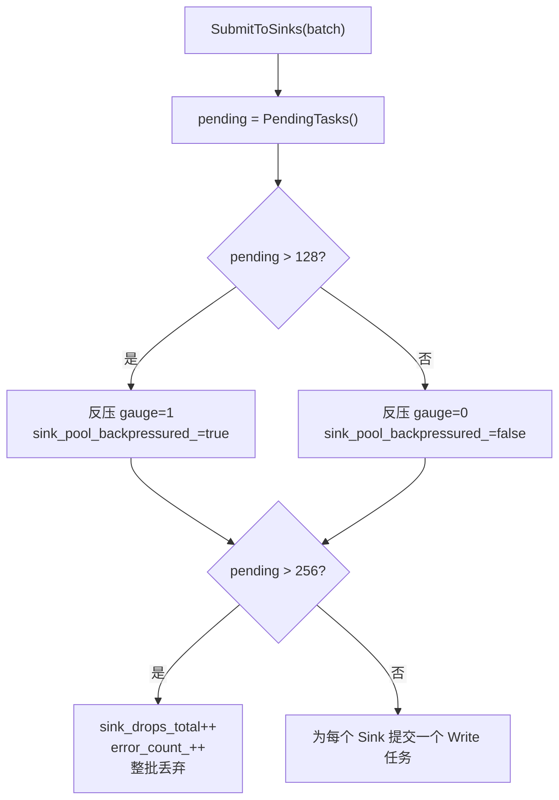

# 02-06 反压与过载

Pipeline v3 没有端到端硬限额，也没有“阻塞生产者直到消费完成”的机制。它用两个独立的软控制点应对过载：

1. **输入通道水位**：有界队列 + 滞回 + 丢弃。
2. **共享 SinkPool 排队数**：软阈值 128 / 256。

返回 [Pipeline v3 总览](./index.md)。

## 1. 两级控制点

<div style="overflow-x: auto; margin: 1.5rem 0;">



</div>

| 控制点 | 度量 | 硬/软 | 超限动作 |
| --- | --- | --- | --- |
| 输入通道 | 队列条目数 | 硬容量 | 按 `DropPolicy` 丢弃 |
| 输出池 | 排队任务数 | 软阈值 | 128 置反压；256 丢整批 |

输入压力来自“处理跟不上采集”，输出压力来自“写入跟不上处理”。两者在 `Pipeline::Enqueue` 里做 OR，再通知 Source。

## 2. 输入通道水位

<div style="overflow-x: auto; margin: 1.5rem 0;">



</div>

- 进入：`size > floor(capacity * high)`
- 退出：`size < floor(capacity * low)`
- 中间区间保持原状态。

| 实际容量 | high=0.8 进入 | low=0.2 退出 |
| --- | --- | --- |
| 1024 | 820 | 203 |
| 4096 | 3277 | 818 |
| 16384 | 13108 | 3275 |

### 2.1 通知链

```cpp
bool bp = channel.IsBackpressured() ||
          sink_pool_backpressured_.load(acquire);
if (bp != last_backpressure_state_) {
    last_backpressure_state_ = bp;
    source_->OnBackpressure(bp);
}
```

- 回调在生产者线程执行。
- 只在状态变化时调用。
- 没有新的 `Enqueue`，就不会有新的检查；反压解除通知可能滞后。

## 3. 丢包策略

### 3.1 DropNewest（默认）

```text
TryPush 失败 → dropped++ → 丢弃新批次
```

适合保留已有数据、拒绝最新数据的场景。默认配置是 `drop_newest`。

### 3.2 DropOldest

```text
TryPush 失败
  → TryPop 一个旧条目（可能是数据或 Sentinel）→ dropped++
  → 再次 TryPush 新批次
```

适合“最新数据更重要”的场景。注意：

- 弹出的可能是 `FlushSentinel`，导致控制信号丢失。
- 第二次入队仍可能失败，此时再计一次 `dropped`。
- `dropped` 是操作计数，不是唯一丢失条目数。

## 4. InjectFlush 不是优先级

`InjectFlush()` 的真实步骤：

1. 普通 FIFO 尝试入队 Sentinel。
2. 满队列时弹出一个最旧条目。
3. 再尝试入队。

它**不会插到队首**，Sentinel 仍然排在队尾；它只是“满队列时驱逐旧条目以保证新 Sentinel 有位置”。被驱逐的可能是数据，也可能是另一个 Sentinel。第二次入队仍可能失败。

源码已用 TODO 承认：极端条件下 Sentinel 仍可能丢失。

## 5. SinkPool 过载

`SubmitToSinks` 在扇出之前检查一次：

```cpp
const size_t pending = sink_pool_->PendingTasks();

if (pending > 128) {
    SetGauge("..._sink_pool_backpressure", 1.0);
    sink_pool_backpressured_ = true;
} else {
    SetGauge("..._sink_pool_backpressure", 0.0);
    sink_pool_backpressured_ = false;
}

if (pending > 256) {
    Inc("..._sink_drops_total");
    error_count_++;
    return;  // 整批丢弃
}
```

<div style="overflow-x: auto; margin: 1.5rem 0;">



</div>

### 5.1 边界

| 条件 | 行为 |
| --- | --- |
| `pending == 128` | 不置反压 |
| `pending == 129` | 置反压 |
| `pending == 256` | 不丢弃 |
| `pending == 257` | 整批丢弃 |

`PendingTasks()` 返回 `tasks_.size()`，**只含排队任务，不含正在执行的任务**。因此“pending 低”不代表池不忙；可能所有线程都在执行慢写。

### 5.2 共享池的耦合

- 阈值是共享池的全局排队数，不是每 Pipeline 配额。
- 一个批次有 M 个 Sink，会一次新增 M 个任务。
- 一条 Pipeline 的输出洪峰会推高所有 Pipeline 看到的 `pending`。
- 反压标志按 Pipeline 保存，但触发它的 `pending` 是共享的。

## 6. 容量与内存估算

```text
通道内存 ≈ 容量 × (shared_ptr 条目 + 每批 Arena 首块 + 记录容器)
```

默认 `DataBatch` 构造即分配 64KiB Arena 首块：

```text
4096 × 64KiB ≈ 256MiB
16384 × 64KiB ≈ 1GiB
```

这还不含：

- `records_` / `stack_samples_` 向量
- `fields` 哈希表
- 驻留缓存
- SinkPool 在途任务持有的批次
- 文件/JSON/SQLite 序列化缓冲

如果使用外部共享 Arena 构造批次，首块成本可能不同；上式的“默认批次”指 `std::make_shared<DataBatch>(type)`。

## 7. 调优顺序

1. **看丢弃率**：`ChannelDropped / ChannelEnqueued`，以及 `sink_drops_total`。
2. **看处理速率**：`BatchesProcessed`、`RecordsProcessed` 随时间的变化。
3. **看通道利用率**：`channel_size / capacity`。
4. **看输出排队**：`sink_pool_pending`。
5. **再决定**：加处理线程（只能加 Pipeline）、减小批次、优化 Processor、加 SinkPool 线程、调整通道容量。
6. **最后才考虑增大通道**：它只是把压力推迟，并增加内存驻留。

不要用“增大通道 + 丢弃率下降”单独证明系统变好了；要同时看端到端延迟、RSS 和输出完成时间。

## 8. 诊断对照

| 症状 | 可能原因 | 验证 |
| --- | --- | --- |
| `ChannelDropped` 高 | 处理慢 / 采集过快 / 容量小 | 看 `channel_size` 与 `BatchesProcessed` |
| `sink_drops_total` 高 | Sink 慢 / SinkPool 线程少 / 扇出多 | 看 `sink_pool_pending` 与 Sink 耗时 |
| 反压反复开关 | 高低水位太近 / 处理速率波动 | 看 `backpressure_events`、调整 high/low |
| 反压一直不解除 | 没有新 Enqueue 触发检查 | 检查 Source 是否还在采集 |
| 内存高但队列小 | 输出在途批次 / 聚合窗口 / Arena 大 | 看 `sink_pool_pending`、Aggregator 状态 |

## 9. 测试映射

| 测试 | 验证内容 |
| --- | --- |
| `BackpressureTriggersSourceCallback` | 水位进入/退出与回调 |
| `ChannelFullDropsDataAndUpdatesStats` | DropNewest 丢弃与计数 |
| `SinkPoolOverloadDropsBatchesAndUpdatesMetrics` | >256 整批丢弃与指标 |
| `InjectFlushUsesPrioritySlot` | 满队列驱逐后 Sentinel 入队 |

测试缺口：没有验证 `pending==128/256` 的边界；没有多 Pipeline 共享池的交叉影响测试。

## 小结

- 两级压力独立：输入通道是硬容量 + 丢弃，输出池是软阈值 + 整批丢弃。
- 水位有滞回，通知只在 Enqueue 时检查状态变化。
- `InjectFlush` 不是优先级，只是满队列驱逐后重试。
- `PendingTasks` 不含执行中任务；阈值是全局共享的。
- 通道容量直接放大内存驻留，不能只看丢弃率调参。

## 边界与后续

- 没有端到端硬限额、字节预算或阻塞生产者机制。
- 反压是“通知”，不是“保证 Source 会降速”；插件可以选择忽略。
- 输出池的 128/256 是固定常量，不可配置。
- 共享池让多条 Pipeline 相互影响，当前没有隔离配额。

返回 [Pipeline v3 总览](./index.md) · 上一篇：[处理与聚合](./05-processing-and-aggregation.md) · 下一篇：[输出与停机](./07-output-and-shutdown.md)
