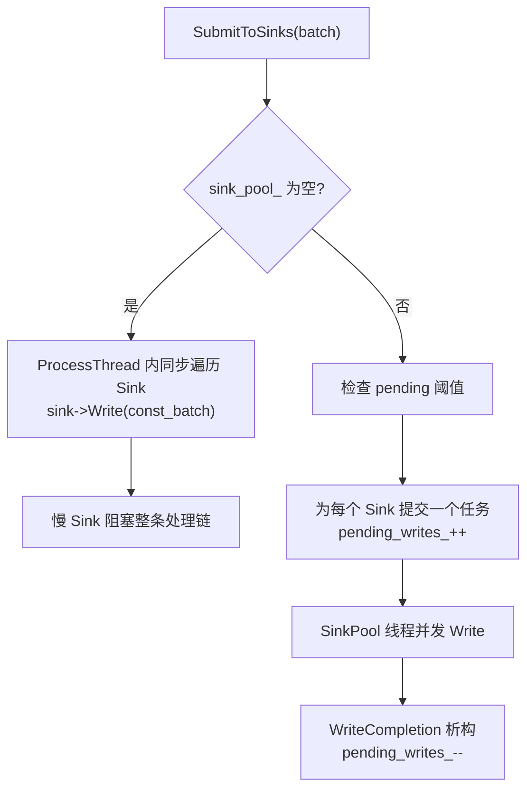
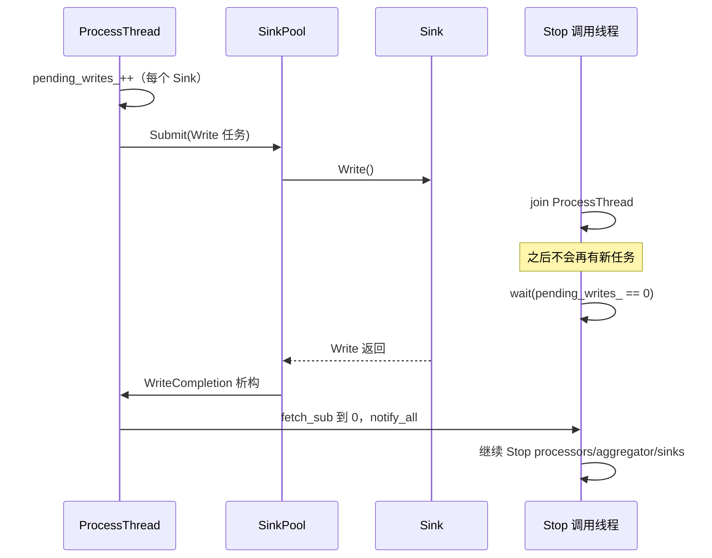
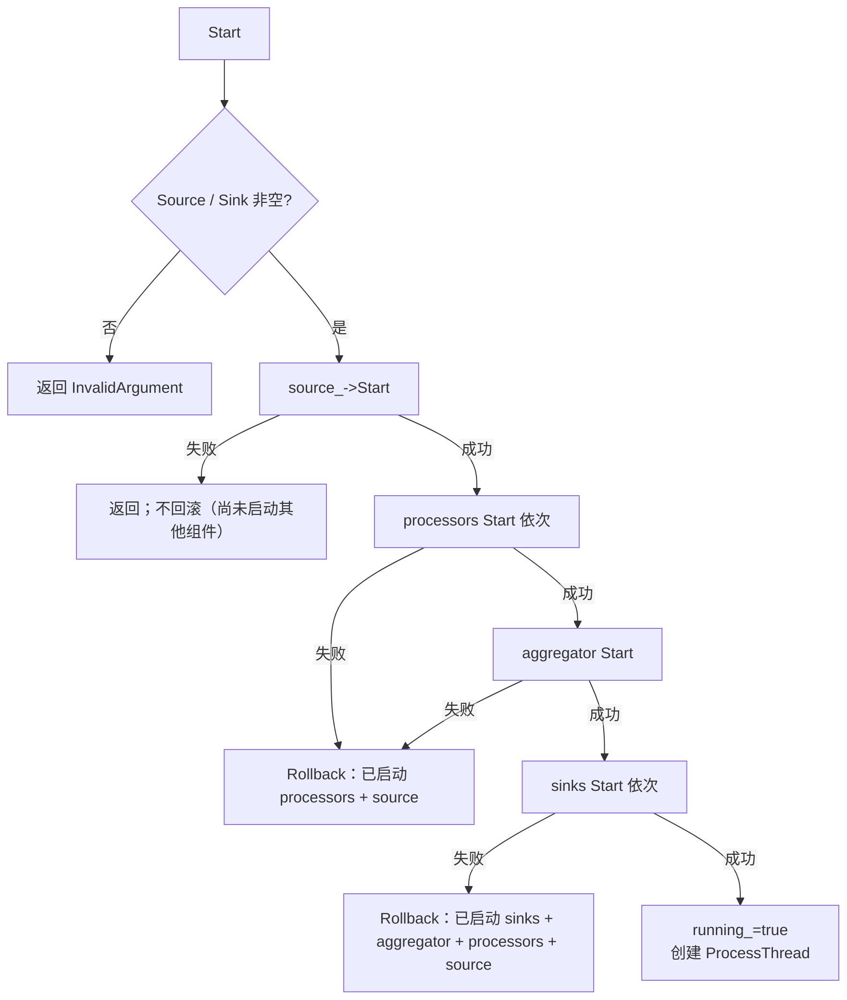
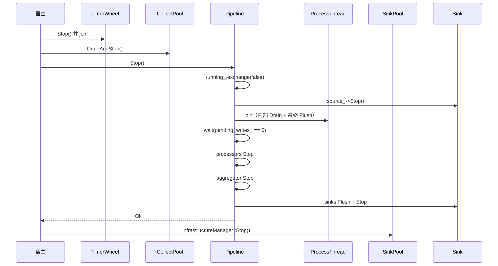

# 02-07 输出与停机

输出是 Pipeline 与外部世界的边界，也是停机最容易出问题的地方。本篇讲清两条输出路径、`pending_writes_` 屏障、Start/Stop 的精确顺序，以及动态 Sink 的已知缺口。

返回 [Pipeline v3 总览](./index.md)。

## 1. SubmitToSinks 的两条路径

<div style="overflow-x: auto; margin: 1.5rem 0;">



</div>

### 1.1 同步路径

```cpp
if (!sink_pool_) {
    std::shared_lock<std::shared_mutex> lock(sinks_mutex_);
    for (auto& sink : sinks_) {
        auto status = sink->Write(const_batch);
        if (!status.ok()) error_count_++;
    }
    return;
}
```

- `Write()` 在 ProcessThread 上执行。
- 一个慢 Sink 会阻塞整条 Pipeline 的处理。
- 没有在途计数，因为写完才返回。
- 同步 Sink 抛出的异常会逃出 `ProcessLoop`；线程函数没有 catch，可能触发 `std::terminate`。

### 1.2 异步路径

```cpp
for (auto& sink : sinks_) {
    pending_writes_++;
    sink_pool_->Submit([sink, const_batch, this] {
        WriteCompletion completion{this};
        auto status = sink->Write(const_batch);
        if (!status.ok()) error_count_++;
    });
}
```

- 每个 Sink 一个任务，共享同一个 `ConstDataBatchPtr`。
- 同一 Sink 的多个 `Write()` 可能并发，顺序不保证。
- 任务异常会被 `packaged_task` 存进 future；Pipeline 不 `get()` future，因此异常不会增加 `ErrorCount`。
- SinkPool 由多个 Pipeline 共享，队列本身无界；丢弃逻辑在 Pipeline 侧（>256）。

## 2. `pending_writes_` 完成屏障

`pending_writes_` 是**每 Pipeline** 的异步写在途计数，不是每 Sink。

```cpp
struct WriteCompletion {
    Pipeline* pipeline;
    ~WriteCompletion() {
        std::lock_guard<std::mutex> lock(pipeline->writes_mutex_);
        if (pipeline->pending_writes_.fetch_sub(1, acq_rel) == 1) {
            pipeline->writes_done_.notify_all();
        }
    }
};
```

<div style="overflow-x: auto; margin: 1.5rem 0;">



</div>

为什么必须在 join 处理线程之后等待？因为 ProcessThread 在退出前还会执行 `Drain()`，Drain 可能提交最后的批次和最终 Flush。如果先等计数归零，后续还会新增任务，屏障就不成立。

## 3. Start 的顺序与回滚

```cpp
Status Start() {
    if (!source_) return InvalidArgument;
    if (sinks_.empty()) return InvalidArgument;

    status = source_->Start();
    if (!status.ok()) return status;

    for (auto& p : processors_) {
        status = p->Start();
        if (!status.ok()) { RollbackStart(started_processors, false, 0); return status; }
        ++started_processors;
    }

    if (aggregator_) {
        status = aggregator_->Start();
        if (!status.ok()) { RollbackStart(started_processors, false, 0); return status; }
        aggregator_started = true;
    }

    for (auto& s : sinks_) {
        status = s->Start();
        if (!status.ok()) { RollbackStart(started_processors, aggregator_started, started_sinks); return status; }
        ++started_sinks;
    }

    running_ = true;
    last_flush_time_ = now;
    process_thread_ = std::thread([this] { ProcessLoop(); });
    return Ok();
}
```

<div style="overflow-x: auto; margin: 1.5rem 0;">



</div>

关键边界：

- **不调用 `Init()`**：宿主必须先初始化。
- **失败组件自己清理**：`RollbackStart` 只停止“已经成功启动”的组件；刚刚失败的那个不会被 `Stop()`。
- **Source Start 失败不 rollback**：因为还没有启动其他组件。
- **没有二次启动保护**：`Start()` 不检查 `running_`；重复调用会再次启动插件并创建第二个 ProcessThread。
- **`running_` 在创建线程前设置**：线程启动后立即可见。

## 4. Stop 的顺序

```cpp
Status Stop() {
    if (!running_.exchange(false)) return Status::Ok();

    source_->Stop();

    if (process_thread_.joinable()) process_thread_.join();

    {
        std::unique_lock<std::mutex> lock(writes_mutex_);
        writes_done_.wait(lock, [this] { return pending_writes_ == 0; });
    }

    for (auto& p : processors_) p->Stop();
    if (aggregator_) aggregator_->Stop();

    {
        std::shared_lock<std::shared_mutex> lock(sinks_mutex_);
        for (auto& s : sinks_) {
            s->Flush();
            s->Stop();
        }
    }
    return Status::Ok();
}
```

<div style="overflow-x: auto; margin: 1.5rem 0;">



</div>

### 4.1 为什么是这个顺序

1. **先停外部生产者**：Timer 和 CollectPool 必须静默，否则 `Enqueue` 可能与 Stop 竞态。
2. **停 Source**：让 Source 自己关闭采集资源。
3. **join ProcessThread**：线程退出前会 `Drain()` 通道、做最终 Flush，并提交最后的写任务。
4. **等待 `pending_writes_`**：确保本 Pipeline 的异步写都完成。
5. **停 Processor/Aggregator**：此时不会再有新调用。
6. **Flush + Stop Sink**：最后关闭输出资源。
7. **停 SinkPool**：由宿主在 Infrastructure 层最后做。

### 4.2 不能提前停 SinkPool

如果宿主先 `DrainAndStop()` SinkPool，再调用 `Pipeline::Stop()`：

- Drain 的最终 Flush 会提交 Write 任务，但池已经没有 worker。
- `pending_writes_` 永远不减到 0。
- `Stop()` 永久阻塞。

### 4.3 Stop 的并发语义

- `running_.exchange(false)` 保证只有第一个调用进入完整流程。
- 第二个并发 Stop 看到 exchange 返回 false，**立即返回 Ok**，不会等待第一个 Stop 完成。
- 因此“Stop 返回”在不同调用者眼里含义不同；宿主应保证串行调用。

### 4.4 错误语义

`Stop()` 不聚合子组件的 `Status`。它总是返回 Ok（除非未来增加检查），因此：

- Sink 的 `Flush()` 失败不会让 Stop 失败。
- Sink 的 `Stop()` 失败不会让 Stop 失败。
- “Stop 成功”不等于“数据已经可靠持久化”。

## 5. 动态 Sink

| 方法 | 行为 | 缺口 |
| --- | --- | --- |
| `AddSinkRuntime(unique_ptr)` | 检查 running → `sink->Start()` → 写锁 push | 不调用 `Init()`；与 Stop 并发可能把 Sink 加到已停止 Pipeline |
| `RemoveSinkRuntime(name)` | 写锁摘除 → 解锁 → `Flush()` + `Stop()` | 不等待该 Sink 的在途 Write；任务仍持有 shared_ptr |
| `GetSinks()` | 读锁返回 `vector<shared_ptr>` 快照 | 快照里的 Sink 可能随后被移除 |
| `RunProcessors(batch)` | 在调用线程直接跑 Processor 链 | 绕过通道、Aggregator、Sink；只适合测试/诊断 |
| `Reconfigure(params)` | 依次 Source → Processors → Aggregator → Sinks | 不冻结、不回滚；非 continue 错误立即返回 |

`AddSinkRuntime` 与 `Stop` 的竞态：

```text
线程 A: AddSinkRuntime 检查 running_ == true
线程 B: Stop 完成，running_ == false，析构时再次 Stop 直接返回
线程 A: sink->Start() 成功，写锁 push
结果: 一个已启动的 Sink 挂在已停止的 Pipeline 上，可能永远不会被 Stop
```

## 6. 失败模式清单

| 现象 | 原因 | 排查 |
| --- | --- | --- |
| `Stop()` 永久卡住 | Sink Write 永不返回，或 SinkPool 已提前停止 | 看 Sink 实现、池是否已 DrainAndStop |
| `Stop()` 返回后仍有写 | 动态移除 Sink 不等待在途写 | 检查是否用了 `RemoveSinkRuntime` |
| 数据缺失但 `ErrorCount==0` | 通道丢弃、Aggregator Add/Flush 静默失败、RecordingSink 未开始录制 | 查 `ChannelDropped`、录制状态 |
| 异步 Sink 异常无记录 | `packaged_task` 把异常存进 future，Pipeline 不 get | 在 Sink 内部记录错误 |
| 同步 Sink 导致进程退出 | 异常逃出 ProcessThread | 在 Sink 内部捕获并返回 Status |
| Start 后有两个处理线程 | 重复 `Start()` | 宿主保证只调用一次 |

## 7. 测试映射

| 测试 | 验证内容 |
| --- | --- |
| `DrainsWritesBeforeStoppingSinkAndLeavesPoolUsable` | 16 批、10ms 写；Stop 后无 Write-after-Stop；共享池仍可用 |
| `PipelineStartRollback` | 启动失败时逆序停止已启动组件 |
| `pipeline_dynamic_sink_test` | 动态增删的列表安全 |
| `pipeline_integration_test` | 多 Sink 扇出与错误计数 |

测试缺口：动态 Sink 测试不证明“在途写完成后再 Stop”；没有覆盖重复 Start；没有覆盖 SinkPool 提前停止导致 Stop 卡死。

## 小结

- 无 SinkPool 时同步写，慢 Sink 阻塞处理；有池时每个 Sink 一个任务，可并发且乱序。
- `pending_writes_` 是每 Pipeline 的屏障；Stop 先 join 处理线程，再等计数归零。
- Start 只启动、不 Init；失败只回滚已成功组件。
- Stop 顺序：running=false → Source Stop → join → 等写 → 停 Processor/Aggregator → Flush+Stop Sink；SinkPool 最后停。
- 动态 Sink 不支持“停止接收 → 等待在途 → Flush → Stop”的完整协议。

## 边界与后续

- Sink Write 永不返回会让 Stop 永久等待。
- Stop 不聚合错误；成功不代表持久化成功。
- 并发 Stop 的第二个调用立即返回，不是等待屏障。
- 没有每 Sink 串行队列；需要顺序时由 Sink 自己加锁或使用单线程池。

返回 [Pipeline v3 总览](./index.md) · 上一篇：[反压与过载](./06-backpressure-and-overload.md) · 下一篇：[插件走读](./08-plugin-walkthrough.md)
