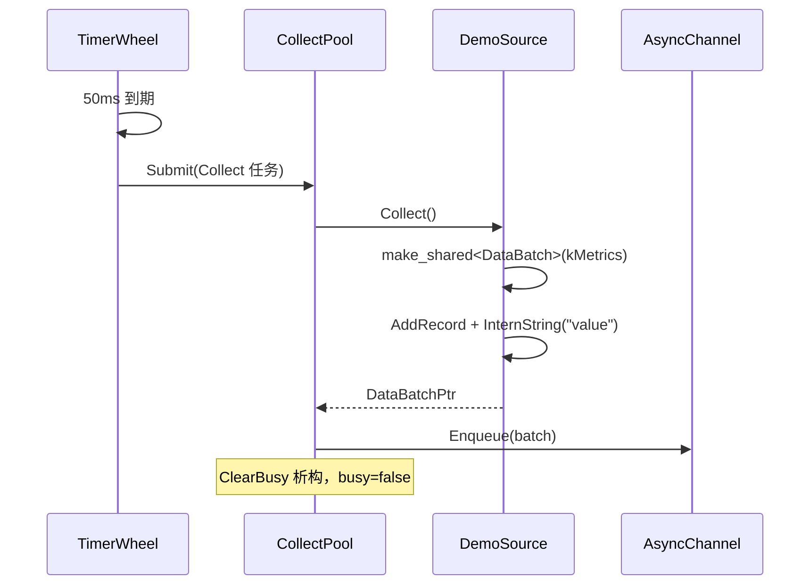
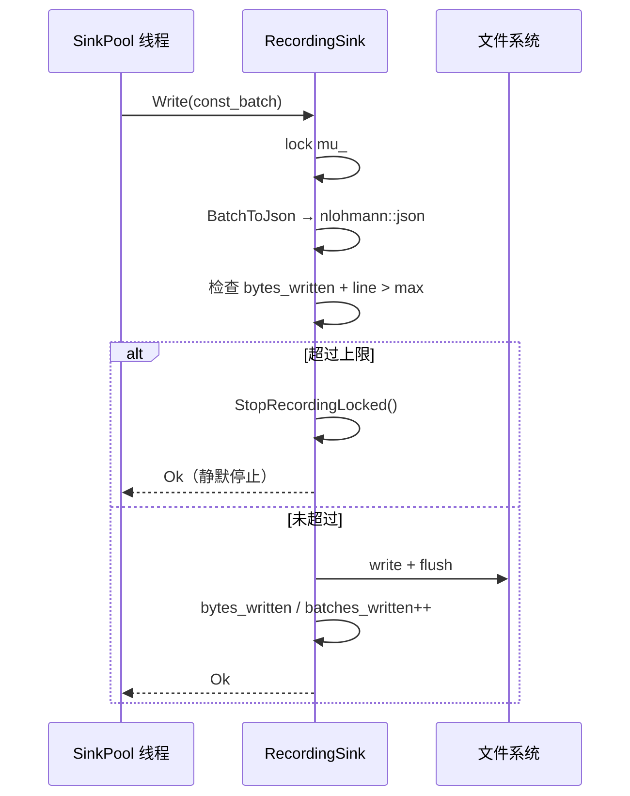
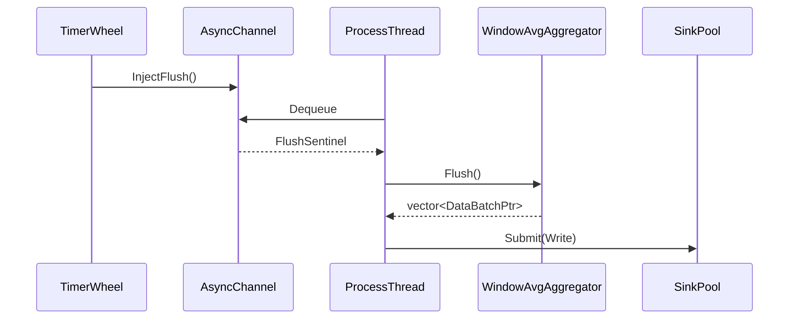

# 02-08 插件走读：从 DemoSource 到 RecordingSink

前面几篇讲的是机制。本篇用一条真实可运行的路径把它们串起来：

```text
TimerWheel → CollectPool → DemoSource::Collect
  → Pipeline::Enqueue → ProcessThread → RecordingSink::Write → .ilr
```

再补两个**教学示例**，说明 Processor 和 Aggregator 怎么写。

返回 [Pipeline v3 总览](./index.md)。

## 1. 真实 Source：CLI DemoSource

`src/cli/main.cc` 中的 `DemoSource` 是合成数据源，不读取任何系统资源，也不需要权限：

```cpp
class DemoSource : public SourcePlugin {
public:
    const char* Name() const override { return "demo_counter"; }
    const char* Version() const override { return "0.1.0"; }

    uint32_t IntervalMs() const override { return 50; }

    StatusOr<DataBatchPtr> Collect() override {
        auto batch = std::make_shared<DataBatch>(DataBatch::Type::kMetrics);
        auto& record = batch->AddRecord();
        record.timestamp = NowTimestamp();
        record.SetField(batch->InternString("value"), ++count_);
        return batch;
    }

private:
    int64_t count_ = 0;
};
```

逐点说明：

| 点 | 含义 |
| --- | --- |
| `IntervalMs() == 50` | 宿主读取后注册 50ms 重复定时器 |
| `kMetrics` | 批次类型，但实际载荷仍只有 `Record` |
| `InternString("value")` | 字段名驻留到该批 Arena，`Record` 只保存 `string_view` |
| `++count_` | 生成 `int64_t` 字段；字段名是 `value`，不是旧文档里的 `counter` |
| `AddRecord()` | 自动设置当前 `system_clock` 时间戳；这里又显式赋值一次 |

### 1.1 它如何被调度

```cpp
auto busy = std::make_shared<std::atomic<bool>>(false);
auto* collect_pool = infrastructure.GetCollectPool();

infrastructure.GetTimerWheel().AddRepeating(
    std::chrono::milliseconds(pipeline.GetSource()->IntervalMs()),
    [&pipeline, collect_pool, busy] {
        if (busy->exchange(true)) return;   // 上一次 Collect 未结束，跳过
        collect_pool->Submit([&pipeline, busy] {
            struct ClearBusy {
                std::atomic<bool>& busy;
                ~ClearBusy() { busy.store(false); }
            } clear{*busy};

            auto batch = pipeline.GetSource()->Collect();
            if (batch.ok()) pipeline.Enqueue(std::move(*batch));
        });
    });
```

<div style="overflow-x: auto; margin: 1.5rem 0;">



</div>

`DemoSource::Collect()` 运行在 CollectPool 线程，不在 TimerWheel 线程。

## 2. 真实 Sink：RecordingSink

`RecordingSink` 同时实现 `SinkPlugin` 和 `RecordableInterface`。它不会随 Pipeline `Start()` 自动开始录制；CLI 在 Pipeline Start 之后显式调用：

```cpp
auto* recording = dynamic_cast<RecordingSink*>(sink.get());
// ...
status = pipeline.Start();
if (recording) {
    status = recording->StartRecordingWithStatus();
}
```

如果没有调用 `StartRecordingWithStatus()`，`Write()` 会直接返回 Ok，数据被静默丢弃。

### 2.1 Init 参数

```cpp
Status Init(const ConfigValue& config) override {
    feature_name_ = config["feature_name"].AsString("default");
    output_dir_ = config["output_dir"].AsString("/tmp/illuminator_recordings");
    max_file_bytes_ = static_cast<uint64_t>(
        config["max_file_mb"].AsInt(100)) * 1024ULL * 1024ULL;
    return Status::Ok();
}
```

| 参数 | 默认值 | 说明 |
| --- | --- | --- |
| `feature_name` | `default` | 流名称，也用于文件名 |
| `output_dir` | `/tmp/illuminator_recordings` | 输出目录 |
| `max_file_mb` | 100 | 文件大小上限（MB） |

`max_file_mb` 没有范围校验；负值转成 `uint64_t` 会变成巨大上限。宿主应传正数。

### 2.2 开始录制

```cpp
std::string filename = feature_name_ + "_" +
                       std::to_string(epoch_ms) + ".ilr";
std::filesystem::create_directories(output_dir_, error);

file_ = std::make_unique<std::ofstream>(path, std::ios::binary);
// 写头
header["format"] = "ilr";
header["version"] = 1;
header["feature"] = feature_name_;
header["started_at"] = epoch_ms;
header["max_bytes"] = max_file_bytes_;
```

文件名格式：`<feature>_<epoch_ms>.ilr`。

### 2.3 Write

```cpp
Status Write(ConstDataBatchPtr batch) override {
    if (!batch) return Status::Ok();
    std::lock_guard<std::mutex> lk(mu_);
    if (!recording_) return Status::Ok();

    nlohmann::json j;
    j["ts"] = duration_cast<milliseconds>(
        system_clock::now().time_since_epoch()).count();
    j["data"] = nlohmann::json::parse(BatchToJson(*batch, feature_name_));

    std::string line = j.dump() + "\n";
    if (session_.bytes_written + line.size() > max_file_bytes_) {
        StopRecordingLocked();       // 达到上限：停止录制，返回 Ok
        return Status::Ok();
    }

    file_->write(line.data(), line.size());
    file_->flush();                  // flush 不是 fsync
    ...
}
```

<div style="overflow-x: auto; margin: 1.5rem 0;">



</div>

注意：

- `mu_` 把并发 `Write` 串行化；Pipeline 不保证同一 Sink 的顺序。
- 每行都 `flush()`，但**不是 fsync**；掉电仍可能丢数据。
- 达到上限后停止录制，不滚动新文件。
- `.ilr` 每行的 `ts` 是**写入时间**，不是 `Record.timestamp`；批次内的时间戳在 `data` 里。

### 2.4 文件样例

头部（键顺序由 nlohmann::json 决定，不是协议）：

```json
{"feature":"demo_counter","format":"ilr","max_bytes":104857600,"started_at":1793750400000,"version":1}
```

一行数据：

```json
{"data":{"pipeline":"demo_counter","records":[{"fields":{"value":1},"labels":{},"timestamp":1793750400050}]},"ts":1793750400062}
```

- `data.pipeline`：流名称。
- `data.records[].fields.value`：DemoSource 的计数字段。
- `data.records[].timestamp`：毫秒（由纳秒截断）。
- 外层 `ts`：RecordingSink 写入时间（毫秒）。

## 3. 真实组装

CLI 的核心装配可以压缩成：

```cpp
auto source = registry.CreateSource("demo_counter");
auto sink = registry.CreateSink("recording");

source->Init(ConfigValue{});
ConfigValue sink_config;
sink_config.Set("feature_name", "demo_counter");
sink_config.Set("output_dir", output_dir);
sink->Init(sink_config);

auto& infra = InfrastructureManager::Instance();
infra.Start(config.engine);

Pipeline pipeline("demo_counter", 4096, DropPolicy::kDropNewest, 0.8, 0.2);
pipeline.SetSource(std::move(source));
pipeline.AddSink(std::move(sink));
pipeline.SetSinkPool(infra.GetSinkPool());
pipeline.Start();

// 录制是显式动作
recording->StartRecordingWithStatus();

// 采集定时器
infra.GetTimerWheel().AddRepeating(50ms, [&] { /* Submit Collect */ });
```

顺序要点：

1. 插件 `Init` 必须在 `Pipeline::Start` 之前。
2. `InfrastructureManager::Start` 必须在需要 SinkPool / Timer 之前。
3. `Pipeline::Start` 之后才能动态添加 Sink 或开始录制。
4. 定时器在 Pipeline Start 之后注册，避免回调先于 `running_=true`。

## 4. 教学示例：FilterProcessor

> ⚠️ 教学示例：以下代码用于说明 Processor 接口，不属于当前仓库实现。

目标：保留 `value >= threshold` 的记录；如果全部被过滤，返回 `nullptr`。

```cpp
class FilterProcessor : public ProcessorPlugin {
public:
    explicit FilterProcessor(int64_t threshold) : threshold_(threshold) {}

    const char* Name() const override { return "filter"; }
    const char* Version() const override { return "0.1.0"; }

    StatusOr<DataBatchPtr> Process(DataBatchPtr input) override {
        if (!input) return DataBatchPtr{};

        auto& records = input->records();
        records.erase(
            std::remove_if(records.begin(), records.end(),
                [this](const Record& rec) {
                    const auto* v = rec.GetField("value");
                    if (!v) return true;
                    const auto* n = std::get_if<int64_t>(v);
                    return !n || *n < threshold_;
                }),
            records.end());

        if (records.empty()) return DataBatchPtr{};  // 过滤整批
        return input;                                // 原地修改，返回同一批
    }

private:
    int64_t threshold_;
};
```

组装：

```cpp
pipeline.AddProcessor(std::make_unique<FilterProcessor>(10));
```

注意事项：

- 原地修改并返回同一个 `shared_ptr` 是最省拷贝的路径。
- 返回新批次时，不能只复制指向旧 Arena 的 `string_view` 然后丢掉旧批次。
- `nullptr` 是合法过滤，不计错误。
- 修改 `records` 后，之前保存的 `Record&` 会失效。

## 5. 教学示例：WindowAvgAggregator

> ⚠️ 教学示例：以下代码用于说明 Aggregator 接口，不属于当前仓库实现。完整版本见 [处理与聚合](./05-processing-and-aggregation.md#6-窗口边界示例)。

```cpp
class WindowAvgAggregator : public AggregatorPlugin {
public:
    const char* Name() const override { return "window_avg"; }
    const char* Version() const override { return "0.1.0"; }

    Status Add(DataBatchPtr batch) override {
        for (auto& rec : batch->records()) {
            if (auto* v = rec.GetField("value")) {
                if (auto* n = std::get_if<int64_t>(v)) {
                    sum_ += static_cast<double>(*n);
                    count_++;
                }
            }
        }
        return Status::Ok();
    }

    StatusOr<std::vector<DataBatchPtr>> Flush() override {
        std::vector<DataBatchPtr> out;
        if (count_ == 0) return out;

        auto batch = std::make_shared<DataBatch>(DataBatch::Type::kMetrics);
        auto& rec = batch->AddRecord();
        rec.SetField(batch->InternString("avg"), sum_ / count_);
        rec.SetField(batch->InternString("samples"), count_);
        out.push_back(std::move(batch));

        sum_ = 0;
        count_ = 0;
        return out;
    }

    uint32_t FlushIntervalMs() const override { return 1000; }

private:
    double sum_ = 0;
    uint64_t count_ = 0;
};
```

宿主必须自己注册刷新定时器：

```cpp
infra.GetTimerWheel().AddRepeating(
    std::chrono::milliseconds(pipeline.FlushIntervalMs()),
    [&pipeline] { pipeline.InjectFlush(); });
```

<div style="overflow-x: auto; margin: 1.5rem 0;">



</div>

注意：

- Pipeline 不检查 `Add` 的返回状态。
- `Flush` 失败不会增加 `ErrorCount`。
- 如果宿主忘了注册定时器，`MaybeForceFlush` 会在 3×interval 后兜底刷新一次。
- `FlushIntervalMs()==0` 不会自动逐批刷新。

## 6. 四类插件对照

| 类型 | 适合做什么 | 输入 → 输出 | 执行线程 | 常见错误 |
| --- | --- | --- | --- | --- |
| Source | 采集系统数据 | 无 → `DataBatchPtr` | CollectPool | 重叠 Collect、临时字符串悬空 |
| Processor | 过滤/转换/派生 | 批次 → 批次或 `nullptr` | ProcessThread | 返回旧 Arena 的视图、误把过滤当错误 |
| Aggregator | 窗口/状态聚合 | 多批 → 0..N 批 | ProcessThread | 忘注册 Flush 定时器、跨批保存 string_view |
| Sink | 文件/DB/远端输出 | 只读批次 | SinkPool（或 ProcessThread） | 并发写未加锁、慢写无边界 |

## 7. 接入检查清单

1. `Init` 是否校验参数？失败是否返回非 Ok？
2. `Start` 失败时是否清理自己已获得的资源？
3. `Stop` 是否可重复调用？是否释放文件/句柄/线程？
4. Source 是否避免重叠 `Collect()`？
5. Processor 返回新批次时，字符串是否重新驻留或保留旧批次所有权？
6. Aggregator 跨批保存数据时，是否保留了所有者，而不是只保存 `string_view`？
7. Sink 是否支持并发 `Write()`，或明确只走同步路径？
8. 是否注册了采集定时器和（如有 Aggregator）刷新定时器？
9. 是否在 Stop 前停止外部生产者并排空 CollectPool？
10. 是否有针对空输入、错误、重复 Stop、大小上限的测试？

## 小结

- `DemoSource` 是 50ms 合成 Source，字段名是 `value`；它由 TimerWheel 调度、CollectPool 执行。
- `RecordingSink` 必须显式开始录制；写路径加锁、每行 flush、达到上限停止，不是 fsync。
- 教学 Processor 展示了“原地修改 + `nullptr` 过滤”；教学 Aggregator 展示了“Add 累积 + Flush 输出 + 宿主定时注入”。
- 真实组装的关键顺序是：Init → Infrastructure → Pipeline → Start → 开始录制 → 注册定时器。

## 边界与后续

- 当前仓库没有生产 Processor/Aggregator，只有接口与测试 Mock。
- 教学示例不在仓库中，不能直接编译。
- RecordingSink 的 `.ilr` 是输出格式，不是完整无损的快照协议。
- 没有 StorageSink；SQLite 由宿主单独调用。

返回 [Pipeline v3 总览](./index.md) · 上一篇：[输出与停机](./07-output-and-shutdown.md) · 下一篇：[指标与测试](./09-metrics-and-testing.md)
