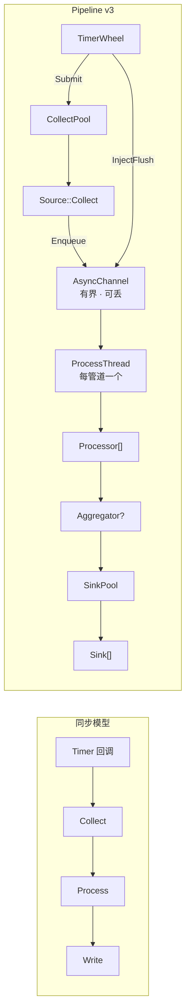
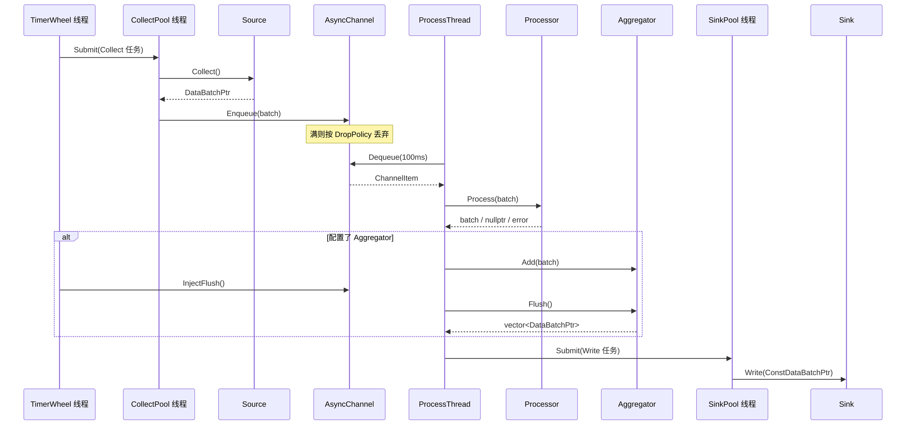

# 02 Pipeline v3 总览

Pipeline v3 是 Illuminator 核心引擎的数据通路：**采集与处理解耦、处理状态单线程、输出 I/O 池化**。本目录用 9 篇专题把它拆开讲透；本篇先回答“为什么需要它”和“它由什么组成”。

> 代码基线：`/workspace/illuminator`，HEAD `ba05c04`，2026-11-04。下文所有“当前实现”均指该基线。

## 1. 一句话定义

> **Pipeline 是一条有界、可丢弃、事件驱动的数据路径：Source 采集的批次与聚合刷新信号共用一条通道，由每管道唯一的处理线程顺序消费，再交给共享输出池写往多个 Sink。**

它包含四个可插拔角色和一组运行资源：

| 角色 | 一句话职责 | 输入 | 输出 |
| --- | --- | --- | --- |
| **Source** | 周期性采集原始观测数据 | 无（自己读 `/proc`、eBPF、网络等） | `DataBatchPtr` |
| **Processor** | 逐批转换、过滤、派生 | `DataBatchPtr` | `DataBatchPtr` 或 `nullptr` |
| **Aggregator** | 跨批缓冲，按刷新信号输出聚合结果 | `DataBatchPtr` | `vector<DataBatchPtr>` |
| **Sink** | 把批次写到最终目标 | `ConstDataBatchPtr` | 文件、数据库、远端等 |

运行资源：

| 资源 | 职责 | 数量 |
| --- | --- | --- |
| **TimerWheel** | 决定“何时采集 / 何时刷新” | 全局 1 个线程 |
| **CollectPool** | 执行 `Source::Collect()`，避免慢采集阻塞调度 | 默认 2 个线程，共享 |
| **AsyncChannel** | 有界事件通道，数据与 `FlushSentinel` 共用 | 每 Pipeline 1 条 |
| **ProcessThread** | 顺序执行 Processor / Aggregator | 每 Pipeline 1 个 |
| **SinkPool** | 执行 `Sink::Write()`，隔离慢 I/O | 默认 `max(2, CPU/2)`，共享 |

## 2. 为什么是 v3 这种结构

### 2.1 三种模型的对比

| 模型 | 工作方式 | 主要问题 |
| --- | --- | --- |
| **同步模型** | 定时回调里直接 `Collect → Process → Write` | 一次慢写阻塞整个定时线程，所有 Source 一起延迟 |
| **无通道多线程** | 采集线程直接调用处理逻辑，共享状态加锁 | 锁竞争、处理顺序不稳定、背压无处表达 |
| **v3 事件驱动** | 定时只投递；通道解耦；处理单线程；输出池化 | 需要接受“有界丢弃”和“最终一致”的关闭语义 |

v3 把“什么时候做”和“实际做”拆成两类线程：

- **调度线程只做投递**：TimerWheel 回调里只调用 `Submit()` 或 `InjectFlush()`，必须是纳秒到微秒级操作。
- **执行线程各司其职**：CollectPool 跑采集，ProcessThread 跑转换/聚合，SinkPool 跑写入。
- **边界用通道表达**：通道满时按策略丢弃，而不是无限堆积或反向阻塞内核回调。

### 2.2 代价与取舍

v3 不是“更快”的同义词，它用以下代价换取隔离与可控性：

1. **数据可能被丢弃**：通道满时按 `DropPolicy` 丢弃；输出池积压超过 256 个排队任务时整批丢弃。
2. **顺序只在单管道内成立**：同一 Sink 的异步写入可能并发且乱序。
3. **关闭需要宿主配合**：Pipeline 只能排空自己通道里的条目，无法停止外部仍在调用的 `Collect()`。
4. **聚合刷新不是精确时间窗口**：`FlushSentinel` 在通道中的位置决定刷新边界。

## 3. 核心不变量

| 不变量 | 含义 | 谁负责保证 |
| --- | --- | --- |
| 生命周期串行 | 同一 Pipeline 的 `Start/Stop` 不应并发调用 | 宿主 |
| Init 先于 Start | Pipeline 不调用插件 `Init()` | 宿主 |
| 同一 Source 不重叠 Collect | 上一个 `Collect()` 未结束前不再投递 | 宿主 |
| Processor/Aggregator 单线程访问 | 只由 ProcessThread 调用 | Pipeline |
| 发布后只读 | 交给 Sink 的批次不得再被修改 | 插件契约 |
| 关闭前先静默生产者 | 停 Timer、排空 Collect，再 `Pipeline::Stop()` | 宿主 |
| 不丢控制信号（尽力） | `InjectFlush` 满队列时驱逐旧条目再重试 | AsyncChannel |

## 4. 一条数据的完整旅程

注意图中两个容易误解的点：

1. `TimerWheel` 线程**不执行** `Collect()`；它只把任务提交到 `CollectPool`。
2. `Flush` 不来自独立线程；`FlushSentinel` 被 ProcessThread 取出后，由同一个处理线程调用 `Aggregator::Flush()`。

## 5. 专题导航

| 篇目 | 回答的问题 |
| --- | --- |
| [01 模型与数据结构](./01-model-and-data-structures.md) | Pipeline 持有什么？`ChannelItem` 为什么是 variant？批次寿命如何变化？ |
| [02 事件通道与无锁队列](./02-event-channel-and-lockfree-queue.md) | 有界通道如何入队/出队？环形队列的 sequence 协议是什么？ |
| [03 TimerWheel](./03-timer-wheel.md) | timerfd/eventfd/epoll 如何协作？重复定时器为什么追赶？Cancel 为什么有“余波”？ |
| [04 线程模型与调度](./04-thread-model-and-scheduling.md) | 一共有哪些线程？谁在什么线程上跑？如何防止采集重入？ |
| [05 处理与聚合](./05-processing-and-aggregation.md) | Processor 链、Aggregator、三种 Flush 来源和窗口边界 |
| [06 反压与过载](./06-backpressure-and-overload.md) | 水位线、丢包策略、输出池阈值如何共同工作？ |
| [07 输出与停机](./07-output-and-shutdown.md) | 同步/异步输出、`pending_writes_` 屏障、Start 回滚与 Stop 顺序 |
| [08 插件走读](./08-plugin-walkthrough.md) | 真实的 DemoSource / RecordingSink 如何运行？如何写教学用 Processor/Aggregator？ |
| [09 指标与测试](./09-metrics-and-testing.md) | 每个指标到底统计什么？测试证明了什么、没证明什么？ |

## 6. 读完本目录后，你应能回答

1. 为什么 TimerWheel 不能直接调用 `Collect()`？
2. 通道满时 `drop_newest`、`drop_oldest`、`InjectFlush` 分别做什么？
3. `FlushSentinel` 在队列中的位置如何影响聚合窗口？
4. 为什么 `FlushIntervalMs()==0` 不等于“每批自动刷新”？
5. 同一 Sink 的两次 `Write()` 为什么可能并发且乱序？
6. `pending_writes_` 等待的是什么？为什么必须在 join 处理线程之后？
7. `Cancel()` 之后为什么还可能看到一次回调？
8. 为什么宿主必须先停 Timer、排空 Collect，才能调用 `Pipeline::Stop()`？

## 7. 边界

- 本目录只讲核心引擎。Server、前端、生产 eBPF 探针和回放系统不在当前代码基线内。
- “无锁处理路径”仅指 Processor/Aggregator 由单线程串行访问；Sink 列表访问仍使用 `shared_mutex`，插件内部也可能加锁。
- 代码中的注释不能替代行为：例如 `LockFreeQueue` 注释写 MPSC，但实现支持多消费者；`Aggregator::FlushIntervalMs()` 注释写“0 表示每批刷新”，实际 Pipeline 并不会自动刷新。本目录以代码路径为准。

返回 [设计总览](../index.md)。
