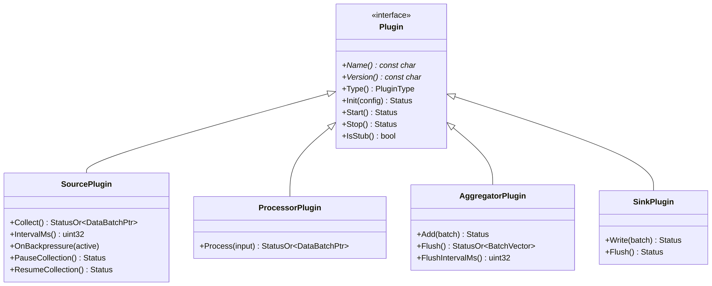
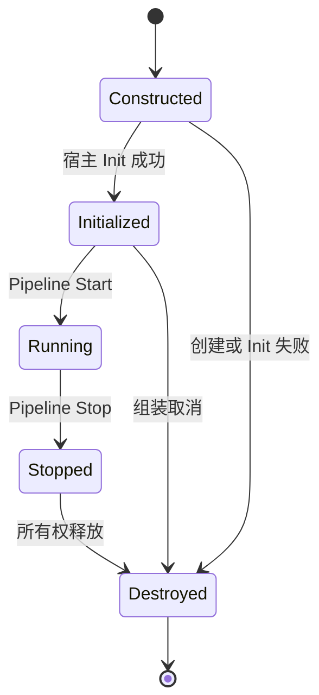
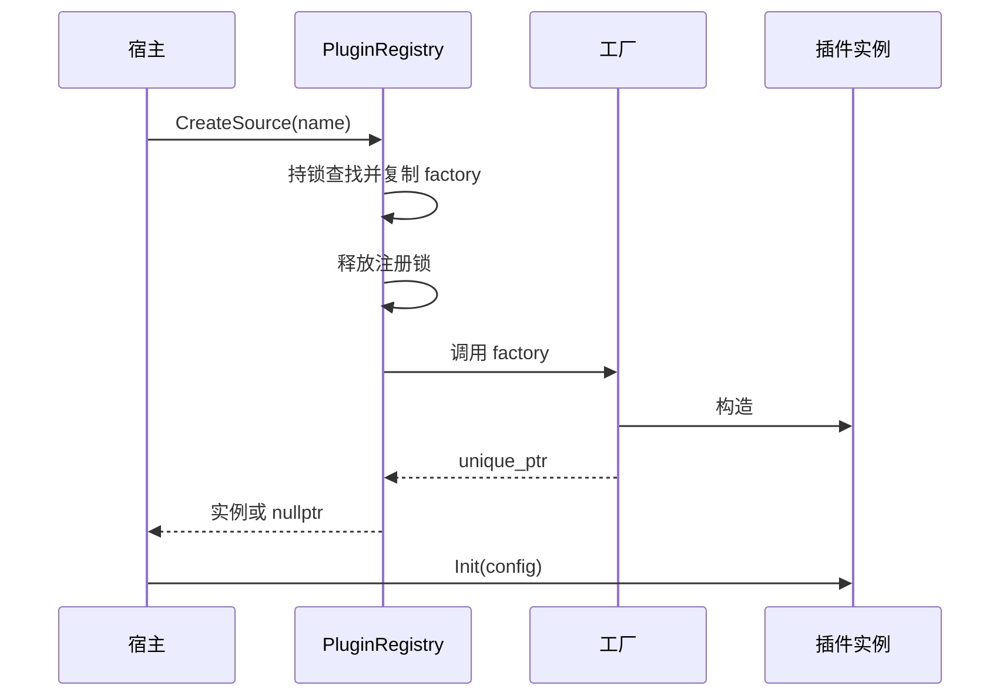
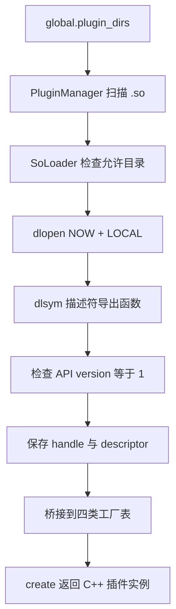

# 03 插件系统与扩展契约

插件系统将采集、转换、聚合和输出分离为四种组件接口。Registry 负责“按类型和名称创建实例”，Manager 与 SoLoader 负责“从动态库发现工厂”，Pipeline 负责“执行已经组装的实例”。这三类职责相互配合，但不互相替代。

返回 [设计总览](./index.md)。组件的执行线程见 [Pipeline v3](./02-pipeline-v3.md)。

## 1. 接口结构

Plugin 定义名称、版本、类型及公共生命周期。Init、Start、Stop 默认返回 OK，派生类按需要覆写。四类接口还分别提供 Reconfigure，默认实现是空操作；“返回成功”不意味着自动支持所有参数的动态更新。

| 类型 | 输入与输出 | 状态与线程约定 |
| --- | --- | --- |
| Source | Collect 返回批次或错误；默认采集周期 1000ms | 宿主避免重叠 Collect；OnBackpressure 可在入队线程执行 |
| Processor | 单批输入，返回同批、新批、空或错误 | 常规路径由 ProcessThread 顺序调用 |
| Aggregator | 多次 Add，Flush 返回批次数组；默认刷新周期 10000ms | Add 与 Flush 由同一处理线程执行 |
| Sink | Write 接收 ConstDataBatchPtr；Flush 刷出内部缓冲 | 异步路径必须支持并发 Write |

Source 的 QueryExtra、GetBpfStats、IsStub 等提供额外查询或能力状态，不构成完整业务控制服务。PauseCollection/ResumeCollection 也不自动撤销宿主已投递的 Collect。

## 2. 生命周期与初始化分工

该图是推荐使用顺序，不表示 Plugin 基类实现了状态检查。宿主应检查每个 Init 结果后再转移所有权，避免将未初始化实例交给 Pipeline。

Start 失败的插件需要自行回收该次调用已获得的部分资源。Pipeline 会停止此前已经成功启动的组件，但不会替失败插件推断内部资源状态。Stop 应尽量可重复并完整释放外部资源；是否允许重启需由具体插件定义，当前框架没有统一的重启契约。

## 3. Registry 的工厂模型

`src/plugin/infra/plugin_registry.h` 使用四张 `name → factory` 映射，工厂分别返回对应接口的 unique_ptr。注册与查找通过 mutex 保护；创建时先在锁内复制 factory，再解锁调用，允许构造函数重新访问 Registry，避免把用户构造逻辑置于全局注册锁内。

名称在各类型表内区分；同名再次注册会覆盖原工厂，当前没有重复注册拒绝策略。列表来自 unordered_map，不保证稳定排序。Factory 只负责创建，不应启动线程、安装定时器或启动整条 Pipeline。

### 3.1 内建注册

`RegisterBuiltinPlugins()` 在 `builtin_plugins.cc` 显式、一次性注册当前内建 `recording` Sink。SDK 还保留 `IL_REGISTER_SOURCE`、`IL_REGISTER_PROCESSOR`、`IL_REGISTER_AGGREGATOR`、`IL_REGISTER_SINK` 静态注册宏。

静态注册要求目标被链接进产物；宏所在翻译单元被链接器裁掉时，注册不会凭空发生。新增内建插件需要更新 BUILD 依赖，推荐将注册入口放在 `.cc` 中显式管理。

`demo_counter` 仅在 CLI 执行 demo 时注册，是示例 Source。当前没有默认注册具体 CPU 采集器，也没有内建生产 Processor/Aggregator 集合。

## 4. 动态库加载

允许目录检查对路径和目录做 realpath，再按带目录分隔符的前缀匹配；直接使用 SoLoader 且允许目录为空时不限制路径。Manager 从配置目录扫描扩展名 `.so` 的条目，单库加载失败会记录日志并继续，其最终返回 OK 不表示所有插件都成功。

因此宿主必须进一步按名称查找所需工厂，并检查创建结果。目录扫描顺序和重名覆盖不应成为部署选择插件版本的机制。

### 4.1 描述符协议

共享库导出 `illuminator_plugin_describe`，返回 IlPluginDescriptor。字段包括 `api_version`、`name`、`version`、`type`、`create`、`process`、`destroy`。当前 API version 为 1。

当前桥接实际调用 `create(nullptr)`，把返回指针解释为指定的 C++ 接口，再使用默认 unique_ptr 析构。描述符中的 `process` 和 `destroy` 没有进入当前实例调用与销毁路径；传给 create 的 JSON 参数也没有被使用来初始化插件。

**这是带 C 链接导出入口的 C++ SDK。** `extern "C"` 只让入口符号名稳定，无法使返回的 C++ 对象、虚函数、标准库布局和分配器跨任意工具链兼容。API version 校验也无法验证全部二进制兼容条件。

部署时需保持宿主与插件的架构、编译器、标准库、编译选项和 SDK 版本兼容。真实动态库测试位于 `src/plugin/test/test_source_plugin.cc`，验证的是当前兼容 C++ 路径。

### 4.2 动态库寿命

SoLoader 析构会 dlclose 已保存句柄，Registry 没有相应的安全卸载协调。局部创建一个 loader、注册工厂后立即销毁，会让工厂持有无效 descriptor，实例虚函数也可能指向卸载代码。

当前应将动态库保持到所有使用者结束，不执行运行时热卸载。后续可为实例及工厂绑定库句柄，再选择稳定 C ABI 或明确版本化 C++ SDK；该设计尚未实现。

## 5. 插件开发契约

### 5.1 数据与线程

Source 应在返回之前把临时字符串复制到批次 Arena。Processor 若创建新批次，不能只复制指向旧 Arena 的 string_view 后立即丢弃原批次。Aggregator 若跨批次保留数据，必须保留完整批次所有权或复制到自身长期存储。Sink 应只读输入；其自身缓存、文件和连接需要同步。

OnBackpressure、Reconfigure、Stop 与工作方法可能来自不同线程。插件不能只依据“ProcessThread 单线程”推导所有方法都无须同步；运行期控制要与宿主共同建立屏障。

### 5.2 错误与能力

用 Status 返回预期失败；不要在热路径静默吞掉无效参数。无数据可以返回空批次或空指针，但应与采集失败区分。eBPF Source 的 IsStub 为 true 代表降级运行，不能展示为探针正常采样。

WASM 在当前代码中只有概念性注释，没有运行时、沙箱或可调用加载器。新增不可信插件隔离能力需要独立设计，不能把当前 `.so` 当作隔离边界。

## 6. 新增组件的建议步骤

1. 明确组件类型、输入字段、输出字段、时间单位与线程约定。
2. 实现 Init 参数校验及 Start 失败清理。
3. 实现数据路径与 Stop/Flush，控制自身缓冲大小。
4. 添加独立 BUILD 目标和注册入口，避免反向依赖 engine 或 CLI。
5. 验证空输入、无效配置、重复关闭、批次寿命及必要的并发行为。
6. 通过宿主装配，在阻塞输出与信号退出下验证完整生命周期。

配置写法见 [05](./05-configuration-and-status.md)，eBPF 专用 hooks 见 [07](./07-ebpf-sdk.md)，构建与测试见 [09](./09-development-and-validation.md)。
