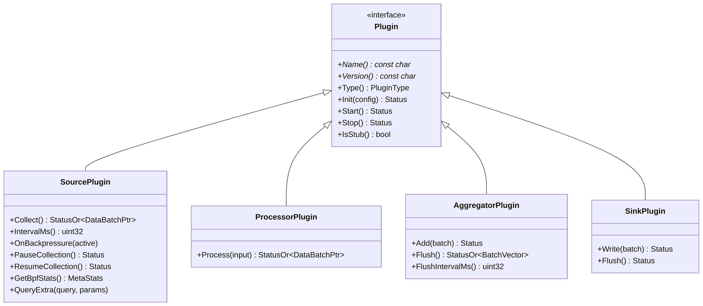
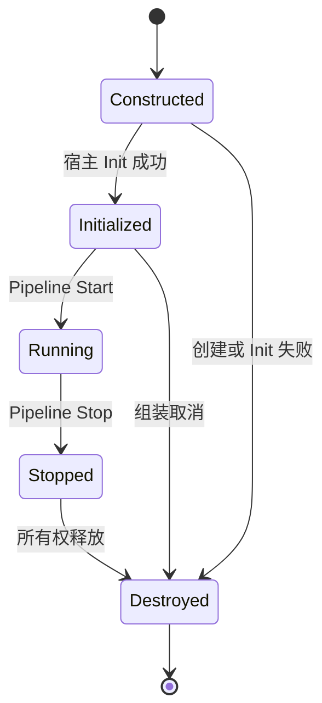
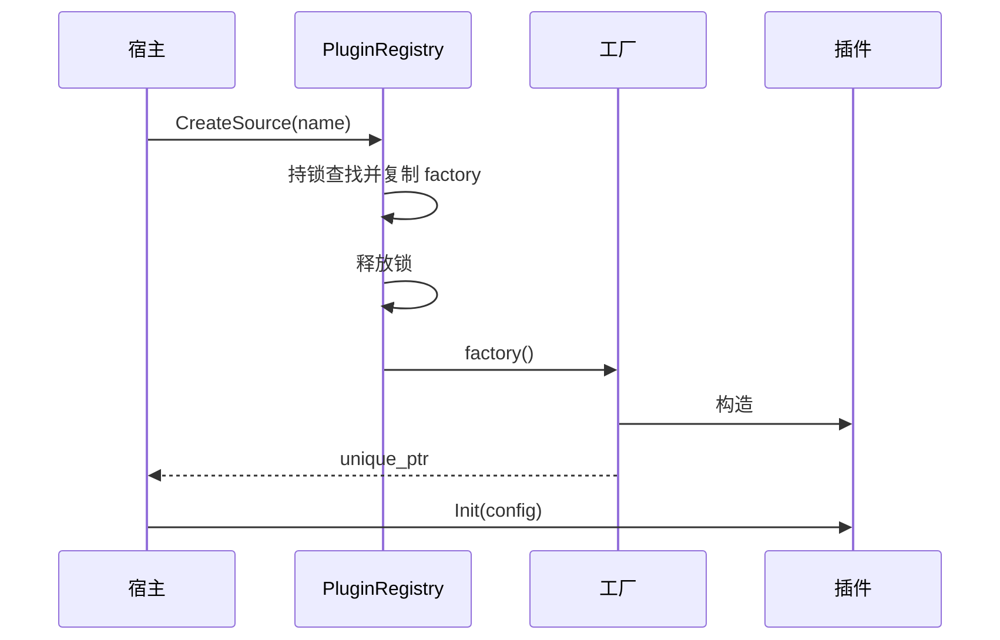
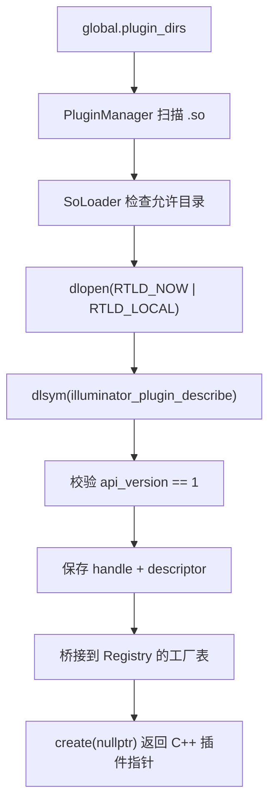

# 03 插件系统与扩展契约

Illuminator 把数据处理拆成四个可替换角色：Source、Processor、Aggregator、Sink。插件系统解决两个问题：

1. **按名称创建实例**：Registry 保存“名称 → 工厂”。
2. **从动态库发现工厂**：Manager / SoLoader 扫描 `.so`，把描述符桥接进 Registry。

它**不**负责运行插件；插件何时 `Init`、`Start`、被哪个线程调用，由宿主编排。

返回 [设计总览](./index.md)。Pipeline 如何使用插件见 [Pipeline v3](./02-pipeline-v3/index.md)。

## 1. 四类接口

<div style="overflow-x: auto; margin: 1.5rem 0;">



</div>

| 类型 | 输入 | 输出 | 常规执行线程 |
| --- | --- | --- | --- |
| Source | 无 | `DataBatchPtr` | CollectPool |
| Processor | 批次 | 批次 / `nullptr` / 错误 | ProcessThread |
| Aggregator | 批次 | 0..N 批次 | ProcessThread |
| Sink | `ConstDataBatchPtr` | 外部副作用 | SinkPool（或同步 ProcessThread） |

### 1.1 方法契约

| 方法 | 调用者 | 是否可阻塞 | 是否可并发 |
| --- | --- | --- | --- |
| `Init` | 宿主 | 可以 | 不应并发 |
| `Start` / `Stop` | 宿主 / Pipeline | 可以 | 不应并发 |
| `Collect` | CollectPool | 可以 | 同一 Source 不应重叠 |
| `Process` | ProcessThread | 可以（但会拖慢管道） | 同一实例不并发 |
| `Add` / `Flush` | ProcessThread | 可以（同上） | 同一实例不并发 |
| `Write` | SinkPool 或 ProcessThread | 可以 | **可能并发** |
| `Reconfigure` | 宿主 | 由插件决定 | 不冻结其他调用 |
| `OnBackpressure` | 生产者线程 | 应快速返回 | 可能与其他方法并发 |

## 2. 生命周期

<div style="overflow-x: auto; margin: 1.5rem 0;">



</div>

关键事实：

- **Pipeline 不调用 `Init()`**。宿主必须在交给 Pipeline 前初始化。
- `Start()` 失败时，Pipeline 只回滚“已经成功启动”的组件；失败的那个需要插件自己清理。
- `Stop()` 应尽量可重复；框架没有统一的重启契约。
- `IsStub()` 为 true 表示降级运行（例如内核不支持 BPF），不能展示为正常采样。

## 3. Registry：名称到工厂

Registry 内部是四张独立的 `name → factory` 表，用一把 mutex 保护：

```cpp
using SourceFactory = std::function<std::unique_ptr<SourcePlugin>()>;

std::unique_ptr<SourcePlugin> CreateSource(const std::string& name) {
    SourceFactory factory;
    {
        std::lock_guard<std::mutex> lock(mutex_);
        auto it = sources_.find(name);
        if (it == sources_.end()) return nullptr;
        factory = it->second;
    }
    return factory();   // 锁外构造
}
```

<div style="overflow-x: auto; margin: 1.5rem 0;">



</div>

边界：

- 同名再次注册会覆盖原工厂，没有重复注册拒绝。
- 列表来自 `unordered_map`，顺序不稳定。
- 工厂只负责构造，不应启动线程或注册定时器。
- `IL_REGISTER_*` 宏存在，但当前内建插件由 `RegisterBuiltinPlugins()` 显式注册；目前只注册 `recording`。

## 4. 动态库加载

<div style="overflow-x: auto; margin: 1.5rem 0;">



</div>

### 4.1 描述符

```cpp
struct IlPluginDescriptor {
    uint32_t api_version;
    const char* name;
    const char* version;
    uint32_t type;
    void* (*create)(const char* config_json);
    int   (*process)(void* ctx, void* input, void* output);
    void  (*destroy)(void* ctx);
};
```

导出符号：`illuminator_plugin_describe`。当前 `api_version == 1`。

当前桥接只使用 `create`：

```cpp
reg.RegisterSource(name, [desc]() {
    void* raw = desc->create(nullptr);
    return std::unique_ptr<SourcePlugin>(static_cast<SourcePlugin*>(raw));
});
```

`process` 和 `destroy` 没有进入实例调用与销毁路径；传入的 `nullptr` 也不用于配置。

### 4.2 这是 C++ SDK，不是纯 C ABI

`extern "C"` 只稳定入口符号名，不能保证：

- 返回的 C++ 对象布局
- 虚函数表布局
- `std::string`/`shared_ptr` 等标准库 ABI
- 分配器一致性

因此宿主与插件必须保持架构、编译器、标准库、编译选项兼容。API version 校验不能覆盖这些条件。

### 4.3 加载失败不是整体失败

`LoadPluginsFromDirs` 对单个 `.so` 失败只记录 ERROR，继续加载下一个，最终仍返回 OK：

```cpp
if (!status.ok()) {
    IL_ERROR("Failed to load plugin {}: {}", path, status.message());
}
// 继续
return Status::Ok();
```

所以“加载返回 OK”不等于“所有插件都成功”。宿主必须按名称再检查 `Create*()` 的结果。

### 4.4 动态库寿命

<div style="overflow-x: auto; margin: 1.5rem 0;">


</div>

`SoLoader` 析构会 `dlclose` 保存的句柄；Registry 没有安全卸载协调。当前应让库活到所有使用者结束，不做运行时热卸载。

## 5. 线程与错误契约

### 5.1 线程

- Source 的 `Collect()` 在 CollectPool；不要假设它在 Timer 线程。
- Processor/Aggregator 只在 ProcessThread；不要在内部再起线程直接访问同一实例。
- Sink 的 `Write()` 可能从多个 SinkPool 线程并发进入；必须自行加锁或保证无状态。
- `OnBackpressure`、`Reconfigure`、`Stop` 可能与其他方法并发；需要插件自己建立同步。

### 5.2 错误

- 用 `Status` 返回预期失败；不要用异常作为正常控制流。
- 无数据可以返回空批次或 `nullptr`，但应与采集失败区分。
- `nullptr` 对 Processor 是“过滤”，不是错误。
- eBPF Source 的 `IsStub()` 必须检查；stub 模式下返回空批次。

### 5.3 数据寿命

- Source 必须把临时字符串复制进批次 Arena。
- Processor 返回新批次时，不能只复制指向旧 Arena 的 `string_view` 然后丢掉旧批次。
- Aggregator 跨批保留数据时，必须保留完整批次所有权或复制到长期存储。
- Sink 只读输入；不要把 `ConstDataBatchPtr` 转成可变指针。

## 6. 写一个插件：检查清单

1. 明确类型、输入字段、输出字段、时间单位和线程约定。
2. `Init` 校验参数；`Start` 失败时清理自己已获得的资源。
3. 实现数据路径；控制内部缓冲大小。
4. `Stop` 可重复、释放文件/句柄/线程。
5. 添加 BUILD 目标；不要反向依赖 engine 或 CLI。
6. 注册工厂；动态库保持 ABI 兼容。
7. 测试空输入、错误、重复 Stop、并发 Write、Arena 寿命。

完整的真实/教学示例见 [02/08 插件走读](./02-pipeline-v3/08-plugin-walkthrough.md)。

## 7. 内建插件现状

| 类型 | 已注册 |
| --- | --- |
| Sink | `recording` |
| Source | 无（CLI 的 `demo_counter` 只在 demo 命令中临时注册） |
| Processor | 无 |
| Aggregator | 无 |

不要假设仓库里已有生产 CPU/内存/IO 插件；`src/plugin/sources`、`processors`、`aggregators` 目前主要只有 BUILD 占位。

## 小结

- 插件系统 = 四类接口 + Registry 工厂 + Manager/SoLoader 动态发现。
- 生命周期由宿主驱动；Pipeline 只调用 `Start/Stop` 和运行期方法。
- 动态库入口是 C 链接，但实例仍是 C++ 对象，必须保持工具链兼容。
- 单个 `.so` 失败不会让整体加载失败；要按名称验证。

## 边界与后续

- 没有纯 C ABI、没有跨工具链沙箱、没有 WASM 运行时。
- 没有安全热卸载；库必须活过工厂和实例。
- 没有插件配置 schema；参数由插件自己解释。
- 没有生产 Processor/Aggregator 集合。

返回 [设计总览](./index.md) · 下一篇：[数据模型与内存](./04-data-and-memory.md)
