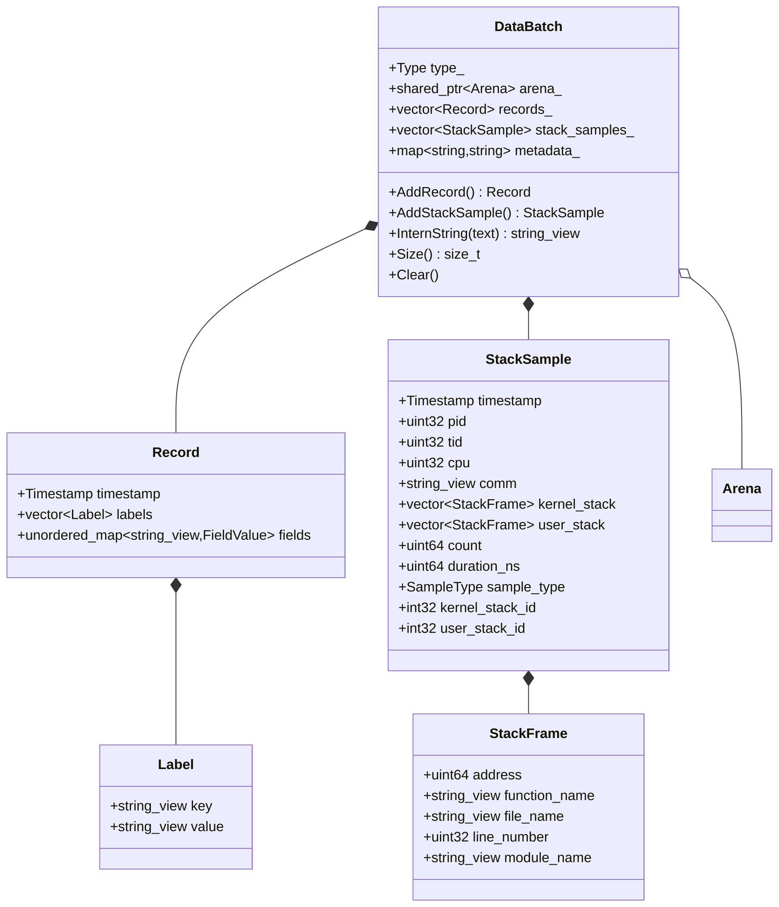
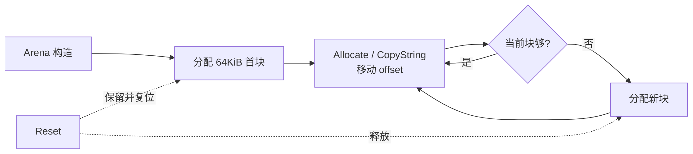
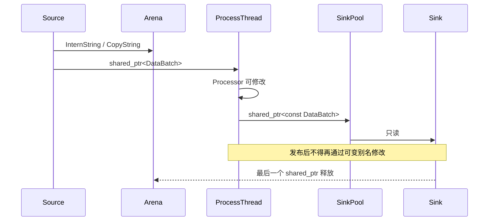

# 04 数据模型与内存生命周期

Pipeline 传递的基本单位不是单条记录，而是 `DataBatch`。理解数据模型的关键是两件事：

1. **哪些内存属于批次**：字符串在 Arena 里，容器和元数据仍各自堆分配。
2. **谁在什么时候可以改**：Processor 可以改，发布给 Sink 后只能读。

返回 [设计总览](./index.md)。

## 1. 数据结构

<div style="overflow-x: auto; margin: 1.5rem 0;">



</div>

## 2. Record 与 FieldValue

`Record` 包含：

- `Timestamp timestamp`
- `std::vector<Label> labels`
- `std::unordered_map<std::string_view, FieldValue> fields`

`FieldValue` 支持：

```cpp
using FieldValue = std::variant<std::monostate, bool, int64_t, uint64_t,
                                double, std::string_view>;
```

要点：

- 标签和字段键值都是 `string_view`，**必须指向寿命足够的内存**。
- 没有全局 schema、单位校验或标签基数限制。
- 字段名重复时，后写入的覆盖先写入的。
- 字段哈希表的键不能被原地改写，否则会破坏哈希查找。

## 3. StackSample 与 StackFrame

`StackSample` 同时支持 On-CPU 和 Off-CPU：

| 字段 | 含义 |
| --- | --- |
| `pid` / `tid` / `cpu` | 进程、线程、CPU |
| `comm` | 进程名（string_view） |
| `kernel_stack` / `user_stack` | 栈帧数组 |
| `count` | 合并后的采样次数 |
| `duration_ns` | Off-CPU 持续时间 |
| `sample_type` | `kOnCpu` / `kOffCpu` |
| `kernel_stack_id` / `user_stack_id` | eBPF 侧栈 ID |

`StackFrame` 保存地址、函数名、源文件、行号、模块名。但不同输出格式会丢字段（见第 8 节）。

## 4. Arena：批内 bump 分配

Arena 是碰撞指针分配器：

```cpp
void* Allocate(size_t size, size_t alignment) {
    size_t aligned = AlignUp(current_offset_, alignment);
    if (aligned + size > current.capacity) {
        AllocateBlock(max(block_size_, size + alignment));
        aligned = 0;
    }
    void* ptr = current.data + aligned;
    current_offset_ = aligned + size;
    return ptr;
}
```

<div style="overflow-x: auto; margin: 1.5rem 0;">



</div>

关键边界：

- 默认 `DataBatch` 构造时就会分配 64KiB 首块；使用外部共享 Arena 构造则不会。
- `Reset()` 只保留第一块，释放后续块，并把 offset 归零。
- `New<T>` 使用 placement new；**Arena 不调用析构函数**。
- 分配失败会先调用 OOM 回调再重试，仍失败则 `abort()`；没有可恢复的 `Status` 通道。
- Arena 只管理放进去的字符串/对象；`records_`、`fields`、`metadata`、驻留缓存仍是独立堆分配。

所以不要宣称“整个批次零分配”或“连续内存”。

## 5. 字符串驻留

`InternString` 先查当前批次的缓存，未命中才复制进 Arena：

```cpp
std::string_view InternString(std::string_view s) {
    if (s.empty()) return {};
    auto it = intern_cache_.find(s);
    if (it != intern_cache_.end()) return it->second;
    auto interned = arena_->CopyString(s);
    intern_cache_.emplace(interned, interned);
    return interned;
}
```

```cpp
auto batch = std::make_shared<DataBatch>(DataBatch::Type::kMetrics);
auto& record = batch->AddRecord();

std::string name = "worker";
record.labels.push_back({batch->InternString("source"),
                         batch->InternString(name)});
record.SetField(batch->InternString("value"), uint64_t{42});
```

- `name` 销毁后，标签值仍有效，因为已经复制进 Arena。
- 不同批次默认不共享驻留表。
- 返回的 `string_view` 依赖该批次 Arena 存活。
- 继续 `AddRecord()` 可能让 `records_` 扩容，之前保存的 `Record&` 会失效。

## 6. 所有权与可变性

<div style="overflow-x: auto; margin: 1.5rem 0;">



</div>

| 阶段 | 可变性 | 说明 |
| --- | --- | --- |
| Source 构造 | 可变 | 填充记录、驻留字符串 |
| 通道中 | 可变（但不应修改） | 所有权已移交 |
| Processor | 可变 | 原地改或返回新批 |
| 发布给 Sink | 只读（`ConstDataBatchPtr`） | 契约约束；无法撤销上游别名 |
| 所有 Sink 完成 | 释放 | 最后一个所有者销毁批次与 Arena |

### 6.1 拷贝是浅拷贝

`DataBatch` 没有删除拷贝构造。拷贝一个批次会共享同一个 `Arena` 和所有 `string_view`：

```cpp
DataBatch copy = *batch;   // 共享 Arena，不是深拷贝
```

不要在别名上调用 `Clear()` 或复用 Arena。

### 6.2 Clear 的真实行为

```cpp
void Clear() {
    records_.clear();
    stack_samples_.clear();
    intern_cache_.clear();
    arena_->Reset();
    // metadata_ 不会被清空
}
```

- 记录、栈样本、驻留缓存被清空。
- Arena 首块保留但逻辑失效，后续分配会覆盖旧字节。
- 仍持有该批次 `shared_ptr` 或 `string_view` 的其他消费者会看到空数据/悬空视图。
- **metadata 不会被清空**；复用批次时要手动管理。

### 6.3 Processor / Aggregator 的寿命规则

- Processor 返回新批次时，不能只复制旧批次的 `string_view` 然后丢掉旧批次。
- Aggregator 跨批保存数据时，必须保留完整批次所有权，或复制到自己的长期存储。
- Sink 只读；但 Sink 可以保留 `ConstDataBatchPtr` 延长寿命。

## 7. 时钟与单位

| 位置 | 时钟 / 单位 | 用途 |
| --- | --- | --- |
| `Timestamp` | `system_clock`，Unix epoch 纳秒 | 观测数据时间 |
| `StackSample.duration_ns` | 纳秒 | Off-CPU 持续时间 |
| TimerWheel | `steady_clock` / `CLOCK_MONOTONIC` | 调度，不受校时影响 |
| Pipeline 刷新判断 | `steady_clock` | 超时兜底 |
| JSON `timestamp` | epoch 毫秒 | 截断纳秒 |
| `.ilr` 外层 `ts` | epoch 毫秒 | 写入时间 |
| `.ilr` `started_at` | epoch 毫秒 | 会话开始 |
| SQLite `timestamp_ns` | epoch 纳秒整数 | 历史查询 |

不能把单调时钟直接当 epoch 时间写入记录；系统校时也可能让墙钟顺序与文件行顺序不一致。

## 8. JSON 与 SQLite 的损失

### 8.1 JSON

`BatchToJson` 输出：

```json
{
  "pipeline": "demo_counter",
  "records": [
    {
      "timestamp": 1793750400050,
      "labels": {},
      "fields": {"value": 42}
    }
  ]
}
```

| 信息 | JSON 行为 |
| --- | --- |
| 纳秒时间戳 | 截断为毫秒 |
| `DataBatch::Type` | 不输出 |
| `metadata` | 不输出 |
| `StackFrame.file_name` / `line_number` | 不输出 |
| BPF stack id | 不输出 |
| 重复标签键 | JSON 对象后者覆盖前者 |

### 8.2 SQLite

`SqliteBackend::SerializeStack` 只序列化 `user_stack`，但**保留每帧的 `addr/fn/file/line`**。它丢掉的是：

- `kernel_stack`
- `cpu`
- `sample_type`
- `duration_ns`
- `kernel_stack_id` / `user_stack_id`

不要把 JSON 的“丢 file/line”与 SQLite 混为一谈。

### 8.3 类型边界

- JSON 文本不携带完整的 C++ 原生类型 schema。
- SQLite 查询把数字反序列化为 `double` / `int64_t` / `uint64_t` 之一；原始 `FieldValue` 的精确类型不一定能恢复。
- 大 `uint64_t` 在某些 JSON 消费端可能丢精度。

## 9. 成本模型

| 成本 | 说明 |
| --- | --- |
| 每批 64KiB 起步 | 默认构造即分配 Arena 首块 |
| `records_` 向量 | 扩容会移动 `Record`，使引用失效 |
| `fields` 哈希表 | 每记录一个，键为 `string_view` |
| `shared_ptr` | 跨线程传递的原子引用计数 |
| 序列化 | JSON 构造/解析、SQLite 绑定都会分配 |
| 驻留缓存 | 每批一个哈希表，减少重复字符串 |

## 小结

- `DataBatch` 是交付单位；字符串在 Arena，容器/元数据仍独立分配。
- `InternString` 只在批内去重；返回的 `string_view` 依赖 Arena 寿命。
- 默认批次从 64KiB 首块开始；`Clear` 不清 metadata，共享 Arena 不能单独 Reset。
- 发布给 Sink 后只读；Processor/Aggregator 要注意旧 Arena 的寿命。
- JSON 和 SQLite 都会丢失部分字段，不能当作无损快照。

## 边界与后续

- 没有全局 metric schema、单位校验、标签基数限制。
- `DataBatch` 拷贝是浅拷贝，容易误用。
- `Arena::New` 不调用析构，不适合复杂 RAII 对象。
- 没有跨进程数据格式或回放协议。

返回 [设计总览](./index.md) · 上一篇：[插件系统](./03-plugin-system.md) · 下一篇：[配置与状态](./05-configuration-and-status.md)
