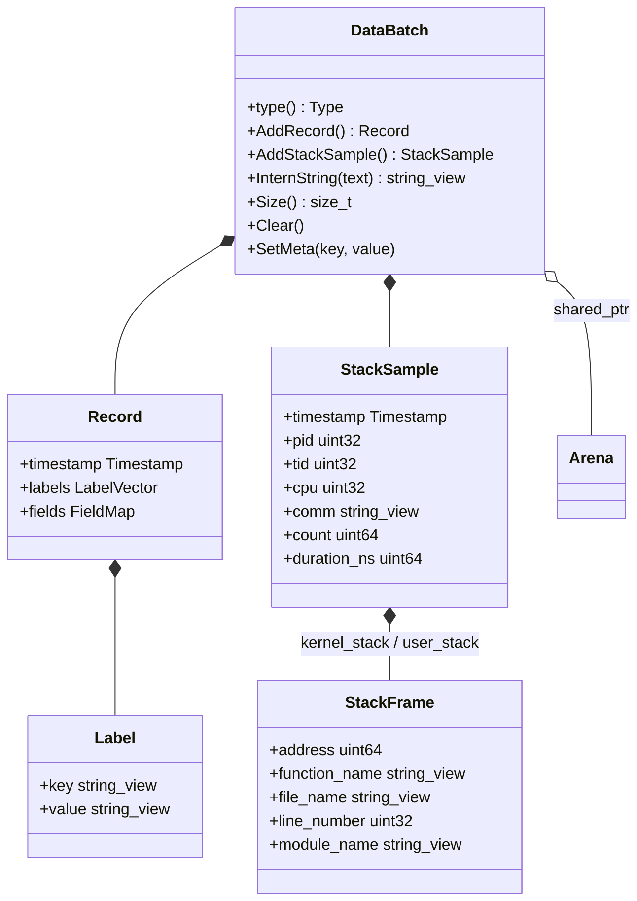
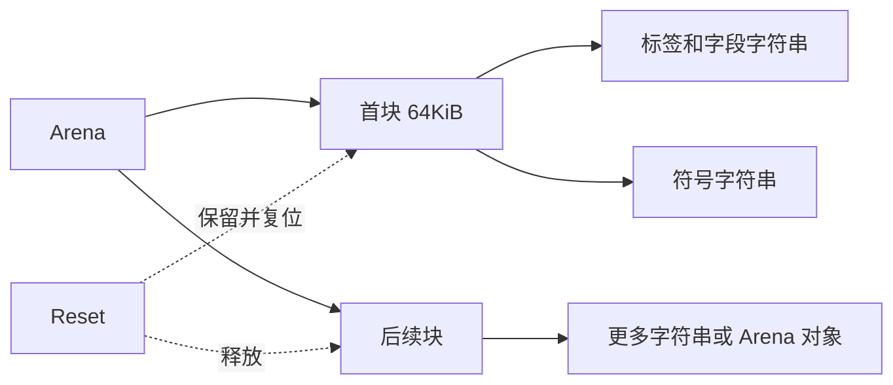
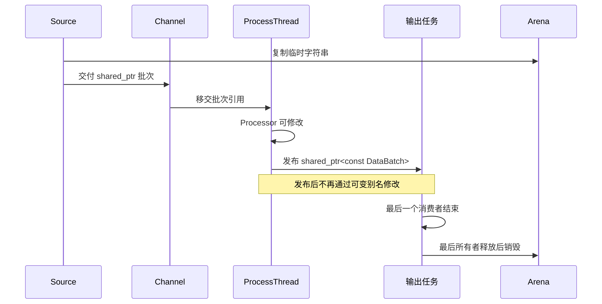

# 04 数据模型与内存生命周期

DataBatch 是 Pipeline 各阶段传递的基本单位。每批数据持有 Arena，标签、字段名和符号字符串通常以 string_view 引用 Arena 中的内存。批次通过 shared_ptr 穿过通道和输出任务，以明确所有权延长数据寿命。

这种设计减少批次传递中的深拷贝，但没有消除所有分配，也没有自动保证线程安全。返回 [设计总览](./index.md)。

## 1. 数据结构

<div style="overflow-x: auto; margin: 1.5rem 0;">



</div>

### 1.1 Record 与字段

Record 包含纳秒时间戳、标签向量和字段哈希表。标签键值均为 string_view，字段键也是 string_view。FieldValue 支持 monostate、bool、int64_t、uint64_t、double、string_view。

标签描述来源与分组维度，字段保存观测值。当前没有全局 metric schema、单位校验或标签基数限制；“字段为 double”不自动说明单位是百分比还是比例。插件及组装方需要明确约定并在文档中说明。

字段哈希表的键不允许悬空或被原地改写，否则除数据内容损坏外，还会破坏哈希查找语义。

### 1.2 StackSample 与栈帧

StackSample 包含 pid、tid、cpu、comm、count、内核栈、用户栈、采样类型和 duration_ns，以及 BPF 内核/用户 stack id。OnCPU 样本通常以 count 表达权重，OffCPU 可用 duration_ns 表达持续时间，具体统计含义由采样插件定义。

StackFrame 同时支持地址、函数名、源文件、行号和模块。原始地址的有效解析依赖采样时的二进制与映射信息；DataBatch 不会自动捕获 build-id、进程映射或符号版本。

### 1.3 批次类型与元数据

Type 枚举包括 Metrics、Profile、Trace、Log、Generic，但实际载荷只有 Record 和 StackSample 两类容器。标记为 Trace 或 Log 不会获得独立事件 schema。

Size 是 records 数加 stack_samples 数；AddRecord/AddStackSample 自动设置当前系统时间，若原始数据携带采样时间，Source 应主动覆写。批次 metadata 使用拥有字符串的 map 保存附加信息，不参与当前 BatchToJson 的完整输出。

## 2. 时钟与单位

| 位置 | 时钟 / 单位 | 用途 |
| --- | --- | --- |
| Timestamp | system_clock，自 Unix epoch 起纳秒 | 观测数据时间 |
| StackSample duration_ns | 纳秒时长 | OffCPU 等持续时间 |
| TimerWheel | CLOCK_MONOTONIC | 调度到期 |
| Pipeline 超期刷新 | steady_clock | 计算刷新间隔 |
| BatchToJson timestamp | epoch 毫秒 | 当前 JSON 输出 |
| `.ilr` 外层 ts / started_at | epoch 毫秒 | 写入时间与会话开始时间 |
| SQLite timestamp_ns | epoch 纳秒整数 | 历史查询 |

单调时钟不能直接当作 epoch 时间写入记录。系统时间校正也可能改变记录的墙钟顺序，不能只靠文件行顺序推导原始事件顺序。

## 3. Arena 的分配方式

Arena 通过块内 bump pointer 分配对齐内存，不为每个小对象单独调用 free。默认创建时即申请 64KiB 首块，空间不足时申请更多块；Reset 释放后续块并复用首块。

<div style="overflow-x: auto; margin: 1.5rem 0;">



</div>

Arena 只管理放进它的内存。Record 向量、字段 unordered_map、StackFrame 向量、metadata 与驻留缓存仍可能分别堆分配，因此不能宣称整个 DataBatch 是连续内存或零分配。

Arena 的 `New<T>` 使用 placement new，不在 Reset 时逐个调用 T 的析构函数。需要管理文件、堆内存或复杂 RAII 状态的对象，不应直接依赖 Arena Reset 完成资源清理。分配失败路径会调用回调、重试，仍失败时 abort；它不是可恢复的 Status 错误通道。

## 4. 字符串驻留

InternString 先查每批缓存，已有内容直接复用，否则复制到 Arena 并缓存。重复字段名、进程名、模块名可在一批内共享字节；不同批次默认不共享驻留表。

```cpp
auto batch = std::make_shared<illuminator::DataBatch>(
    illuminator::DataBatch::Type::kMetrics);
auto& record = batch->AddRecord();
std::string temporary_name = "worker";
record.labels.push_back({batch->InternString("source"),
                         batch->InternString(temporary_name)});
record.SetField(batch->InternString("counter"), uint64_t{42});
```

这段代码在 temporary_name 销毁后仍有效，因为字符串已被复制进该批次 Arena。直接把 temporary_name 转成 string_view 放入标签会悬空。字符串字面量本身寿命足够长，但统一驻留更易保持插件间一致规则。

注意继续 AddRecord 可能让 records 向量扩容，使此前保存的 Record 引用失效；批次共享所有权不能阻止内部 vector 的引用失效。

## 5. 跨线程寿命与发布规则

<div style="overflow-x: auto; margin: 1.5rem 0;">



</div>

ConstDataBatchPtr 约束 Sink 所见的访问接口，但不能撤销 Source 或 Processor 留下的 mutable shared_ptr。发布不可变是插件契约；向多个 Sink 发出后修改字段、Clear 或复用 Arena 都可能产生竞争与悬空视图。

Processor 返回新批次时，复制 Record 不会复制字符串字节。若新批次引用旧 Arena，必须确保 Arena 继续存活且不会 Reset；更直观的做法是向新批次重新 InternString。Aggregator 同样不能只保留 string_view 而丢弃其所有者。

### 5.1 Clear 与共享 Arena

DataBatch::Clear 会清空记录、栈样本和驻留缓存，随后 Reset Arena，**不会清空 metadata**。重复使用批次时需要主动管理旧元数据。

多个 DataBatch 可以共享同一 Arena，但一个批次 Clear 后会使其他批次引用的字节失效或被复写。共享 Arena 不等于拥有独立可回收区域，也不是线程安全内存池。当前最稳妥的默认方式是每批独立 Arena，等所有消费者释放后再回收。

## 6. JSON 表达与信息损失

BatchToJson 输出对象包括 pipeline、records，以及非空时的 stack_samples。Record 以 timestamp、labels 对象、fields 对象表示；monostate 序列化为 null。栈帧输出 address、可选 function_name 和 module_name。

```json
{
  "pipeline": "demo_counter",
  "records": [
    {
      "timestamp": 1793750400000,
      "labels": {"source": "demo"},
      "fields": {"counter": 42}
    }
  ]
}
```

这是格式示例，不要求与 demo 当前所有字段完全一致。关键边界如下：

| 内存信息 | 当前 JSON 行为 |
| --- | --- |
| 纳秒 Timestamp | 除以 1000000，截为毫秒 |
| DataBatch Type / metadata | 未完整编码 |
| StackFrame 源文件与行号 | 未输出 |
| BPF stack id | 未输出 |
| 标签向量的重复键 | 写入 JSON 对象时后者覆盖前者 |
| 有符号 / 无符号整数 | JSON 文本不提供完整的原生类型 schema 契约 |

当前 JSON 是输出格式，不是完整、无损的批次快照协议。若后续要回放、跨进程传输或 schema 迁移，需要新增明确的版本、时间单位与反序列化契约。

## 7. 性能与扩展方向

批处理减少任务和调用次数，Arena 减少字符串碎片；代价是每批首块开销、字段哈希布局、shared_ptr 原子引用计数和序列化分配。性能验证应同时测批大小、字段数、标签基数、栈深度及输出扇出数。

后续可评估安全的 Batch/Arena 复用、固定 schema 字段布局、按字节预算和版本化事件信封。复用必须建立在消费者已完成的证据之上，不能以“入队后过了一段时间”作为回收条件。

源码依据：`src/core/common/data_batch.h`、`json_serializer.h`、`src/core/memory/arena.h`；持久化损失与格式边界另见 [08](./08-recording-and-storage.md)。
