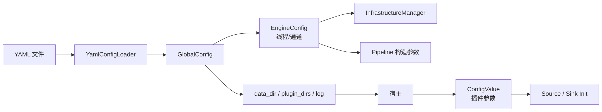

# 05 配置与状态

Illuminator 有两套配置，解决的问题不同：

1. **`GlobalConfig` / `EngineConfig`**：运行资源，如线程数、通道容量、丢包策略。
2. **`ConfigValue`**：传给单个插件的键值参数。

理解它们的分工，才能明白为什么“改了 YAML 却没有 Processor 链”。

返回 [设计总览](./index.md)。

## 1. 两层配置

<div style="overflow-x: auto; margin: 1.5rem 0;">



</div>

| 层 | 类型 | 谁消费 | 典型内容 |
| --- | --- | --- | --- |
| 全局 | `GlobalConfig` | 宿主、Infrastructure | 日志、数据目录、插件目录 |
| 引擎 | `EngineConfig` | Infrastructure、Pipeline | 采集/输出线程数、通道容量、水位 |
| 插件 | `ConfigValue` | 各插件 `Init` | `feature_name`、`output_dir`、`max_file_mb` |

## 2. YAML 结构

```yaml
global:
  log_level: info
  log_file: ""
  log_max_size: 10485760
  log_max_files: 3
  data_dir: ./data
  plugin_dirs:
    - /opt/illuminator/plugins

engine:
  collect_pool_threads: 2
  sink_pool_threads: 4
  channel:
    size: medium          # small | medium | large
    drop_policy: drop_newest
    backpressure_high: 0.8
    backpressure_low: 0.2
```

### 2.1 默认值

| 键 | 默认 | 说明 |
| --- | --- | --- |
| `global.log_level` | `info` | trace/debug/info/warn/error |
| `global.log_max_size` | 10MiB | 日志轮转大小 |
| `global.log_max_files` | 3 | 轮转文件数 |
| `global.data_dir` | `./data` | 数据目录 |
| `engine.collect_pool_threads` | 0 → 2 | 0 表示自动 |
| `engine.sink_pool_threads` | 0 → `max(2, CPU/2)` | 0 表示自动 |
| `engine.channel.size` | `medium` | 1024 / 4096 / 16384 |
| `engine.channel.drop_policy` | `drop_newest` | 或 `drop_oldest` |
| `backpressure_high` | 0.8 | 必须 > low |
| `backpressure_low` | 0.2 | ≥ 0 |

### 2.2 校验范围

加载器只校验：

- 日志级别是否在允许集合。
- channel size 是否是 small/medium/large。
- drop policy 是否是 drop_newest/drop_oldest。
- `high > low`，且都在 `[0,1]`。

**不校验**：

- 线程数是否合理（0 会被替换，负值在 YAML 转 unsigned 时可能出问题）。
- 插件参数是否存在、类型是否正确。
- 定时器周期是否为正。
- PidManager 的目标进程名。

## 3. ConfigValue

`ConfigValue` 是扁平的 `string -> string` 映射，嵌套用点号表示：

```cpp
ConfigValue sink_config;
sink_config.Set("feature_name", "demo_counter");
sink_config.Set("output_dir", "/tmp/illuminator");

auto feature = sink_config["feature_name"].AsString("default");
```

### 3.1 operator[] 返回副本

```cpp
ConfigValue operator[](const std::string& key) const;
```

它返回一个新的 `ConfigValue`，不是引用。修改副本不会影响原对象：

```cpp
auto sub = config["engine"];
sub.Set("channel.size", "large");   // 不影响 config
```

### 3.2 类型转换

| 方法 | 行为 |
| --- | --- |
| `AsInt(def)` | `stoll`；失败返回默认值 |
| `AsDouble(def)` | `stod`；失败返回默认值 |
| `AsString(def)` | 原样返回；不存在返回默认值 |
| `AsBool(def)` | 只认 `"true"` 和 `"1"` |
| `AsList()` | 依赖 `_size` 和 `0..n-1` 键；否则按单值处理 |

`AsBool("yes")` 返回 false；这是常见踩坑点。

### 3.3 嵌套读取

```cpp
// values_ 中实际存的是 "engine.channel.size"
auto channel = config["engine"];      // 得到 "channel.size" 子键
auto size = channel["channel"].AsString("medium");
```

不要在插件里假设 `ConfigValue` 有 schema；插件应自己校验并给出默认值。

## 4. Status / StatusOr

```cpp
Status Ok();
Status Error(StatusCode code, string_view msg);
Status Wrap(Status inner, string_view context);

template <typename T> class StatusOr {
    bool ok() const;
    T& value();
    const Status& status() const;
};
```

| 错误码 | 典型用途 |
| --- | --- |
| `kInvalidArgument` | 参数非法 |
| `kNotFound` | 插件/资源不存在 |
| `kAlreadyExists` | 重复注册/重复开始 |
| `kPermissionDenied` | 只读 SQL 被拒 |
| `kResourceExhausted` | 资源耗尽 |
| `kInternal` | 系统调用/IO 失败 |
| `kUnimplemented` | 可选能力未实现 |
| `kUnavailable` | 组件未运行/不可用 |
| `kDataLoss` | 数据损坏 |
| `kRequiresRestart` | 参数已保存但需重启 |

`Status::Wrap` 形成一个错误链，`cause()` 可读取内层错误：

```cpp
return Status::Wrap(inner, "open recording file");
```

设计上禁止用异常作为正常控制流，但第三方库（filesystem、分配器、YAML）仍可能抛异常；边界处应捕获。

## 5. Reconfigure

```cpp
Status Reconfigure(const ConfigValue& params);
```

Pipeline 的顺序：

```text
Source → Processor[] → Aggregator → Sink[]
```

规则：

- `kOk`：继续。
- `kUnimplemented`：跳过，继续。
- `kRequiresRestart`：记录标志，继续；最终返回 `kRequiresRestart`。
- 其他错误：立即返回。
- 不冻结 Source / ProcessThread。
- 不回滚已经修改的组件。
- 在调用线程直接执行，不经过 ProcessThread。

因此 `Reconfigure` 是“尽力通知”，不是事务性重配置。需要强一致切换时，宿主应停管道、重配、再启动。

## 6. CLI 与 SDK 的差异

CLI 的 `run`：

- 只创建一个 Source 和一个 Sink。
- Source 用空 `ConfigValue{}` 初始化。
- 不组装 Processor/Aggregator。
- 采集间隔取 `Source::IntervalMs()`。
- 录制由 CLI 显式开始。

SDK 使用方：

- 自己创建 `ConfigValue` 并 `Init` 每个插件。
- 自己组装 Processor/Aggregator/Sink。
- 自己注册采集和 Flush 定时器。
- 自己管理关闭顺序。

**YAML 不是编排语言**：它不能定义 Pipeline 图、Processor 链、Sink 扇出或定时器。复杂拓扑必须在 C++ 宿主中组装。

## 7. 配置错误的典型表现

| 现象 | 可能原因 |
| --- | --- |
| 启动时报 `Invalid channel.size` | YAML 写了不支持的字符串 |
| 反压阈值不生效 | high/low 写反或超出 `[0,1]` |
| 插件收不到参数 | `ConfigValue` 键名不匹配；`operator[]` 副本未回写 |
| `AsBool` 总是 false | 值写成 `yes`/`on`，只认 `true`/`1` |
| 动态库没加载 | 目录不存在/路径不在允许目录；单个失败只打日志 |
| 改了 Reconfigure 但行为未变 | 插件返回 `kRequiresRestart` 或未实现 |

## 小结

- 两层配置：全局/引擎配置由 YAML 加载，插件参数由 `ConfigValue` 传递。
- YAML 只校验少量枚举和阈值，不是 schema。
- `ConfigValue` 是扁平字符串映射，`operator[]` 返回副本。
- `Status` 用返回值表达错误；`Reconfigure` 不冻结、不回滚。
- YAML 不负责编排 Pipeline。

## 边界与后续

- 没有插件配置 schema 校验。
- 线程数、定时器周期、插件参数缺少统一校验。
- `ConfigValue` 没有类型信息，复杂结构需要编码约定。
- 没有配置热加载协议；`Reconfigure` 只是逐组件通知。

返回 [设计总览](./index.md) · 上一篇：[数据模型与内存](./04-data-and-memory.md) · 下一篇：[调度与自观测](./06-scheduling-and-observability.md)
