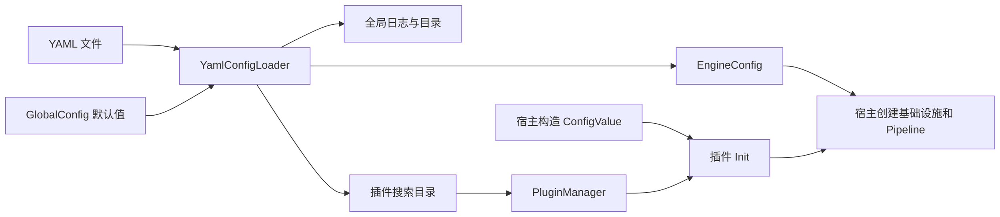
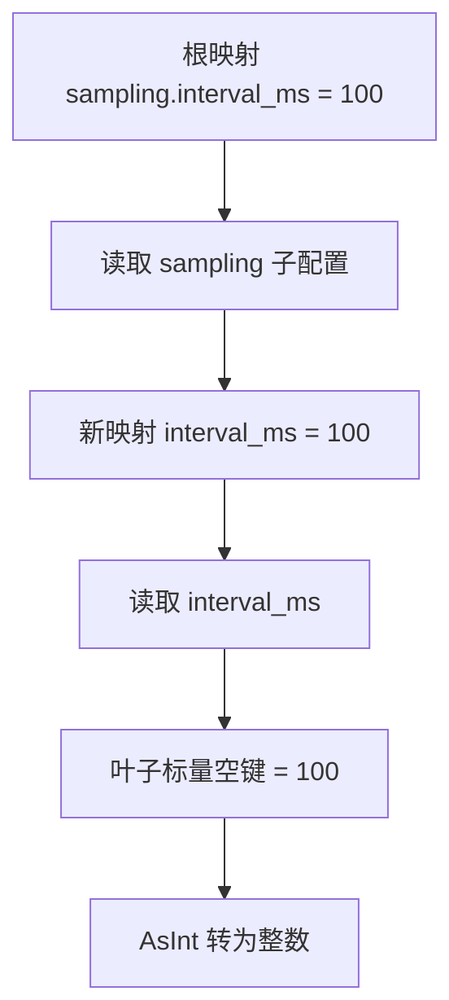

# 05 配置与错误处理

配置分为全局运行资源和插件参数两层。GlobalConfig 描述日志、目录、线程池和通道默认项；ConfigValue 以扁平字符串映射向插件传参。宿主将两者转换为具体实例和调度安排，当前 YAML 不提供完整 Pipeline 声明式装配。

返回 [设计总览](./index.md)。本篇依据 `src/core/common/config.h`、`yaml_config_loader.h`、`status.h` 和 `src/cli/main.cc`。

## 1. 配置流向

<div style="overflow-x: auto; margin: 1.5rem 0;">



</div>

CLI 显式传 `--config` 时读取该文件，未指定时使用结构体默认值；不会隐式读取当前目录同名配置。插件发现用 global.plugin_dirs，Source 的具体参数则需要另一层组装逻辑。

## 2. 全局配置与默认值

| 项 | 默认值 | 含义 |
| --- | --- | --- |
| global.log_level | info | trace/debug/info/warn/error |
| global.log_file | 空字符串 | 仅控制台日志 |
| global.log_max_size | 10485760 | 单日志文件轮转大小，字节 |
| global.log_max_files | 3 | 轮转文件数量 |
| global.data_dir | `./data` | CLI 默认输出目录 |
| global.plugin_dirs | 空列表 | 动态插件搜索目录 |
| engine.collect_pool_threads | 0 | 自动取 2 |
| engine.sink_pool_threads | 0 | 自动取 max(2, 硬件并发数/2) |
| engine.channel.size | medium | small / medium / large |
| engine.channel.drop_policy | drop_newest | drop_newest / drop_oldest |
| engine.channel.backpressure_high | 0.8 | 高水位比例 |
| engine.channel.backpressure_low | 0.2 | 低水位比例 |

仓库的 `illuminator.yaml.example` 显式设置采集池为 2、输出池为 4，与结构体中“0 表示自动”的默认值不同。

```yaml
global:
  log_level: info
  log_file: ""
  log_max_size: 10485760
  log_max_files: 3
  data_dir: ./data
  plugin_dirs: []

engine:
  collect_pool_threads: 2
  sink_pool_threads: 4
  channel:
    size: medium
    drop_policy: drop_newest
    backpressure_high: 0.8
    backpressure_low: 0.2
```

YAML 加载器校验日志级别、通道容量枚举、丢弃策略、比例范围及 high>low 等基础条件；这不等于所有插件和底层 API 已有严格 schema。直接构造 Pipeline、ThreadPool 或 TimerWheel 的使用方仍需检查自己的参数。

旧的 server、Feature 自动启停和前端字段不再属于当前配置契约，不应从历史样例迁入新宿主。

## 3. ConfigValue 的扁平存储

ConfigValue 内部为 `unordered_map<string,string>`，子对象通过点号前缀表达。例如 `config.Set("sampling.interval_ms", int64_t{100})` 对应 `sampling.interval_ms → "100"`。

读取 `config["sampling"]` 会生成一个新 ConfigValue，包含去掉前缀后的 `interval_ms → "100"`；读取叶子会将值放到子容器的空键中，供 AsInt 等转换方法访问。

<div style="overflow-x: auto; margin: 1.5rem 0;">



</div>

### 3.1 正确写入方式

```cpp
illuminator::ConfigValue config;
config.Set("sampling.interval_ms", int64_t{100});
config.Set("output_dir", "/tmp/illuminator");
auto interval_ms = config["sampling"]["interval_ms"].AsInt(1000);
```

`operator[]` 返回副本，所以 `config["output_dir"] = "..."` 只修改临时对象，不会写回根配置。Set 接收字符串或 int64；需要浮点和布尔参数时，可以显式写对应的字符串文本。

### 3.2 列表表示

列表以 `_size` 和索引键存储，例如 `plugin_dirs._size=2`、`plugin_dirs.0=/opt/a`、`plugin_dirs.1=/opt/b`。AsList 按声明的大小恢复；标量字符串也可作为单元素列表返回。当前不是递归类型树，不应把它当作带类型校验的 JSON DOM。

### 3.3 类型转换的宽松行为

| 方法 | 当前行为 | 使用影响 |
| --- | --- | --- |
| AsInt / AsDouble | 缺失或转换异常时返回默认值 | 非法参数可能被掩盖，转换也不是严格完整文本校验 |
| AsString | 有标量则返回，否则用默认值 | 不检查路径和业务枚举 |
| AsBool | 缺失时用默认值；仅 true、1 为真 | 存在但未知的文本返回 false，即使默认值是 true |
| AsList | 从索引恢复，失败时可为空 | 需要调用方验证数量和每项内容 |

插件应在 Init 中校验范围与组合关系，返回带插件名、参数名和预期值的 kInvalidArgument。涉及文件、内核能力等外部条件的校验还应在 Start 阶段处理。

## 4. CLI 与 SDK 的装配差异

当前 CLI 的 run 使用空 ConfigValue 调用 Source::Init；recording Sink 则获得 feature_name 和 output_dir 等参数。它没有按 YAML 创建任意 Processor/Aggregator 链，也没有通用插件参数树映射。

需要复杂配置的嵌入方应显式完成：选择工厂 → 构造每个插件 ConfigValue → 调用 Init → 转移到 Pipeline → 设置共享资源 → Start。不要把未实现的 `pipelines:` 配置作为现有命令行功能。

## 5. Status 与 StatusOr

Status 保存 code、message 和可选 cause；Wrap 可以附加上层上下文而保留原始错误码。`StatusOr<T>` 通过 variant 保存成功值或 Status，适合带所有权结果与错误同时表达。

```cpp
auto result = source->Collect();
if (!result.ok()) {
    return illuminator::Status::Wrap(result.status(), "collect my_source");
}
auto batch = std::move(result.value());
if (batch && !batch->Empty()) {
    pipeline.Enqueue(std::move(batch));
}
```

只在 `!ok()` 时读取 StatusOr::status，只在 ok 时读取 value。当前 StatusOr 以 variant 当前分支判断成功，不能用 `StatusOr<T>(Status::Ok())` 代替一个成功 T，这会构造状态分支而非值分支。

| 常用错误码 | 建议场景 |
| --- | --- |
| kInvalidArgument | 参数范围、格式或组合不合法 |
| kNotFound | 指定插件、目标或文件不存在 |
| kPermissionDenied | 动态库路径限制或访问权限不足 |
| kResourceExhausted | 明确的资源耗尽 |
| kInternal | 底层系统调用或内部操作失败 |
| kUnimplemented | 可选能力未实现 |
| kUnavailable | 当前生命周期状态不允许操作 |
| kDataLoss | 已识别的数据损坏或丢失 |
| kRequiresRestart | 参数已保存，需要重启才能生效 |

框架以返回值处理预期错误，但编译并未全面禁止 C++ 异常；filesystem、分配及第三方库仍可能抛异常。输出任务异常被 future 保存的细节见 [02](./02-pipeline-v3.md)。

## 6. 运行期重配置

<div style="overflow-x: auto; margin: 1.5rem 0;">


</div>

Pipeline 对 OK、Unimplemented 和 RequiresRestart 继续遍历；若任何组件要求重启，最终返回 RequiresRestart；其他错误会立即返回。此前成功组件不会自动回滚，因此一次失败也可能已经部分生效。

方法直接运行在调用线程，不自动切换到 ProcessThread，也不冻结 Collect。当前 CLI 不开放运行期重配置。宿主应停机后修改，或自行建立互斥与静默期。

后续建议为插件增加严格 schema、完整文本转换和统一校验入口，并将运行命令通过可确认的处理队列提交。需要事务语义时，还要设计 validate/prepare/commit 或回滚机制；仅新增配置字段无法解决一致性问题。
