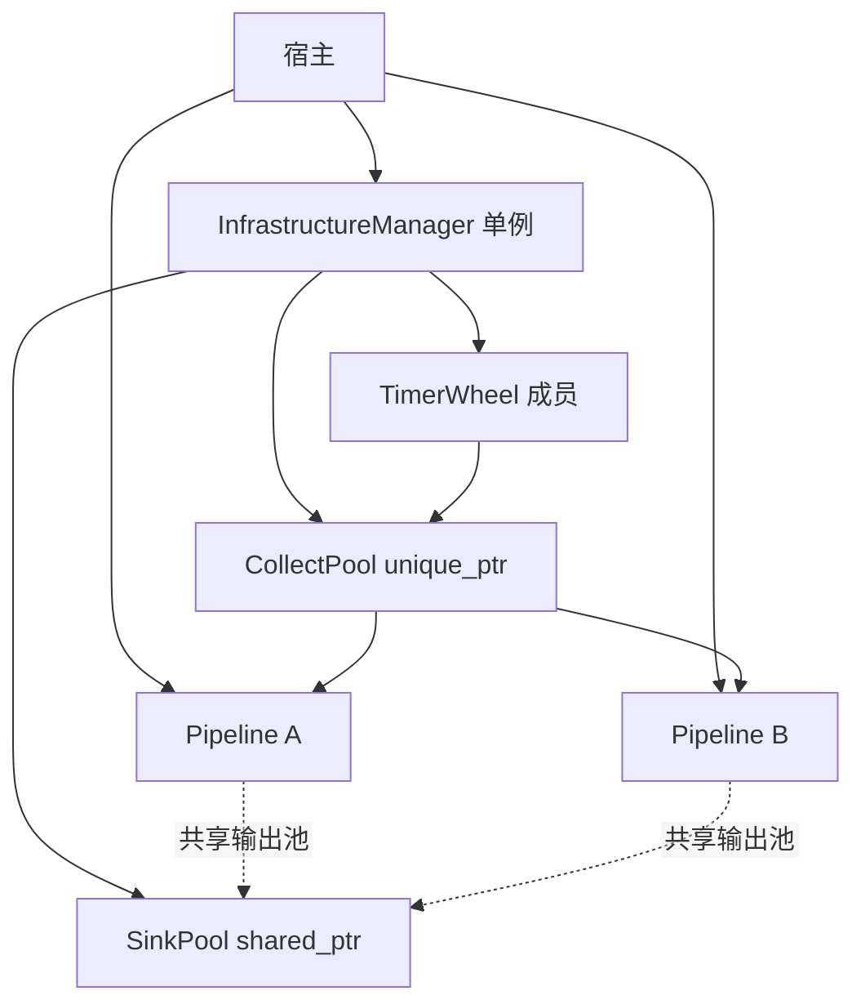
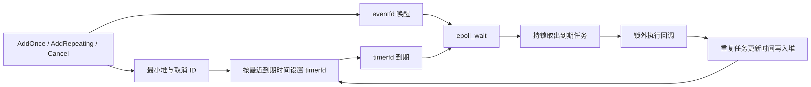
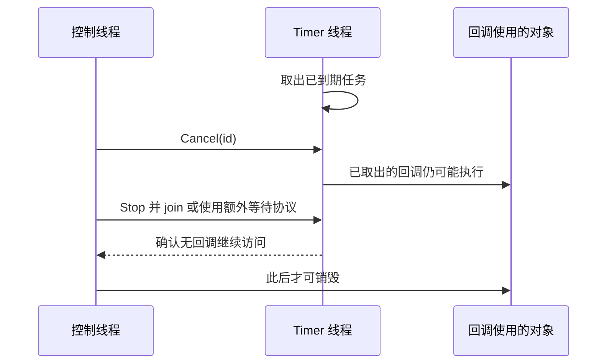
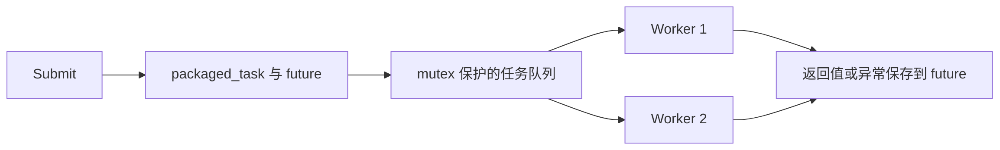
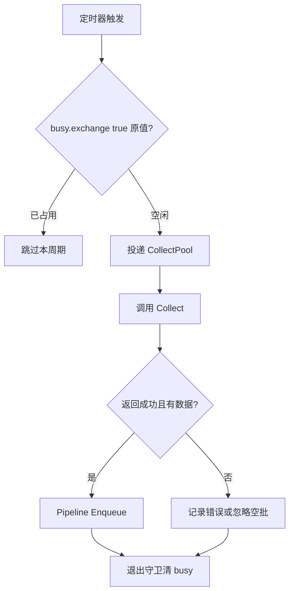
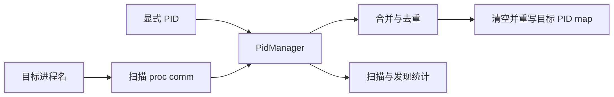

# 06 调度、线程与自观测

公共基础设施提供定时调度和共享工作线程，不拥有业务管道。宿主把调度回调与 Pipeline 连接起来，并负责在关闭前让外部任务静默。这一分工让同一引擎既可由 CLI 驱动，也可被其他程序嵌入。

返回 [设计总览](./index.md)。整管道关闭时序见 [02](./02-pipeline-v3.md)。

## 1. InfrastructureManager

Start 根据 EngineConfig 创建两类线程池，并启动 TimerWheel。采集线程配置为 0 时使用 2，输出线程配置为 0 时使用 `max(2, hardware_concurrency/2)`。这里的自动值不同于 ThreadPool 自身“传入 0 则至少 1 线程”的兜底行为。

Manager 的 Stop 按 Timer → CollectPool → SinkPool 停止，但它并不知道 Pipeline 是否已经完成最终输出。CLI 先手动停 Timer、排空 Collect，再 Stop Pipeline，最后调用 Manager Stop；Manager 内部重复停止已静默资源不会替代这个顺序。

当前启动没有完整地将 TimerWheel fd 创建、epoll 注册等错误传播到宿主，返回 OK 不能单独证明定时器有效。未来应把底层初始化状态改为显式可检查结果。

## 2. TimerWheel：基于最小堆的 Linux 定时器

虽然类名为 TimerWheel，实际数据结构是按 next_fire 排序的 priority_queue 最小堆，不是分层时间轮。内核侧使用 timerfd、eventfd 与 epoll，用户态维护任务 ID、间隔和回调。

### 2.1 到期与重复策略

TimerWheel 使用 CLOCK_MONOTONIC，不随墙钟校时跳变。重复任务按 `next_fire += interval` 更新，而不是按回调结束时间重新计算。这样减少长期漂移，但当线程被阻塞或机器繁忙时可能出现过期任务追赶。

因此定时器适合做 dispatch，不适合执行文件扫描、大量符号解析或阻塞 I/O。一个长回调会影响同一个 TimerWheel 上其他管道的触发延迟。

### 2.2 取消与回调寿命

Cancel 记录 ID，后续通过重建堆懒删除。回调若已经从堆中弹出进入待执行数组，Cancel 不会等待或撤回它。

AddRepeating 当前不拒绝零或负间隔。CLI 校验 Source 间隔为正；SDK 使用方必须在调用前验证自己的间隔。非法间隔可能导致持续立即触发，不能仅依赖配置默认值避免。

## 3. ThreadPool 的任务模型

ThreadPool 使用 mutex、condition_variable 和无界 FIFO 任务队列。Submit 将工作包装为 packaged_task，返回 future；工作线程取出任务后在锁外执行。PendingTasks 返回等待队列长度，不含已取出的运行任务。

DrainAndStop 设置 stop，通知并 join 工作线程；线程在 stop 且队列空时退出，因而会执行关闭前已排队的任务。不过 Submit 当前没有检查 stop，停止后仍能排队，任务可能永远没有工作线程执行。宿主必须先撤销生产者，再关闭池。

线程池也没有硬容量、优先级、deadline 或公平性保证。SinkPool 的 128/256 阈值由 Pipeline 在提交前观察，不能改变底层无界队列性质。

## 4. Collect 调度与防重入

CLI 为 Source 使用一个共享 atomic busy 标记：到期时若上一次任务尚未结束，就跳过本次触发；成功取得标记后投递 Collect，任务退出守卫负责恢复标记。

这个策略选择跳过周期，而不是为一个 Source 无限累积采集任务。实际采集频率可能低于 IntervalMs 声明值。它是 CLI 的宿主策略，不是 SourcePlugin 或 Pipeline 自动提供的框架保证。

busy 也不等待外部 Reconfigure、Pause 或 Stop；这些操作需要另行协调。固定 interval 定时任务不会因为 Source 后来改变 IntervalMs 而自动重建。

## 5. PID 管理公共设施

`src/core/engine/pid_manager.h` 支持显式 PID、按 `/proc/[pid]/comm` 精确匹配的进程名发现、活跃 PID 合并，以及可选 BPF map 同步。可通过 TimerWheel 注册默认 30 秒的自动发现。

当前查重使用线性遍历，map 同步倾向于全量重写，较多 PID 时需要关注扫描和锁持有成本。ScanProc 在本次匹配结果为空时提前返回，不能据此保证旧发现集合立即被全部清理；接入时还应验证进程退出和 PID 复用场景。

自动发现回调捕获 this。Unregister 只 Cancel 定时任务，析构前仍需确认已取出的回调不再访问对象。类中保留的 feature_name 仅用于标识与日志，不表示恢复 Feature 框架。

## 6. 内部指标与资源检查

InternalMetrics 提供 Counter、Gauge 和延迟摘要，支持 JSON 与 Prometheus 文本导出。当前没有 HTTP `/metrics` 服务；宿主若要对外暴露，需要自行提供传输层。

| 能力 | 实现 | 实际边界 |
| --- | --- | --- |
| Counter | 名称映射，累计 uint64 | Pipeline 的一些累计值以 Gauge 同步，需看具体名称 |
| Gauge | 名称映射，保存 double | 快照不等于跨指标原子一致的业务状态 |
| 延迟摘要 | count、sum、min、max；文本中计算 avg | 没有桶、P95 或 P99 |
| 并发访问 | 所有映射共享一个 mutex | 热路径频繁调用可能产生锁竞争 |
| RSS 检查 | 读取 `/proc/self/statm`，默认阈值 512MiB | 超限标记与日志，不强制阻止分配 |

ResourceLimiter 的名称不表示硬内存隔离；Pipeline 仅在部分循环检查并告警。Arena 分配失败也不会通过 ResourceLimiter 自动回退。

## 7. 运行与性能调优原则

先区分瓶颈位于 Collect、Process、Aggregation 还是 Write，再决定增加线程、改变批次或限制数据量。增加 SinkPool 线程可能提高吞吐，也可能让更多任务同时争用同一文件锁；增加 Pipeline 数量会增加独立线程和通道常驻成本。

建议实测空闲 CPU、采集周期抖动、通道利用率与丢弃、窗口占用、输出排队时间、端到端延迟和 RSS。当前没有已验证的固定 CPU 百分比或百万事件吞吐承诺。

后续可改进停止后拒绝 Submit、硬性队列与字节预算、可等待定时句柄、分片指标、真正的延迟分布及 RuntimeContext 多实例隔离，优先级见 [10](./10-core-audit-and-evolution.md)。
