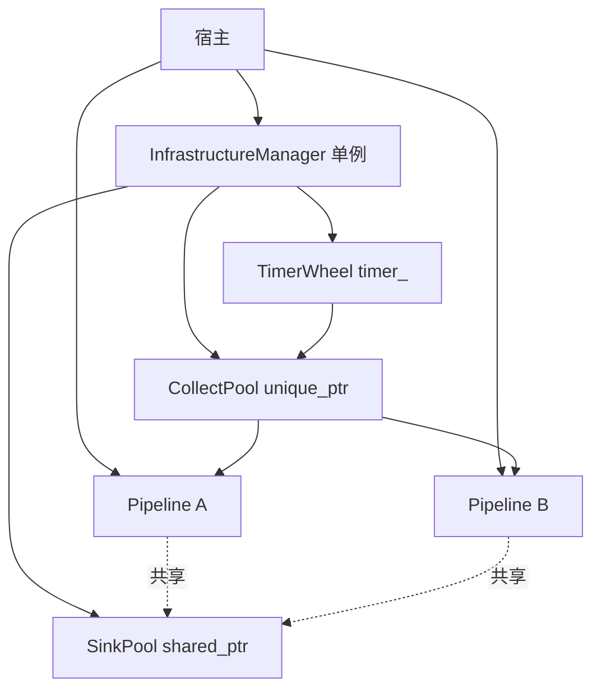
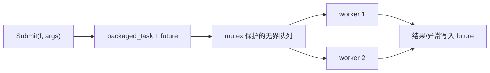
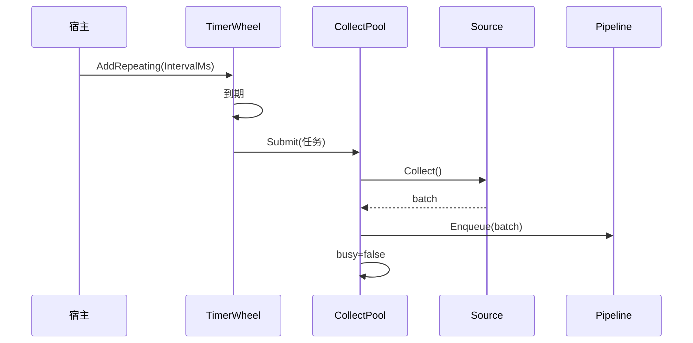
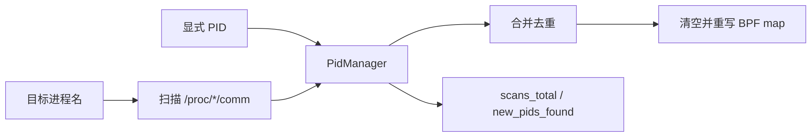

# 06 调度、线程池与自观测

公共基础设施负责“提供资源”，不负责“运行 Pipeline”。宿主把这些资源接到自己的调度回路上，并在关闭前排空外部生产者。

TimerWheel 的内部原理已在 [02/03 TimerWheel](./02-pipeline-v3/03-timer-wheel.md) 讲透；本篇只讲它在哪里被持有、如何被使用。

返回 [设计总览](./index.md)。

## 1. InfrastructureManager

<div style="overflow-x: auto; margin: 1.5rem 0;">



</div>

职责：

- 创建 CollectPool 和 SinkPool。
- 持有并启动 TimerWheel。
- 提供 `GetTimerWheel()` / `GetCollectPool()` / `GetSinkPool()`。

不负责：

- 构建 Pipeline。
- 注册定时器。
- 调用插件 `Init`。
- 管理 Pipeline 生命周期。

### 1.1 启动参数

```cpp
size_t collect_threads = config.collect_pool_threads > 0
    ? config.collect_pool_threads : 2;
size_t sink_threads = config.sink_pool_threads;
if (sink_threads == 0) {
    sink_threads = std::max(2u, std::thread::hardware_concurrency() / 2);
}
```

| 配置 | 实际值 |
| --- | --- |
| `collect_pool_threads = 0` | 2 |
| `collect_pool_threads = N > 0` | N |
| `sink_pool_threads = 0` | `max(2, hardware_concurrency()/2)` |
| `sink_pool_threads = N > 0` | N |

`ThreadPool` 自身对 0 的兜底是“至少 1 线程”，但这里已经把 0 替换掉，所以实际不会看到 1。

### 1.2 Stop 顺序

```text
TimerWheel.Stop()
  → CollectPool.DrainAndStop()
  → SinkPool.DrainAndStop()
```

但 Manager 不知道 Pipeline 是否完成最终输出。正确顺序是宿主先：

```text
Timer.Stop → CollectPool.DrainAndStop → Pipeline.Stop → Infrastructure.Stop
```

如果先停 SinkPool，Pipeline 的最终 Flush 任务没有 worker，`pending_writes_` 永不归零，`Stop()` 卡死。

## 2. ThreadPool

```cpp
class ThreadPool {
    std::vector<std::thread> workers_;
    std::queue<std::function<void()>> tasks_;
    std::mutex mutex_;
    std::condition_variable cv_;
    bool stop_ = false;
};
```

<div style="overflow-x: auto; margin: 1.5rem 0;">



</div>

| 行为 | 说明 |
| --- | --- |
| `Submit` | 包装为 `packaged_task`，返回 future |
| 队列容量 | 无界；不会丢弃 |
| `PendingTasks()` | 只返回 `tasks_.size()`，不含正在执行的任务 |
| `DrainAndStop()` | 设置 stop，唤醒并 join；会执行已排队任务 |
| 停止后 `Submit` | 仍可入队，但没有 worker 执行，future 永远不 ready |
| 任务异常 | 存入 future；worker 继续运行 |

SinkPool 的 128/256 阈值在 `Pipeline::SubmitToSinks`，不在 ThreadPool。ThreadPool 本身不做过载保护。

## 3. 宿主采集调度

Pipeline 不知道 `IntervalMs()`。CLI 负责：

1. 读取 `Source::IntervalMs()`。
2. 注册 TimerWheel 重复定时器。
3. 用 `busy` 原子闩防止重叠。
4. 把 `Collect()` 提交到 CollectPool。
5. 成功则 `Pipeline::Enqueue`。

<div style="overflow-x: auto; margin: 1.5rem 0;">



</div>

### 3.1 为什么用 busy

如果不防重入：

- 上一次 `Collect()` 还没结束，下一次定时又提交一个任务。
- 同一个 Source 可能被两个 CollectPool 线程同时调用。
- eBPF ring buffer、文件读取、内部计数器都可能冲突。

CLI 的策略是“跳过本周期”，不是“排队补采”。因此实际采样频率可能低于 `IntervalMs()`。

### 3.2 采集错误归属

```cpp
auto batch = source->Collect();
if (batch.ok()) pipeline.Enqueue(std::move(*batch));
else ++collect_errors;
```

采集错误由宿主计数，不进入 `Pipeline::ErrorCount()`。排障时要同时看两个计数。

### 3.3 Pause/Resume 与 Reconfigure

- `PauseCollection` / `ResumeCollection` 不会撤销已经提交的 Collect 任务。
- 定时器周期不会因为 Source 运行时改变 `IntervalMs()` 而自动重建。
- `Reconfigure` 直接调用插件，不经过 ProcessThread，也不冻结采集。
- 需要严格切换时，宿主应停 Timer、排空 Collect、重配、再启动。

## 4. TimerWheel 的使用方式

| 用途 | 注册者 | 回调内容 |
| --- | --- | --- |
| Source 采集 | 宿主 | `collect_pool->Submit(...)` |
| Aggregator 刷新 | 宿主 | `pipeline.InjectFlush()` |
| PidManager 自动发现 | PidManager | `ScanProc()` |
| 存储清理 | 宿主 | `Submit(Prune)`（当前没有内建实现） |

规则：回调只做轻量 dispatch。细节见 [02/03](./02-pipeline-v3/03-timer-wheel.md)。

## 5. PidManager

`PidManager` 维护目标 PID：

- 显式 PID：`SetTargetPids` / `AddPid` / `RemovePid`。
- 按进程名发现：扫描 `/proc/[pid]/comm`。
- 合并去重：`GetActivePids`。
- 可选同步 BPF map。
- 自动发现：`RegisterAutoDiscovery(tw, 30s)`。

<div style="overflow-x: auto; margin: 1.5rem 0;">



</div>

边界：

- 查重是线性遍历；PID 多时成本上升。
- `ScanProc` 持锁扫描 `/proc` 并全量重写 BPF map，会阻塞 TimerWheel 线程。
- 析构不自动 `Cancel`；TimerWheel 活得更久时，回调捕获的 `this` 可能悬空。
- `timer_id == 0` 表示“未注册”，但 TimerWheel 第一个 ID 就是 0；在全新 TimerWheel 上第一次注册可能得到 0，导致后续重复注册/无法取消。CLI 先注册采集定时器，所以通常不会触发。

## 6. InternalMetrics

```cpp
InternalMetrics::Instance().Inc("name");
InternalMetrics::Instance().SetGauge("name", value);
InternalMetrics::Instance().RecordLatency("name", us);
```

| 类型 | 语义 | 边界 |
| --- | --- | --- |
| Counter | 只增 | 无标签 |
| Gauge | 可增可减 | 无标签 |
| Histogram | count/sum/min/max | 无 P95/P99 |

导出：

- `ExportPrometheus()`：文本，前缀 `illuminator_`。
- `ExportJson()`：JSON。
- **没有 HTTP `/metrics` 端点**。

所有映射共享一把 mutex；高频写指标可能成为竞争点。

## 7. ResourceLimiter

```cpp
ResourceLimiter::Limits limits;
limits.max_memory_bytes = 512 * 1024 * 1024;
ResourceLimiter::Instance().SetLimits(limits);

auto usage = ResourceLimiter::Instance().Check();
if (usage.memory_exceeded) { /* WARN */ }
```

- 读取 `/proc/self/statm` 的 RSS。
- 默认 512MiB。
- 只告警、设置 `rss_bytes` gauge，不阻止分配。
- Pipeline 只在有数据的循环分支每 100 次检查一次。

它不是硬内存隔离，也不能替代 cgroup。

## 8. 性能调优原则

先定位瓶颈，再改参数：

| 瓶颈 | 证据 | 动作 |
| --- | --- | --- |
| Collect 慢 | 采集耗时、CollectPool 排队 | 增加采集线程 / 降低频率 |
| Process 慢 | 通道堆积、`BatchesProcessed` 上不去 | 优化 Processor / 拆 Pipeline |
| Aggregation 慢 | 窗口大、Flush 慢 | 缩小窗口 / 降低刷新频率 |
| Write 慢 | `sink_pool_pending` 高 | 增加写线程 / 换 Sink / 批量写 |
| 锁竞争 | CPU 高但吞吐低 | 检查 InternalMetrics、插件锁 |

不要只凭“无锁队列 + Arena”推导高性能；瓶颈常在 Sink、序列化或 Timer 回调。

## 9. 边界与后续

- `InfrastructureManager` 是进程级单例，没有多实例隔离。
- ThreadPool 无界、无优先级、无 deadline。
- 停止后 `Submit` 仍可入队但无人执行。
- PidManager 的定时器生命周期和 ID 0 语义有已知缺口。
- 指标没有标签、分位数和 HTTP 端点。

返回 [设计总览](./index.md) · 上一篇：[配置与状态](./05-configuration-and-status.md) · 下一篇：[eBPF SDK](./07-ebpf-sdk.md)
