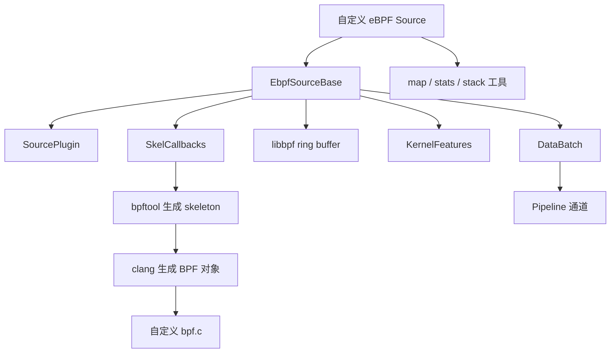
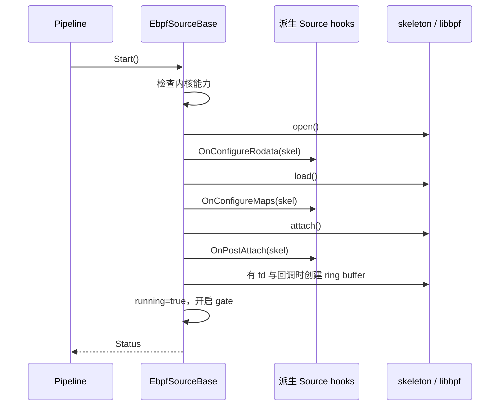
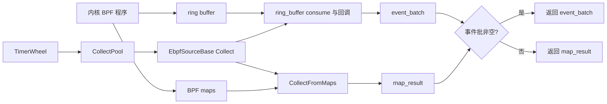
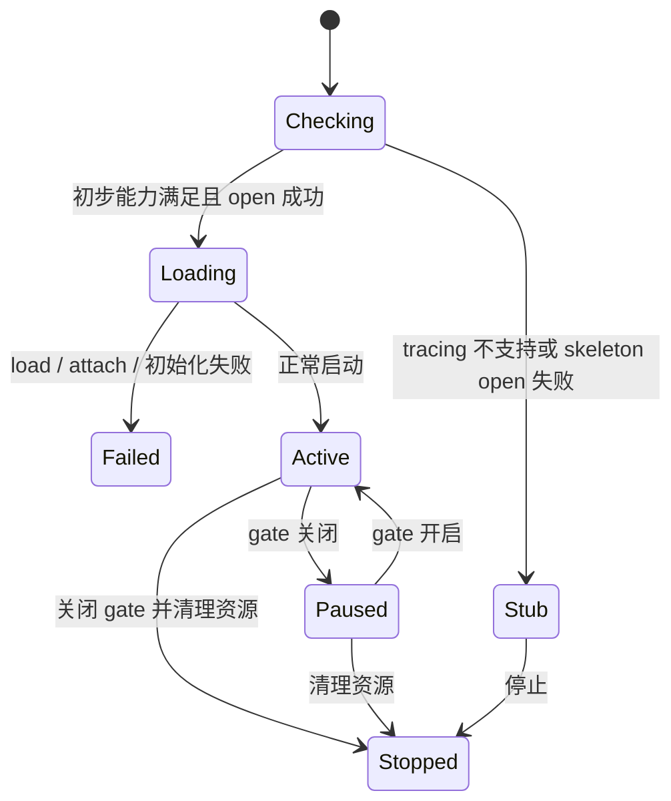

# 07 eBPF 公共采集设施

当前保留的是 eBPF 插件开发设施：Source 基类、skeleton 回调、内核能力探测、map 与堆栈工具、BPF 兼容头和 Bazel 生成规则。具体 CPU 采集实现已删除，因此“SDK 可编译”与“真实探针可采样”需要分别验证。

返回 [设计总览](./index.md)。一般插件接口见 [03](./03-plugin-system.md)。

## 1. 组件关系

内核探测文件 `src/ebpf_common/loader/feature_probe.h` 中的 feature 指内核特性，不属于已移除的业务 Feature 系统。

## 2. skeleton 生命周期

EbpfSourceBase 通过 SkelCallbacks 的 open/load/attach/destroy 函数操作生成的 skeleton。`IL_SKEL_CALLBACKS` 宏可为子类生成这些类型适配回调，避免公共基类依赖每个探针的具体 skeleton 类型。

| Hook | 时机 | 典型职责 |
| --- | --- | --- |
| MakeSkelCallbacks | 启停时 | 返回 skeleton 操作函数 |
| OnConfigureRodata | open 后、load 前 | 采样频率、只读参数 |
| OnConfigureMaps | load 后、attach 前 | 初始 map 内容，设置 gate、stats、ringbuf fd |
| OnPostAttach | attach 后 | 附加 perf_event 等额外资源 |
| OnPreDestroy | Stop 时、skeleton 销毁前 | 关闭派生类额外资源 |
| GetEventCallback / MakeEventBatch | 消费事件前 | 定义事件转换和目标批次 |
| CollectFromMaps | 每次 Collect | 读取聚合 map 并生成批次 |
| OnPause / OnResume | 暂停 / 恢复 | 子类附加控制逻辑 |

公共基类在 load、attach 或 ring buffer 初始化失败时销毁 skeleton 并返回错误。派生 hook 创建的额外资源仍需设计失败回滚，不能只依赖正常 Stop 才清理。

## 3. 统一 Pull 采集路径

当前 ring buffer 在 Collect 内主动 consume，没有独立轮询线程，也没有把全部 ring buffer fd 接入统一 epoll。消费频率受 Timer、CollectPool 和 Source interval 影响。

事件回调使用 pending_batch_ 累积数据，临时事件内存不能被 string_view 长期引用，需复制到批次 Arena。同一 Source 的 Collect 不可重叠，否则 pending_batch_ 和读 map 状态可能竞争。

### 3.1 事件与 map 同时启用的限制

当前先执行 CollectFromMaps，再在 event_batch 非空时直接返回事件批次。此时 map_result 中的数据或错误会被丢弃，并未进行合并。若 map 读取同时清除了内核数据，影响可能更大。

在定义并验证合并策略前，不应假设一个混合 Source 能完整输出两类数据。可暂时将实现约束为单一通路；后续再设计合并批次、多个输出批次或不同 Pipeline 的方案，并补齐错误传播。

## 4. 能力探测与 Stub

KernelFeatures 读取 `/sys/kernel/btf/vmlinux` 判断 BTF 可读性，并解析 `/proc/version`，按版本推断 tracing 与 ring buffer 能力。它不是对所有内核配置、权限、helper、attach 类型和 verifier 行为的完整探测。

缺少 tracing 或 skeleton open 失败可能进入 Stub 并返回 OK；Stub 的 Collect 返回空指标批次。宿主必须查看 IsStub，不能将 Start 成功解释为真实数据链路成功。

版本判断也不提供自动 perf buffer 回退实现。新探针需要自行明确最低内核、BTF、能力和权限要求，并在不满足时选择报错或显式降级。

## 5. 暂停与停止

Pause 关闭 gate、设置暂停标记并调用 OnPause；Resume 调用 OnResume 并重新开启 gate。gate 的具体效果依赖 BPF 程序检查相应 map，公共基类不会自动修改任意内核程序。

Stop 先关闭 gate，再调用 OnPreDestroy，释放 ring buffer、destroy skeleton，并重置缓存 fd。关闭前必须让宿主所有 Collect 已结束；running 原子标志无法防止一个已经执行的 ring_buffer__consume 使用被释放的对象。

同理，PidManager 绑定的 BPF map fd 必须在 skeleton 销毁前撤销使用。map fd 是资源引用，不因保存一个整数就延长其有效寿命。

## 6. 公共工具与构建

| 路径 | 职责 |
| --- | --- |
| `src/ebpf_common/include/bpf_compat.h` | 统一兼容系统 BPF / libbpf 头文件 |
| `include/common.bpf.h`、`event_types.h` | BPF 公共定义与事件布局 |
| `loader/bpf_util.h` | map、gate 等用户态操作 |
| `loader/bpf_stats_reader.h` | 汇总 PERCPU_ARRAY 自观测计数 |
| `loader/stack_trace_util.h` | 栈数据读取和转换 |
| `loader/feature_probe.h` | 内核能力信息 |
| `src/plugin/common/stack_symbol_resolver.h` | proc maps、ELF 符号及地址解析公共工具 |
| `src/ebpf_common/bpf_probe.bzl` | BPF 对象和 skeleton 生成规则 |

bpf_probe 生成 `.bpf.o`；bpf_skeleton 进一步生成 skeleton 及 cc_library 包装。规则默认 arch=x86，可显式传入架构。当前编译使用系统 clang、系统 include 和 bpftool；`.bazelrc` 配置 BPF_CLANG。它不是完全封闭的跨平台工具链。

vmlinux 头、BPF 事件结构、用户态解码与工具版本必须协调。CO-RE/BTF 可以缓解内核布局差异，但不保证任意内核上的挂载点、helper 和权限都满足。

## 7. 真实探针接入验收

后续新增探针至少验证：

1. 目标内核与权限下 load/attach 成功，IsStub=false，确实收到预期数据。
2. 用户态事件结构与内核布局一致，时间转换、PID、CPU 和单位正确。
3. ring buffer 满、过滤和丢弃有可读计数，采集频率变化时数据语义可解释。
4. map 读取是否清空、重复采样是否重计、与事件通路如何合并有明确定义。
5. 暂停恢复、进程退出、PID 复用和信号停机后没有残留资源访问。
6. 符号解析使用匹配版本的二进制；保留 frame pointer 并实测用户栈覆盖率。

当前测试中的真实 `.so` Source 是合成数据，只借助包含 EbpfSourceBase 头提供 SDK 编译覆盖，不能替代上述内核实机验证。未来的统一 poll、批量 map 读取和生产探针集合仍属于演进工作。
