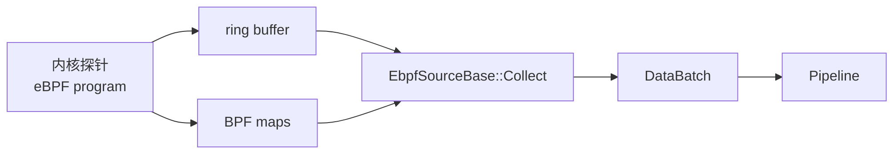
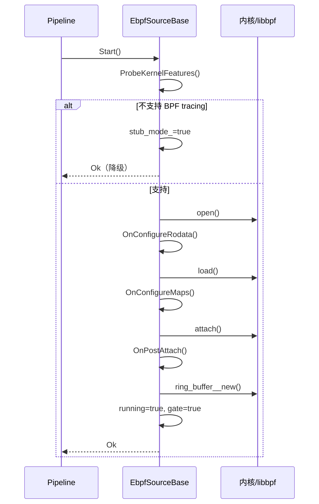
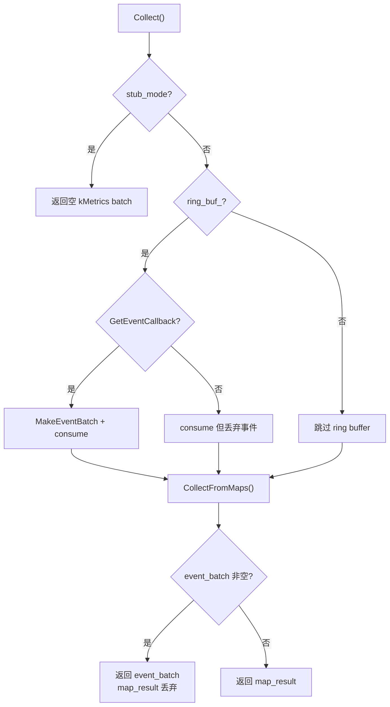

# 07 eBPF SDK

eBPF Source 与普通 Source 的区别在于数据来源：它从内核 ring buffer 和 BPF map 里取事件。为了不让每个探针重复写生命周期代码，Illuminator 提供了 `EbpfSourceBase`：

```text
框架 = 不变的生命周期 (open → load → attach → destroy)
      + 可变的 hooks（子类填 open/attach/采集逻辑）
```

返回 [设计总览](./index.md)。Pipeline 如何使用 Source 见 [02/08](./02-pipeline-v3/08-plugin-walkthrough.md)。

## 1. 在整体架构中的位置

<div style="overflow-x: auto; margin: 1.5rem 0;">



</div>

与 `/proc` 轮询 Source 相比：

| 维度 | `/proc` 轮询 | eBPF |
| --- | --- | --- |
| 数据频率 | 低（秒级） | 高（事件级） |
| 权限 | 普通用户通常可读 | 需要 `CAP_BPF`/root |
| 内核依赖 | 低 | 内核版本、BTF、libbpf |
| 降级 | 无 | `stub_mode` |

## 2. EbpfSourceBase 的 hooks

| Hook | 必须 | 作用 |
| --- | --- | --- |
| `MakeSkelCallbacks()` | 是 | 返回 `open/load/attach/destroy` 函数指针 |
| `OnConfigureRodata(void*)` | 否 | load 前写 rodata |
| `OnConfigureMaps(void*)` | 否 | load 后配置 map，设置 ringbuf/gate/meta_stats fd |
| `OnPostAttach(void*)` | 否 | attach 后额外挂载（如 perf_event） |
| `OnPreDestroy()` | 否 | 停止时清理额外资源 |
| `GetEventCallback()` | 否 | 返回 ring buffer 事件回调 |
| `MakeEventBatch()` | 否 | 创建事件批次容器 |
| `CollectFromMaps()` | 否 | 从 map 读聚合数据 |
| `OnPause()` / `OnResume()` | 否 | 暂停/恢复的额外动作 |

`IL_SKEL_CALLBACKS(prefix)` 宏为子类生成：

- `skel_t` 类型别名
- `skel()` 类型安全指针
- `MakeSkelCallbacks()` 的标准实现

```cpp
class MyCpuSource : public EbpfSourceBase {
public:
    const char* Name() const override { return "cpu_sample"; }
    const char* Version() const override { return "0.1.0"; }
    IL_SKEL_CALLBACKS(my_cpu);

protected:
    void OnConfigureMaps(void* skel) override {
        auto* s = static_cast<skel_t*>(skel);
        SetRingBufFd(bpf_map__fd(s->maps.events));
        SetGateFd(bpf_map__fd(s->maps.gate));
        SetMetaStatsFd(bpf_map__fd(s->maps.meta_stats));
    }
};
```

## 3. Start 的标准序列

<div style="overflow-x: auto; margin: 1.5rem 0;">



</div>

失败语义并不统一：

| 阶段 | 失败行为 |
| --- | --- |
| 无 BPF tracing | 进入 stub，返回 Ok |
| `open` 失败 | 进入 stub，返回 Ok |
| `load` / `attach` / `OnPostAttach` / ring buffer 失败 | destroy 并返回错误 |

因此 **`Start()` 返回 Ok 不等于真实探针在工作**；必须检查 `IsStub()`。

## 4. Collect 的路径

```cpp
StatusOr<DataBatchPtr> Collect() override {
    if (stub_mode_) return make_shared<DataBatch>(kMetrics);

    DataBatchPtr event_batch;
    if (ring_buf_) {
        if (GetEventCallback()) {
            pending_batch_ = MakeEventBatch();
            ring_buffer__consume(ring_buf_);
            event_batch = std::move(pending_batch_);
            pending_batch_ = nullptr;
        } else {
            ring_buffer__consume(ring_buf_);   // 没有回调，消费后丢弃
        }
    }

    auto map_result = CollectFromMaps();

    if (event_batch && !event_batch->Empty()) {
        return event_batch;   // map_result 被丢弃
    }
    return map_result;
}
```

<div style="overflow-x: auto; margin: 1.5rem 0;">



</div>

两个重要限制：

1. **事件批次非空时，map 结果（包括错误）被丢弃。**
2. `GetEventCallback() == nullptr` 时，如果 `ring_buf_` 存在，仍会消费事件并丢弃。

## 5. 事件结构

`src/ebpf_common/include/event_types.h` 定义了内核/用户态共享结构：

| 结构 | 用途 | 关键字段 |
| --- | --- | --- |
| `il_pidns_config` | PID namespace 过滤 | `dev`, `ino` |
| `il_stack_key` | 栈聚合键 | `pid`, `tid`, `kernel_stack_id`, `user_stack_id`, `comm` |
| `il_cpu_sample_event` | CPU 采样 | `timestamp_ns`, `pid`, `tid`, `cpu`, `comm`, 栈 ID |
| `il_mem_event` | 内存分配/释放 | `addr`, `size`, `alloc` |
| `il_net_event` | 网络连接 | `saddr`, `daddr`, `sport`, `dport`, `protocol`, `event_type` |
| `il_bio_event` | 块 IO | `sector`, `nr_sector`, `dev`, `latency_ns`, `rwflag` |
| `il_sched_event` | 调度事件 | `prev/next pid/tid/comm`, `cpu`, `latency_ns`, `event_type` |
| `il_offcpu_event` | Off-CPU | `duration_ns`, 栈 ID, `comm` |
| `il_sched_stats` | 调度聚合 | `switch_count`, `total/max_runqueue_latency_ns`, `migrate_count` |

常量：

- `MAX_STACK_DEPTH = 127`
- `TASK_COMM_LEN = 16`

这些结构必须同时兼容 BPF C 和 C++ 编译器，因此只能使用固定大小整数，不能有指针、`std::string` 或动态容器。

## 6. 用户态转换

| 工具 | 作用 |
| --- | --- |
| `LookupBpfStackTrace(stacks_fd, stack_id)` | 从 stack trace map 读取地址，生成 `StackFrame` |
| `IsCanonicalAddress(addr)` | 过滤非法地址 |
| `ReadBpfMetaStats(fd)` | 读取 ring buffer 溢出/丢弃/过滤计数 |
| `PidManager` | 维护目标 PID 并同步 BPF map |
| `bpf_util.h` | PID/comm 过滤、perf_event 等辅助 |

`LookupBpfStackTrace` 只填 `address`，不会自动符号化；函数名、文件名、行号需要另做符号解析。

事件内存必须复制进 `DataBatch` 的 Arena：ring buffer 的内存只在回调期间有效，不能直接把指针/`string_view` 留到批次里。

## 7. KernelFeatures 与 stub

```cpp
struct KernelFeatures {
    bool has_btf;
    bool has_ringbuf;      // >= 5.8
    bool has_bpf_tracing;  // >= 4.14
    int major, minor, patch;
};
```

`ProbeKernelFeatures()`：

1. 检查 `/sys/kernel/btf/vmlinux`。
2. 从 `/proc/version` 解析主/次/修订版本。
3. `has_ringbuf = major>5 || (major==5 && minor>=8)`。
4. `has_bpf_tracing = major>4 || (major==4 && minor>=14)`。

stub 模式：

- `IsStub() == true`
- `HasBpfProbe() == false`
- `Collect()` 返回空 `kMetrics` 批次
- `Pause/Resume` 直接返回 Ok

展示层必须把 stub 标为“降级运行”，不能显示为正常采样。

## 8. 构建

`src/ebpf_common/bpf_probe.bzl` 提供两个规则：

### 8.1 `bpf_probe`

```python
bpf_probe(
    name = "my_probe",
    src = "my_probe.bpf.c",
    arch = "x86",
)
```

执行：

```bash
clang -g -O2 -target bpf -D__TARGET_ARCH_x86 \
  -Isrc/ebpf_common/include -isystem /usr/include \
  -c my_probe.bpf.c -o my_probe.bpf.o
```

### 8.2 `bpf_skeleton`

生成三个目标：

- `<name>_bpf`：`.bpf.o`
- `<name>_skel_gen`：`.skel.h`（`bpftool gen skeleton`）
- `<name>_skel`：包装头文件的 `cc_library`

依赖：

- `clang`（可用 `BPF_CLANG` 覆盖）
- `bpftool`（可用 `BPF_BPFTOOL` 覆盖）
- `libbpf-dev`、`libelf-dev`、`zlib1g-dev`
- `vmlinux.h`、`common.bpf.h`、`event_types.h`

架构通过 `arch` 参数传给 `-D__TARGET_ARCH_<arch>`。

## 9. 接入验收清单

1. `Start()` 返回 Ok 后检查 `IsStub()`。
2. `OnConfigureMaps` 是否正确设置 ringbuf/gate/meta_stats fd。
3. ring buffer 回调是否把事件复制进批次 Arena。
4. 事件批次非空时，确认 map 数据被丢弃是否可以接受。
5. `GetEventCallback()` 为空时，是否真的不需要 ring buffer。
6. `Stop()` 是否先关 gate，再 free ring buffer、destroy skeleton。
7. 权限：`CAP_BPF`/root、`RLIMIT_MEMLOCK`、`perf_event_paranoid`。
8. 内核：BTF、ring buffer、目标 hook 是否存在。
9. 符号化：是否单独实现，不要假设 `LookupBpfStackTrace` 会解析函数名。
10. 压测：高事件率下 ring buffer 是否溢出，`MetaStats` 是否增长。

## 10. 边界与后续

- 当前仓库没有生产 eBPF 探针；SDK 可编译不等于内核可采样。
- `Collect` 的事件/map 二选一逻辑会丢 map 结果。
- stub 与失败语义不一致：open 失败降级，load/attach 失败报错。
- 没有 perf buffer 回退实现；`has_ringbuf` 只是能力标志。
- 没有内置符号化、build-id 捕获或跨内核 CO-RE 验证流程。

返回 [设计总览](./index.md) · 上一篇：[调度与自观测](./06-scheduling-and-observability.md) · 下一篇：[录制与存储](./08-recording-and-storage.md)
