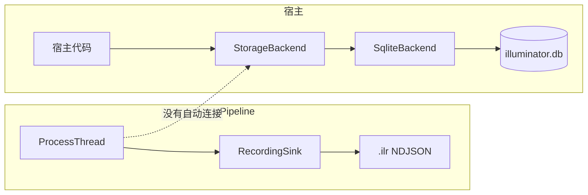
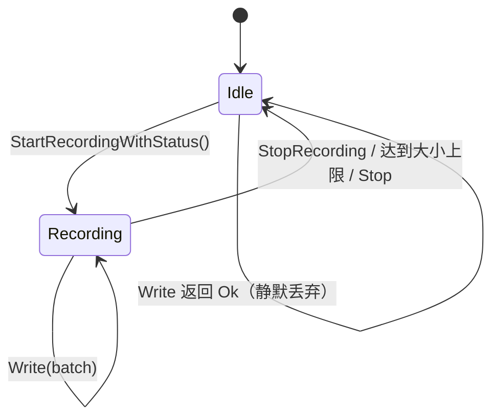
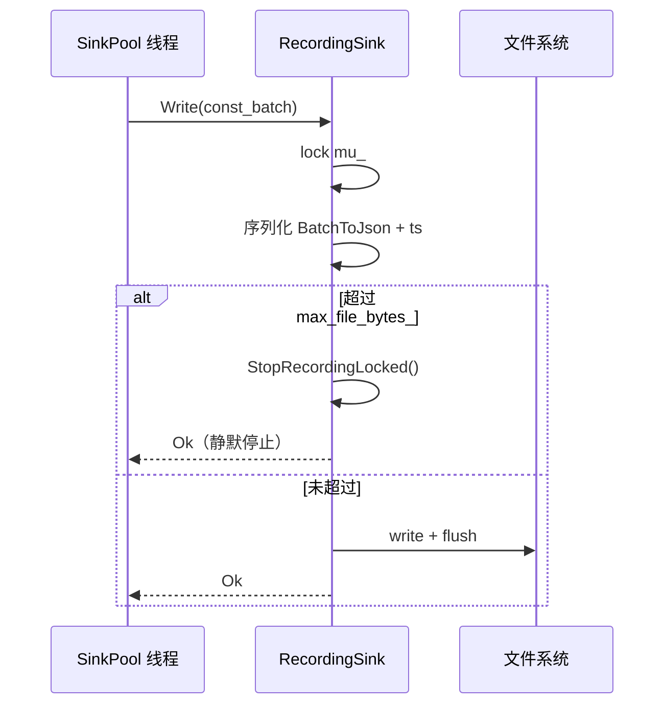
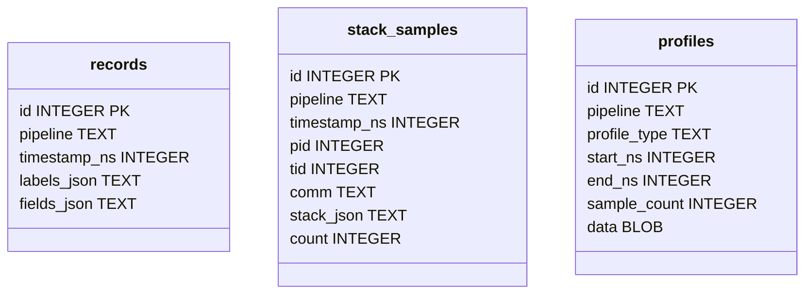

# 08 录制与存储

Illuminator 有两条**互不自动连接**的持久化路径：

1. **Pipeline → RecordingSink → `.ilr` 文件**：按批次录制，适合保真回看。
2. **Host → StorageBackend → SQLite**：结构化写入与查询，适合历史检索。

当前没有 `StorageSink`，Pipeline 不会自动把数据写进 SQLite。

返回 [设计总览](./index.md)。

## 1. 两条路径

<div style="overflow-x: auto; margin: 1.5rem 0;">



</div>

| 路径 | 触发者 | 粒度 | 典型用途 |
| --- | --- | --- | --- |
| `.ilr` | Sink 插件 | 每个 DataBatch 一行 | 录制、回放、问题复现 |
| SQLite | 宿主直接调用 | 记录/样本数组 | 查询、统计、保留策略 |

## 2. RecordingSink

### 2.1 状态机

<div style="overflow-x: auto; margin: 1.5rem 0;">



</div>

关键：**Pipeline `Start()` 不会自动开始录制**。宿主（CLI）在 Pipeline Start 后显式调用 `StartRecordingWithStatus()`。未开始录制时，`Write()` 直接返回 Ok，数据被静默丢弃。

### 2.2 参数

| 参数 | 默认 | 说明 |
| --- | --- | --- |
| `feature_name` | `default` | 流名称，用于文件名和 `pipeline` 字段 |
| `output_dir` | `/tmp/illuminator_recordings` | 输出目录 |
| `max_file_mb` | 100 | 文件大小上限 |

`max_file_mb` 没有范围校验；负值转 `uint64_t` 会变成巨大上限。

### 2.3 文件格式

文件名：`<feature>_<epoch_ms>.ilr`

首行是头：

```json
{"feature":"demo_counter","format":"ilr","max_bytes":104857600,"started_at":1793750400000,"version":1}
```

之后每个批次一行：

```json
{"data":{"pipeline":"demo_counter","records":[{"fields":{"value":1},"labels":{},"timestamp":1793750400050}]},"ts":1793750400062}
```

| 字段 | 含义 |
| --- | --- |
| `data` | `BatchToJson` 的结果 |
| `data.pipeline` | 流名称 |
| `data.records[].timestamp` | 记录时间，毫秒 |
| 外层 `ts` | 写入时间，毫秒 |

注意：外层 `ts` 是**写入时间**，不是记录时间；记录时间在 `data` 里。

### 2.4 写入流程

```cpp
std::lock_guard<std::mutex> lk(mu_);
if (!recording_) return Status::Ok();

j["ts"] = now_ms();
j["data"] = json::parse(BatchToJson(*batch, feature_name_));
std::string line = j.dump() + "\n";

if (session_.bytes_written + line.size() > max_file_bytes_) {
    StopRecordingLocked();      // 达到上限：停止录制，返回 Ok
    return Status::Ok();
}

file_->write(line.data(), line.size());
file_->flush();
```

<div style="overflow-x: auto; margin: 1.5rem 0;">



</div>

边界：

- `mu_` 把并发 `Write` 串行化。
- 每行 `flush()`，但不是 `fsync()`；掉电仍可能丢数据。
- 达到上限停止录制，不滚动新文件。
- `Stop()` 关闭文件；`Flush()` 只是 `flush()`。
- 文件名使用毫秒时间戳，同一毫秒内重复启动可能冲突。

## 3. 存储抽象

```cpp
class StorageBackend {
public:
    virtual Status Init(const std::string& data_dir, const ConfigValue& config) = 0;
    virtual Status WriteRecords(const std::string& pipeline,
                                const std::vector<Record>& records) = 0;
    virtual Status WriteStackSamples(const std::string& pipeline,
                                     const std::vector<StackSample>& samples) = 0;
    virtual Status WriteProfile(const ProfileMeta& meta,
                                const std::vector<uint8_t>& data) = 0;
    virtual StatusOr<QueryResult> Query(const QueryRequest& req) = 0;
    virtual StatusOr<std::vector<ProfileMeta>> ListProfiles(
        const std::string& pipeline, const TimeRange& range) = 0;
    virtual Status Flush() = 0;
    virtual Status Compact() = 0;
    virtual Status Close() = 0;
    virtual Status Prune(uint64_t max_age_ns) { return Status::Ok(); }
    virtual uint64_t DiskUsageBytes() const { return 0; }
    virtual StatusOr<std::string> ExecuteRawQuery(const std::string& sql);
};
```

`StorageFactory` 用静态注册把名称映射到创建函数。当前实现是头文件里的静态变量；只有包含 `sqlite_backend.h` 的翻译单元才会注册，工厂本身没有互斥锁。

## 4. SqliteBackend

### 4.1 三张表

<div style="overflow-x: auto; margin: 1.5rem 0;">



</div>

索引：

```sql
CREATE INDEX idx_records_ts  ON records(pipeline, timestamp_ns);
CREATE INDEX idx_samples_ts  ON stack_samples(pipeline, timestamp_ns);
CREATE INDEX idx_profiles_ts ON profiles(pipeline, start_ns);
```

### 4.2 PRAGMA

```sql
PRAGMA journal_mode = WAL;       -- 多读一写
PRAGMA synchronous = NORMAL;     -- 平衡安全与速度
PRAGMA cache_size = 10000;       -- 10000 页，不是 10MB
busy_timeout = 5000;             -- 并发写等待 5s
```

源码注释写“10MB cache_size”，实际 `cache_size=10000` 是**页数**；按 4KiB 页算约 40MiB，具体取决于页大小。

### 4.3 写入事务

| 方法 | 事务 |
| --- | --- |
| `WriteRecords` | `BEGIN` → 批量 INSERT → `COMMIT`；失败 `ROLLBACK` |
| `WriteStackSamples` | 同上 |
| `WriteProfile` | 单条 INSERT，**没有显式事务** |

写入用 `write_mutex_` 串行化，避免同一连接上的并发写冲突。

### 4.4 查询限制

```cpp
SELECT timestamp_ns, labels_json, fields_json
FROM records
WHERE pipeline = ?
  [AND timestamp_ns >= ?]
  [AND timestamp_ns <= ?]
ORDER BY timestamp_ns DESC
LIMIT ?;
```

| 项 | 实际行为 |
| --- | --- |
| `metric_name` | 忽略 |
| `order_by` | 忽略；固定按 `timestamp_ns` |
| `stack_samples` 查询 | 未实现；只查 `records` |
| `total_count` | 本次返回的行数，不是全库命中数 |
| `has_more` | 从未置 true |
| `Query` 加锁 | 不加 `write_mutex_` |

`QueryResult.string_pool` 保存反序列化字符串；`Record` 里的 `string_view` 指向它。**`QueryResult` 必须比这些 `Record` 活得更久**，否则视图悬空。

### 4.5 堆栈序列化

`SerializeStack` 只写 `user_stack`，但保留每帧的 `addr/fn/file/line`：

```json
[{"addr":140234,"file":"main.cc","fn":"main","line":42}]
```

它丢掉：

- `kernel_stack`
- `cpu`
- `sample_type`
- `duration_ns`
- `kernel_stack_id` / `user_stack_id`

这与 JSON 输出（丢 `file/line`）不同，不要混淆。

### 4.6 生命周期与维护

| 方法 | 行为 |
| --- | --- |
| `Flush` | `PRAGMA wal_checkpoint(PASSIVE)` |
| `Compact` | `VACUUM` |
| `Prune(max_age_ns)` | 删除 records/stack_samples/profiles 中过旧数据；每 12 次做一次 TRUNCATE checkpoint |
| `DiskUsageBytes` | 只统计主数据库文件，不含 `-wal`/`-shm` |
| `Close` | `sqlite3_close`；不加 `write_mutex_` |
| `ExecuteRawQuery` | 只允许 SELECT/EXPLAIN/PRAGMA，最多 1000 行，BLOB 显示为 `[blob]` |

`Prune` 的 SQL 用 `snprintf` 拼接数值，不绑定参数；因为输入是内部计算的整数，当前没有注入面，但后续扩展要谨慎。

## 5. 该选哪条路径

| 需求 | 建议 |
| --- | --- |
| 保真录制、回放、问题复现 | `.ilr` |
| 按时间/管道查询结构化记录 | SQLite |
| 高频、低开销、可丢弃 | `.ilr` + 文件轮转/外部清理 |
| 长期保留、可删除旧数据 | SQLite + `Prune` |
| 需要 stack_samples 查询 | 当前不支持，需扩展 |

两条路径还没有统一会话 ID、schema 版本或回放协议。

## 6. 测试映射

| 测试 | 验证内容 |
| --- | --- |
| `QueryDeserializesLabelsAndFields` | 标签/字段 round-trip |
| `QueryRespectsTimeRange` | 时间范围过滤 |
| `ConcurrentWritesDoNotFail` | 写入串行化 |
| `ExecuteRawQueryRejectsNonSelectStatements` | 只读检查 |
| `PruneRemovesOldRecords` | 过期删除 |
| CLI `smoke_test` | demo 生成 `.ilr` 并可解析 |

测试缺口：没有验证 `string_pool` 生命周期的误用；没有 64 位大整数精度边界；没有 stack_samples 查询；没有 WAL 文件大小统计。

## 小结

- `.ilr` 是批次级 NDJSON；必须显式开始录制；每行 flush 不是 fsync；达到上限停止。
- SQLite 是独立持久化 API，不自动接入 Pipeline。
- 写入有事务与串行化；查询只覆盖 records，`total_count`/`has_more` 不是分页语义。
- JSON 和 SQLite 都会丢字段，不能当无损快照。

## 边界与后续

- 没有 `StorageSink`。
- `Query` 不支持 stack_samples、`metric_name`、自定义排序。
- `DiskUsageBytes` 不含 WAL。
- `Close` 不与写入互斥，宿主应先停止写入。
- 没有统一 schema 版本与回放协议。

返回 [设计总览](./index.md) · 上一篇：[eBPF SDK](./07-ebpf-sdk.md) · 下一篇：[开发与验证](./09-development-and-validation.md)

