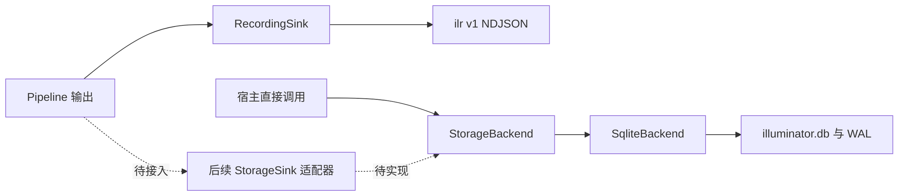
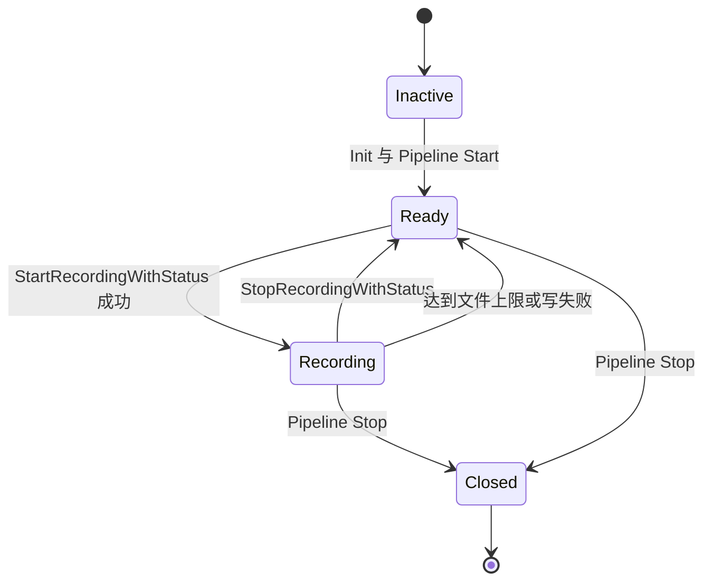
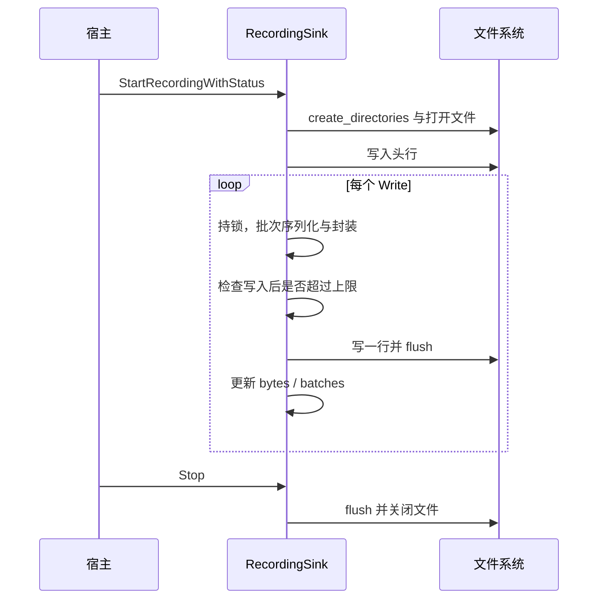
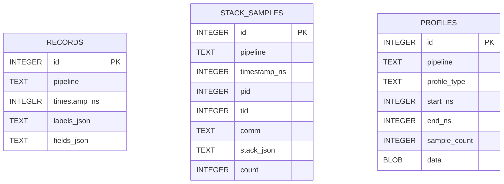
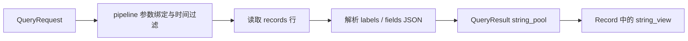

# 08 录制与独立存储

当前持久化有两条独立路径：RecordingSink 直接消费 Pipeline 输出，生成 `.ilr` 文件；StorageBackend 提供数据库写入和查询，内置 SQLite 实现。SQLite 已迁到 `src/storage`，可以独立于任何服务使用，但尚未通过通用 StorageSink 连接 Pipeline。

返回 [设计总览](./index.md)。数据字段与时间精度见 [04](./04-data-and-memory.md)。

## 1. 数据路径

<div style="overflow-x: auto; margin: 1.5rem 0;">



</div>

录制文件用于保留流式批次，SQLite 用于结构化历史数据和 profile 字节。当前没有把两者统一为一个多流会话，也没有自动文件导入数据库或完整回放引擎。

## 2. RecordingSink 的接口与状态

RecordingSink 同时实现 SinkPlugin 与 RecordableInterface。通用接口提供 StartRecording、StopRecording、IsRecording 和 GetSession；具体类还提供带 Status 的开始/停止方法及完整会话信息，CLI 使用带状态方法检查文件打开失败。

<div style="overflow-x: auto; margin: 1.5rem 0;">



</div>

Sink 的 Start 不自动开始录制。未录制时 Write 返回 OK 并跳过数据；达到文件上限后也停止录制并返回 OK。这些行为适合显式控制会话，但不能用 Pipeline 的 ErrorCount 为零证明录制完整。

| 参数 | 默认值 | 说明 |
| --- | --- | --- |
| feature_name | default | 文件和数据流名称，沿用 v1 字段名 |
| output_dir | `/tmp/illuminator_recordings` | 独立插件默认目录 |
| max_file_mb | 100 | 以 MiB 换算文件上限 |

CLI 将输出目录设为 `--output-dir` 或 global.data_dir，将 feature_name 设为 Source 名称。参数和文件头中的 feature 仅为旧格式兼容，不依赖 FeatureBus/Driver。插件当前没有对 max_file_mb 做完整范围校验，宿主应传正且合理的值。

## 3. 文件结构与写入过程

文件名为 `<feature_name>_<epoch_ms>.ilr`，内容是 UTF-8 JSON 文本，每行一个对象。第一行是头，后面每行是一个批次信封。

```json
{"format":"ilr","version":1,"feature":"demo_counter","started_at":1793750400000,"max_bytes":104857600}
{"ts":1793750400050,"data":{"pipeline":"demo_counter","records":[{"timestamp":1793750400050,"labels":{},"fields":{"counter":1}}]}}
```

示例用于展示结构。started_at 和外层 ts 是墙钟毫秒；内层 timestamp 也由当前 JSON 序列化截为毫秒。外层时间表示写入时刻，不等于 Source 的原始采样时刻。

<div style="overflow-x: auto; margin: 1.5rem 0;">



</div>

目录创建使用 filesystem，不通过 shell，能够处理含空格的目录并返回路径错误。当前每批执行 BatchToJson 后又 parse 成 JSON，最后再次 dump；实现直接，但存在重复序列化成本。

### 3.1 一致性与失败边界

mutex 串行保护会话与文件状态，防止多个 Write 同时修改流；线程锁获取顺序不保证提交顺序。每批 flush 是 C++ 流缓冲刷新，不是 fsync 的持久化承诺。

超过大小上限的整批不写入，也没有自动滚动到下一个文件；已停止录制后的批次继续被跳过。当前文件没有批次序号、校验和、提交尾标、崩溃恢复协议或跨流 manifest。读取方应验证头版本和每行 JSON，不能把完整文件名当作完整性证据。

数据 Write 检测流错误并返回 Status；文件头写入和最终 Flush/Close 的错误传播仍不完整。要求严格落盘确认时，需要后续扩展协议。

## 4. StorageBackend 抽象

| 接口 | 数据与用途 |
| --- | --- |
| Init(data_dir, config) | 初始化后端 |
| WriteRecords(pipeline, records) | 写入指标记录 |
| WriteStackSamples(pipeline, samples) | 写入堆栈采样 |
| WriteProfile(meta, bytes) | 保存原始 profile 二进制 |
| Query(request) | 查询历史数据；具体后端决定已支持范围 |
| ListProfiles(pipeline, range) | 列出 profile 元信息 |
| Flush / Compact / Close | 生命周期与维护 |
| Prune(max_age_ns) | 按保留时长清理旧数据 |
| DiskUsageBytes | 报告占用 |
| ExecuteRawQuery(sql) | 可选的只读 SQL 查询 |

StorageFactory 保存 `name → creator`，当前 SQLite 通过头文件静态注册器注册。它没有与 PluginRegistry 相同的完整并发保护，注册和创建应安排在启动阶段。后续建议改为 `.cc` 中显式注册，减少多翻译单元静态初始化的隐式行为。

## 5. SQLite 表结构

Init 创建 `<data_dir>/illuminator.db`。当前使用 WAL、synchronous=NORMAL、cache_size=10000 和 busy_timeout=5000ms。正数 cache_size 以页计，不应按源码注释直接理解为固定 10MB。

<div style="overflow-x: auto; margin: 1.5rem 0;">



</div>

三张表通过 pipeline 文本字段建立逻辑归属，没有外键关系。records、stack_samples 上有 `(pipeline,timestamp_ns)` 索引，profiles 上有 `(pipeline,start_ns)` 索引。

WriteRecords 与 WriteStackSamples 在 mutex 内开启事务，用预编译语句绑定并批量插入，再提交；准备或执行失败路径会尝试回滚。它们分别提交，不构成跨两类载荷的原子批次。WriteProfile 保存二进制与基础元信息，ProfileMeta 中 labels 未完整落表。

栈表不是完整的 StackSample schema：cpu、sample_type、duration_ns 等没有独立列，当前 stack_json 只序列化用户栈的 addr、fn、file、line，不包含内核栈和完整样本属性。需要保真保存时应先明确格式扩展。

## 6. 查询与返回数据寿命

QueryRequest 声明 pipeline、metric_name、时间范围、limit、order_by 和 descending。当前 SQLite Query 只查询 records，以 pipeline 和可选时间范围过滤，按 timestamp_ns 升降序并限制行数；metric_name、任意 order_by 和 stack_samples 查询尚未落实。

<div style="overflow-x: auto; margin: 1.5rem 0;">



</div>

QueryResult 使用 `vector<unique_ptr<string>>` 持有反序列化字符串，Record 中视图指向这些字符串。不能仅把 records 复制到外部后立即销毁 QueryResult；需要保留所有者或重新驻留。

total_count 当前随本次读出的行数增加，不是全库命中数；has_more 没有完整计算，不能据此实现可靠分页。部分 JSON 解析错误会被跳过，查询执行末尾错误也可能只记录日志，所以后续应完善错误与结果完整性表达。

ExecuteRawQuery 先限制语句前缀为 SELECT、EXPLAIN、PRAGMA，再检查 sqlite3_stmt_readonly，最多返回 1000 行 JSON。这是数据库读取接口，不是已经开放的远程查询服务。

## 7. 维护、关闭与后续适配

Flush 触发 PASSIVE WAL checkpoint，Compact 执行 VACUUM；Prune 以当前墙钟减 max_age_ns 为截止，删除三表旧数据。参数含义是“保留多长时间”，不是直接传截止时间戳。极端时长和底层错误传播仍应补齐验证。

DiskUsageBytes 当前主要统计主数据库文件，未完整累计 WAL/SHM。Query、Close、维护与写入的生命周期同步未统一，宿主应序列化关闭及维护，确保无人继续使用后再 Close。WAL 提供的数据库并发能力不等于 C++ 对象成员可任意并发访问。

后续建议增加 StorageSink，将批次映射为后端写入；统一保留 schema 版本、会话、时钟及原始样本来源；再设计回放器与迁移。适配器应位于持久化层，避免让 Pipeline 内嵌 SQLite SQL 或文件格式判断。
