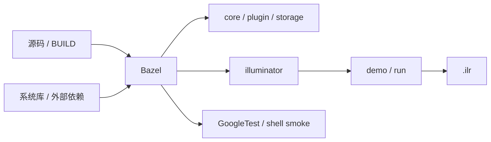
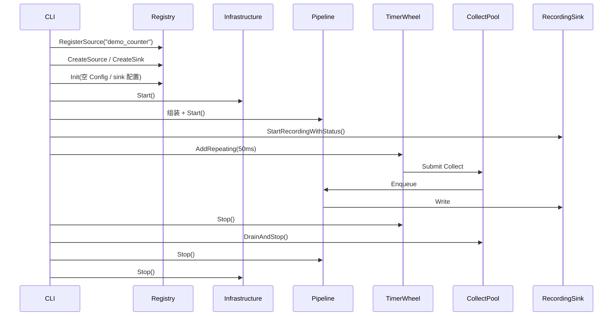
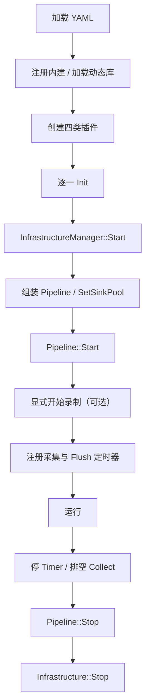

# 09 开发、构建与验证

核心工程可以独立构建并由 CLI 运行，不需要 Server 或前端。本篇给出可复现入口，并区分“当前能证明什么”和“历史记录”。

返回 [设计总览](./index.md)。所有命令默认在 `/workspace/illuminator` 执行。

## 1. 环境与构建

| 依赖 | 说明 |
| --- | --- |
| Linux | timerfd、eventfd、epoll、`/proc` |
| C++20 | GCC 11 或兼容编译器 |
| Bazel 7.6.1 / Bazelisk | `.bazelversion` 指定版本 |
| Python 3 | 构建辅助 |
| libbpf / libelf / zlib / sqlite3 | 系统开发库 |
| clang / bpftool | 新增 BPF 探针时使用 |

Bazel 通过外部依赖获取 spdlog、nlohmann/json、yaml-cpp、GoogleTest。

```bash
make check-env
bazel build //src/...
bazel test //src/... --test_output=errors

# 只构建优化版 CLI
bazel build //src/cli:illuminator --config=opt
```

`.bazelrc` 开启 frame pointer、保留符号；`--config=opt` 使用 O2；ASAN/TSAN 通过 `--config=asan` / `--config=tsan`。

工具链仍读取系统库和 BPF 工具，不是完全 hermetic。

<div style="overflow-x: auto; margin: 1.5rem 0;">



</div>

## 2. CLI 命令

```bash
./bazel-bin/src/cli/illuminator version
./bazel-bin/src/cli/illuminator plugins
./bazel-bin/src/cli/illuminator storage
./bazel-bin/src/cli/illuminator --help
```

| 命令 | 行为 |
| --- | --- |
| `version` | 打印版本与构建信息 |
| `plugins` | 列出已注册的四类插件 |
| `storage` | 列出可用存储后端，不创建数据库 |
| `demo` | 合成 Source + RecordingSink |
| `run --source <name>` | 运行已注册 Source（含 `.so`） |

`demo` 参数：

```bash
./bazel-bin/src/cli/illuminator demo \
  --config illuminator.yaml.example \
  --duration 2 \
  --output-dir /tmp/illuminator-demo
```

- `--duration` 为 1..86400 秒，默认 1。
- Source 每 50ms 生成一条记录，字段名 `value`。
- 不读取系统 CPU，是合成数据。
- 运行结束输出 `batches=... records=... errors=...` 和录制信息。

`run` 的边界：

- Source 用空 `ConfigValue{}` 初始化。
- CLI 不组装 Processor/Aggregator。
- 复杂参数和拓扑需要 C++ 宿主。

## 3. demo 走读

<div style="overflow-x: auto; margin: 1.5rem 0;">



</div>

预期（1 秒）：约 20 批、20 条记录、错误 0。实际数量受调度和关闭时点影响。

### 3.1 解析录制文件

```bash
python3 - <<'PY'
import json
from pathlib import Path

files = sorted(Path('/tmp/illuminator-demo').glob('*.ilr'))
assert files, 'no recording produced'
with files[-1].open(encoding='utf-8') as stream:
    header = json.loads(next(stream))
    assert header['format'] == 'ilr' and header['version'] == 1
    batches = [json.loads(line) for line in stream if line.strip()]
assert batches, 'recording contains no batches'
records = sum(len(item['data']['records']) for item in batches)
print(files[-1], 'batches=', len(batches), 'records=', records)
PY
```

这只能证明“格式可读且有输出”，不能证明零丢弃、顺序严格或已经 fsync。

## 4. 动态 Source

配置目录：

```yaml
global:
  data_dir: ./data
  plugin_dirs:
    - /opt/illuminator/plugins
```

```bash
./bazel-bin/src/cli/illuminator plugins --config illuminator.yaml
./bazel-bin/src/cli/illuminator run \
  --source my_source --sink recording \
  --config illuminator.yaml --duration 5 \
  --output-dir /tmp/illuminator-run
```

`my_source` 是待开发插件名，不是内建组件。目录加载返回 OK 不代表所有库都成功；要按名称确认工厂。

测试库 `src/plugin/test/test_source_plugin.cc` 提供真实 `.so` 入口示例；`//src/plugin/test:test_source_plugin.so` 是 testonly 目标，不是发布包。

## 5. SDK 装配顺序

<div style="overflow-x: auto; margin: 1.5rem 0;">



</div>

宿主必须：

- 同一个 Source 不重叠 `Collect()`。
- 有 Aggregator 时注册 `InjectFlush` 定时器。
- 关闭时先停外部生产者，再 Stop Pipeline，最后停 SinkPool。
- 信号处理只设置安全标志，把阻塞关闭放回控制线程。

## 6. 插件开发步骤

1. 明确类型、输入输出、时间单位、线程契约。
2. 实现 `Init` 参数校验和 `Start` 失败清理。
3. 实现数据路径，控制内部缓冲。
4. 实现 `Stop/Flush`，释放资源。
5. 添加 BUILD 目标，避免反向依赖 engine/CLI。
6. 显式注册工厂。
7. 测试空输入、错误、重复 Stop、并发 Write、Arena 寿命。

完整示例见 [02/08](./02-pipeline-v3/08-plugin-walkthrough.md)。

## 7. 测试组织

| 领域 | 目标 | 重点 |
| --- | --- | --- |
| 公共契约 | `config_test`、`status_test` | 默认值、校验、错误码 |
| 内存 | `arena_test`、`lock_free_queue_test` | 对齐、Reset、并发队列 |
| 线程 | `thread_pool_test` | future、异常、PendingTasks、Drain |
| 引擎 | `async_channel_test`、`data_batch_test`、`timer_wheel_test`、`pid_manager_test` | 通道、数据、定时、PID |
| Pipeline | `pipeline_integration_test` | 转换链、反压、过载、强制刷新 |
| 停机 | `pipeline_shutdown_test` | 写入屏障、共享池复用 |
| 动态 Sink | `pipeline_dynamic_sink_test` | 增删、并发列表访问 |
| 压力 | `stress_test` | 吞吐、多 Pipeline、RSS |
| 基础设施 | `infrastructure_manager_test` | 单例、启停、默认线程数 |
| 插件 | `plugin_registry_test`、`test_source_plugin.so` | 工厂、动态库 |
| 存储 | `sqlite_backend_test` | 写入、查询、Prune、只读 SQL |
| CLI | `smoke_test.sh` | demo、run、配置错误、信号退出 |

当前共 17 个 `cc_test` + 1 个 CLI `sh_test`，合计 18 个测试目标。

### 7.1 关键回归命令

```bash
bazel test //src/core/engine/test:pipeline_shutdown_test
bazel test //src/core/engine/test:pipeline_integration_test
bazel test //src/cli:smoke_test

bazel test //src/cli:smoke_test \
  //src/core/engine/test:pipeline_shutdown_test \
  //src/core/common/test:config_test --config=asan

make asan
make tsan
```

测试应使用 promise/条件变量/门闩建立“工作线程已阻塞”的条件，不要用固定睡眠推断并发状态。

## 8. 历史验证记录

以下来自 2026-11-04 核心精简后的基线，**属于当时记录，不表示本轮重新执行**：

| 检查 | 结果 | 证明范围 |
| --- | --- | --- |
| `bazel build //src/...` | 40 个目标构建成功 | 源码、链接、测试产物可构建 |
| `bazel test //src/...` | 18/18 通过 | 当前自动化覆盖的行为 |
| CLI/停机/ConfigValue 定向 ASAN | 3/3 通过 | 这些路径的地址检查 |
| 1 秒 demo | 20 批、20 条、20 批录制、0 错误 | 最小闭环 |
| Docker 镜像 | 未实际构建 | Dockerfile 存在，未验收 |
| 全量 ASAN/TSAN | 未执行全套 | 不声明全量通过 |
| 真实 eBPF 探针 | 未实机验收 | SDK 编译不等于内核采样 |

## 9. CI 与 Docker

`.github/workflows/ci.yml`：

| Job | 触发 | 内容 |
| --- | --- | --- |
| `backend-build` | push/PR | `bazel build //src/...` |
| `backend-test` | push/PR | `bazel test //src/...` |
| `sanitizer-asan` | PR | `--config=asan`，`detect_leaks=1` |
| `sanitizer-tsan` | PR | `--config=tsan` |
| `ci-gate` | always | 汇总 Layer-1/2 结果 |
| `docker-build` | `workflow_dispatch` | 构建镜像，不推送 |

`Dockerfile`：

- 构建阶段：Ubuntu 22.04、GCC 11、Bazelisk 1.25.0、Bazel 7.6.1，构建 `//src/cli:illuminator --config=opt`。
- 运行阶段：Ubuntu 22.04，安装运行时库，创建非 root 用户 `illuminator`。
- 数据卷：`/var/lib/illuminator`。
- 默认命令：`demo --config illuminator.yaml --output-dir /var/lib/illuminator`。

工作流文件存在不等于远端当前通过；本轮未验证远端流水线。

## 10. 文档自身的验证

```bash
cd /workspace/Scriptorium
pnpm docs:frontmatter --check
pnpm build
```

检查：

- 非 `index.md` 文档有 frontmatter；`index.md` 也保留 title/description。
- 不再存在指向旧版单文件 Pipeline 文档的链接。
- 文档中不出现已废弃的沙箱路径。
- demo/录制示例使用 `value`，不是 `counter`。
- Mermaid 在 `pnpm dev` 浏览器控制台无解析错误。
- 侧边栏出现 `02-pipeline-v3` 分组。

## 11. 后续验收矩阵

| 变更 | 至少确认 |
| --- | --- |
| Source | 空数据、错误、重叠 Collect、Stop 与采集静默 |
| Processor | 过滤、转换失败、旧/新批次字符串寿命 |
| Aggregator | 窗口边界、Flush 失败、最终刷新、内存增长 |
| Sink | 并发 Write、阻塞、错误、Flush/Stop 顺序 |
| 动态库 | 符号/版本、缺依赖、实例与句柄寿命 |
| 调度器 | 非法周期、追赶、Cancel 与已触发回调 |
| 存储 | 类型/精度、事务失败、查询寿命、关闭与并发 |

性能验收要固定硬件、内核、编译模式、数据规模和 Sink 行为，并同时报告丢弃率、吞吐、延迟、CPU 和 RSS。

## 小结

- Bazel 7.6.1 + C++20，依赖系统 libbpf/libelf/zlib/sqlite3。
- CLI 提供 demo/run/plugins/storage/version；demo 是 50ms 合成源。
- 测试矩阵 18 个目标；关键风险点仍有覆盖缺口。
- Docker/CI 文件存在，但本轮未验证远端或镜像。
- 历史验证记录必须带基线日期，不能写成“本次已验证”。

## 边界与后续

- 工具链非 hermetic。
- 没有生产 eBPF 探针实机验收。
- 没有全量 ASAN/TSAN 本轮记录。
- 没有性能基准结论。

返回 [设计总览](./index.md) · 上一篇：[录制与存储](./08-recording-and-storage.md) · 下一篇：[风险与演进](./10-core-audit-and-evolution.md)
