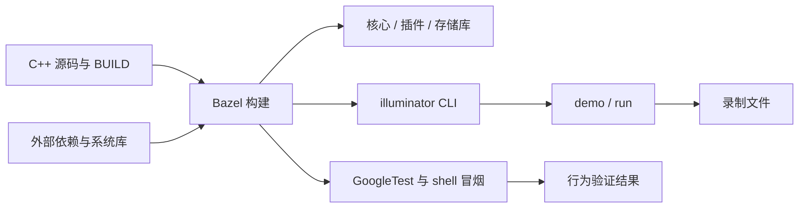
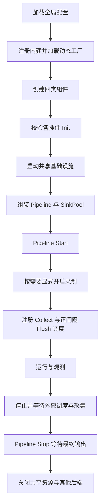

# 09 开发、构建与验证

核心工程可以通过 Bazel 独立构建并由 CLI 运行，不需要启动 Server 或前端。本篇提供可复现入口，并区分“当前已执行的验证”和“后续新增能力的验收要求”。

返回 [设计总览](./index.md)。所有 shell 命令默认在 `/sandbox/illuminator` 执行。

## 1. 环境与构建

当前宿主实现面向 Linux，依赖 timerfd、epoll、eventfd 和 proc。构建使用 C++20、Bazel 7.6.1 或 Bazelisk、Python 3，以及系统 libbpf、libelf、zlib 和 SQLite 开发库。spdlog、nlohmann/json、yaml-cpp、GoogleTest 由 Bazel 获取。

Clang 与 bpftool 用于新增 BPF 探针编译；运行合成 demo 不需要 root。真实探针的权限、内核配置和架构要求应由具体 Source 单独说明。

```bash
make check-env
bazel build //src/...
bazel test //src/... --test_output=errors

# 只构建优化版 CLI
bazel build //src/cli:illuminator --config=opt
```

Makefile 的 make build、make test、make build-opt 是相应封装。`.bazelrc` 开启 frame pointer 并保留符号，便于后续用户栈解析；opt 配置使用 O2。工具链目前仍读取系统库和 BPF 工具，不能据此宣称构建已完全 hermetic。

<div style="overflow-x: auto; margin: 1.5rem 0;">



</div>

## 2. 最小运行与输出检查

```bash
./bazel-bin/src/cli/illuminator version
./bazel-bin/src/cli/illuminator plugins
./bazel-bin/src/cli/illuminator storage
./bazel-bin/src/cli/illuminator --help

./bazel-bin/src/cli/illuminator demo \
  --config illuminator.yaml.example \
  --duration 2 \
  --output-dir /tmp/illuminator-demo
```

demo 的 Source 每 50ms 生成一条计数记录，字段名为 value；它不读取系统 CPU。运行到期后进入关闭路径，并输出处理批次、记录、错误与录制信息。`--duration` 为 1..86400 秒，默认 1 秒。

plugins 查询已注册的四类组件；storage 只列出可用后端，不创建数据库或自动执行 SQL。demo_counter 在执行 demo 时才注册，不要求独立 plugins 命令将它列为常驻插件。

可以用以下脚本验证新生成的录制文件包含可解析的头和批次：

```bash
python3 - <<'PY'
import json
from pathlib import Path

files = sorted(Path('/tmp/illuminator-demo').glob('*.ilr'))
assert files, 'no recording produced'
with files[-1].open(encoding='utf-8') as stream:
    header = json.loads(next(stream))
    assert header['format'] == 'ilr' and header['version'] == 1
    batches = [json.loads(line) for line in stream if line.strip()]
assert batches, 'recording contains no batches'
records = sum(len(item['data']['records']) for item in batches)
print(files[-1], 'batches=', len(batches), 'records=', records)
PY
```

这只能确认格式可读和有输出，不保证顺序、丢弃为零或所有字节已经 fsync。文件格式边界见 [08](./08-recording-and-storage.md)。

## 3. 动态 Source 运行

将兼容 SDK 的动态库放进配置目录，例如：

```yaml
global:
  data_dir: ./data
  plugin_dirs:
    - /opt/illuminator/plugins
```

```bash
./bazel-bin/src/cli/illuminator plugins --config illuminator.yaml
./bazel-bin/src/cli/illuminator run \
  --source my_source --sink recording \
  --config illuminator.yaml --duration 5 \
  --output-dir /tmp/illuminator-run
```

my_source 是待开发插件的名称示例，并非内建组件。应先确认工厂确实加载，再运行；目录加载返回 OK 不能代替按名称检查。当前 run 用空 ConfigValue 初始化 Source，复杂插件参数及处理链需要 C++ 宿主装配。

测试库 `src/plugin/test/test_source_plugin.cc` 提供真实共享库入口示例，`//src/plugin/test:test_source_plugin.so` 是 testonly 目标，不是业务发布包。

## 4. 使用 SDK 装配宿主

<div style="overflow-x: auto; margin: 1.5rem 0;">



</div>

Pipeline 不自动调用 Init，不自动注册采集或刷新定时器。为 Source 设置防重入策略；CollectPool 任务使用的裸指针或引用在退出前必须保持有效。信号处理函数只设置安全的退出标记，把阻塞关闭工作放回正常控制线程；当前 CLI 使用 sig_atomic_t 标记处理 SIGINT/SIGTERM。

失败路径同样要执行关闭顺序。可以参考 `RuntimeShutdown`：先让 Timer 静默并 join，排空 Collect，再停 Pipeline，最后停基础设施。不能先停 SinkPool 再指望最终 Flush 的任务执行。

## 5. 当前测试组织

| 领域 | 现有验证重点 | 源码位置 |
| --- | --- | --- |
| 公共契约 | Status、ConfigValue、YAML 默认值和非法配置 | `src/core/common/test` |
| 内存与队列 | Arena、环形队列、并发与容量行为 | `src/core/memory/test` |
| 线程池 | 任务执行、并发与排空 | `src/core/threading/test` |
| 数据与通道 | Record/StackSample、驻留、事件及水位 | `src/core/engine/test` |
| Pipeline 集成 | 转换链、多管道、刷新、反压和输出过载 | `pipeline_integration_test.cc` |
| Pipeline 停机 | 异步 Write 完成后再 Stop Sink，共享池可继续使用 | `pipeline_shutdown_test.cc` |
| 动态 Sink | 添加、移除及有限并发场景 | `pipeline_dynamic_sink_test.cc` |
| 插件 | 工厂创建和真实 `.so` SDK 路径 | `src/plugin/test`、CLI 冒烟 |
| SQLite | 存储、查询与只读 SQL 等 | `src/storage/sqlite_backend/test` |
| CLI | demo、动态 Source、配置错误、录制与信号退出 | `src/cli/smoke_test.sh` |

“存在相关测试”不表示所有并发组合都已正确。尤其动态 Sink 测试不能替代每 Sink 在途写入屏障；当前已知限制仍在 [10](./10-core-audit-and-evolution.md) 保留。

### 5.1 关键回归命令

```bash
bazel test //src/core/engine/test:pipeline_shutdown_test
bazel test //src/core/engine/test:pipeline_integration_test
bazel test //src/cli:smoke_test

bazel test //src/cli:smoke_test \
  //src/core/engine/test:pipeline_shutdown_test \
  //src/core/common/test:config_test --config=asan

# 更广的内存或竞态验证：按修改范围和环境执行
make asan
make tsan
```

过载与关闭测试应使用 promise、条件变量或显式门闩建立“工作线程已阻塞”的条件，再提交数据并核对结果。固定睡眠不能稳定证明队列状态，容易把机器繁忙造成的时序差异误判为引擎缺陷。

## 6. 已完成验证记录

以下结果来自 2026-11-04 核心精简后的代码验证，属于当时工作区基线，不表示每次打开本文都重新执行过：

| 检查 | 结果 | 证明范围 |
| --- | --- | --- |
| `bazel build //src/...` | 40 个目标构建成功 | 保留源码、链接和测试产物可构建 |
| `bazel test //src/...` | 18/18 测试目标通过 | 当前自动化覆盖的核心行为 |
| CLI、停机、ConfigValue 定向 ASAN | 3/3 通过 | 这些目标所覆盖路径的地址检查 |
| 1 秒实际 demo | 20 批、20 条，录制 20 批，错误 0 | 最小采集、处理、输出和关闭闭环 |
| Docker 镜像 | 未实际构建，本机无 Docker | Dockerfile 已调整，运行验收尚缺 |
| 全量 ASAN / TSAN | 本次未执行全套 | 不声明全量 Sanitizer 通过 |
| 真实 eBPF 探针 | 未进行生产探针实机验收 | SDK 编译不等于内核采样验证 |

CI 保留全量 C++ 构建测试、Sanitizer 和核心 CLI 镜像流程；工作流配置存在不等于当前远端流水线全部通过。文档更新本身应检查链接、Mermaid 和 VitePress 构建，不需要为纯文字变更反复执行全量 C++ 测试。

## 7. 后续验收矩阵

新增代码应围绕行为风险增加必要验证：

| 变更 | 至少需要确认 |
| --- | --- |
| Source | 无数据、错误、采集重入、Stop 与采集静默 |
| Processor | 过滤、转换失败、新旧批次字符串寿命 |
| Aggregator | 窗口边界、Flush 失败、最终刷新与内存增长 |
| Sink | 并发 Write、阻塞、错误、Flush/Stop 顺序 |
| 动态库 | 符号/API 版本、缺依赖、实例与句柄寿命 |
| 调度器 | 非法周期、过期追赶、Cancel 与已触发回调 |
| 存储 | 类型与精度、事务失败、查询寿命、关闭和并发 |

性能验收需要固定硬件、内核、编译模式、数据规模和 Sink 行为，同时记录丢弃率。吞吐、延迟、CPU 与 RSS 必须组合报告，不能通过丢弃大量输入获得的低 CPU 数字宣称性能提升。
