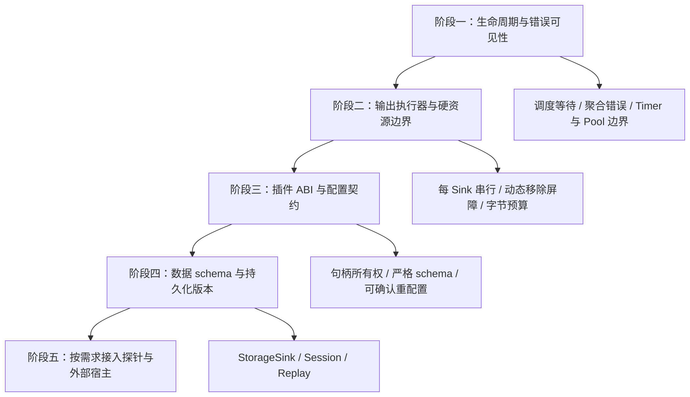

# 10 核心架构审阅与演进

保留内核已经具备独立构建、运行、插件装配和持久化输出闭环，可以作为后续重构的基线。当前最需要完善的是宿主与组件的生命周期契约，其次是插件二进制边界、配置与数据表达的一致性。删除应用层缩小了维护范围，但不会自动修复保留核心中的并发问题。

本篇替代源码仓库旧架构审阅报告，仅审阅当前核心，不保留已删除 Server、Feature、前端的缺陷章节。返回 [设计总览](./index.md)。

## 1. 评估口径

| 级别 | 本文含义 |
| --- | --- |
| P0 | 违反当前使用约定时可能出现资源寿命、竞态或停机错误，应优先收敛 |
| P1 | 影响数据完整性、扩展契约或资源边界，接入对应能力前需处理 |
| P2 | 性能、可维护性与工程化改进，按实测和需求安排 |

分级服务于核心重构顺序，不表示所有问题在当前 CLI 的受限路径上都会触发。每项同时说明当前可用约定与后续改进，避免将建议误认为已经实现。

## 2. 已完成的边界清理

| 清理项 | 当前结果 | 代码依据 |
| --- | --- | --- |
| 注册表与业务编排解耦 | 移除 Driver 工厂，保留四类组件工厂 | `src/plugin/infra/plugin_registry.h` |
| SQLite 迁出应用目录 | 独立 StorageBackend 与 SQLite target | `src/storage` |
| 移除录制全局裸指针注册表 | 宿主持有具体 Sink，保留 RecordableInterface | `src/plugin/api/recording_interface.h` |
| 提供核心运行入口 | CLI 直接装配并定时采集，支持动态 Source | `src/cli/main.cc` |
| 整管道输出停止屏障 | Stop 等待本 Pipeline 异步 Write 后关闭 Sink | `src/core/engine/pipeline.h` |
| 录制路径和关闭 | filesystem 建目录，Stop 关闭文件，数据写失败返回错误 | `recording_sink.h` |
| eBPF 公共头兼容 | 复用 bpf_compat，增加 SDK 编译覆盖 | `src/ebpf_common`、测试 Source |

这些结果已由 [09](./09-development-and-validation.md) 的构建和测试基线支持。输出停止屏障是整条 Pipeline 的保障，不等于动态移除 Sink 也有相同保障。

## 3. P0：并发与生命周期

### 3.1 外部采集不属于 Pipeline 的停止屏障

**证据：** GetSource/Enqueue/Stop 没有外部 Collect 的在途计数。Stop 会调用 Source Stop，可能关闭骨架和 ring buffer；外部任务仍持有 Source 裸指针时存在资源竞争。

**当前约定：** 先停止并 join Timer，排空 CollectPool，再 Stop Pipeline；同一 Source 不重叠 Collect。检查 IsRunning 无法代替等待。

**建议：** 提供可停止且可等待的调度句柄，或在宿主运行对象中维护 Collect 在途屏障。验收需显式阻塞 Collect，证明 Stop 不会提前关闭 Source 资源。

### 3.2 动态移除 Sink 不等待在途输出

**证据：** RemoveSinkRuntime 只从集合移除，随后立即 Flush/Stop；已提交任务仍持有 Sink 的 shared_ptr。

**影响：** 对象内存存在，但文件或连接已经关闭，旧任务仍可能继续 Write。AddSinkRuntime 与 Stop 并发也没有完整状态机。

**当前约定：** 异步输出时停止管道后再重建 Sink 集合，生命周期操作由一个 owner 串行执行。

**建议：** 每 Sink 独立的“停止接收 → 等待在途 → Flush → Stop”协议。测试必须覆盖提交后尚未开始的任务，而不仅是列表遍历安全。

### 3.3 同一 Sink 的 Write 并发与乱序

**证据：** 每批每 Sink 独立提交到共享池。多个线程可同时调用同一实例，mutex 也不保证按提交顺序获得。

**影响：** 非线程安全插件出现数据竞争；录制文件或有序流消费者观察到批次乱序。

**当前约定：** Sink 自行同步；严格顺序场景使用同步输出并接受 I/O 阻塞。

**建议：** 每 Sink 串行执行器或有序队列，结合动态移除屏障设计；区分批次提交顺序、事件时间顺序和持久化完成顺序。

### 3.4 控制入口绕过处理线程

**证据：** RunProcessors 和 Reconfigure 直接调用插件，不切换到 ProcessThread，也不冻结 Source。

**当前约定：** CLI 不暴露热重配置；嵌入方停机修改，或自行同步控制与工作方法。

**建议：** 引入可确认的控制命令队列，明确执行线程、可失败状态和超时；不能只给 running 增加原子操作就认为生命周期完整。

## 4. P1：契约、完整性与资源边界

| 问题 | 代码行为与影响 | 后续工作 |
| --- | --- | --- |
| 动态库为 C++ SDK | create 返回 C++ 对象，destroy/process 未参与；句柄析构 dlclose | 选择版本化 C++ SDK 或纯 C 函数表，绑定工厂和实例的库寿命 |
| 配置缺少严格类型 | 下标读副本、宽松转换、插件无 schema | 显式 Set、严格读取、统一 Init/Reconfigure 校验 |
| 数据形状固定 | Type 多种，载荷仍为 Record/StackSample | 明确 schema 与版本，评估通用事件信封 |
| 聚合错误未完整传播 | Add 状态忽略，Flush 失败不计入 ErrorCount | 建立错误计数、日志与是否停止的策略 |
| Flush 控制尽力投递 | 共用通道，驱逐后重试仍可能失败 | 独立控制通道或序号确认，保留停机最终刷新 |
| eBPF map/event 选择丢结果 | event_batch 非空即覆盖 map_result | 在混合 Source 接入前定义合并和错误规则 |
| 线程池无硬容量 | 提交前软阈值无法限制并发扇出和字节数 | 有界队列、拒绝结果、每管道预算与公平性 |
| 停止后仍可 Submit | 工作线程可能退出，任务无人执行 | 底层拒绝提交并返回明确结果，覆盖关闭竞争 |
| Timer 参数与启动状态 | 周期未拒绝非正值，fd 错误未完整上抛 | 严格参数校验与可检查启动状态 |
| 录制和数据库分离 | 无 StorageSink、统一会话、版本迁移或回放 | 先定义持久化契约，再加适配器与 Session |

配置、数据和 ABI 的改变可能引入兼容性成本，应先确定契约再迁移插件。解决这些问题不需要恢复已删除的上层框架。

## 5. P2：性能与维护

| 观察点 | 当前实现 | 改进触发条件 |
| --- | --- | --- |
| 小批内存成本 | 默认每批 Arena 立即分配 64KiB | 观察驻留批次和 RSS 后评估批次合并与安全复用 |
| 字段布局 | 每条 Record 使用字段哈希表 | 固定指标高吞吐场景再评估 schema 布局 |
| 指标同步 | 全局 mutex，热路径构造名称并更新 | 实测竞争后做分片、缓存或周期汇总 |
| 延迟统计 | min/max/avg，无分位数 | 性能验收需要尾延迟时增加桶或专用直方图 |
| PID 管理 | 扫描 proc、线性查重、全量 map 重写 | 大进程数时测扫描成本，改增量更新并补退出场景 |
| 错误日志 | 过载和入队失败可频繁打印 | 持续过载测试后引入限频与累计计数 |
| SQLite 生命周期 | 读写、维护和 Close 同步不统一 | 扩展并发读取前明确锁与连接模型 |
| SQLite 查询语义 | total_count 为本页行数，has_more 未完整实现 | 需要分页时增加稳定游标与真实计数定义 |
| SQLite 注册 | 头文件静态初始化 | 改显式 `.cc` 注册，减少重复和顺序依赖 |
| 单例资源 | 多宿主共享 Registry/Infrastructure/Metrics | 有隔离需求时再引入 RuntimeContext |
| 工具链 | BPF 与 SQLite 等使用系统依赖 | 跨平台交付时固定版本和构建环境 |

ResourceLimiter 只报告 RSS 超限，不会自动强制限额。低 CPU、低延迟和小内存必须通过负载测试证明，不能依据“无锁队列”或“Arena”名称推导。

## 6. 建议的演进顺序

这是后续建议的依赖顺序，不是本次文档迁移新增的实现承诺。不同阶段应保留小步、可回归的修改：先固化使用约定和可观察结果，再引入新的执行结构。

### 6.1 需要后续明确选择的设计点

| 设计点 | 可选方向 | 决策依据 |
| --- | --- | --- |
| 插件边界 | 固定工具链 C++ SDK；或 opaque handle + C 函数表 | 是否需要第三方语言与跨工具链兼容 |
| 输出顺序 | 每 Sink 串行；或显式无序并发 | 消费者是否要求可回放顺序、吞吐目标 |
| 数据扩展 | 保持双模型；或版本化 schema / 事件信封 | 真实 Trace/Log 的接入需求 |
| 运行上下文 | 继续受限单例；或实例化 RuntimeContext | 多租户、测试隔离与嵌入多实例需求 |
| 持久化 | 优先文件流；或数据库查询；或统一会话 | 数据规模、时序精度与回放要求 |

这些选择应在对应重构开始时确定，不能仅为文档完整而擅自选定新架构。

## 7. 验收原则

生命周期改进必须通过阻塞采集和阻塞输出等确定性用例验证；ABI 改进必须通过真实库与不匹配版本验证；持久化改进必须验证精度、类型、部分写入和崩溃恢复；性能改进必须同时报告有效处理量与丢弃率。

现有 18 个测试目标与定向 ASAN 提供基线，尚不覆盖任意并发启停、完整 Sanitizer、生产探针和回放。每项问题只有在实现、回归和适用边界同时更新后，才应从本篇待办中移除。
