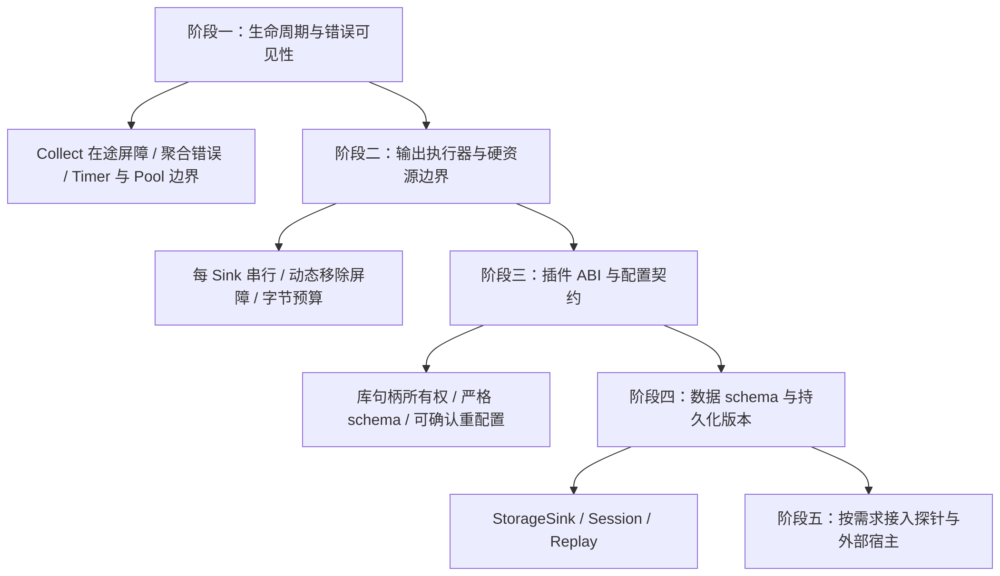

# 10 核心架构审阅与演进

保留内核已经具备独立构建、运行、插件装配和持久化输出闭环。当前最需要收敛的是**宿主与组件的生命周期契约**，其次是插件二进制边界、配置与数据表达的一致性。删除应用层缩小了维护范围，但不会自动修复保留核心里的并发问题。

本篇替代旧架构审阅报告，只审阅当前核心。返回 [设计总览](./index.md)。

## 1. 评估口径

| 级别 | 含义 |
| --- | --- |
| **P0** | 违反当前使用约定时可能出现资源寿命、竞态或停机错误 |
| **P1** | 影响数据完整性、扩展契约或资源边界，接入前需处理 |
| **P2** | 性能、可维护性与工程化改进 |

分级服务于重构顺序，不表示所有问题都会在当前 CLI 路径上触发。每一项都区分“当前可用约定”和“后续建议”。

## 2. 已完成的边界清理

| 清理项 | 当前结果 |
| --- | --- |
| 注册表与业务编排解耦 | 移除 Driver 工厂，保留四类组件工厂 |
| SQLite 迁出应用目录 | 独立 `StorageBackend` 与 SQLite target |
| 移除录制全局裸指针注册表 | 宿主持有具体 Sink，保留 `RecordableInterface` |
| 提供核心运行入口 | CLI 直接装配并定时采集，支持动态 Source |
| 整管道输出停止屏障 | Stop 等待本 Pipeline 异步 Write 后再关闭 Sink |
| 录制路径和关闭 | filesystem 建目录，Stop 关闭文件，写失败返回错误 |
| eBPF 公共头兼容 | 复用 `bpf_compat`，增加 SDK 编译覆盖 |

这些结果由 [09](./09-development-and-validation.md) 的历史记录支持。整管道输出屏障不等于“动态移除 Sink”也有相同保障。

## 3. P0：并发与生命周期

### 3.1 外部采集不属于 Pipeline 的停止屏障

**证据**：`GetSource()` / `Enqueue()` / `Stop()` 没有外部 Collect 的在途计数。`Stop()` 会调用 `source_->Stop()`，可能关闭 skeleton 和 ring buffer；外部任务仍持有 Source 裸指针时存在资源竞争。

**当前约定**：先停止并 join Timer，排空 CollectPool，再 `Pipeline::Stop()`；同一 Source 不重叠 Collect。检查 `IsRunning()` 不能代替等待。

**后续建议**：提供可停止且可等待的调度句柄，或在宿主运行对象中维护 Collect 在途屏障。

详见 [02/04 线程模型](./02-pipeline-v3/04-thread-model-and-scheduling.md)。

### 3.2 动态移除 Sink 不等待在途输出

**证据**：`RemoveSinkRuntime` 只从 `sinks_` 移除，随后立即 `Flush()` + `Stop()`；已提交任务仍持有 Sink 的 `shared_ptr`。

**影响**：对象内存存在，但文件或连接已经关闭，旧任务可能继续 `Write()`。

**当前约定**：异步输出时，停止管道后再重建 Sink 集合；生命周期操作由一个 owner 串行执行。

**后续建议**：每 Sink 的“停止接收 → 等待在途 → Flush → Stop”协议。测试要覆盖“已提交但尚未开始”的任务，而不仅是列表遍历安全。

详见 [02/07 输出与停机](./02-pipeline-v3/07-output-and-shutdown.md)。

### 3.3 同一 Sink 的 Write 并发与乱序

**证据**：每批每 Sink 独立提交到共享池。多个线程可同时调用同一实例，mutex 也不保证按提交顺序获得。

**影响**：非线程安全插件出现数据竞争；录制文件或有序流消费者观察到批次乱序。

**当前约定**：Sink 自行同步；严格顺序场景使用同步输出并接受 I/O 阻塞。

**后续建议**：每 Sink 串行执行器或有序队列，结合动态移除屏障设计。

### 3.4 控制入口绕过处理线程

**证据**：`RunProcessors` 和 `Reconfigure` 直接调用插件，不切换到 ProcessThread，也不冻结 Source。

**当前约定**：CLI 不暴露热重配置；嵌入方停机修改，或自行同步控制与工作方法。

**后续建议**：引入可确认的控制命令队列，明确执行线程、可失败状态和超时。

### 3.5 Pipeline 重复 Start / 并发 Stop

**证据**：

- `Start()` 不检查 `running_`；重复调用会再次启动插件并创建第二个 ProcessThread。
- `Stop()` 用 `running_.exchange(false)`；第二个并发 Stop 立即返回 Ok，不等待第一个完成。

**当前约定**：宿主保证 Start/Stop 串行且只调用一次。

**后续建议**：显式的生命周期状态机，拒绝重复 Start；并发 Stop 返回“正在停止”或等待承诺。

### 3.6 AddSinkRuntime 与 Stop 的竞态

**证据**：`AddSinkRuntime` 先 `sink->Start()`，再获取写锁 push；如果与 Stop 并发，可能把已启动 Sink 加到已停止 Pipeline，之后析构 Stop 直接返回，Sink 不会被停。

**当前约定**：动态 Sink 操作与 Stop 串行。

**后续建议**：在写锁内重新检查 `running_`，失败时 `Stop()` 新 Sink 并返回错误。

## 4. P1：契约、完整性与资源边界

| 问题 | 代码行为与影响 | 后续工作 |
| --- | --- | --- |
| 动态库为 C++ SDK | `create` 返回 C++ 对象，`destroy`/`process` 未参与；句柄析构 `dlclose` | 版本化 C++ SDK 或纯 C 函数表，绑定工厂与实例的库寿命 |
| 配置缺少严格类型 | 下标返回副本、宽松转换、插件无 schema | 显式 `Set`、严格读取、统一 Init/Reconfigure 校验 |
| 数据形状固定 | Type 多种，载荷仍为 Record/StackSample | 明确 schema 与版本，评估通用事件信封 |
| 聚合错误未完整传播 | `Add` 状态忽略，`Flush` 失败不计入 `ErrorCount` | 建立错误计数、日志与是否停止的策略 |
| Flush 控制尽力投递 | 共用通道，驱逐后重试仍可能失败 | 独立控制通道或序号确认，保留停机最终刷新 |
| eBPF map/event 选择丢结果 | `event_batch` 非空即覆盖 `map_result` | 在混合 Source 接入前定义合并和错误规则 |
| 线程池无硬容量 | 提交前软阈值无法限制并发扇出和字节数 | 有界队列、拒绝结果、每管道预算与公平性 |
| 停止后仍可 Submit | 工作线程可能退出，任务无人执行 | 底层拒绝提交并返回明确结果 |
| Timer 参数与启动状态 | 周期未拒绝非正值，fd 错误未完整上抛 | 严格参数校验与可检查启动状态 |
| 录制和数据库分离 | 无 StorageSink、统一会话、版本迁移或回放 | 先定义持久化契约，再加适配器与 Session |
| SQLite 查询语义 | 只查 records，`total_count` 是返回行数，`has_more` 未实现 | 需要分页时增加稳定游标与真实计数 |
| PidManager timer ID 0 | TimerWheel 第一个 ID 是 0，PidManager 用 0 表示未注册 | 改用 `optional`/哨兵值，补取消测试 |

配置、数据和 ABI 的改变可能引入兼容成本，应先确定契约再迁移插件。

## 5. P2：性能与维护

| 观察点 | 当前实现 | 改进触发条件 |
| --- | --- | --- |
| 小批内存成本 | 默认每批 Arena 立即分配 64KiB | 观察驻留批次和 RSS 后评估批次合并与安全复用 |
| 字段布局 | 每条 Record 使用字段哈希表 | 固定指标高吞吐场景再评估 schema 布局 |
| 指标同步 | 全局 mutex，热路径构造名称并更新 | 实测竞争后做分片、缓存或周期汇总 |
| 延迟统计 | min/max/avg，无分位数 | 需要尾延迟时增加桶或专用直方图 |
| PID 管理 | 扫描 `/proc`、线性查重、全量 map 重写 | 大进程数时改增量更新并补退出场景 |
| 错误日志 | 过载和入队失败可频繁打印 | 持续过载测试后引入限频与累计计数 |
| SQLite 生命周期 | 读写、维护和 Close 同步不统一 | 扩展并发读取前明确锁与连接模型 |
| SQLite 注册 | 头文件静态初始化，只对包含该头的 TU 生效 | 改显式 `.cc` 注册，减少重复和顺序依赖 |
| 单例资源 | 多宿主共享 Registry/Infrastructure/Metrics | 有隔离需求时引入 RuntimeContext |
| 工具链 | BPF 与 SQLite 使用系统依赖 | 跨平台交付时固定版本和构建环境 |

`ResourceLimiter` 只报告 RSS 超限，不会自动强制限额。低 CPU、低延迟和小内存必须通过负载测试证明。

## 6. 演进顺序

这是依赖顺序，不是已经实现的承诺。每一步都应保留小步、可回归的修改：先固化使用约定和可观察结果，再引入新的执行结构。

### 6.1 需要后续明确选择的设计点

| 设计点 | 可选方向 | 决策依据 |
| --- | --- | --- |
| 插件边界 | 固定工具链 C++ SDK；或 opaque handle + C 函数表 | 是否需要第三方语言与跨工具链兼容 |
| 输出顺序 | 每 Sink 串行；或显式无序并发 | 消费者是否要求可回放顺序、吞吐目标 |
| 数据扩展 | 保持双模型；或版本化 schema / 事件信封 | 真实 Trace/Log 的接入需求 |
| 运行上下文 | 继续受限单例；或实例化 RuntimeContext | 多租户、测试隔离与嵌入多实例需求 |
| 持久化 | 优先文件流；或数据库查询；或统一会话 | 数据规模、时序精度与回放要求 |

## 7. 验收原则

- 生命周期改进：用阻塞采集和阻塞输出的确定性用例验证。
- ABI 改进：用真实库与不匹配版本验证。
- 持久化改进：验证精度、类型、部分写入和崩溃恢复。
- 性能改进：同时报告有效处理量与丢弃率。

现有 18 个测试目标与定向 ASAN 提供基线，尚不覆盖任意并发启停、完整 Sanitizer、生产探针和回放。每项问题只有在实现、回归和适用边界同时更新后，才应从本篇待办中移除。

## 小结

- P0 集中在“宿主与组件的停止屏障”：外部 Collect、动态 Sink、并发 Write、控制入口、重复 Start/并发 Stop。
- P1 集中在 ABI、配置、数据 schema、聚合错误、控制信号、线程池边界和存储语义。
- P2 是性能与工程化改进，需由实测触发。
- 演进应先生命周期，再输出边界，再 ABI/配置，最后数据与持久化。

返回 [设计总览](./index.md) · 上一篇：[开发与验证](./09-development-and-validation.md)
