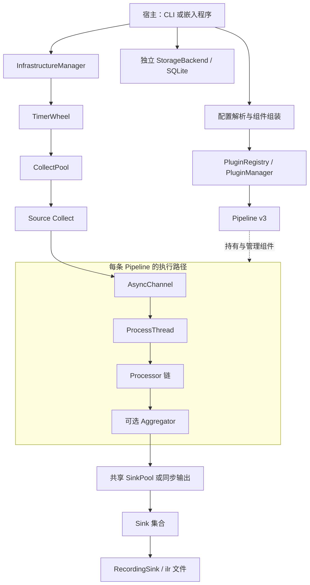

# Illuminator 核心引擎设计方案

Illuminator 面向系统性能观测，提供可嵌入的 C++20 数据采集与处理内核。核心抽象是一条 Pipeline：Source 产生批次，Processor 顺序转换，Aggregator 按窗口积累，Sink 消费输出。插件系统负责组件发现与实例化；调度、内存、配置和持久化提供支撑能力。

本文档集以 **2026-11-04 核心精简后的 `/sandbox/illuminator` 实现**为依据，代码基线为 `ba05c04`。当前交付边界为 Pipeline v3、四类插件框架、数据模型、配置、公共基础设施、eBPF SDK、录制 Sink、独立 SQLite 和最小 CLI。原有 FeatureBus、FeatureDriver、具体 CPU Source、Server、SSE 和前端已移除。

文档中的“已实现”指代码中存在的行为，“宿主约定”指嵌入方必须满足的使用条件，“后续建议”指尚未交付的改进。接口注释与执行路径不一致时，本文按执行路径描述，并标明差异。

## 1. 设计目标与边界

| 目标 | 当前实现方式 | 适用边界 |
| --- | --- | --- |
| 核心可独立运行 | CLI 直接组装 Pipeline，demo 输出真实录制文件 | demo 是合成计数器，不测量系统 CPU |
| 采集与处理解耦 | CollectPool、每管道 AsyncChannel 和 ProcessThread | 采集调度由宿主持有 |
| 输出扩展 | 多 Sink 与共享 SinkPool | 异步 Write 可并发、可乱序 |
| 插件扩展 | 四类 C++ 接口、工厂注册、`.so` 加载 | 要求兼容工具链，无安全热卸载保证 |
| 控制数据积压 | 有界输入通道、水位反压、输出池软阈值 | 非端到端硬内存配额，不保证无损 |
| 明确数据寿命 | DataBatch 共享所有权、Arena 驻留字符串 | 发布后不可变依赖插件约定 |
| 保留持久化基础 | RecordingSink 与独立 StorageBackend | SQLite 尚无通用 StorageSink 接入 |

当前不包含应用控制 API、界面、业务 Feature 编排、生产探针集合和确定性回放。后续应用可以依赖本内核重新构建；其协议、权限和展示模型应另行设计。

## 2. 系统全景

图中的 SQLite 由宿主独立调用；当前没有从 Pipeline 自动写入 SQLite 的通路。无 Aggregator 时，Processor 的结果直接进入输出阶段；无 Processor 时，Source 批次直接进入聚合或输出阶段。

## 3. 文档地图

| 子文档 | 主要回答的问题 |
| --- | --- |
| [01 总体架构与模块边界](./01-overall-architecture.md) | 哪些模块保留，构建依赖、运行关系和所有权如何组织？ |
| [02 Pipeline v3 详细设计](./02-pipeline-v3.md) | 数据、Flush、线程、反压、启动回滚和排空停机怎样协作？ |
| [03 插件系统与扩展契约](./03-plugin-system.md) | 四类接口如何使用，工厂和动态库如何加载，ABI 有哪些限制？ |
| [04 数据模型与内存生命周期](./04-data-and-memory.md) | 批次如何表示指标与堆栈，Arena 和 string_view 如何保持有效？ |
| [05 配置与错误处理](./05-configuration-and-status.md) | 全局 YAML 与插件参数如何分工，Status 如何传播？ |
| [06 调度、线程与自观测](./06-scheduling-and-observability.md) | TimerWheel、线程池、PID 管理和资源检查承担什么责任？ |
| [07 eBPF 公共采集设施](./07-ebpf-sdk.md) | skeleton、map、ring buffer 和内核能力探测如何接入 Source？ |
| [08 录制与独立存储](./08-recording-and-storage.md) | `.ilr` 和 SQLite 分别保存什么，如何关闭与查询？ |
| [09 开发、构建与验证](./09-development-and-validation.md) | 如何运行内核、开发插件，以及验证哪些行为？ |
| [10 核心架构审阅与演进](./10-core-audit-and-evolution.md) | 当前风险是什么，后续重构应先解决哪些问题？ |

初次阅读建议按 `总览 → 01 → 02 → 04 → 09`；插件作者继续阅读 `03、05、07`；负责嵌入与运行稳定性的开发者重点阅读 `02、06、08、10`。

图表按原始字号呈现，宽图可在图内横向滚动；正文和表格保持站点默认布局。

## 4. 核心设计取舍

1. **由宿主组织运行，而非注册表组织运行。** Registry 只保存组件工厂，不创建或启停整条业务管道。
2. **由 ProcessThread 顺序访问 Processor 与 Aggregator。** 数据和 Flush 进入同一通道，避免常规路径上的聚合并发。
3. **通过批次共享减少传递成本。** 数据从处理阶段向多个 Sink 扇出时共享只读视图，字符串由 Arena 管理。
4. **允许以丢弃换取输入侧资源边界。** 通道容量按条目计算；输出线程池仍需后续补充硬性限额与隔离。
5. **生命周期按所有权关闭。** 宿主先撤销外部生产者，Pipeline 再排空自身事件及输出，最后释放共享基础设施。
6. **存储保持独立。** 持久化格式与后端不进入引擎调度逻辑，后续通过 Sink 适配器衔接。

这些取舍形成可工作的内核基线，同时留下动态 Sink、插件 ABI、严格配置和数据 schema 等需要继续收敛的边界。

## 5. 交付状态与文档维护

核心精简后的全量构建和 18 个测试目标已通过；3 个定向目标通过 ASAN，1 秒 demo 处理并录制 20 批、20 条记录。验证条件及未覆盖范围见 [09](./09-development-and-validation.md)。这些结果不代表真实 eBPF 探针、任意并发启停、跨工具链插件或完整回放已验收。

设计文档统一维护在本目录；源码仓库保留 `README.md`、配置样例、构建和测试入口。修改核心接口时，应同步更新对应专题与 [10](./10-core-audit-and-evolution.md) 中的问题状态。实现尚未落地的演进项必须持续保留“后续建议”标记。
