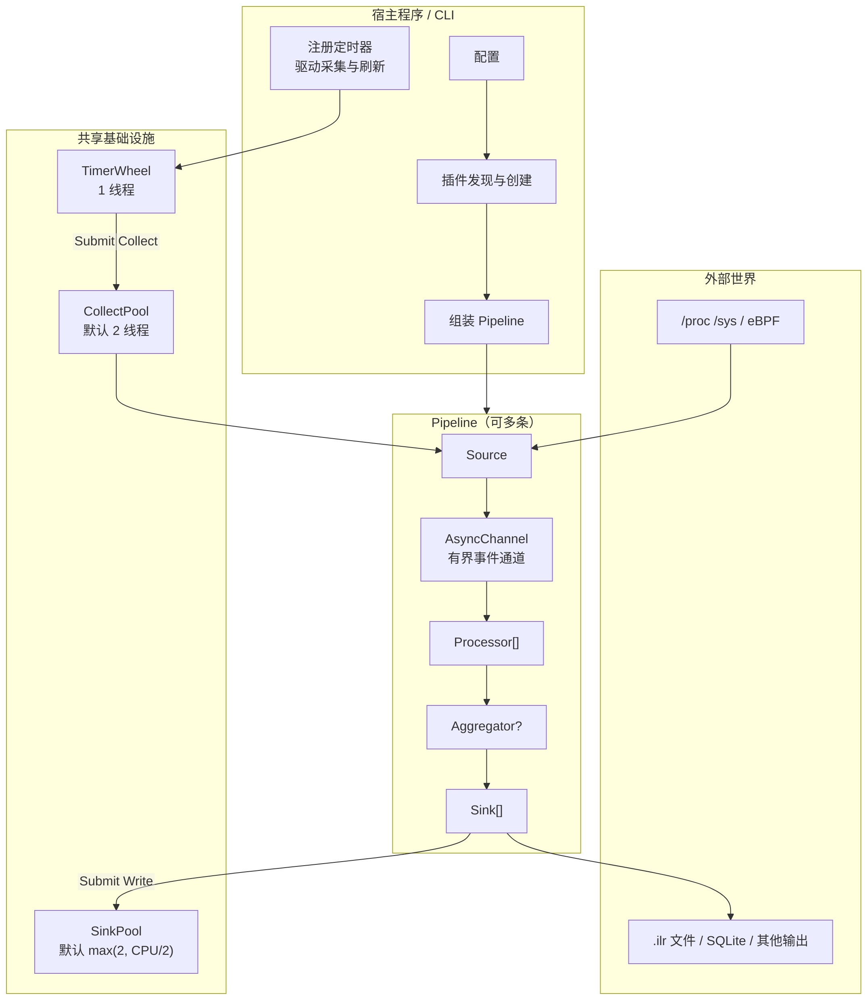

# Illuminator 设计方案总览

**Illuminator 是一个面向 Linux 的可嵌入 C++20 性能观测内核。** 它负责把系统观测数据从采集端送到输出端，但不提供 Server、Web UI、告警平台或完整产品编排。

> 代码基线：`/workspace/illuminator`，HEAD `ba05c04`，2026-11-04。本文档集只描述该基线中的核心引擎。

## 1. 先看全局

<div style="overflow-x: auto; margin: 1.5rem 0;">



</div>

一次运行的主线：

```text
宿主配置 → 发现/创建插件 → Init → 启动基础设施
  → 组装 Pipeline → Start
  → TimerWheel 定时触发 Collect
  → CollectPool 执行 Source::Collect
  → 批次进入 AsyncChannel
  → ProcessThread 执行 Processor / Aggregator
  → SinkPool 执行 Sink::Write
  → 录制文件或数据库
  → 停 Timer、排空 Collect、Stop Pipeline、停基础设施
```

## 2. 五个核心角色

| 角色 | 一句话定义 | 谁实现 |
| --- | --- | --- |
| **Source** | 数据的生产者，周期性地返回一批观测数据 | 插件作者 / eBPF SDK |
| **Processor** | 逐批转换、过滤、派生 | 插件作者 |
| **Aggregator** | 跨批缓冲，按刷新信号输出聚合结果 | 插件作者 |
| **Sink** | 把只读批次写到最终目标 | 插件作者 / `RecordingSink` |
| **Host** | 组合根：配置、Init、组装、调度、关闭 | 嵌入方 / CLI |

Pipeline 只是这四类角色的容器和调度器，它**不实现**业务逻辑，也**不负责**插件初始化。

## 3. 五个运行资源

| 资源 | 一句话定义 | 归属 |
| --- | --- | --- |
| **TimerWheel** | 全局定时调度器，决定何时采集/刷新 | `InfrastructureManager` |
| **CollectPool** | 执行 `Collect()` 的共享线程池 | `InfrastructureManager` |
| **AsyncChannel** | 每 Pipeline 一条的有界事件通道 | `Pipeline` |
| **ProcessThread** | 每 Pipeline 一个的处理线程 | `Pipeline` |
| **SinkPool** | 执行 `Write()` 的共享线程池 | `InfrastructureManager` |

## 4. 术语表

| 术语 | 含义 |
| --- | --- |
| **Pipeline** | 一条完整数据路径：Source → Processor[] → Aggregator? → Sink[] |
| **DataBatch** | 流水线交付单位，包含若干 `Record` 和/或 `StackSample` |
| **Record** | 一条指标记录：时间戳 + 标签 + 字段 |
| **StackSample** | 一条堆栈采样：pid/tid/cpu/comm/栈帧/计数 |
| **ChannelItem** | `variant<DataBatchPtr, FlushSentinel>` |
| **FlushSentinel** | 空标记，表示“处理到此处时刷新聚合器” |
| **Flush** | 调用 `Aggregator::Flush()`，输出窗口数据 |
| **Backpressure** | 队列水位过高时通知 Source 降速 |
| **Collect** | Source 拉取一批数据 |
| **Host** | 嵌入 Illuminator 的程序，负责组装和生命周期 |
| **Plugin** | 实现四类接口之一的组件 |
| **Skeleton** | eBPF 探针的 `open/load/attach/destroy` 生命周期封装 |
| **`.ilr`** | RecordingSink 输出的 NDJSON 录制文件 |
| **CollectPool / SinkPool** | 共享采集线程池 / 共享输出线程池 |

## 5. 组件职责速查

| 组件 | 输入 | 输出 | 运行线程 | 不做什么 |
| --- | --- | --- | --- | --- |
| Source | 无 | `DataBatchPtr` | CollectPool | 不决定调度周期 |
| Processor | 批次 | 批次 / `nullptr` / 错误 | ProcessThread | 不跨批保存状态 |
| Aggregator | 批次 | 0..N 批次 | ProcessThread | 不自动安装刷新定时器 |
| Sink | 只读批次 | 外部副作用 | SinkPool 或 ProcessThread | 不保证写入顺序 |
| Pipeline | 批次 | 交给 Sink | 拥有 ProcessThread | 不调用 `Init()` |
| TimerWheel | 定时器注册 | 回调 | 自己的线程 | 不执行重活 |
| CollectPool | 任务 | 执行结果 | 池线程 | 不防重入 |
| SinkPool | Write 任务 | 执行结果 | 池线程 | 不丢弃任务 |
| PluginRegistry | 名称 | 工厂 | 调用线程 | 不管理生命周期 |
| PluginManager / SoLoader | 目录 | 已加载工厂 | 调用线程 | 不保证全部加载成功 |
| StorageBackend | 记录/样本 | 持久化 | 调用线程 | 不自动接入 Pipeline |

## 6. 文档地图

```text
设计方案/
├── index.md                          # 本篇：全局、术语、阅读路径
├── 01-overall-architecture.md        # 模块边界、所有权、线程拓扑、宿主契约
├── 02-pipeline-v3/                   # Pipeline v3 专题
│   ├── index.md
│   ├── 01-model-and-data-structures.md
│   ├── 02-event-channel-and-lockfree-queue.md
│   ├── 03-timer-wheel.md
│   ├── 04-thread-model-and-scheduling.md
│   ├── 05-processing-and-aggregation.md
│   ├── 06-backpressure-and-overload.md
│   ├── 07-output-and-shutdown.md
│   ├── 08-plugin-walkthrough.md
│   └── 09-metrics-and-testing.md
├── 03-plugin-system.md               # 插件接口、注册、动态库、ABI
├── 04-data-and-memory.md             # DataBatch/Record/StackSample/Arena
├── 05-configuration-and-status.md    # YAML、ConfigValue、Status、Reconfigure
├── 06-scheduling-and-observability.md# Infrastructure、ThreadPool、PidManager、指标
├── 07-ebpf-sdk.md                    # eBPF Source 基类、事件、构建
├── 08-recording-and-storage.md       # .ilr 与 SQLite
├── 09-development-and-validation.md  # 构建、CLI、测试、验证
└── 10-core-audit-and-evolution.md    # 风险登记与演进
```

### 6.1 三条阅读路径

**第一次读（建立全局观）**

```text
index → 01 → 02/index → 02/01 → 02/02 → 02/04 → 02/03
       → 02/05 → 02/06 → 02/07 → 03 → 04
```

**写插件**

```text
03 → 02/08 → 04 → 02/05 → 02/07 → 05
```

**嵌入 / 调优 / 排障**

```text
01 → 02/06 → 02/07 → 02/09 → 06 → 09 → 10
```

## 7. 信息标记约定

| 标记 | 含义 |
| --- | --- |
| **已实现** | 当前代码中确实存在的行为 |
| **宿主约定** | 调用方必须满足，否则行为未定义 |
| **后续建议** | 当前代码没有实现 |
| 教学示例 | 明确标注“非仓库现有代码”，仅用于说明接口 |

本套文档优先引用**符号名和文件路径**，不依赖容易漂移的行号。

## 8. 交付边界

当前基线**包含**：

- Pipeline v3 引擎：通道、处理线程、SinkPool、启停。
- 四类插件接口与 C++ SDK 加载路径。
- `RecordingSink` 与 SQLite 存储后端。
- eBPF Source 基类与共享事件结构。
- CLI 的 `demo` / `run` / `plugins` / `storage` / `version`。

当前基线**不包含**：

- Server、HTTP API、Web UI。
- 完整 Feature/Driver 编排框架。
- 生产级 CPU/内存/IO 探针。
- 生产 Processor/Aggregator 集合。
- 自动写 SQLite 的 `StorageSink`。
- 回放系统、跨进程数据协议。
- 跨工具链的纯 C ABI 插件隔离。
- WASM 运行时。
- HTTP `/metrics` 端点。

`web/` 目录是未纳入版本控制的遗留构建产物，不属于当前架构。

## 9. 快速运行

```bash
cd /workspace/illuminator
bazel build //src/cli:illuminator --config=opt
./bazel-bin/src/cli/illuminator demo --duration 2 --output-dir /tmp/illuminator-demo
```

预期：约每 50ms 一批，2 秒约 40 批；录制文件位于 `/tmp/illuminator-demo/*.ilr`。具体验证口径见 [09](./09-development-and-validation.md)。

下一步：[全局架构与模块边界](./01-overall-architecture.md) · [Pipeline v3 总览](./02-pipeline-v3/index.md)
