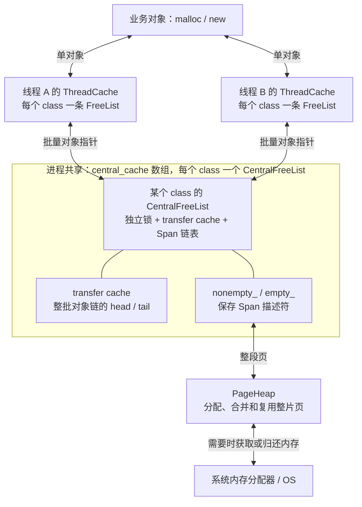
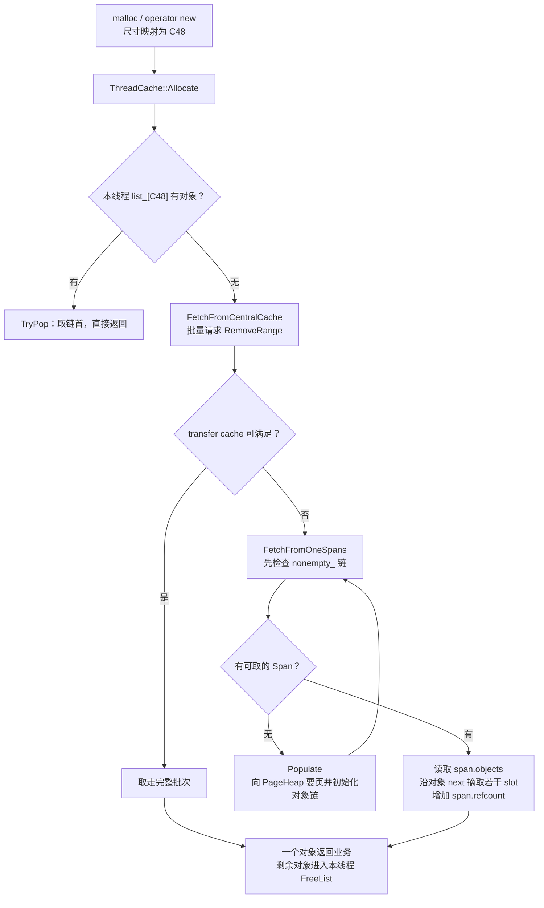
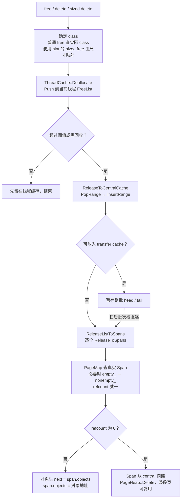

# tcmalloc 小对象申请与释放流程图解

tcmalloc 的小对象通常先在线程缓存里申请和释放。线程缓存缺货或积压时，才按批次与中央缓存交换对象；中央缓存再通过 Span 管理这些对象所在的页。理解这几层之间搬运的是“对象指针”，就能解释为什么一次错误释放可能在很久之后的 `new` 中暴露。

本文基于 **gperftools 的 ThreadCache 实现**，参考源码 `/sandbox/google-gperftools`，快照为 `0b07e0cf56fd09037bb7220a28343d82103249f1`。它不是 Google 当前采用 per-CPU cache 的另一套 TCMalloc 实现。下文讲普通、未采样的小对象路径；大对象、特殊对齐、采样和初始化慢路径不逐项展开。size class 表、页大小、批量数量受构建配置影响，图中 class 名和数量均为教学示意。

相关现场案例：[dr_perception 中 sized-free 错配候选原因排查记录](../../秘藏龛/2026-10-22_dr_perception_sized-free错配排查记录.md)。该案例的根因尚未确认，本文的正常机制讲解不依赖其归因成立。

## 1. 先看全貌：对象在哪里，谁保存它的地址

可以把业务看作领用者，ThreadCache 看作每个线程的周转架，CentralFreeList 看作同一尺寸对象的公共仓库，PageHeap 看作负责整片页的管理者。这里的“周转”主要移动指针，不搬动用户数据本体。



`central_cache[cl]` 的 `cl` 是 **class 编号**，不是字节数。文中的 `C48` 表示“对象 slot 为 48B 的 class”，不表示数组下标就是 48。

同一个 Span 中不同 slot 的地址可以分别被业务、不同线程的缓存、transfer cache 和 `span->objects` 持有。对象始终位于原来的页中，改变的是“哪个列表当前保存着这个空闲对象的指针”。

## 2. 第一类链：用空闲对象自己的前几个字节串起来

### 2.1 一个 48B slot 的两种身份

普通小对象没有必要在每个 slot 前额外放一份固定的分配头。对象大小和所属 Span 可以通过地址查表获取。对象空闲时，tcmalloc 复用对象首部存放单链表 next；分配给业务后，这些字节又归业务使用。

```text
同一块 48B slot，地址 p

业务持有时：
  p + 0                                         p + 48
  ┌─────────────────────────────────────────────────┐
  │               业务对象的 48B 内容                 │
  └─────────────────────────────────────────────────┘

空闲时（以 64 位指针为例）：
  p + 0          p + 8                          p + 48
  ┌───────────────┬─────────────────────────────────┐
  │ next：8B 指针 │ 其余字节不作为这条链的 next 使用    │
  └───────┬───────┴─────────────────────────────────┘
          └──────────> 另一个空闲对象，或 NULL
```

最核心的操作就是：

```cpp
// src/linked_list.h:44、48，保持原始表达式
return *(reinterpret_cast<void**>(t));       // SLL_Next(t)
*(reinterpret_cast<void**>(t)) = n;          // SLL_SetNext(t, n)
```

因此，释放后继续写对象的前 8B，可能直接覆盖 allocator 的 next；写入当时地址仍可能可访问，稍后遍历链表才因坏指针崩溃。OS 的页权限不负责检查 C/C++ 对象边界或生命周期。

### 2.2 ThreadCache::FreeList 的形状

```text
ThreadCache（每线程一份）
  list_[C48] : FreeList
    list_ ───────> [对象 A | next] ──> [对象 B | next] ──> NULL
    length_       当前对象数量，例如 2
    max_length_   动态回收阈值，不是固定不变的容量
    lowater_      回收策略使用的低水位
    size_         这个 class 的对象大小

  list_[C160] : FreeList
    list_ ───────> [对象 X | next] ──> NULL

  ……每个 class 都有自己的列表
```

这里节点就是用户 slot，没有另外分配 `Node { object, next }`。这类列表也不要求每个节点来自同一 Span；只要 class 一致，来自多个 Span 的空闲对象可以混在同一条 ThreadCache 链中。释放对象也不必回到最初分配它的线程，而是通常进入当前释放线程的缓存。

源码：`src/thread_cache.h:133` 的 `FreeList`，`src/linked_list.h:44` 的单链表操作。

## 3. 第二类链：Span 描述符之间的双向链

### 3.1 Span 描述符和对象页是两种不同内存

`Span` 描述一段连续的 allocator 逻辑页。小对象 Span 归属于一个 size class，其 slot 按该 class 的大小切分。Span 描述符是独立管理的元数据，不是每个业务对象前面的头，也不是对象 slot 本身。

```text
元数据：Span S                       对象页：base = S.start << kPageShift
+------------------------+         +----------------------------------+
| start = 起始页号        |         | slot 0: business data            |
| length = 页数          |         +----------------------------------+
| next = Span*           |         | slot 1 (A): next = &slot3        |
| prev = Span*           |         +----------------------------------+
| objects = &slot1       |         | slot 2: ThreadCache free object  |
| refcount               |         +----------------------------------+
| sizeclass              |         | slot 3 (B): next = NULL          |
| location / sample      |         +----------------------------------+
+------------------------+         | ...                              |
                                   +----------------------------------+

S.objects ──> A（slot 1）──> B（slot 3）──> NULL
S.next / S.prev ──> 其他 Span 描述符，不指向上述 slot
```

上图 `objects` 指向 slot 1，slot 1 内的 next 指向 slot 3。slot 2 虽然业务已经不用，但只要仍在线程缓存，就没有回到 `objects` 链中。

关键字段的准确含义如下。

| 字段 | 普通小对象 Span 中的含义 |
| --- | --- |
| `start`、`length` | 对象页的起点与长度；逻辑字节长度为 `length << kPageShift` |
| `next`、`prev` | 把 Span 描述符串入双向链，和对象首部的 next 完全不同 |
| `objects` | 直接归还本 Span 的空闲对象链头；耗尽时为 NULL |
| `refcount` | 已从 Span freelist 取出、尚未归还该 freelist 的 slot 数；包含业务持有、ThreadCache、transfer cache 中的对象 |
| `sizeclass` | Span 的真实 class；普通小对象 Span 中非零 |

源码：`src/span.h:68`。上表只解释普通小对象；该结构中 `objects` 所在 union 在其他类型 Span 中还可能有不同用途。

### 3.2 CentralFreeList 中的两条环形双向链

```text
central_cache[C48] : CentralFreeList
  lock_        本 class 的锁
  size_class_  C48

  nonempty_ 哨兵 H（是内嵌 Span 形状的头节点，不承载用户 slot）
      H <──> Span S1 <──> Span S2 <──> H
              │            │
              objects      objects
              ↓            ↓
              A → B → NULL C → NULL

  empty_ 哨兵 E
      E <──> Span S3 <──> E
              objects = NULL

  tc_slots_[]   另见下一节
  num_spans_   两条 Span 链中的真实 Span 总数
  counter_     Span freelist 中的空闲对象数量，不含 transfer cache
```

两条链都用 `next/prev` 双向链接。没有真实节点时，哨兵的 `next` 和 `prev` 指向自己；`DLL_IsEmpty` 判断的正是 `list->next == list`。哨兵的 `objects` 不代表用户空闲对象链。

**这里 empty/nonempty 说的是 Span 的空闲对象链，不是业务占用情况：**

- `nonempty_`：Span 还有对象能直接取，即 `objects != NULL`。
- `empty_`：Span 中可直接取的对象耗尽，即 `objects == NULL`；对象可能仍在业务、线程缓存或 transfer cache 中。
- 所有对象都归还 Span、`refcount` 降为 0 时，Span 从 central 移走并归还 PageHeap，不是长期放在 `empty_` 中。

源码：`src/central_freelist.h:158`、`src/span.cc:77`、`src/span.h:151`。

## 4. transfer cache 与 PageMap 分别解决什么问题

### 4.1 transfer cache：保存整批链，不先拆回每个 Span

```text
CentralFreeList[C48].tc_slots_[i] : TCEntry
  +----------+
  | head = A |       head                 tail
  | tail = C |         ↓                    ↓
  +----------+         A ─────> B ─────────> C ─────> NULL

批内节点均应属于 C48，但可以来自多个 Span。
批量对象仍位于原有 slot；TCEntry 只保存 head 和 tail。
```

当 `InsertRange` 收到标准批量、transfer cache 有可用槽位时，可以直接存 `head/tail`，不逐个查 PageMap。`RemoveRange` 请求符合条件时也可整批取走。这能减少 Span 操作，但也使错误对象可能在缓存中停留较久。

transfer cache **是 CentralFreeList 内部成员**，不是与它并列的另一套独立全局 allocator。源码：`src/central_freelist.h:88`、`src/central_freelist.cc:216`、`src/central_freelist.cc:231`。

### 4.2 PageMap：由对象地址反查实际 Span

```text
对象地址 p
   │  页号 = uintptr_t(p) >> kPageShift
   ↓
PageMap[页号] ─────> Span S
                       ├─ start / length：它管理哪片页
                       └─ sizeclass：这些 slot 实际有多大

同一小对象 Span 覆盖的页号 ─────> 同一个 Span 描述符
```

`GetDescriptor` 返回 PageMap 中的描述符。普通 free 还可以先走页号到 class 的缓存；这和 ThreadCache 缓存对象指针是不同的两件事。源码：`src/page_heap.h:150`、`src/tcmalloc.cc:1522`。

## 5. 一次 new(48) 怎样拿到对象



省略初始化、采样和分配失败分支后的调用路径为：

```text
tc_new / tc_malloc
  → 分配入口与 size class 映射
  → ThreadCache::Allocate
      ├─ TryPop 成功 → 返回一个对象
      └─ FetchFromCentralCache
           → central_cache[cl].RemoveRange
               ├─ 满足条件 → 从 transfer cache 取批次
               └─ FetchFromOneSpansSafe
                    ├─ FetchFromOneSpans
                    └─ 无 Span 可取 → Populate → 再取
```

`FetchFromOneSpans` 取 `nonempty_.next`，从 `span->objects` 沿 next 摘取若干对象。如果取空，把 Span 从 `nonempty_` 移到 `empty_`；随后更新 `span->objects`、增加 `refcount`、减少 central 的 `counter_`。不同 Span 不够凑批时，`RemoveRange` 还可能继续从其他 Span 取。

`Populate` 才负责按当前 class 大小把新页切成 slot 并建立对象链。**`FetchFromOneSpans` 只沿已有指针链取对象，不会按 class 大小重新切分已存在的 Span。**

源码：`src/thread_cache.h:330`、`src/thread_cache.cc:118`、`src/central_freelist.cc:231`、`:275`、`:305`。

## 6. 一次 free / delete 怎样归还对象



以上是当前线程缓存存在时的常规路径；没有 ThreadCache 时，源码也有直接把对象送进 central 的分支。线程缓存的回收还会因 Scavenge、线程销毁等触发，不只因某一条链达到阈值。

`ReleaseToSpans` 的顺序可用下面的伪代码记忆，字段名和关键顺序与参考源码一致：

```cpp
Span* span = PageMapLookup(object);
if (span->objects == nullptr) {
  DLL_Remove(span);                     // 正常应在本 class 的 empty_
  DLL_Prepend(&nonempty_, span);
}
--span->refcount;
if (span->refcount == 0) {
  DLL_Remove(span);
  // 更新 central 计数，暂时释放 central 锁
  pageheap->Delete(span);               // 不再把 object 单独接回对象链
} else {
  *(void**)object = span->objects;
  span->objects = object;
}
```

这里“释放到 Span”和“向 OS 归还物理内存”不是同一步。`PageHeap::Delete` 使整段页可被 allocator 复用；是否进一步向 OS 释放、是否保留虚拟地址，取决于平台实现和回收策略。不能用一次业务 free 推断 RSS 会立即下降。

源码：`src/tcmalloc.cc:1514`、`src/thread_cache.h:350`、`src/thread_cache.cc:161`、`:192`、`:213`、`src/central_freelist.cc:84`、`:92`。

## 7. 用四个 slot 看懂 refcount 和链表迁移

下面假设一个教学用 Span 只有四个 slot：A、B、C、D。它不对应生产 48B Span 的实际容量。设每次演示批量取两个，忽略函数内部暂态。

| 步骤 | `span->objects` | 业务持有 | ThreadCache / transfer cache | `refcount` | Span 归属 |
| --- | --- | --- | --- | ---: | --- |
| Populate 完成 | A → B → C → D | 无 | 无 | 0 | `nonempty_` |
| central 取出 A、B，A 返回业务 | C → D | A | B | 2 | `nonempty_` |
| 业务 free(A)，先进入线程缓存 | C → D | 无 | A、B | 2 | `nonempty_` |
| A、B 整批进入 transfer cache | C → D | 无 | A、B | 2 | `nonempty_` |
| 另一线程取走 transfer 批次，暂存在其线程缓存 | C → D | 无 | A、B | 2 | `nonempty_` |
| 又从 Span 取出 C、D | NULL | C | A、B、D | 4 | `empty_` |
| A 真正进入 ReleaseToSpans | A → NULL | C | B、D | 3 | 移回 `nonempty_` |
| B、C、D 最终都归还 Span | 不再需要保留对象链 | 无 | 无 | 0 | 从 central 移除，交 PageHeap |

因此普通小对象 Span 在稳定状态满足：

```text
slot 总数 = floor((length << kPageShift) / 实际 class 大小)
slot 总数 = objects 链节点数 + refcount

refcount = 业务持有 + ThreadCache 持有 + transfer cache 持有
           + 分配器内部正在搬运、尚未归还 objects 链的对象
```

不能把 `refcount` 直接解释成“业务活对象数”。业务释放之后，直到对象真正进入 `ReleaseToSpans`，这个计数通常都不会下降。

## 8. sized delete 的作用，以及必须保持的约束

编译器在适用的 C++ delete 表达式中可以选择 `operator delete(p, size)`；使用库也可能调用该重载。gperftools 的 `--enable-sized-delete` 将相应重载连接到 `tc_delete_sized` / `tc_free_sized`，让 allocator 可以利用大小 hint 确定 class。它本身不会让业务调用 realloc，也不意味着所有 delete 都有大小 hint。

`size` 是字节尺寸，必须先经过 SizeMap 归类；两个不同尺寸可以属于同一个 class，所以诊断应该比较 class，而不是强制 `hint == malloc_usable_size(p)`。

```text
普通 free：    p → 页号 / class 缓存或 PageMap → 实际 class → ThreadCache
使用 hint：   size_hint → SizeMap → hint class          → ThreadCache
诊断版增加：  PageMap(p).sizeclass == hint class，否则日志 + abort
```

参考快照 `0b07e0cf` 已含诊断检查；此前 release 路径对适用的小对象 hint 没有这项强制核对。完整库的采样相关回退、大 hint、hooks 等分支可能改走普通 free，不能把所有 sized-delete 调用都等同于使用 hint 的快路径。

最需要保护的是以下约束：

1. 缓存对象所属 class，必须等于该对象 PageMap 所指 Span 的 `sizeclass`。
2. 某个 CentralFreeList 管理的 Span，应由该 class 的锁保护。
3. `nonempty_` 中真实 Span 的 `objects` 必须非空；`empty_` 中则为空。
4. 同一个 slot 不能同时出现在两个空闲列表中，也不能同时属于业务和空闲列表。
5. 对象单链表首部与 Span 元数据的 `next/prev` 是两类指针，分析内存破坏时必须分别检查。

编译器可能生成 sized delete，并不等于普通 `malloc/realloc` 得到的内存可以合法地用 delete 释放。C/C++ 分配释放必须匹配；标准容器也不会因为使用 C++17，就自动接管任意 realloc 返回值。具体混用或自定义分配器场景必须检查真实代码。

源码：`src/libc_override_gcc_and_weak.h:73`、`src/tcmalloc.cc:1514`、`:1985`。错配如何成为现场候选原因，见关联排查记录。

## 9. 源码导航与复查方法

以下行号绑定 `0b07e0cf56fd09037bb7220a28343d82103249f1`；源码变更后先按函数名查找。链接固定到该快照，不应拿这里的行号推定任意 QNX 运行包的二进制布局。

| 主题 | 源码入口 |
| --- | --- |
| slot 首部的对象链 next | [linked_list.h:44](https://code.deeproute.ai/third-party-repos/google-gperftools/-/blob/0b07e0cf56fd09037bb7220a28343d82103249f1/src/linked_list.h#L44) |
| Span 字段 | [span.h:68](https://code.deeproute.ai/third-party-repos/google-gperftools/-/blob/0b07e0cf56fd09037bb7220a28343d82103249f1/src/span.h#L68) |
| Span 双向链插入 | [span.cc:77](https://code.deeproute.ai/third-party-repos/google-gperftools/-/blob/0b07e0cf56fd09037bb7220a28343d82103249f1/src/span.cc#L77) |
| ThreadCache 的 FreeList | [thread_cache.h:133](https://code.deeproute.ai/third-party-repos/google-gperftools/-/blob/0b07e0cf56fd09037bb7220a28343d82103249f1/src/thread_cache.h#L133) |
| ThreadCache 分配 / 释放 | [thread_cache.h:330](https://code.deeproute.ai/third-party-repos/google-gperftools/-/blob/0b07e0cf56fd09037bb7220a28343d82103249f1/src/thread_cache.h#L330) |
| 批量从 central 取对象 | [thread_cache.cc:118](https://code.deeproute.ai/third-party-repos/google-gperftools/-/blob/0b07e0cf56fd09037bb7220a28343d82103249f1/src/thread_cache.cc#L118) |
| 批量向 central 归还 | [thread_cache.cc:192](https://code.deeproute.ai/third-party-repos/google-gperftools/-/blob/0b07e0cf56fd09037bb7220a28343d82103249f1/src/thread_cache.cc#L192) |
| CentralFreeList 数据成员 | [central_freelist.h:158](https://code.deeproute.ai/third-party-repos/google-gperftools/-/blob/0b07e0cf56fd09037bb7220a28343d82103249f1/src/central_freelist.h#L158) |
| 向 Span 回收对象 | [central_freelist.cc:92](https://code.deeproute.ai/third-party-repos/google-gperftools/-/blob/0b07e0cf56fd09037bb7220a28343d82103249f1/src/central_freelist.cc#L92) |
| central 批次缓存与分配 | [central_freelist.cc:216](https://code.deeproute.ai/third-party-repos/google-gperftools/-/blob/0b07e0cf56fd09037bb7220a28343d82103249f1/src/central_freelist.cc#L216) |
| 从 Span 取对象 / Populate | [central_freelist.cc:275](https://code.deeproute.ai/third-party-repos/google-gperftools/-/blob/0b07e0cf56fd09037bb7220a28343d82103249f1/src/central_freelist.cc#L275) |
| PageMap 地址反查 | [page_heap.h:150](https://code.deeproute.ai/third-party-repos/google-gperftools/-/blob/0b07e0cf56fd09037bb7220a28343d82103249f1/src/page_heap.h#L150) |
| hint 诊断 / free 分类 | [tcmalloc.cc:1514](https://code.deeproute.ai/third-party-repos/google-gperftools/-/blob/0b07e0cf56fd09037bb7220a28343d82103249f1/src/tcmalloc.cc#L1514) |

本地复查示例：

```bash
cd /sandbox/google-gperftools
git show 0b07e0cf56fd09037bb7220a28343d82103249f1:src/central_freelist.cc | nl -ba | sed -n '84,134p;231,301p'
git show 0b07e0cf56fd09037bb7220a28343d82103249f1:src/thread_cache.cc | nl -ba | sed -n '118,138p;192,209p'
```
