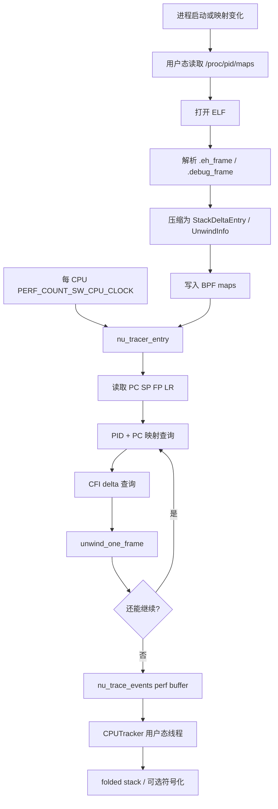
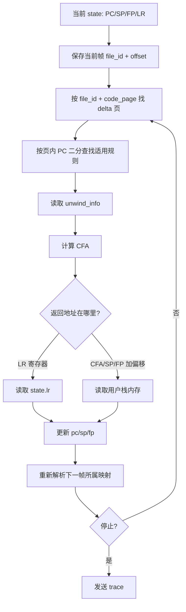
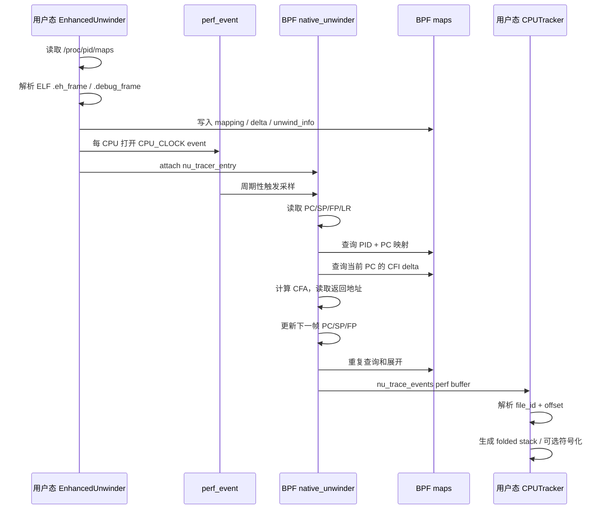

# perf_event 与 BPF 内轻量化 DWARF CFI 堆栈回溯：从一次采样到完整调用链

> 本文专门解释 `/sandbox/platform/perf_ebpf` 当前 CPU 主路径采用的堆栈回溯方法：
>
> `perf_event` 负责在合适的时刻触发采样；用户态提前解析 ELF 中的 `.eh_frame` / `.debug_frame`，把回溯规则压缩后写入 BPF map；BPF 在采样点读取寄存器、查找规则、读取用户栈并逐帧恢复调用者。
>
> 文档重点是流程和原理，不要求读者先读懂 BPF C 代码。代码文件和行号只用于帮助读者在需要时回到真实实现核对。

## 先看结论

当前 `perf_ebpf` 的 CPU 用户栈主路径可以概括成下面这句话：

```text
perf_event 触发采样
    -> BPF 读取当前 PC / SP / FP / LR
    -> 用 PC 找到所属 ELF 和对应 CFI 规则
    -> BPF 执行轻量化的 DWARF unwind
    -> 从用户栈恢复上一帧的 PC / SP / FP
    -> 重复上述过程
    -> 输出 file_id + offset 形式的调用链
```

它不是“每次采样后都让用户态 libunwind 重新解析 ELF”，也不是“只沿着 FP 指针链走一遍”。它的特点是：

1. **规则准备在用户态完成**：读取进程映射、解析 ELF、解析 CFI。
2. **逐帧回溯在 BPF 中完成**：采样发生时只做有限的 map 查询、整数运算和用户内存读取。
3. **函数名解析是后续阶段**：回溯得到的是调用地址或 `file_id + offset`，不等于已经得到 C++ 函数名。
4. **`bpf_get_stackid()` 仍然存在**：当前主要用于内核栈采集，以及 DWARF 回溯失败时的用户栈备用路径。

本文中的核心关系是：

```text
采样：现在 CPU 正在执行哪里？
回溯：当前函数的调用者是谁？调用者的调用者是谁？
符号化：这些地址属于哪个文件、哪个函数、哪一行？
```

三者不是同一件事。

## 目录

> 说明：第 1–5 节为通用背景速览（已压缩为要点与链接，深入展开见文末「与其他文档的关系」中的正典阁「栈回溯」系列）；第 6–16 节是本文主体，讲 `perf_ebpf` 自身实现。

1. [从一个直觉问题开始：程序怎么知道自己从哪里返回](#1-从一个直觉问题开始程序怎么知道自己从哪里返回)
2. [函数调用和栈帧：先看清内存如何变化](#2-函数调用和栈帧先看清内存如何变化)
3. [三种坐标和四个关键寄存器](#3-三种坐标和四个关键寄存器)
4. [DWARF 和 CFI 到底是什么](#4-dwarf-和-cfi-到底是什么)
5. [三种常见回溯方法的区别](#5-三种常见回溯方法的区别)
6. [perf_ebpf 的整体设计](#6-perf_ebpf-的整体设计)
7. [阶段一：采样开始前，用户态准备回溯规则](#7-阶段一采样开始前用户态准备回溯规则)
8. [阶段二：perf_event 如何触发 BPF 采样](#8-阶段二perf_event-如何触发-bpf-采样)
9. [阶段三：BPF 如何用 CFI 一帧一帧地回溯](#9-阶段三bpf-如何用-cfi-一帧一帧地回溯)
10. [用一个完整例子走完寄存器和 CFA 的变化](#10-用一个完整例子走完寄存器和-cfa-的变化)
11. [回溯结果怎样传回用户态](#11-回溯结果怎样传回用户态)
12. [当前实现中的备用路径和边界](#12-当前实现中的备用路径和边界)
13. [为什么说它是“BPF 内轻量化”](#13-为什么说它是bpf-内轻量化)
14. [初学者排查一条栈为什么断了](#14-初学者排查一条栈为什么断了)
15. [把整套流程压缩成一张图](#15-把整套流程压缩成一张图)
16. [源码对照表](#16-源码对照表)

---

## 1. 从一个直觉问题开始：程序怎么知道自己从哪里返回

先看一个普通的调用关系：

```cpp
int read_sensor();
int filter() { return read_sensor(); }
int plan()   { return filter(); }
int main()   { return plan(); }
```

当 `read_sensor()` 正在运行时，人类会说当前调用链是 `main -> plan -> filter -> read_sensor`。但 CPU 实际上只需要知道几件事：当前指令地址在哪、当前函数执行完要回到哪里、局部变量和保存寄存器在哪里、上一层调用者的栈在哪里——这些信息分散在寄存器、线程栈和二进制文件携带的回溯规则中。围绕它们，有三个经常被混为一谈的动作：

```text
采样：现在 CPU 正在执行哪里？
回溯：当前函数的调用者是谁？调用者的调用者是谁？
符号化：这些地址属于哪个文件、哪个函数、哪一行？
```

采样得到的调用栈是一张「统计快照」，不是执行录像；回溯先输出地址序列，把它变成函数名与源码行是符号化阶段的事。完整链路的形状是：`CPU 执行 -> perf_event 采样 -> 读取 PC/SP/FP/LR -> 栈回溯 -> 地址链（或 file_id+offset）-> ELF 映射与符号表 -> 函数名/源码行`。

> 本节展开版：[函数调用与返回：AArch64栈帧与寄存器的逐步变化](../正典阁/技术栈/操作系统/函数调用与返回：AArch64栈帧与寄存器的逐步变化.md) 第 1 节（调用栈便签模型与三个方向的直观理解）。

---

## 2. 函数调用和栈帧：先看清内存如何变化

这一节先不讲 DWARF，只回答一个问题：**回溯需要的信息，到底藏在哪里**。

调用 `foo()` 时，调用者 `main()` 和被调用者 `foo()` 之间至少要约定两件事：`foo()` 执行完后回到 `main()` 的哪一条指令（产生**返回地址**），以及 `foo()` 使用的局部空间和寄存器怎样不破坏 `main()` 的现场（产生**栈帧和寄存器保存规则**）。函数返回时再把两者恢复——栈是后进先出，建立与拆除完全镜像。在 AArch64 上，`bl` 把返回地址写进 `x30`（LR），典型序言用两条指令建立栈帧：

```asm
stp x29, x30, [sp, #-16]!   ; 保存旧 FP 与 LR，SP 下移 16 字节
mov x29, sp                 ; x29 成为本帧锚点（FP）
```

由此形成每个栈帧顶部的两个关键格子：

```text
[x29 + 0] = 调用者的 FP     （旧帧指针，上一帧的锚点）
[x29 + 8] = 返回地址        （保存的 LR，回溯用的「返程票」）
```

LR 会被一层层调用覆盖：`foo` 调用 `work` 后，`x30` 里已经是「回到 foo」而不是「回到 main」，所以非叶子函数必须在调用下一级前把 LR 保存到栈上；而叶子函数可能完全不建帧、靠寄存器里的 LR 直接返回——这两种形态正是后面 FP 链与 DWARF CFI 分别要处理的场景。回溯时若帧内有局部空间，还需要一条统一的参考规则算出「调用前的栈顶」，这就是一行式 CFA 公式：**CFA = 调用者执行 `bl` 前的 SP**，返回地址与保存的 FP 都写成相对 CFA 的偏移（如 `RA = [CFA - 8]`）。

> 逐步跟踪（每一步的 CPU 动作、寄存器面板与内存示意图，时刻 0–8）见 [函数调用与返回：AArch64栈帧与寄存器的逐步变化](../正典阁/技术栈/操作系统/函数调用与返回：AArch64栈帧与寄存器的逐步变化.md) 第 4 节；x86-64 对照见其第 8 节。

---

## 3. 三种坐标和四个关键寄存器

回溯时最容易混淆的是三套坐标系，先一句话区分：

```text
运行时虚拟地址：CPU 当前看到的地址（受 ASLR 与共享库加载位置影响）
映射地址：      /proc/<pid>/maps 里的段起止，用来判断地址属于哪个 ELF
文件内偏移：    运行时地址 - 装载 bias，跨进程可比，写成 file_id + offset
```

四个关键寄存器各有分工：

| 寄存器 | 角色 | 回溯时的作用 |
| --- | --- | --- |
| PC | 程序计数器 | 判断「当前在哪」「适用哪组 CFI 规则」 |
| SP | 栈指针 | 随序言/尾声移动，单独看通常找不到调用者 |
| FP（x29） | 帧指针 | FP 链回溯的锚点；也是 CFI 规则的一种参考寄存器 |
| LR（x30） | 链接寄存器 | 非叶子函数须先保存到栈，回溯时据此恢复上一帧 |

当前 `perf_ebpf` 的 BPF 状态同时保留 `pc / sp / fp / lr / cfa` 五个字段，以覆盖不同架构与不同函数形态；字段定义在 [`unwinder_common.h`](/sandbox/platform/perf_ebpf/bpf_common/unwinder_common.h:31)。

> 寄存器合同与逐个拆解见 [函数调用与返回：AArch64栈帧与寄存器的逐步变化](../正典阁/技术栈/操作系统/函数调用与返回：AArch64栈帧与寄存器的逐步变化.md) 第 2 节；三种坐标与 CFI 规则如何结合见 [DWARF-CFI回溯](../正典阁/技术栈/操作系统/栈回溯方法/DWARF-CFI回溯.md)。

---

## 4. DWARF 和 CFI 到底是什么

先纠正一个常见误解：**DWARF 不等于「调试符号」**。它是描述程序与机器码关系的整套数据格式，可以描述函数边界、源码行、类型、内联关系……以及本文唯一用到的一小块——**Call Frame Information（CFI，调用帧信息）**，也就是「某个机器地址范围内，怎样恢复调用者的寄存器与栈」：

```text
DWARF：一整套描述程序与机器码关系的语言
  |
  +-- 调试信息：函数名、源码行、类型、内联
  |
  +-- CFI：调用帧恢复规则（回溯只用到这一块）
```

**CFI 是一份「当前 PC 对应的恢复说明书」**，规则与 PC 绑定、按地址区间组织——采样落在函数序言中间和落在函数主体，适用的规则可能不同：

```text
PC 区间                     CFA 规则          返回地址（RA）规则
checksum+0x00 .. +0x04     CFA = SP + 0      RA = LR（仍在寄存器中）
checksum+0x04 .. +0x08     CFA = SP + 16     RA = [CFA - 8]
checksum+0x08 .. +0x30     CFA = x29 + 16    RA = [CFA - 8]        <- 帧建立完成后命中
```

**CFA（Canonical Frame Address，规范帧地址）是恢复动作的统一参考点**：`CFA = 调用者执行调用指令前的 SP`，可由规则算成 `CFA = SP + 常量` 或 `CFA = FP + 常量`；返回地址、保存的 FP、其他寄存器都用相对 CFA 的偏移描述——这样函数内部 SP 怎么移动都不影响恢复。

规则表存放在 `.eh_frame`（常随程序发布）或 `.debug_frame`（可能被 strip 掉）中，由两类记录组成：**CIE**（公共初始规则模板：指令/数据对齐因子、返回地址寄存器、初始规则）与 **FDE**（某函数地址范围内的规则变化，即具体函数 `foo` 从哪条指令起适用什么规则）。同一函数规则只在少数位置变化，解析器只保存变化点——这就是 **delta**：采样时给定 PC，找到「不超过它的最后一个 delta」即得当前规则，天然适合二分查找。

> 完整展开见 [DWARF-CFI回溯](../正典阁/技术栈/操作系统/栈回溯方法/DWARF-CFI回溯.md)：逐 PC 规则表、CFI 规则类型（`SAME_VALUE` / `OFFSET` / `EXPRESSION` 等）、CFA 栈上位置图与逐步回溯。`.eh_frame`/`.debug_frame` 在 `perf_ebpf` 中的解析与落地见本文第 7、9 节。

---

## 5. 三种常见回溯方法的区别

三句话记住三种方法的区别：

```text
FP 链回溯：      沿「[FP]=上一帧 FP、[FP+8]=返回地址」的固定链表走——快，但依赖编译器保留 FP；
DWARF CFI 回溯：按 PC 查恢复规则，算 CFA、恢复返回地址——不要求 FP，能穿过混合栈，是 perf_ebpf 主路径；
eBPF 栈采样：    bpf_get_stackid() 请内核帮忙抓栈，返回 stack ID——接口简单，内部展开由内核决定。
```

| 对比项 | FP 链 | DWARF CFI | `bpf_get_stackid()` |
| --- | --- | --- | --- |
| 回溯依据 | 固定的 FP 内存布局 | PC 对应的恢复规则 | 内核 helper 的栈采集逻辑 |
| 是否需要 FP | 需要 | 不需要 | 由内核实现决定，调用方不直接控制 |
| 采样时工作 | 读两个指针并循环 | 查规则、算 CFA、读内存 | helper 完成采集并返回 ID |
| 结果 | 地址序列 | 地址/文件偏移序列 | stack ID，地址数组在 map 中 |
| 控制粒度 | 高，但能力弱 | 高，能力强但复杂 | 低，接口简单 |
| 对优化代码 | 容易断 | 通常更强 | 取决于内核展开能力 |
| 当前 `perf_ebpf` 位置 | fallback 标记路径 | CPU 用户栈主路径 | 内核栈和用户栈 fallback |

特别注意：当前代码将 `bpf_get_stackid()` 得到的用户栈 fallback 输出标记为 `[u/fp]`，这只是项目输出标签。它不等于项目在用户态手写了 FP `while` 循环。

> 三种方法的全景对比、选型建议与「同一现场三种方法各自看到什么」，见 [三种栈回溯方法总览](../正典阁/技术栈/操作系统/栈回溯方法/三种栈回溯方法总览.md)；方法细节分别见 [FP帧指针链回溯](../正典阁/技术栈/操作系统/栈回溯方法/FP帧指针链回溯.md)、[DWARF-CFI回溯](../正典阁/技术栈/操作系统/栈回溯方法/DWARF-CFI回溯.md)、[eBPF栈采样](../正典阁/技术栈/操作系统/栈回溯方法/eBPF栈采样.md)。

---

## 6. perf_ebpf 的整体设计

### 6.1 为什么不能在采样点解析整个 ELF

采样点的 BPF 程序运行在内核上下文，受到 verifier 和运行环境限制，不能像普通用户态程序一样随意：

- 打开 ELF 文件；
- 分配动态内存；
- 解析复杂二进制结构；
- 调用 C++ 库；
- 执行无限循环；
- 读取任意用户地址。

因此 `perf_ebpf` 把工作拆成两部分：

```text
用户态：做复杂的、低频的准备工作
    - 读 /proc/<pid>/maps
    - 打开 ELF
    - 解析 .eh_frame / .debug_frame
    - 把规则写入 BPF map

BPF：做高频的、受限的采样工作
    - 读取现场寄存器
    - 查询映射
    - 查询规则
    - 计算 CFA
    - 读取少量用户栈内存
    - 输出一条 trace
```

这里的关键工程思想是：

```text
把“理解规则”放到采样前
把“执行规则”留在采样点
```

### 6.2 总体数据流



对应的 ASCII 版本：

```text
                    采样前的准备阶段
        ┌───────────────────────────────────┐
        │ /proc/<pid>/maps                   │
        └────────────────┬──────────────────┘
                         v
        ┌───────────────────────────────────┐
        │ ELF .eh_frame / .debug_frame       │
        └────────────────┬──────────────────┘
                         v
        ┌───────────────────────────────────┐
        │ 用户态 CFI parser                  │
        └────────────────┬──────────────────┘
                         v
        ┌───────────────────────────────────┐
        │ BPF mapping / delta / rule maps    │
        └────────────────┬──────────────────┘
                         │ 采样时查询
                         v
┌──────────────┐  ┌────────────────────┐  ┌─────────────────────┐
│ perf_event   │->│ nu_tracer_entry    │->│ unwind_one_frame()   │
│ CPU clock    │  │ 读 PC/SP/FP/LR     │  │ CFI 算 CFA、读用户栈 │
└──────────────┘  └────────────────────┘  └──────────┬──────────┘
                                                     │ 重复
                                                     v
                                      ┌────────────────────────┐
                                      │ perf buffer trace       │
                                      │ file_id + offset frames │
                                      └────────────┬───────────┘
                                                   v
                                      ┌────────────────────────┐
                                      │ 用户态输出 / 符号化      │
                                      └────────────────────────┘
```

### 6.3 当前 CPUTracker 的启动证据

当前 CPUTracker 初始化时创建 `EnhancedUnwinder`，见 [`cputracker.cc:81`](/sandbox/platform/perf_ebpf/src/plugins/cputracker/cputracker.cc:81)。启动时调用 `attach()`，见 [`cputracker.cc:127`](/sandbox/platform/perf_ebpf/src/plugins/cputracker/cputracker.cc:127)。

`EnhancedUnwinder::attach()` 为每个 CPU 创建 `PERF_COUNT_SW_CPU_CLOCK`，并把 `nu_tracer_entry` 附加到 perf event，见 [`enhanced_unwinder.cc:121`](/sandbox/platform/perf_ebpf/src/plugins/cputracker/enhanced_unwinder.cc:121)。

因此，当前 CPUTracker 的主路径是：

```text
CPUTracker
   |
   v
EnhancedUnwinder
   |
   v
native_unwinder BPF skeleton
   |
   v
nu_tracer_entry -> nu_unwind_native -> nu_unwind_stop
```

仓库中仍有 `profile.bpf.c` 和 `CPUTrackerProgram`，它们直接使用 `bpf_get_stackid()`，但当前 `CPUTracker::initialize()` 和 `start()` 走的是 `EnhancedUnwinder`，不能把遗留的 `profile.bpf.c` 当成当前 CPUTracker 的主回溯路径。

---

## 7. 阶段一：采样开始前，用户态准备回溯规则

这是整个方案中非常重要、但容易被忽略的一步：**采样发生之前，回溯规则已经被准备好并写进 BPF map。**

### 7.1 读取进程的可执行映射

用户态读取：

```text
/proc/<pid>/maps
```

并筛选有执行权限的文件映射，例如：

```text
7f12a0300000-7f12a0500000 r-xp 00000000 ... /usr/lib/libfoo.so
00400000-00450000 r-xp 00000000 ... /opt/app/bin/app
```

当前 `EnhancedUnwinder::readProcessMappings()` 只保留可执行映射，并计算：

- 映射起始地址；
- 映射结束地址；
- 文件偏移；
- ELF 路径；
- `file_id`；
- 装载 bias。

代码见 [`enhanced_unwinder.cc:321`](/sandbox/platform/perf_ebpf/src/plugins/cputracker/enhanced_unwinder.cc:321)。

### 7.2 计算 file_id

项目不是在每个 BPF 帧中携带完整路径，而是给 ELF 一个稳定的 `file_id`。当前实现会读取文件头部、尾部和文件大小，使用 FNV-1a 组合计算 ID，见 [`enhanced_unwinder.cc:294`](/sandbox/platform/perf_ebpf/src/plugins/cputracker/enhanced_unwinder.cc:294)。

这样做的直觉是：

```text
完整路径很长，不适合高频采样携带
        |
        v
文件路径 -> file_id
        |
        v
BPF 每帧只记录 file_id + offset
```

用户态会保留：

```text
file_id -> /usr/lib/libfoo.so
```

所以 BPF 输出轻量，用户态仍然可以恢复文件名。

### 7.3 解析 ELF 中的 CIE 和 FDE

`EhFrameParser::parse()` 的过程可以画成：

```text
打开 ELF
    |
    v
读取 .eh_frame
    |
    +-- 如果不存在，尝试 .debug_frame
    |
    v
逐条读取 CIE / FDE
    |
    v
CIE 建立默认状态
    |
    v
FDE 指定函数地址范围和规则变化
    |
    v
执行 CFI opcode 状态机
    |
    v
在地址变化点生成 StackDeltaEntry
    |
    v
按 address 排序
```

CIE/FDE 的实际处理见 [`eh_frame_parser.cc:629`](/sandbox/platform/perf_ebpf/src/framework/eh_frame_parser.cc:629) 到 [`eh_frame_parser.cc:699`](/sandbox/platform/perf_ebpf/src/framework/eh_frame_parser.cc:699)。

### 7.4 一个规则如何被压缩

假设解析器从某个 FDE 得到：

```text
地址范围 [0x1200, 0x1250)：
    CFA = SP + 32
    返回地址 = CFA - 8
    FP 保存于 CFA - 16
```

项目会把它抽象为类似：

```text
StackDeltaEntry:
    address       = 0x1200
    base_reg      = SP
    param         = 32
    aux_base_reg  = CFA
    aux_param     = -8
    flags         = FRAME
```

用户态 `getOrCreateUnwindInfo()` 将规则写入 `nu_unwind_info_array`，见 [`enhanced_unwinder.cc:363`](/sandbox/platform/perf_ebpf/src/plugins/cputracker/enhanced_unwinder.cc:363)。

注意：这不是把完整 DWARF opcode 原样搬进 BPF，而是把高频回溯阶段需要的结果压成固定字段。

### 7.5 四类关键 BPF map

#### Map A：PID + PC 页面到 ELF 映射

```text
(pid, pc_page) -> (file_id, bias, unwind_program)
```

对应 `nu_pid_page_to_mapping`，使用 LPM trie。它回答：

> 当前这个进程的这个 PC，属于哪个 ELF？

#### Map B：file_id + 代码页到 delta 范围

```text
(file_id, code_page) -> (first_delta, num_deltas)
```

对应 `nu_delta_page_to_info`。它回答：

> 这个 ELF 的这一页代码，对应哪些 CFI delta？

#### Map C：全局 delta 数组

```text
index -> (page_offset, unwind_info_index)
```

对应 `nu_stack_deltas`。它保存按地址排列的 delta。

#### Map D：具体回溯规则

```text
unwind_info_index -> (base_reg, param, aux_base_reg, aux_param, flags)
```

对应 `nu_unwind_info_array`。它保存 BPF 真正执行所需的固定字段。

四张表连起来：

```text
当前 PC
  |
  v
(pid, pc_page)
  |
  v
file_id + bias
  |
  v
(file_id, code_page)
  |
  v
delta 范围
  |
  v
unwind_info_index
  |
  v
CFA / 返回地址恢复规则
```

### 7.6 为什么按页面组织

PC 是完整的 64 位地址，但规则通常集中在代码附近。项目将代码按 64 KB 页面组织，页内只需比较低 16 位地址：

```text
PC = [代码页号][页内偏移]
                 ^
                 +-- 在该页的 delta 中查找
```

这样可以避免每次采样都扫描整个 ELF 的所有 FDE。

---

## 8. 阶段二：perf_event 如何触发 BPF 采样

### 8.1 为每个 CPU 建立 CPU clock 事件

当前 `EnhancedUnwinder::attach()` 设置：

```text
type        = PERF_TYPE_SOFTWARE
config      = PERF_COUNT_SW_CPU_CLOCK
freq        = 1
sample_freq = 配置值
```

并对每个在线 CPU 调用 `perf_event_open()`，再将 `nu_tracer_entry` 附加到这个事件。

若配置为 `sample_freq = 97`，可以直观理解为：

```text
每秒大约希望看到 97 个采样机会
```

真实样本数会受调度、过滤、perf buffer、系统负载等影响。

### 8.2 一次采样的入口

采样发生时进入：

```text
nu_tracer_entry(ctx)
```

入口首先取得当前进程和线程标识：

```text
pid = 当前线程所属进程
tid = 当前线程
```

如果启用了 PID 过滤，不在目标集合中的进程会直接返回。

### 8.3 从 pt_regs 取初始现场

以 AArch64 为例，BPF 从 perf 上下文的寄存器现场取得：

```text
PC = regs->pc
SP = regs->sp
FP = regs->regs[29]   // x29
LR = regs->regs[30]   // x30
```

对应实现见 [`native_unwinder.bpf.c:375`](/sandbox/platform/perf_ebpf/bpf_common/native_unwinder.bpf.c:375)。

可以画成：

```text
perf_event 进入 BPF
        |
        v
       pt_regs
   ┌────────────┐
   │ pc         │ ----> 当前执行位置
   │ sp         │ ----> 当前栈位置
   │ x29 / fp   │ ----> 当前帧参考
   │ x30 / lr   │ ----> 暂存返回地址
   └────────────┘
```

### 8.4 先采当前帧，再找调用者

BPF 回溯循环的顺序是：

```text
1. 将当前状态的 file_id + offset 记录为一帧
2. 根据当前 PC 查 CFI
3. 执行 unwind_one_frame()
4. 得到调用者状态
5. 重复
```

所以如果当前 PC 在 `work()`，输出的内部顺序通常是：

```text
work -> foo -> main
```

生成 folded stack 时，用户态可能再反转为：

```text
main;foo;work
```

两者描述的是同一条调用链，只是存储方向不同。

### 8.5 BPF 的 tail call 为什么出现

BPF 程序有复杂度和指令限制。项目没有把 128 层回溯全部塞进一个巨大程序，而是：

```text
nu_unwind_native
    一次展开最多 5 帧
          |
          v
    tail call 自己
          |
          v
    再展开最多 5 帧
```

定义见 [`native_unwinder.h:9`](/sandbox/platform/perf_ebpf/bpf_common/native_unwinder.h:9)：

```text
最大深度       = 128 帧
每次展开       = 5 帧
最大 tail call = 28 次
```

这是一种工程上的“分段循环”：逻辑上仍然是一条栈，物理上拆成多次 BPF 程序调用。

---

## 9. 阶段三：BPF 如何用 CFI 一帧一帧地回溯

这一节是整个教程的核心。我们把 `unwind_one_frame()` 拆成几个非常具体的动作。

### 9.1 动作一：根据当前 PC 找适用的 delta

当前状态类似：

```text
pc                  = 0x7f12a0345678
text_section_id     = file_id(libfoo.so)
text_section_offset = 0x345678
```

首先根据 `file_id` 和代码页查：

```text
(file_id, 0x340000) -> delta 起始下标 + delta 数量
```

然后在该页的 delta 范围中二分查找：

```text
找到最后一个 address <= 当前页内偏移的 delta
```

代码见 [`unwinder_common.h:150`](/sandbox/platform/perf_ebpf/bpf_common/unwinder_common.h:150)。

图示：

```text
该代码页的 delta：

页内地址      0x0100      0x0180      0x0200      0x0300
规则           R0          R1          R2          R3
                                                        ^
                                                        |
当前 PC 页内偏移 = 0x0340 ------------------------------+

适用规则 = R3
```

### 9.2 动作二：计算 CFA

从 `unwind_info` 中得到：

```text
base_reg = SP
param    = 32
```

BPF 执行：

```text
base_val = 当前 SP
CFA      = base_val + param
```

如果当前：

```text
SP = 0x7fe0
```

那么：

```text
CFA = 0x7fe0 + 32 = 0x8000
```

对应 BPF 实现见 [`unwinder_common.h:282`](/sandbox/platform/perf_ebpf/bpf_common/unwinder_common.h:282)。

### 9.3 动作三：计算返回地址位置

如果规则是：

```text
aux_base_reg = CFA
aux_param    = -8
```

则：

```text
返回地址地址 = CFA - 8
```

如果规则是：

```text
aux_base_reg = LR
```

则说明返回地址仍在 LR 寄存器中：

```text
返回地址 = 当前 state.lr
```

当前 BPF 会分别处理这两种情况，见 [`unwinder_common.h:301`](/sandbox/platform/perf_ebpf/bpf_common/unwinder_common.h:301)。

### 9.4 动作四：从用户栈读取保存内容

如果返回地址在栈上，BPF 使用安全的用户内存读取方式：

```text
ra = user_memory[CFA + aux_param]
```

AArch64 中如果检测到 FP 和 LR 按成对方式保存，项目会一次读取两个值：

```text
saved_fp = user_memory[ra - 8]
saved_ra = user_memory[ra]
```

这样可以同时恢复 FP 和返回地址，见 [`unwinder_common.h:315`](/sandbox/platform/perf_ebpf/bpf_common/unwinder_common.h:315)。

### 9.5 动作五：更新下一帧状态

成功读取后，BPF 更新：

```text
state.pc = 恢复出的返回地址
state.sp = CFA
state.fp = 恢复出的上一帧 FP（如果规则提供）
```

于是：

```text
当前帧：
    PC = work
    SP = 0x7fe0
    FP = 0x7fe0

下一帧：
    PC = foo 的返回位置
    SP = 0x8000
    FP = foo 的 FP
```

然后 BPF 重新用新的 PC 查找新的 ELF 映射和 CFI 规则。

### 9.6 一次 `unwind_one_frame()` 的完整流程



### 9.7 什么时候停止

当前实现会在这些情况停止或转备用路径：

```text
没有对应 mapping
没有对应 delta
unwind_info 无效
CFI 指示 STOP
返回地址无效
用户栈读取失败
PC 太小或明显非法
SP 没有向调用者方向变化
达到最大栈深度
达到 tail call 限制
```

源码中的 `NU_CMD_STOP`、`NU_CMD_SIGNAL`、`NU_CMD_FRAME_POINTER` 命令处理见 [`unwinder_common.h:220`](/sandbox/platform/perf_ebpf/bpf_common/unwinder_common.h:220)。

这里的 `NU_CMD_FRAME_POINTER` 是 CFI 规则在特殊情况下要求采用 FP 读取的命令，不代表整个主算法退化成“永远使用 FP 链”。主算法仍然是由当前 PC 选择规则，再执行规则。

---

## 10. 用一个完整例子走完寄存器和 CFA 的变化

下面构造一个便于手算的 AArch64 示例。它不是某个具体业务函数的反汇编，而是为了展示当前回溯器如何工作。

### 10.1 调用关系和采样点

```text
main() -> foo() -> work()
```

假设采样发生在 `work()` 内部：

```text
main 的代码范围：0x401000 - 0x401100
foo  的代码范围：0x402000 - 0x402100
work 的代码范围：0x403000 - 0x403080
```

采样时寄存器是：

```text
PC = 0x403040       // work 内部
SP = 0x7fc0
FP = 0x7fc0
LR = 0x402044       // work 返回 foo 的位置
```

当前栈内容简化为：

```text
高地址
0x8000  ┌─────────────────────────────┐
        │ foo 的调用者边界 / CFA(foo)   │
0x7ff8  ├─────────────────────────────┤
        │ foo 的局部空间 / 对齐空间     │
0x7ff0  ├─────────────────────────────┤
        │ foo 的局部空间 / 对齐空间     │
0x7fe8  ├─────────────────────────────┤
        │ 保存的 foo LR = 0x40100c      │
0x7fe0  ├─────────────────────────────┤
        │ 保存的 foo FP                 │
0x7fd8  ├─────────────────────────────┤
        │ foo 的局部空间                │
0x7fd0  ├─────────────────────────────┤
        │ foo 的局部空间                │
0x7fc8  ├─────────────────────────────┤
        │ 保存的 work LR = 0x402044     │
0x7fc0  ├─────────────────────────────┤
        │ 保存的 work FP                │
        └─────────────────────────────┘
低地址
```

为了便于例子成立，假设 `work` 的 CFI 是：

```text
CFA = SP + 32
保存的 FP = CFA - 32
保存的 LR = CFA - 24
```

### 10.2 回溯第 0 帧：记录 work

BPF 首先不急着读取栈，而是把当前帧记录下来：

```text
frame[0] = file_id(work_binary) + 0x3040
```

注意：当前帧的 PC 是 `0x403040`，但 folded 输出中可能最终显示为 `work_binary+0x3040`，或者在后续符号化后显示为 `work()`。

### 10.3 回溯第 1 步：从 work 找到 foo

使用 work 的规则：

```text
CFA = SP + 32 = 0x7fc0 + 32 = 0x7fe0
保存的 LR = CFA - 24 = 0x7fc8
保存的 FP = CFA - 32 = 0x7fc0
```

读取用户栈：

```text
memory[0x7fc8] = 0x402044
memory[0x7fc0] = work 的调用者 FP
```

更新状态：

```text
旧状态：
    PC = 0x403040
    SP = 0x7fc0
    FP = 0x7fc0

新状态：
    PC = 0x402044
    SP = 0x7fe0
    FP = work 的调用者 FP
```

因为 `0x402044` 属于 foo，BPF 重新解析 foo 的 mapping 和 CFI。

### 10.4 回溯第 1 帧：记录 foo 并找到 main

```text
frame[1] = file_id(foo_binary) + 0x2044
```

假设 foo 的规则同样是：

```text
CFA = SP + 32
保存的 FP = CFA - 32
保存的 LR = CFA - 24
```

代入当前状态：

```text
CFA = 0x7fe0 + 32 = 0x8000
保存的 LR 地址 = 0x8000 - 24 = 0x7fe8
```

读取：

```text
memory[0x7fe8] = 0x40100c
```

更新为 main 的状态：

```text
PC = 0x40100c
SP = 0x8000
FP = main 的 FP
```

### 10.5 回溯结果和输出方向

BPF 内部记录顺序是从当前帧向外层走：

```text
work_binary+0x3040
foo_binary+0x2044
main_binary+0x100c
```

生成 folded line 时，用户态通常反转成外层到内层：

```text
main_binary+0x100c;foo_binary+0x2044;work_binary+0x3040 1
```

如果之后做符号化，可能变成：

```text
app!main();app!foo();app!work() 1
```

### 10.6 这个例子中 CFA 的作用

如果没有 CFA，回溯器需要猜：

```text
保存的 LR 到底在 SP + 8、SP + 24，还是 FP - 16？
```

有了 CFI，规则直接告诉它：

```text
先算 CFA，再按 CFA + 偏移取值
```

这就是 CFI 的核心价值：**把“怎样恢复上一帧”从经验猜测变成由二进制提供的规则。**

---

## 11. 回溯结果怎样传回用户态

### 11.1 BPF 内部的 `nu_trace`

每次采样会形成一个 `nu_trace`，其中包含：

```text
pid
tid
ktime
comm
kernel_stack_id
user_stack_id
num_frames
frame_data[]
```

native 帧在 `frame_data[]` 中编码为：

```text
[frame header][file_id][offset]
```

解释器帧还可以使用不同的 frame type，例如 Python、HotSpot、Ruby、PHP、V8、Perl 等。当前文章重点是 native CFI，解释器扩展可以理解为：

```text
从 native CFI 展开到某个运行时区域
    |
    v
通过 tail call 进入对应运行时的展开程序
    |
    v
追加一类特殊 frame
```

### 11.2 通过 perf event array 传输

BPF 不直接写普通文件，而是调用：

```text
bpf_perf_event_output(..., &nu_trace_events, ...)
```

将一条 trace 放入 `nu_trace_events` 对应的 perf buffer。实现见 [`unwinder_common.h:339`](/sandbox/platform/perf_ebpf/bpf_common/unwinder_common.h:339)。

数据流：

```text
BPF 当前 CPU
    |
    v
nu_trace_events perf event array
    |
    v
用户态 perf_buffer__poll()
    |
    v
EnhancedUnwinder::handlePerfEvent()
    |
    v
CPUTracker::processEnhancedTrace()
```

CPUTracker 工作线程中的 `pollTraces()` 会轮询 perf buffer，见 [`cputracker.cc:792`](/sandbox/platform/perf_ebpf/src/plugins/cputracker/cputracker.cc:792)。

### 11.3 当前用户态如何生成文本

native DWARF 帧主要被转换为：

```text
basename + 0xoffset [u]
```

例如：

```text
libfoo.so+0x1234 [u]
```

对应处理见 [`cputracker.cc:508`](/sandbox/platform/perf_ebpf/src/plugins/cputracker/cputracker.cc:508)。

如果 `enable_deferred_symbolization` 开启，则可以暂存：

```text
file_id:offset
```

这再次说明：

```text
回溯完成  !=  函数名解析完成
```

### 11.4 符号化的另一条输入路径

内核 stack ID 或用户栈 fallback 的地址数组，用户态可以：

```text
stack_id
   |
   v
bpf_map_lookup_elem(STACK_TRACE map)
   |
   v
[addr0, addr1, addr2, ...]
   |
   v
blazesym
   |
   v
函数名 / 模块 / 行号
```

`Symbolizer::symbolizeStack()` 见 [`symbolizer.cc:202`](/sandbox/platform/perf_ebpf/src/framework/symbolizer.cc:202)，它读取地址数组后调用 blazesym。

---

## 12. 当前实现中的备用路径和边界

### 12.1 `bpf_get_stackid()` 的内核栈路径

每次 `nu_tracer_entry()` 中，当前实现会采集内核 stack ID：

```c
rec->trace.kernel_stack_id =
    bpf_get_stackid(ctx, &nu_kernel_stackmap, 0);
```

这与用户态 native DWARF CFI 路径是两套表示：

```text
用户态 native 栈：frame_data = file_id + offset
内核态栈：        kernel_stack_id -> 地址数组
```

### 12.2 用户栈 DWARF 失败时的 fallback

如果出现以下情况：

- 找不到当前 PC 的进程映射；
- 找不到对应 CFI delta；
- 用户栈内存读取失败；
- LR 无效；
- DWARF 只展开出很浅的栈；

BPF 会尝试：

```text
bpf_get_stackid(ctx, &nu_user_stackmap, BPF_F_USER_STACK | ...)
```

用户态在 DWARF 帧为空或帧数很少时，会比较 fallback 地址栈的深度，必要时使用 fallback 结果，见 [`cputracker.cc:592`](/sandbox/platform/perf_ebpf/src/plugins/cputracker/cputracker.cc:592)。

### 12.3 当前主路径不是 `profile.bpf.c`

仓库中存在旧的 `profile.bpf.c`：

```c
bpf_get_stackid(ctx, &stack_traces, ...)
```

它仍被 BUILD 文件构建，但当前 CPUTracker 使用的是：

```text
EnhancedUnwinder
native_unwinder.bpf.c
```

因此分析当前运行行为时，应沿着 `CPUTracker::initialize()` -> `EnhancedUnwinder::load()` -> `EnhancedUnwinder::attach()` 追踪，不能只因为仓库里有 `profile.bpf.c` 就断言 CPUTracker 仍然使用传统 stack ID 主路径。

### 12.4 CFI 不一定覆盖所有代码

CFI 路径可能中断于：

```text
某个 ELF 没有可用 .eh_frame
该函数的 CFI 不完整
映射刚变化，用户态还没有同步到 BPF map
进程退出或 PID 变化
栈地址不可读
当前地址属于特殊运行时或信号帧
规则超过 BPF map 容量
perf buffer 丢事件
```

因此一个完整的性能采集系统通常需要主路径加 fallback，而不是假设所有样本都能以同样方式回溯到栈底。

### 12.5 Off-CPU 复用相同的 CFI 组件

如果启用 `sched_tracker` 的 Off-CPU DWARF 路径，被切出任务的用户寄存器会进入类似的 native unwind 流程：

```text
sched_switch
    |
    v
拿到被切出任务的用户现场
    |
    v
复用 mapping / delta / unwind_info
    |
    v
执行 native CFI unwind
    |
    v
用栈哈希和睡眠时间关联
```

对应入口见 [`sched_tracker.bpf.c:1585`](/sandbox/platform/perf_ebpf/bpf_common/sched_tracker.bpf.c:1585)。如果 DWARF 路径不能使用，off-CPU 代码同样保留 `bpf_get_stackid()` fallback，见 [`sched_tracker.bpf.c:1644`](/sandbox/platform/perf_ebpf/bpf_common/sched_tracker.bpf.c:1644)。

---

## 13. 为什么说它是“BPF 内轻量化”

这里的“轻量化”不是说回溯没有计算，而是说把复杂工作从高频采样点搬走，并把采样点的操作压成固定形式。

### 13.1 采样点不做什么

BPF 采样点不负责：

```text
不打开 ELF 文件
不解析 CIE/FDE 字节流
不查询 C++ 函数名
不读取源码文件
不分配任意大小的动态容器
不执行无限循环
```

### 13.2 采样点只做什么

```text
读取寄存器
查 PID + PC 映射
查代码页 delta
二分查找适用规则
计算 CFA
读取少量用户栈内存
更新固定大小状态
追加 frame_data
发送 trace
```

### 13.3 复杂度在哪里被控制

```text
规则解析复杂度：用户态低频完成
单帧回溯：固定字段 + 有界 map 查询
每个 tail call：最多 5 帧
总深度：最多 128 帧
frame_data：固定最大容量
```

这也是为什么项目将 `StackDeltaEntry` 转换为 `nu_unwind_info`：减少 BPF 端需要理解的语义。

### 13.4 代价和风险

这种设计并不是没有代价：

- 用户态必须持续同步进程映射；
- ELF 的 CFI 解析器必须覆盖目标平台常见编码；
- BPF map 有容量上限；
- 规则压缩或实现不完整时可能出现短栈；
- 用户栈读取发生在内核上下文，权限和内存可访问性会影响结果；
- 每个采样都做多次 map lookup 和用户内存读取，采样频率不能无限提高；
- perf buffer 满时会丢事件。

所以调优目标不是“让每条样本都回溯到 128 层”，而是：在可接受开销下，让热点路径具有足够稳定、可解释的深度。

---

## 14. 初学者排查一条栈为什么断了

可以沿着数据链逐层判断，不要一看到 `no_stack` 就直接归因于符号化。

### 14.1 第一步：有没有采样事件

检查：

```text
perf_event 是否成功打开？
BPF 程序是否成功 attach 到每个 CPU？
perf buffer 是否创建成功？
是否有 lost event 日志？
```

如果连 `nu_trace` 都没有，问题在采样或传输阶段，还没有进入回溯。

### 14.2 第二步：有没有当前 PC

当前实现会从 `pt_regs` 读取 PC。如果 PC 无效或处于内核地址，处理路径不同：

```text
用户 PC -> native DWARF 用户栈
内核 PC -> 内核 stack ID，必要时再尝试用户栈
```

### 14.3 第三步：PC 是否能映射到 ELF

如果 `nu_pid_page_to_mapping` 查不到：

```text
PID 是否正确？
/proc/<pid>/maps 是否存在？
映射是否刚加载？
用户态是否调用了 synchronizeProcess？
地址是否落在可执行映射？
```

映射缺失时，BPF 无法知道当前 PC 属于哪个文件，也无法索引 CFI。

### 14.4 第四步：ELF 是否有 CFI

检查用户态日志：

```text
Parsed N deltas from <path>
```

如果看到：

```text
No .eh_frame in <path>
```

说明该 ELF 没有被当前解析器找到的回溯信息，可能走 fallback，也可能只能得到浅栈。

### 14.5 第五步：delta 是否命中

即使 ELF 有 `.eh_frame`，也可能因为：

```text
PC 不在已解析的 FDE 范围
page key 计算不一致
file_id 不一致
delta map 写入失败
规则数组容量不足
```

导致 `get_stack_delta()` 失败。

### 14.6 第六步：用户栈内存能否读取

如果 CFI 找到了，但 `bpf_probe_read_user()` 失败，典型原因包括：

```text
SP/CFA 算错
栈地址已经离开有效映射
线程正在特殊信号帧中
被采样任务的用户栈不可读
```

此时可能出现：

```text
只有当前一帧
只有 1 到 3 帧
转入 user_stack_id fallback
```

### 14.7 第七步：回溯成功但函数名为空

这不是回溯失败。应区分：

```text
有 file_id + offset
    -> 回溯成功

没有函数名
    -> 符号化材料不足或尚未执行符号化
```

当前 CPUTracker 默认配置中的 `enable_symbolization` 是 `false`，见 [`perf_ebpf.json:98`](/sandbox/platform/perf_ebpf/config/default/perf_ebpf.json:98)。但 native DWARF 路径仍可以输出 `basename + offset`，这属于地址归属信息，不等于函数名解析。

### 14.8 一张排查决策图

```text
没有火焰图样本
    |
    +-- 没有 perf_event / BPF 事件？ -> 查 attach、权限、采样频率
    |
    +-- 有事件但 trace 丢失？       -> 查 perf buffer、lost event
    |
    +-- 有 trace 但 num_frames=0？   -> 查 PC、mapping、CFI、fallback
    |
    +-- 只有一两帧？                -> 查 delta 命中、用户栈读取、停止条件
    |
    +-- 有 file+offset 无函数名？    -> 查符号化配置、ELF 符号和 debuginfo
    |
    +-- 有函数名但火焰图不对？       -> 查栈方向、PID/TID、聚合和权重
```

---

## 15. 把整套流程压缩成一张图

### 15.1 从启动到输出的全流程



### 15.2 最重要的“前后状态”

```text
展开前：
    state.pc = 当前函数地址
    state.sp = 当前函数栈指针
    state.fp = 当前函数帧指针（可能无效）
    state.lr = 当前链接寄存器

执行 CFI：
    规则 = lookup(file_id, pc)
    cfa  = base_register + cfa_offset
    ra   = memory[cfa + ra_offset] 或 state.lr

展开后：
    state.pc = 调用者返回位置
    state.sp = cfa
    state.fp = 调用者 FP（如果能恢复）
    state.lr = 按需要保留或更新
```

### 15.3 用一句话记忆

```text
先用 PC 找规则，再用规则找 CFA；
先用 CFA 找返回地址，再把返回地址当成下一帧 PC。
```

---

## 16. 源码对照表

以下位置来自当前 `/sandbox/platform/perf_ebpf` 分支，便于学习者按模块回看实现。

| 学习问题 | 源码位置 | 作用 |
| --- | --- | --- |
| CPUTracker 是否使用 EnhancedUnwinder | [`cputracker.cc:81`](/sandbox/platform/perf_ebpf/src/plugins/cputracker/cputracker.cc:81) | 创建增强展开器 |
| 什么时候 attach perf event | [`cputracker.cc:127`](/sandbox/platform/perf_ebpf/src/plugins/cputracker/cputracker.cc:127) | 启动采样 |
| perf event 如何附加 BPF | [`enhanced_unwinder.cc:121`](/sandbox/platform/perf_ebpf/src/plugins/cputracker/enhanced_unwinder.cc:121) | 每 CPU 打开 CPU clock event |
| 如何轮询回溯结果 | [`cputracker.cc:792`](/sandbox/platform/perf_ebpf/src/plugins/cputracker/cputracker.cc:792) | 用户态轮询 perf buffer |
| BPF 采样入口 | [`native_unwinder.bpf.c:327`](/sandbox/platform/perf_ebpf/bpf_common/native_unwinder.bpf.c:327) | 读取当前任务和寄存器 |
| 如何获取 AArch64 PC/SP/FP/LR | [`native_unwinder.bpf.c:375`](/sandbox/platform/perf_ebpf/bpf_common/native_unwinder.bpf.c:375) | 初始化回溯状态 |
| 如何查进程映射 | [`unwinder_common.h:114`](/sandbox/platform/perf_ebpf/bpf_common/unwinder_common.h:114) | PID + PC 到 file_id/bias |
| 如何查 CFI delta | [`unwinder_common.h:150`](/sandbox/platform/perf_ebpf/bpf_common/unwinder_common.h:150) | 页内二分查找 |
| 如何展开一帧 | [`unwinder_common.h:202`](/sandbox/platform/perf_ebpf/bpf_common/unwinder_common.h:202) | 执行规则、恢复 PC/SP/FP |
| 如何发送 trace | [`unwinder_common.h:339`](/sandbox/platform/perf_ebpf/bpf_common/unwinder_common.h:339) | 写入 perf event array |
| ELF 是否读取 `.eh_frame` | [`eh_frame_parser.cc:143`](/sandbox/platform/perf_ebpf/src/framework/eh_frame_parser.cc:143) | 读取 CFI section |
| 是否 fallback 到 `.debug_frame` | [`eh_frame_parser.cc:156`](/sandbox/platform/perf_ebpf/src/framework/eh_frame_parser.cc:156) | 无 `.eh_frame` 时尝试 |
| CIE/FDE 如何转换成 delta | [`eh_frame_parser.cc:245`](/sandbox/platform/perf_ebpf/src/framework/eh_frame_parser.cc:245) | 生成固定规则 |
| 规则如何写入 BPF map | [`enhanced_unwinder.cc:397`](/sandbox/platform/perf_ebpf/src/plugins/cputracker/enhanced_unwinder.cc:397) | 加载 delta 和 page 索引 |
| 进程映射如何同步 | [`enhanced_unwinder.cc:567`](/sandbox/platform/perf_ebpf/src/plugins/cputracker/enhanced_unwinder.cc:567) | 解析 ELF 并更新 map |
| native frame 如何输出 | [`cputracker.cc:508`](/sandbox/platform/perf_ebpf/src/plugins/cputracker/cputracker.cc:508) | `file + offset` 文本 |
| stack ID 如何转地址和符号 | [`symbolizer.cc:202`](/sandbox/platform/perf_ebpf/src/framework/symbolizer.cc:202) | 读取 stack map 并调用符号器 |
| Off-CPU 是否复用 DWARF | [`sched_tracker.bpf.c:1585`](/sandbox/platform/perf_ebpf/bpf_common/sched_tracker.bpf.c:1585) | sched_switch 中展开 |

## 与其他文档的关系

- [从堆栈回溯到火焰图：perf_ebpf 与 FlameCraft 教学](./2026-10-09%20从堆栈回溯到火焰图：perf_ebpf%20与%20FlameCraft%20教学.md)：全链路概览，继续讲 FlameCraft 如何解析和构建火焰图。
- [函数调用与返回：AArch64栈帧与寄存器的逐步变化](../正典阁/技术栈/操作系统/函数调用与返回：AArch64栈帧与寄存器的逐步变化.md)：本文第 1–3 节的展开版——调用与返回每一步的寄存器与内存变化（AArch64 主线，附 x86-64 对照）。
- [三种栈回溯方法总览](../正典阁/技术栈/操作系统/栈回溯方法/三种栈回溯方法总览.md)：本文第 5 节的展开版——方法对比、选型与学习导航；方法细节分别见 [FP帧指针链回溯](../正典阁/技术栈/操作系统/栈回溯方法/FP帧指针链回溯.md)、[DWARF-CFI回溯](../正典阁/技术栈/操作系统/栈回溯方法/DWARF-CFI回溯.md)、[eBPF栈采样](../正典阁/技术栈/操作系统/栈回溯方法/eBPF栈采样.md)。
- [ELF 与符号化：从文件结构到运行时地址装载](../正典阁/技术栈/操作系统/ELF与符号化：从文件结构到运行时地址装载.md)：重点解释 ELF、装载 bias、符号表、DWARF 行号和地址符号化。

---

## 最后复习

如果只记住五句话，请记住：

1. `perf_event` 负责在 CPU 运行过程中定期触发观察。
2. BPF 先拿到采样瞬间的 `PC/SP/FP/LR`，这些只是当前现场。
3. DWARF CFI 负责告诉回溯器“从这个 PC 出发，怎样恢复上一帧”。
4. CFA 是恢复保存寄存器和返回地址时的统一参考点。
5. 当前 `perf_ebpf` 在用户态预解析 CFI，在 BPF 内执行轻量化逐帧回溯，最后才由用户态完成地址归属和可选符号化。

最简心智模型：

```text
PC 告诉我“现在在哪儿”
CFI 告诉我“上一帧怎么找”
CFA 告诉我“从哪里量偏移”
返回地址告诉我“调用者在哪儿继续”
重复这些动作，就得到完整调用链
```
