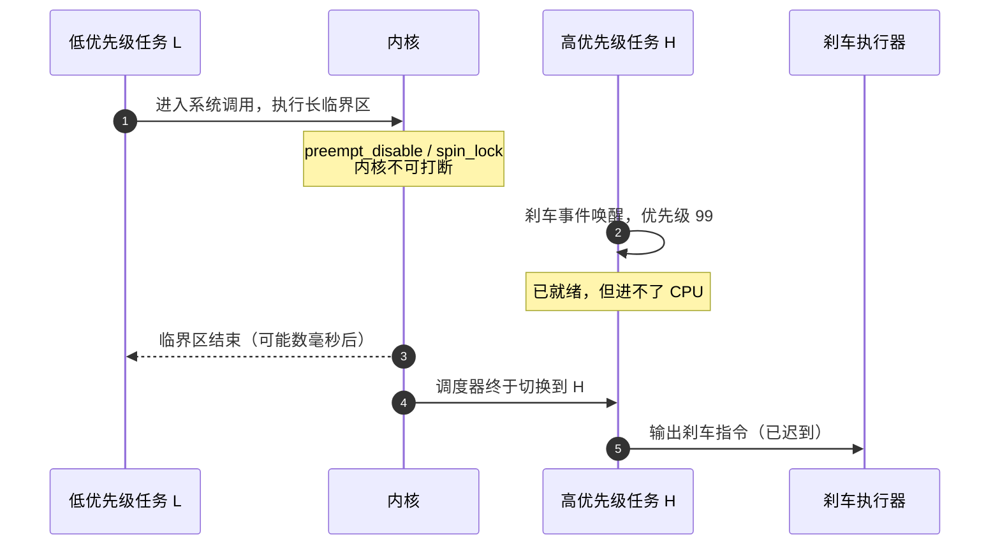
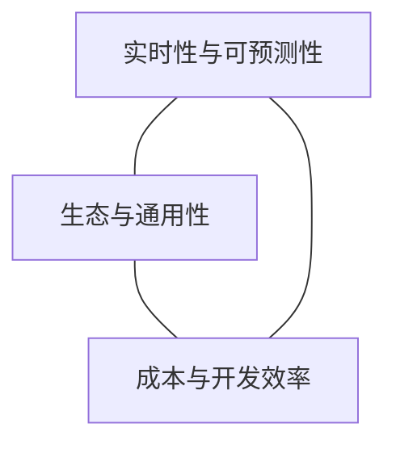
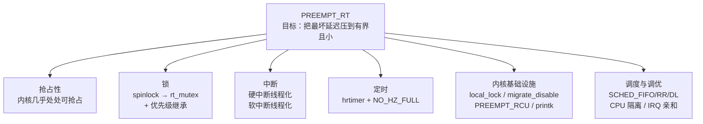
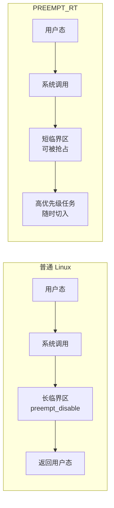
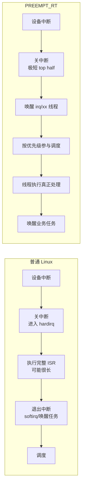
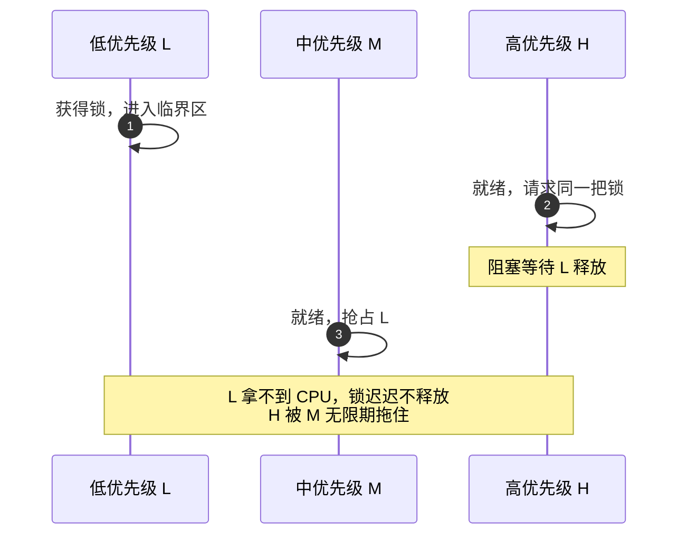
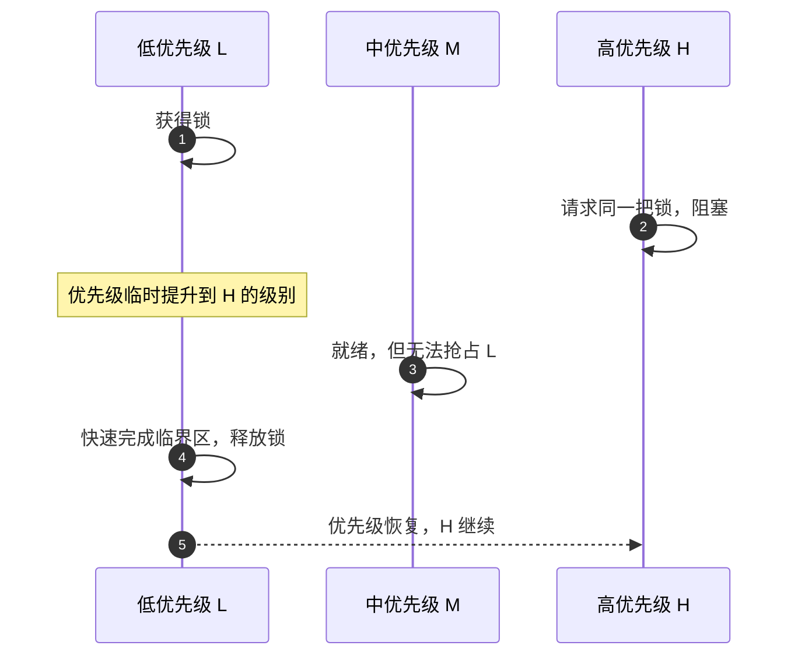
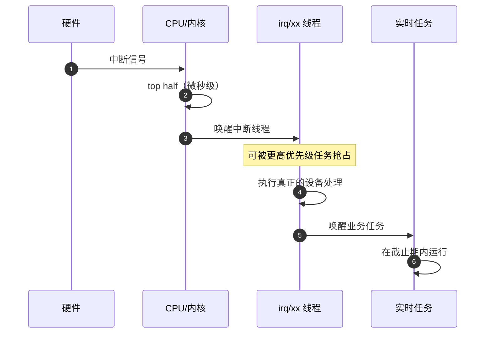
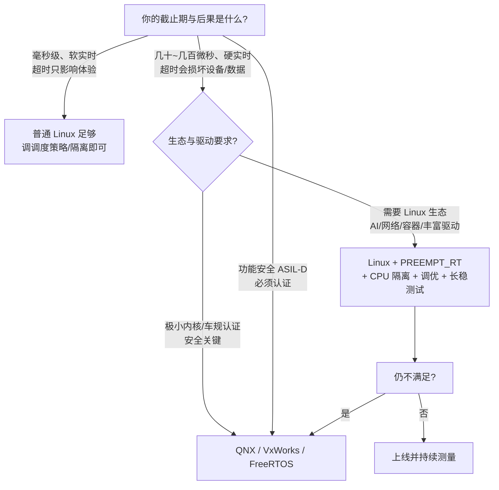

# Linux 与实时操作系统：从分时公平到 PREEMPT_RT 的确定性改造

> 本文面向第一次系统接触实时操作系统的同学。主线只有一句：**实时不是“平均跑得快”，而是“最坏情况也有上界”**。沿着这条主线，第 1～3 节建立直觉与延迟预算，第 4 节解释普通 Linux 为什么做不到，第 5 节看 RTOS 的做法，第 6～8 节拆解 PREEMPT_RT（俗称 RT-patch）到底改了什么，第 9～11 节给出测量、调优、选型与总结。
>
> 文中以 Linux x86-64 为主线，QNX 作为典型 RTOS 对照；所有延迟数字都是**量级示意**，真实值取决于硬件、驱动、负载与内核配置。
>
> **阅读前只需要三个背景概念**：进程/线程是“正在运行的程序及其执行流”；一个 CPU 核同一时刻只能执行一个线程；中断是硬件打断 CPU、要求它立刻处理紧急事件的机制。剩下的概念文中都会现学现用。

## 1. 先纠正一个直觉：实时不是“快”

### 1.1 实时 = 结果正确 + 时间正确

想象你坐在一辆带自动紧急制动（AEB）的车里。前方突然出现障碍物，系统必须在 **100 ms** 内完成“发现 → 决策 → 刹车”。如果它在 300 ms 后才算出“应该刹车”，这个结果在逻辑上完全正确，但已经没有任何意义。

这就是实时系统的第一性原理：

> **一个实时系统，不仅要给出正确的计算结果，还必须在规定的时间之内给出。**

这个“规定的时间”叫**截止期（deadline）**。按“错过截止期的后果”，实时任务通常分三类：

| 类型 | 定义 | 错过截止期的后果 | 例子 |
| --- | --- | --- | --- |
| 硬实时（hard） | 必须在截止期内完成 | 灾难性、不可接受 | 安全气囊、刹车、电机控制、飞行控制 |
| 固实时（firm） | 大部分情况要准时，偶尔超时可接受 | 结果直接作废，但不一定造成事故 | 音视频帧、工业视觉触发 |
| 软实时（soft） | 希望准时，偶尔超时只降低体验 | 质量下降 | 视频播放、游戏、语音通话 |

注意表格里的措辞：硬实时说的是“**不允许**错过”，不是“**很少**错过”。这两者在工程上是天壤之别。

### 1.2 平均分与最差一次：工程师为什么盯着 Max 看

我们习惯用“平均响应时间”评价一个系统。但在实时语境里，平均值几乎没有意义。

一个类比：

- 网约车平台的广告说“平均 20 分钟接单”。你从家去公司，这个数字很有用。
- 但如果你在运送一颗可移植的心脏，规定“2 小时内必须送到”，你关心的是**最坏的那一次**会不会超过 2 小时，而不是平均用时。

实时系统也一样。假设两个系统的响应时间如下（示意数据）：

| 系统 | 平均 | P99 | 最坏 | 能否保证 100 ms 截止期 |
| --- | --- | --- | --- | --- |
| 普通 Linux | 2 ms | 15 ms | 800 ms | **不能** |
| 调优后的 RT Linux | 30 µs | 50 µs | 90 µs | 在给定假设下可以 |

普通 Linux 的平均值甚至可能更漂亮，但它的最坏值 800 ms 已经足以让刹车功能失效。**实时系统的 KPI 是 Max，不是 Avg。** 每次响应时间的波动，工程上叫**抖动（jitter）**；抖动越大，系统越难承诺上界。

### 1.3 一个贯穿全文的例子：刹车信号

我们把后面的讨论都挂在这个例子上：


假设从“障碍物出现”到“刹车片夹紧”的总预算是 100 ms，可以拆成一张**延迟预算表**：

| 环节 | 预算 | 说明 |
| --- | --- | --- |
| 传感器采样与传输 | 1 ms | 1 kHz 采样，一帧 1 ms |
| 中断响应 + 唤醒任务 | 50 µs | 本文重点讨论的部分 |
| 感知/决策任务 | 20 ms | 算法本身有明确最坏执行时间 |
| CAN 发送与仲裁 | 5 ms | 总线有优先级仲裁 |
| 执行器机械响应 | 20 ms | 电机/液压的物理时间 |
| 安全余量 | 约 54 ms | 留给未建模的长尾 |
| **合计** | **100 ms** | 任何一环超支，功能就可能失效 |

这张表告诉我们一个关键事实：**实时性是整条链路共同承诺的，不是某一个环节“快”就能解决的**。而本文关注的，是其中“操作系统贡献的那一段”——它往往不是最大的，却是最不可预测的。

## 2. 两种世界观：银行大厅与急诊室

### 2.1 普通 Linux 像银行大厅

普通 Linux 的设计目标，是让很多任务**公平地**分享 CPU，让服务器的**吞吐量**最大，让交互式桌面的**平均响应**足够好。它像银行大厅：

- 所有人取号排队，按顺序或按权重办理；
- 银行追求“今天办完 1000 个人”“平均等待 10 分钟”；
- 不会因为某位客户要赶飞机，就让所有人停下来先给他办；
- 某个窗口办得慢，其他窗口继续运转，整体吞吐仍然不错。

这套逻辑在服务器、桌面、嵌入式多媒体里非常成功。它的 KPI 是**平均**与**吞吐**，不是**最坏等待**。

### 2.2 RTOS 像急诊室

实时操作系统（RTOS）更像急诊室：

- 病人进门先分诊，按病情轻重分级；
- 心脏骤停的病人可以立刻打断正在看感冒的医生；
- 医院承诺的不是“平均等 10 分钟”，而是“危重病人**最迟**几分钟内必须得到处置”；
- 为了守住这个承诺，宁可让轻症多等一会儿，甚至“饿死”某些低优先级任务。

RTOS 的 KPI 是**最坏情况的上界**与**可预测性**。它不追求把所有任务都跑得很快，而是追求：**任何时刻，最高优先级的就绪任务都能在已知的时间内拿到 CPU。**

### 2.3 一张表看清两种世界观

| 维度 | 普通 Linux（分时系统） | 实时操作系统 |
| --- | --- | --- |
| 设计目标 | 吞吐量、公平、平均响应 | 最坏延迟有界、可预测 |
| 调度策略 | 公平调度（CFS/EEVDF），按权重分 CPU | 优先级抢占，最高优先级就绪即运行 |
| 对延迟的态度 | 平均低就好，长尾可接受 | 平均值不重要，Max 必须小于截止期 |
| 内核结构 | 宏内核，功能丰富，临界区可能较长 | 微内核/小内核，临界区短 |
| 资源分配 | 按需分配、overcommit、swap | 预留、锁定、确定性分配 |
| 典型代表 | Ubuntu、Android、服务器发行版 | QNX、VxWorks、FreeRTOS、RT-Thread |
| 一句话类比 | 银行大厅取号 | 急诊分诊 |

> 重要：普通 Linux 不是“做得差”，而是**目标不同**。用吞吐量标准衡量 RTOS，它也会输得很惨。理解这一点，才不会把“实时”误解成“性能”。

## 3. 响应时间都花在哪：一笔延迟预算

### 3.1 从事件到动作的完整路径

一个外部事件从发生到被任务处理，通常要经过下面这条链：


把每一段命名清楚：

| 术语 | 含义 |
| --- | --- |
| 中断延迟（interrupt latency） | 事件发生到 CPU 执行中断服务程序第一条指令 |
| 硬中断处理时间 | 在关中断/中断上下文中执行 top half 的时间 |
| 唤醒延迟 | 中断处理完成到目标任务被标记为就绪 |
| 调度延迟（scheduling latency） | 任务就绪到调度器真正把 CPU 交给它 |
| 上下文切换 | 保存旧任务现场、恢复新任务现场 |
| 任务执行时间 | 业务代码本身的最坏执行时间（WCET） |
| 输出延迟 | 总线仲裁、驱动、执行器机械响应 |

写成一行：

```text
最坏响应时间 = 中断延迟 + 硬中断处理 + 唤醒延迟
             + 调度延迟 + 上下文切换 + 任务执行 + 输出延迟
```

### 3.2 每一段的典型量级

下表只是数量级示意，用来建立感觉，不要当成 benchmark 数据：

| 环节 | 普通 Linux | PREEMPT_RT Linux | 说明 |
| --- | --- | --- | --- |
| 中断延迟 | 几 µs ～ 几十 µs | 几 µs | 主要来自硬件与关中断窗口 |
| 硬中断处理 | 几十 µs ～ 数 ms | 几 µs（top half）+ 线程 | 驱动质量影响极大 |
| 调度延迟 | 几十 µs ～ 数 ms | 几 µs ～ 几十 µs | 取决于不可抢占区与负载 |
| 定时唤醒精度 | 受 tick/定时器影响 | hrtimer 高精度 | 还受唤醒路径影响 |
| 最坏响应 | 数百 µs ～ 数 ms | 几十 µs ～ 一百 µs | 需要硬件与调优配合 |

### 3.3 实时优化的本质：把“无界”变成“有界”

注意，RT-patch 并没有把每个环节都变成“零”。它做的是另一件事：

> **把内核里那些“可能很长、且无法被打断”的路径，改造成“很短、且随时可以被更高优先级任务打断”的路径。**

换句话说，实时优化的核心不是“更快”，而是**消除不可预测的长尾**。只要每个环节都有已知上界，整条链路的最坏响应时间就可以被分析和承诺。

## 4. 普通 Linux 为什么“不实时”

### 4.1 它的出生目标不是实时

Linux 诞生于多用户、分时系统的传统：让多个用户/进程公平地共享一台机器，让服务器吞吐尽可能高。为此它引入了很多“平均很划算、最坏很难看”的机制：

- **公平调度**：CFS/EEVDF 按权重分配 CPU，避免某个任务饿死；但实时要求“高优先级一来就运行”，两者天然冲突。
- **按需分页**：进程第一次访问某页内存时触发缺页中断，从磁盘/页缓存取页；一次缺页可能是几微秒，也可能是几毫秒。
- **overcommit 与 swap**：内存不够时回收、换出，延迟不可预测。
- **通用驱动**：为了兼容海量硬件，驱动里可能有长临界区、忙等、关中断。
- **省电机制**：CPU 进入深度 C-state 后，唤醒需要额外时间。
- **庞大的内核**：文件系统、网络栈、安全模块、调试设施都在内核里，路径长、分支多。

这些机制让 Linux 成为通用操作系统的王者，但也让“最坏延迟”变成一个很难给出上界的量。

### 4.2 内核不可抢占：那间“请勿打扰”的会议室

要理解普通 Linux 的实时性问题，必须先理解**内核态**和**抢占**。

- 用户态任务可以被调度器随时切换；
- 但任务一旦通过系统调用、异常或中断进入**内核态**，情况就不同了：内核代码在很多地方会**禁止抢占**（`preempt_disable()`），或者**关闭中断**（`local_irq_disable()`），或者持有**自旋锁**（`spin_lock()` 会关抢占）。

可以用一个类比：

> 一个员工走进了一间“保密电话亭”，门上亮着“请勿打扰”。在他出来之前，哪怕外面着火了，前台也只能等他。普通 Linux 的内核里，有很多这样的电话亭，而且有些电话打得特别久。

这就是问题的根源：**高优先级任务被唤醒了，但内核根本没给调度器切换的机会。** 它只能等当前内核路径走完。

Linux 提供了几种内核抢占模型，可以粗略理解为“电话亭的长度”：

| 配置 | 内核可抢占吗 | 典型用途 | 最坏延迟 |
| --- | --- | --- | --- |
| `PREEMPT_NONE` | 基本不可，只有显式调度点 | 服务器、追求吞吐 | 最大 |
| `PREEMPT_VOLUNTARY` | 在少量显式检查点让出 | 桌面 | 中等 |
| `PREEMPT` | 大部分可抢占，但自旋锁区不可 | 低延迟桌面/嵌入式 | 较小 |
| `PREEMPT_RT` | 几乎处处可抢占，锁可睡眠 | 工业、车载、机器人 | 最小 |

> 现代内核还提供 `PREEMPT_DYNAMIC`，允许在启动时选择抢占模式；但无论怎么选，只要还存在“长且不可抢占”的内核路径，硬实时就无法承诺。

### 4.3 长尾来源清单

把普通 Linux 的“长尾制造者”列出来，后面我们会看到 RT-patch 如何逐项处理：

| 长尾来源 | 机制 | 典型影响 | RT-patch 的对策 |
| --- | --- | --- | --- |
| 内核不可抢占区 | `preempt_disable()` 保护临界区 | 高优先级任务无法切入 | 几乎处处可抢占 |
| 关中断 | `local_irq_disable()` | 中断被延迟 | 缩短关中断窗口 |
| 自旋锁忙等 | `spin_lock()` 关抢占 + 原地打转 | 持锁者不能被抢占，等待者烧 CPU | 改成可睡眠的 `rt_mutex` |
| 硬中断处理过长 | 完整 ISR 在中断上下文执行 | 阻塞调度与同级中断 | 中断线程化 |
| 软中断/tasklet 批量 | 中断退出时集中处理 | 一次性占用大量时间 | 交给 `ksoftirqd` 线程 |
| 优先级反转 | 低优先级持锁、中优先级插队 | 高优先级被无界拖延 | 优先级继承 |
| 周期 tick | 固定频率时钟中断 | 唤醒粒度与抖动 | hrtimer + NO_HZ_FULL |
| 缺页/换页/回收 | 按需分页、内存压力 | 毫秒级停顿 | 需应用 `mlockall` 配合 |
| printk/串口控制台 | 同步输出、慢设备 | 内核长时间停住 | printk 线程化/原子控制台 |
| SMI/NMI/硬件 | 固件/硬件抢占 CPU | 内核完全不可见 | **RT-patch 管不了** |
| 虚拟化 | hypervisor 调度 vCPU | 抖动大 | 需 RT 虚拟机/CPU 直通 |

前七项是内核软件可以改造的，也是 PREEMPT_RT 的主战场；后几项则说明：**实时是一条端到端的链路，内核只是其中一环。**

### 4.4 思想实验：低优先级任务霸占内核

假设有三个任务：

- **L（低优先级）**：正在执行一个系统调用，进入了一段很长的内核临界区；
- **H（高优先级）**：刹车事件触发，优先级 99，已经被唤醒；
- **调度器**：想让 H 运行，但当前 CPU 还在内核里，且禁止抢占。



这个图里，调度器并没有“不聪明”。真正的问题是：**内核没有给调度器机会**。所以，想让 Linux 实时，光调高任务优先级是不够的，必须改造内核本身。

## 5. RTOS 是怎么把上界做小的

### 5.1 小内核/微内核：把“不可控”赶出内核

以 QNX 为代表的 RTOS 采用**微内核**架构：内核里只保留最核心的几件事——调度、进程间通信（IPC）、中断分发、定时器；文件系统、网络协议栈、设备驱动都运行在**用户态**的独立进程中。

一个类比：

> 急诊楼里只保留分诊台、调度室和抢救室；CT、化验、药房都在旁边独立的楼里。某个 CT 室排队再长，也不会把急诊通道堵死。每个科室还可以有自己的优先级。

这样做的好处：

- 内核临界区极短，最坏延迟容易分析；
- 驱动崩溃通常不会拖垮整个内核（可以重启驱动进程）；
- 每个驱动/服务可以被赋予独立优先级，参与全局调度；
- 优先级继承可以贯穿内核 IPC 和用户态服务。

代价是：跨进程通信比函数调用贵，生态和驱动数量远不如 Linux。

### 5.2 优先级抢占调度：永远让最紧急的跑

RTOS 的调度器通常很简单：

- 每个任务有固定优先级；
- 最高优先级的就绪任务**立即**运行；
- 同优先级任务按 FIFO 或时间片轮转；
- 高优先级任务一就绪，立刻抢占低优先级任务，不需要等时间片。

它不追求“公平”，只追求“紧急的先来”。这也意味着：如果高优先级任务设计不当（比如死循环），系统会被它饿死。所以 RTOS 通常还配合**优先级设计规范**、**看门狗**、**资源预留**一起使用。

### 5.3 短临界区 + 优先级继承

微内核并不是魔法。它同样需要锁和临界区，只是：

- 临界区被刻意做得极短；
- 内核锁普遍支持**优先级继承（priority inheritance）**；
- 中断处理被切成很小的 top half，剩余工作交给线程。

优先级继承是 RTOS 的标配，也是后面 PREEMPT_RT 的重点改造之一（见 7.5）。

### 5.4 确定性内存与驱动模型

RTOS 通常避免“按需分页”这种不可预测的机制：

- 内存分配使用固定大小的池，分配时间有界；
- 关键任务的内存在启动时预留、锁定；
- 驱动运行在用户态，可以用优先级和资源配额约束；
- 很多 RTOS 甚至不启用 MMU（或只做简单保护），以减少地址翻译与缺页的开销。

一句话：**RTOS 不怕慢，怕不确定。** 它宁愿牺牲一些平均性能，也要让每个操作的最坏时间可分析。

### 5.5 RTOS 的代价：实时性、生态、成本的不可能三角



RTOS 的实时性最好，但驱动少、开发门槛高、硬件支持窄、人才稀缺；Linux 生态最好，但原生实时性弱。PREEMPT_RT 的出现，本质上是在这个三角里找一个新的平衡点：**保留 Linux 的生态，把实时性补上来。**

## 6. 三类系统放在一张表里

### 6.1 普通 Linux、RT Linux、QNX 对比

| 维度 | 普通 Linux | Linux + PREEMPT_RT | QNX 等 RTOS |
| --- | --- | --- | --- |
| 内核结构 | 宏内核 | 宏内核 + 实时化 | 微内核 |
| 调度 | EEVDF/CFS 公平 + RT 策略 | 同左，但 RT 路径更可预测 | 优先级抢占 |
| 内核可抢占 | 部分 | 几乎全部 | 天然 |
| 中断处理 | 硬中断上下文执行 | 硬中断线程化 | 用户态驱动/线程 |
| 优先级继承 | 用户态 PI futex | 内核锁 + futex PI | 内核 IPC/锁 PI |
| 内存管理 | 虚拟内存/按需分页/swap | 同左，需 `mlock` 调优 | 确定性内存 |
| 最坏延迟 | 数百 µs ～ 数 ms | 几十 µs ～ 一百 µs | 几十 µs |
| 生态与驱动 | 极丰富 | 极丰富 | 专用、较少 |
| 功能安全认证 | 通用，需额外工作 | 需额外工作 | 有 ASIL-D 版本 |
| 典型场景 | 服务器、桌面、多媒体 | 工业、机器人、车载非安全核 | 安全关键、车控、医疗 |

再次强调：表中的延迟是量级示意，不是承诺值。一个配置糟糕的 PREEMPT_RT 系统，完全可能输给一个调优良好的普通 Linux；一个驱动写得糟糕的 RTOS，也可能出现毫秒级抖动。

### 6.2 实现实时的两条路线

在 Linux 世界里，实现实时有两条典型路线：

| 路线 | 做法 | 优点 | 缺点 |
| --- | --- | --- | --- |
| 双内核 | 在 Linux 旁边放一个小的实时核（如 Xenomai、RTLinux），实时任务跑在实时核上 | 延迟极低、确定性强 | 两套编程模型、隔离复杂、生态受限 |
| 单内核 | 直接把 Linux 内核改造成可抢占（PREEMPT_RT） | 保留 Linux 生态、单一编程模型 | 需要驱动适配、最坏延迟仍受内核与硬件影响 |

PREEMPT_RT 走的是第二条路。它不是“另一个操作系统”，而是**一组把 Linux 内核实时化的补丁集合**。2024 年，PREEMPT_RT 正式合并进 Linux 6.12 主线，这意味着你不再需要单独打一套庞大的 `-rt` 补丁，打开 `CONFIG_PREEMPT_RT` 就能构建 RT 内核。

## 7. PREEMPT_RT 到底做了什么

### 7.0 一句话与一张改造地图

如果只用一句话概括：

> **PREEMPT_RT 把内核里所有“可能长时间不可打断”的路径，改造成“短且可抢占”的路径，并让锁、中断、定时器都参与优先级调度。**

改造地图如下：



下面按“问题 → 改造 → 类比 → 效果”的顺序逐项拆解。

### 7.1 让内核几乎处处可抢占

**问题**：普通 Linux 在内核里大量使用 `preempt_disable()` 来保护 per-CPU 数据、循环、锁。只要处于“关抢占”状态，调度器就不能切换任务，哪怕更高优先级的任务已经就绪。

**改造**：

- 把大多数“只是为了防迁移”的 `preempt_disable()` 替换成 `migrate_disable()`：**允许被抢占，但禁止迁移到别的 CPU**；
- 把 per-CPU 数据的保护改成 `local_lock`：只保证同一 CPU 上的互斥，不再粗暴地关抢占；
- 只在真正不能睡眠的极短路径上保留 `raw_spinlock_t` 和关抢占；
- 让调度器在几乎任何内核返回点都能检查是否需要抢占。

改造后，内核里仍然存在不可抢占区，但它们必须**极短且有界**：调度器核心、定时器核心、CPU 启动、少量低层中断入口等。



### 7.2 自旋锁变睡眠锁：从“占着厕所死等”到“取号回座位”

**问题**：普通 Linux 的 `spinlock_t` 有两个特点：

1. 加锁时关抢占；
2. 拿不到锁就**原地自旋**，不睡觉，浪费 CPU。

更糟的是，持锁者因为关抢占而无法被更高优先级任务抢占。如果持锁者是个低优先级任务，而等待者是高优先级任务，就会形成**优先级反转**：高优先级任务在等一个根本跑不起来的低优先级任务。

一个类比：

> 老式做法：一个人进了唯一的厕所隔间，外面的人一直敲门、原地转圈，既不回去干活，也不让别人插队；里面的人还不能被叫出来。

**改造**：在 PREEMPT_RT 上，大部分 `spinlock_t` 被替换成**可睡眠的 `rt_mutex`**：

- 拿不到锁时，任务睡眠，CPU 去干别的；
- 持锁者可以被更高优先级任务抢占；
- 锁支持**优先级继承**：等待者会把持锁者的优先级临时抬高，让他尽快跑完临界区；
- 真正不能睡眠的底层代码使用 `raw_spinlock_t`，保持“真自旋 + 关抢占”。

| 锁类型 | 行为 | 能否睡眠 | 典型用途 |
| --- | --- | --- | --- |
| `raw_spinlock_t` | 真自旋、关抢占 | 否 | 调度器/定时器核心、硬中断 |
| `spinlock_t`（RT） | 睡眠锁、支持 PI | 是 | 大多数驱动与子系统 |
| `mutex` | 睡眠锁 | 是 | 进程上下文 |

**代价**：睡眠/唤醒有上下文切换开销，吞吐量会下降；驱动不能假设“spinlock 里可以关中断”；一些老驱动需要审计和适配。

### 7.3 中断线程化：把“急诊大夫”变成“可排班的科室”

**问题**：普通 Linux 的硬中断处理程序（top half/ISR）在中断上下文运行，通常会关闭当前中断线（甚至关本地中断）。如果 ISR 很长，会出现：

- 更高优先级的任务无法运行；
- 同级或更低优先级的中断被延迟；
- 调度器没有机会介入。

**改造**：PREEMPT_RT 把中断处理拆成两段：

1. **top half（硬中断上下文）**：只做最紧急、最短的事——屏蔽该中断、确认硬件、唤醒对应的中断线程；
2. **中断线程（`irq/xx-name`）**：真正耗时的处理放在内核线程里，拥有实时优先级（默认约 50，可调），可以像普通任务一样被调度、被抢占、参与优先级继承。



一个类比：

> 以前是“急诊大夫亲自在门口登记、分诊、抢救、写病历，全部一个人干，期间谁也别找他”；现在是“前台只做 10 秒登记，然后把病人交给对应科室，科室按优先级排队，院长可以随时调人”。

**关键澄清**：中断线程化**不会**降低硬件中断本身的延迟（从引脚拉低到 CPU 响应仍然是硬件决定的）。它降低的是**关中断时间**和**高优先级任务被阻塞的时间**。另外，并非所有中断都能线程化：定时器中断、IPI（核间中断）、级联中断等必须保留在硬中断上下文，通过 `IRQF_NO_THREAD` 标记。

### 7.4 软中断线程化：让网络栈也能被抢占

**问题**：软中断（softirq）和 tasklet 通常在硬中断退出时集中执行。网络收包时，软中断可能一次处理大量数据包，甚至循环很久；这段时间里，高优先级任务同样进不来。

**改造**：PREEMPT_RT 把软中断交给 **`ksoftirqd` 内核线程**执行：

- 软中断变成可调度的线程工作；
- 高优先级任务可以抢占 `ksoftirqd`；
- 每个 CPU 一个线程，避免跨核竞争；
- 网络栈的收包处理仍然高效，但不再“霸占中断退出路径”。

**代价**：网络吞吐量可能下降（线程切换、调度开销），但延迟更可预测。对于实时系统，这通常是值得的交换。

### 7.5 优先级继承：把“被插队”变成“临时升职”

这是实时系统里最经典的问题之一。考虑三个任务：

- **L（低优先级）**：持有锁，正在临界区里；
- **M（中优先级）**：CPU 密集型，随时可能抢占 L；
- **H（高优先级）**：需要同一把锁，已经就绪。

没有优先级继承时：



H 等的不再是 L 的“临界区长度”，而是 M 的“整个执行时间”——这就是**无界优先级反转**。

有了优先级继承（PI）之后：



一个类比：

> 实习生拿着公司唯一的公章在盖章，CEO 在门口等着盖章，几个中层还在不断插队找实习生签字。优先级继承相当于给实习生一张“CEO 特批”的临时工牌：在中层眼里，他现在就是 CEO，谁也不能插他的队；盖完章，工牌收回。

**实现位置**：

- 内核态：`rt_mutex` 内置 PI，等待者阻塞时会把持锁者的优先级抬高；
- 用户态：`futex` 支持 PI，使用 `PTHREAD_PRIO_INHERIT` 属性的 mutex 即可启用；
- 链式等待：如果 L 又在等更底层的锁，优先级会沿着等待链传递（传递性 PI）。

**边界**：PI 只解决“持锁者被中优先级任务抢占”的问题，**不解决**“持锁者自己临界区很长”的问题。如果 L 在临界区里做了 10 ms 的工作，H 仍然要等 10 ms。所以 RT 系统既要 PI，也要**短临界区**。

### 7.6 高精度定时器与无滴答：从“整点敲钟”到“个人闹钟”

**问题**：传统 Linux 依赖周期性时钟中断（tick），比如 `HZ=1000` 就是每 1 ms 一次。它带来两个问题：

- 定时器精度受 tick 限制，唤醒可能被推迟到下一个 tick；
- 即使 CPU 空闲，tick 也会周期性打断它，制造抖动、浪费功耗。

**改造**：

- **hrtimer（高精度定时器）**：基于硬件时钟，提供纳秒级精度；`clock_nanosleep()`、`timerfd`、`epoll` 超时等都建立在它之上；
- **NO_HZ_FULL（无滴答）**：在隔离的 CPU 上停掉周期性 tick，让 CPU 只在真正有工作时被唤醒；
- **RCU 回调卸载（`rcu_nocbs`）**：把 RCU 回调从实时 CPU 上移走，减少干扰；
- 配合 `isolcpus` 把实时任务与普通任务隔离开。

一个类比：

> 以前是“全班整点一起对表”，哪怕你没事也要被敲钟打断；现在是“每个人自己设闹钟”，谁的事谁醒，别人不受影响。

**澄清**：hrtimer 并不是 RT-patch 独有的，主干 Linux 早已支持；PREEMPT_RT 把它作为基础设施，并进一步消除周期 tick 对隔离 CPU 的干扰。真正决定唤醒延迟的，除了定时器精度，还有调度延迟和中断路径。

### 7.7 那些“不显眼但要命”的改造

除了上面几条主线，PREEMPT_RT 还改了很多基础设施。它们单看都不起眼，但任何一个都可能制造长尾：

| 改造/机制 | 解决的问题 | 一句话解释 |
| --- | --- | --- |
| `local_lock` | per-CPU 数据保护依赖关抢占 | 只防同 CPU 竞争，不关抢占 |
| `migrate_disable` | 需要固定 CPU 但不想关抢占 | 允许被抢占，禁止迁移 |
| `PREEMPT_RCU` | RCU 读临界区不可抢占 | 读临界区可被抢占，减少停顿 |
| printk 线程化 | 串口/控制台慢导致内核停住 | 日志交给线程或原子控制台 |
| 减少原子分配 | 原子上下文分配内存导致长延迟 | 预留内存、per-CPU 缓存 |
| `stop_machine` 改造 | 多核同步时停住所有 CPU | 减少/替换长停顿路径 |
| RT throttling（调优） | RT 任务可能饿死系统 | 默认 95% 带宽限流，生产按需调整 |

其中 **printk** 值得单独说一句：很多人以为日志无关紧要，但在 RT 系统里，一条同步写串口的 `printk` 可能让内核停住几百微秒甚至更久。RT-patch 把控制台输出改成线程化/原子控制台，就是为了消灭这种“看起来无害”的长尾。

### 7.8 一条中断路径的前后对照

把前面的改造串起来，看一条完整的中断路径：

| 步骤 | 普通 Linux | PREEMPT_RT |
| --- | --- | --- |
| 1. 设备拉中断线 | 硬件中断 | 硬件中断 |
| 2. CPU 响应 | 关中断，进入 hardirq | 关中断，进入 hardirq |
| 3. top half | 执行完整 ISR，可能很长 | 只做屏蔽/确认/唤醒线程，微秒级 |
| 4. 退出中断 | 执行 softirq/tasklet | 唤醒 `irq/xx` 线程，按优先级调度 |
| 5. 实际处理 | 在中断上下文完成 | 在线程上下文完成，可被抢占、可 PI |
| 6. 唤醒业务任务 | 调度器选择任务 | 调度器选择任务 |
| 7. 业务任务运行 | 可能被内核长路径延迟 | 最坏延迟大幅缩短 |
| **最长不可抢占窗口** | **可能数毫秒** | **通常几十微秒量级** |

用一张时序图表示 RT 下的路径：



### 7.9 改造的代价：没有免费的午餐

| 收益 | 代价 |
| --- | --- |
| 最坏延迟从毫秒级降到几十微秒级 | 吞吐量下降（上下文切换、线程化中断） |
| 优先级反转有界 | 驱动需要审计、适配，老驱动可能不兼容 |
| 中断处理可调度、可配优先级 | 系统线程变多，调试与观测更复杂 |
| 定时精度提高、tick 干扰减少 | 内核配置与调优门槛更高 |
| 保留 Linux 生态与编程模型 | 仍然不是经过认证的硬实时 RTOS |

一句话：**RT-patch 不是“性能补丁”，它用一点平均性能换取最坏情况的确定性。** 如果你的系统只需要高吞吐，打 RT 补丁很可能得不偿失。

## 8. 实时是一条链路：内核之外的长尾

很多同学以为“打了 RT 补丁就实时了”。实际上，RT-patch 只负责内核软件这一段。最终的最坏响应时间，是整条链路上所有环节共同决定的：


| 层级 | 典型长尾来源 | RT-patch 能解决吗 |
| --- | --- | --- |
| 应用 | `malloc`、`printf`、缺页、非 PI 锁 | 否，需应用改造 |
| 内核 | 不可抢占区、自旋锁、软中断 | 是，主要目标 |
| 驱动 | 长临界区、关中断、忙等 | 部分，需驱动适配 |
| 总线 | PCIe 延迟、CAN 仲裁、网络拥塞 | 否，需硬件/协议设计 |
| 硬件 | SMI、缓存缺失、DRAM 刷新、DVFS | 否，需 BIOS/硬件调优 |
| 虚拟化 | hypervisor 调度、vCPU 抢占 | 否，需 RT 虚拟机/CPU 直通 |

几个特别容易被忽略的点：

- **SMI（系统管理中断）**：BIOS/固件可以在操作系统完全不知情的情况下抢占 CPU 几百微秒甚至更久。`hwlatdetect` 就是用来发现这类“内核看不见的停顿”的。
- **深度 C-state**：CPU 睡得太深，唤醒要几十到几百微秒。实时系统通常限制 C-state，或通过 `/dev/cpu_dma_latency` 告诉内核“我不要深度睡眠”。
- **缺页**：第一次访问一块内存可能触发缺页，延迟远高于普通指令。RT 任务通常要 `mlockall()` 锁住内存并预热。
- **虚拟化**：vCPU 被 hypervisor 调度出去时，客户机内的 RT 补丁无能为力。硬实时通常要求裸机或 CPU 直通。

所以，实时性从来不是“一个补丁”的事，而是**硬件选型、BIOS 配置、内核、驱动、应用、测试**共同承诺的结果。

## 9. 动手：确认、测量、调优

### 9.1 确认你的内核是不是 RT

```bash
# 1. 看内核版本字符串，末尾通常会出现 PREEMPT_RT
uname -v

# 2. RT 内核会提供这个文件，值为 1
cat /sys/kernel/realtime

# 3. 看内核配置（不同发行版路径可能不同）
zcat /proc/config.gz | grep -E "CONFIG_PREEMPT_RT|CONFIG_PREEMPT="
# 或者
grep -E "CONFIG_PREEMPT_RT|CONFIG_PREEMPT=" /boot/config-"$(uname -r)"
```

典型输出：

```text
#1 SMP PREEMPT_RT Debian 6.12.0-rt-amd64
1
CONFIG_PREEMPT_RT=y
```

如果 `/sys/kernel/realtime` 不存在，或者版本字符串里没有 `PREEMPT_RT`，那多半不是 RT 内核。

### 9.2 用 cyclictest 量一量最坏延迟

`cyclictest` 是 `rt-tests` 包里最常用的工具。它创建一个高优先级线程，按固定周期睡眠，然后测量“应该醒来”到“实际醒来”的差值。

```bash
sudo apt install rt-tests          # Debian/Ubuntu
sudo cyclictest -m -Sp90 -i200 -h400 -D10m
```

参数含义：

| 参数 | 含义 |
| --- | --- |
| `-m` | 锁定内存，避免缺页干扰 |
| `-S` | 所有 CPU 使用同一套参数 |
| `-p90` | 线程优先级 90（SCHED_FIFO） |
| `-i200` | 周期 200 µs |
| `-h400` | 直方图统计到 400 µs |
| `-D10m` | 运行 10 分钟 |

典型输出：

```text
T: 0 ( 1234) P:90 I:200 C: 3000000 Min: 2 Act: 3 Avg: 3 Max: 27
```

- `Min/Avg` 好看不代表什么；
- **`Max` 才是你真正要盯的数**；
- 直方图能看出长尾分布；
- 一定要在**有负载**时跑（比如同时跑 `stress-ng`、网络收包、磁盘 IO），否则测到的是“空载童话”。

如果怀疑硬件/固件在捣鬼，再跑一个 `hwlatdetect`：

```bash
sudo hwlatdetect --duration=60s
```

它通过轮询时钟来发现 SMI、固件停顿这类“内核看不见”的延迟。

### 9.3 一个最小但像样的实时线程

下面这段代码演示三个关键点：锁内存、设 `SCHED_FIFO`、用绝对时间睡眠。

```c
#define _GNU_SOURCE
#include <errno.h>
#include <pthread.h>
#include <sched.h>
#include <stdio.h>
#include <string.h>
#include <sys/mman.h>
#include <time.h>

static int fail(const char *what, int err)
{
    fprintf(stderr, "%s: %s\n", what, strerror(err));
    return 1;
}

int main(void)
{
    /* 1. 锁住当前和未来分配的内存，避免缺页把实时任务拖进慢路径 */
    if (mlockall(MCL_CURRENT | MCL_FUTURE) != 0)
        return fail("mlockall", errno);

    /* 2. 把自己设为 SCHED_FIFO，优先级 80（需要 root 或 CAP_SYS_NICE） */
    struct sched_param sp = { .sched_priority = 80 };
    int err = pthread_setschedparam(pthread_self(), SCHED_FIFO, &sp);
    if (err != 0)
        return fail("pthread_setschedparam", err);

    const long period_ns = 1000000; /* 1 ms */
    struct timespec next;
    clock_gettime(CLOCK_MONOTONIC, &next);

    long max_late_ns = 0;
    for (int i = 0; i < 10000; i++) {
        /* 3. 用绝对时间推进，避免相对睡眠的累积漂移 */
        next.tv_nsec += period_ns;
        while (next.tv_nsec >= 1000000000L) {
            next.tv_nsec -= 1000000000L;
            next.tv_sec++;
        }

        err = clock_nanosleep(CLOCK_MONOTONIC, TIMER_ABSTIME, &next, NULL);
        if (err != 0)
            return fail("clock_nanosleep", err);

        /* 4. 记录本次唤醒迟到了多久 */
        struct timespec now;
        clock_gettime(CLOCK_MONOTONIC, &now);
        long late_ns = (now.tv_sec - next.tv_sec) * 1000000000L
                     + (now.tv_nsec - next.tv_nsec);
        if (late_ns > max_late_ns)
            max_late_ns = late_ns;

        /*
         * 5. 这里只做有界、非阻塞的实时工作。
         *    不要 printf、malloc、open、写文件——它们都可能阻塞。
         */
    }

    printf("max wake-up lateness: %ld ns\n", max_late_ns);
    return 0;
}
```

编译与运行：

```bash
gcc -O2 -pthread rt_demo.c -o rt_demo
ulimit -l unlimited          # 允许 mlockall，或者用 root
sudo ./rt_demo
```

这段代码测量的是“定时唤醒延迟”，和 `cyclictest` 类似。它不能替代完整的端到端测量，但足够让你亲眼看到：**同一台机器，普通内核和 RT 内核的 `max` 可能差一个数量级。**

### 9.4 系统调优清单

RT 内核只是起点。要让最坏延迟真正稳定，通常还要做这些事：

1. **内核配置**：`CONFIG_PREEMPT_RT=y`、`CONFIG_HIGH_RES_TIMERS=y`、`CONFIG_NO_HZ_FULL=y`；生产环境关闭开销大的调试选项（如 `lockdep`、`kmemleak`）。
2. **CPU 隔离**：启动参数加入 `isolcpus=2-3 nohz_full=2-3 rcu_nocbs=2-3 irqaffinity=0-1`，把实时任务固定在隔离核上。
3. **中断亲和**：用 `tuna` 或 `/proc/irq/<n>/smp_affinity` 把网卡、磁盘等中断移到非实时核。
4. **电源管理**：限制深度 C-state（如 `processor.max_cstate=1`），或通过 `/dev/cpu_dma_latency` 持有低延迟约束。
5. **RT 限流**：确认 `kernel.sched_rt_runtime_us` 的设置。默认 950000（95%）会限制 RT 任务的总带宽；生产环境常设为 `-1`，但要确保 RT 任务不会死循环。
6. **内存**：`mlockall()`、预分配、预热堆栈；避免 swap；必要时使用大页减少 TLB miss。
7. **应用**：实时线程里不做 `malloc`/`printf`/文件 IO；共享锁使用 `PTHREAD_PRIO_INHERIT`；循环必须有界。
8. **隔离普通任务**：用 cpuset/cgroup 把后台任务挡在实时核之外；不要让日志、监控、SSH 跑到隔离核上。
9. **测量**：`cyclictest` + 负载、`hwlatdetect`、`ftrace` 的 `preemptirqsoff`/`wakeup` tracer、`perf sched`。
10. **长稳测试**：跑几小时甚至几天，覆盖温度变化、网络风暴、磁盘 IO、内存压力；最坏值往往在长时间运行后才出现。

### 9.5 常见坑

| 坑 | 现象 | 原因 | 对策 |
| --- | --- | --- | --- |
| 实时线程里 `printf`/`malloc` | 偶发几百 µs ～ ms 抖动 | stdio 锁、堆锁、缺页、`write()` | 预分配、无锁日志、实时线程只做有界工作 |
| 与普通线程共用非 PI mutex | 高优先级被低优先级拖住 | 用户态锁没有优先级继承 | 使用 `PTHREAD_PRIO_INHERIT` 或设计无锁路径 |
| 网卡中断全落在实时核 | 周期性抖动 | IRQ 与 RT 任务抢 CPU | 中断亲和分离 |
| 深度 C-state | 唤醒慢 | CPU 睡得太深 | 限制 C-state / `cpu_dma_latency` |
| 二进制驱动 | 偶发大延迟 | 驱动里长临界区/`raw_spinlock` | 换 RT 友好驱动，审计源码 |
| 虚拟机 | 抖动大 | hypervisor 调度 vCPU | 裸机、CPU 直通、RT 虚拟机 |
| RT 任务被限流 | 运行一段时间被掐 | 默认 95% RT 带宽 | 评估后调整 `sched_rt_runtime_us` |
| 未锁内存 | 首次访问缺页 | 按需分页 | `mlockall` + 预热 |
| 把 RT 优先级设得太高 | 系统卡死、看门狗复位 | RT 任务饿死所有普通任务 | 合理优先级 + 看门狗 + 资源预留 |

## 10. 边界与选型：什么时候需要 RT

### 10.1 先问三个问题

选型时不要问“哪个系统更快”，而要问：

1. **截止期是多少？** 是 1 ms、100 ms，还是 1 s？
2. **错过截止期的后果是什么？** 是体验下降、结果作废，还是人身安全事故？
3. **生态与认证要求是什么？** 需要海量驱动、AI 框架、容器，还是需要 ASIL-D 认证？

### 10.2 选型决策树



### 10.3 三种典型选择

| 场景 | 推荐 | 理由 |
| --- | --- | --- |
| Web 服务器、数据库、视频转码 | 普通 Linux | 吞吐优先，软实时，长尾可接受 |
| 工业机器人、运动控制、车载非安全域控 | Linux + PREEMPT_RT | 需要 Linux 生态，截止期在几十 µs ～ 几 ms |
| 安全气囊、线控制动、发动机控制 | RTOS / QNX | 硬实时 + 功能安全认证 + 极小内核 |
| 自动驾驶域控 | 混合架构 | QNX 管安全岛/实时控制，Linux 管感知/AI，hypervisor 隔离 |

在自动驾驶域控制器里，常见的做法不是“二选一”，而是**混合架构**：用 QNX 或 RTOS 承担安全关键、强实时的控制任务，用 Linux + PREEMPT_RT 承担感知、规划、AI 推理等算力密集任务，两者通过 hypervisor 或异构 SoC 隔离。这样既拿到了实时性与认证，又保留了 Linux 的生态。

### 10.4 PREEMPT_RT 不是银弹

最后强调几个边界：

- 它不提供**形式化 WCET 证明**，也不自动获得 ISO 26262 认证；
- 它不能消除 SMI、缓存缺失、DRAM 刷新、总线竞争等硬件长尾；
- 它不能拯救写得糟糕的驱动和应用；
- 它用吞吐量换确定性，不是所有场景都划算；
- “最坏延迟”必须在**目标硬件 + 目标负载 + 长时间运行**下测出来，不能照搬别人的数字。

## 11. 一页纸总结

### 11.1 六句话记住全文

1. **实时不是快，是“最坏情况有上界”**；硬实时不允许错过截止期，平均延迟没有意义。
2. **普通 Linux 为吞吐与公平而生**，内核里有大量不可抢占区、自旋锁、长中断处理，导致最坏延迟不可控。
3. **RTOS 用微内核 + 优先级抢占 + 短临界区 + 优先级继承**，把最坏延迟做小，但牺牲生态与通用性。
4. **PREEMPT_RT 把 Linux 内核几乎处处变成可抢占**：`spinlock` 变 `rt_mutex`、中断线程化、软中断线程化、PI、hrtimer、`local_lock`/`migrate_disable`、printk 线程化等。
5. **Linux 6.12 起 PREEMPT_RT 进入主线**，打开 `CONFIG_PREEMPT_RT` 即可构建；它保留 Linux 生态，但不是认证 RTOS。
6. **实时是一条端到端链路**：硬件、BIOS、内核、驱动、应用、调优、测试，任何一环的长尾都会出现在最终响应时间里。

### 11.2 术语表

| 术语 | 解释 |
| --- | --- |
| 截止期（deadline） | 任务必须完成的最晚时间 |
| 硬/固/软实时 | 按错过截止期的后果分类 |
| 抖动（jitter） | 响应时间的波动程度 |
| 最坏响应时间 | 所有可能情况下最大的响应时间 |
| 抢占（preemption） | 高优先级任务打断当前任务、夺取 CPU |
| 临界区 | 访问共享资源、需要互斥保护的代码段 |
| 关中断 | CPU 暂时不响应中断，会增大中断延迟 |
| 自旋锁 | 拿不到锁时原地忙等的锁 |
| 优先级反转 | 高优先级任务被低优先级持锁者间接阻塞 |
| 优先级继承（PI） | 持锁者临时继承等待者的高优先级 |
| 中断线程化 | 把耗时的中断处理放到内核线程中执行 |
| top half / bottom half | 中断处理的“上半段/下半段”拆分 |
| hrtimer | 高精度定时器 |
| NO_HZ_FULL | 在隔离 CPU 上停掉周期性 tick |
| CPU 隔离 | 把 CPU 从通用调度器中隔离开，专供实时任务 |
| cyclictest | 测量定时唤醒延迟的常用工具 |

### 11.3 思考题

1. 一个系统平均响应时间是 1 ms，但最坏是 500 ms。它能用于 100 ms 截止期的刹车控制吗？为什么？
2. PREEMPT_RT 把 `spinlock_t` 改成了可睡眠的 `rt_mutex`，为什么还必须保留 `raw_spinlock_t`？
3. 中断线程化之后，硬件中断延迟会变小吗？它真正改善的是哪一段时间？
4. 优先级继承能解决所有优先级反转吗？如果持锁者自己在临界区里睡了 10 ms 呢？
5. 为什么 `cyclictest` 一定要在系统有负载时跑？空载测出来的 `Max` 能说明什么？
6. 一个 1 ms 控制周期的电机驱动器，你会选 Linux + PREEMPT_RT 还是 RTOS？请从截止期、生态、认证、成本四个维度说明理由。

> **最后一句**：实时系统的设计，本质上是在和“不确定性”作斗争。RT-patch 做的，是把 Linux 内核里一段段“不可预测的长暂停”切成“短而可抢占的小段”；而真正的实时性，仍然需要你从硬件到应用，逐层把上界找出来、测出来、守住。
