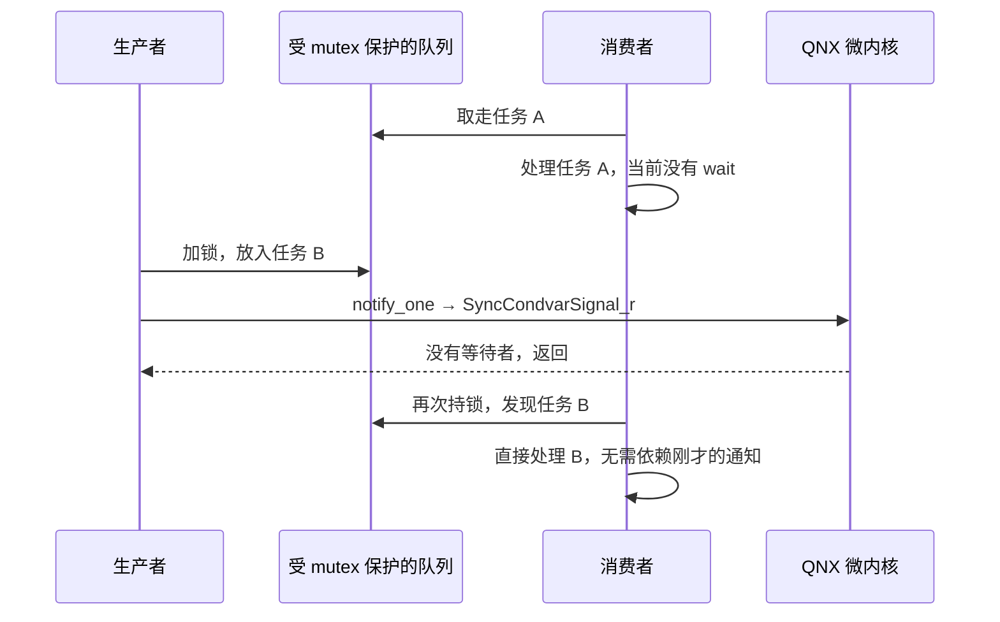
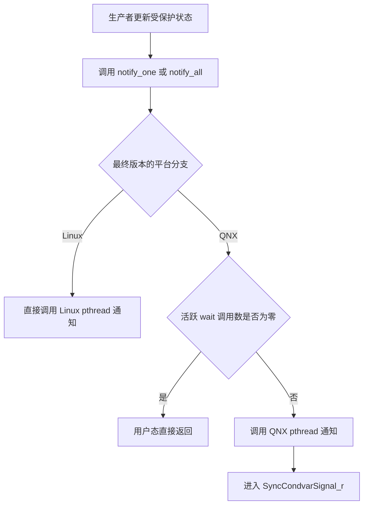
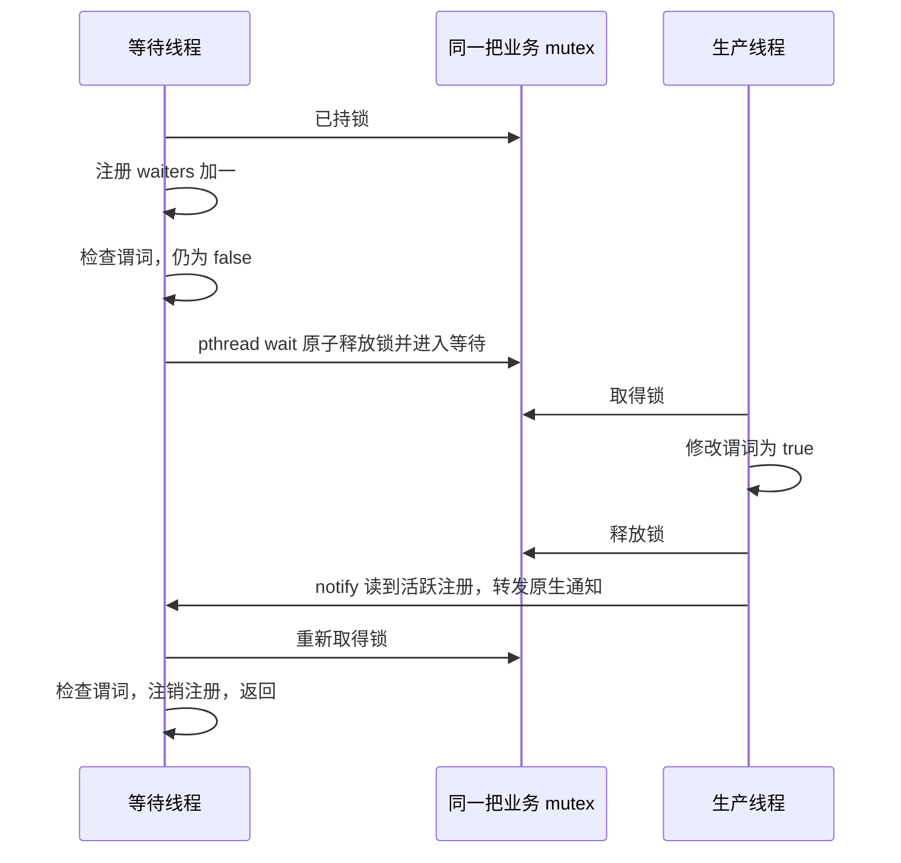

# QNX 条件变量空通知优化：问题背景、并发原理与修复方案

条件变量、谓词与 mutex 的通用背景见[条件变量原理：从共享状态到等待与唤醒](../条件变量原理：从共享状态到等待与唤醒.md)。本文在这些概念基础上，分析 QNX 的通知成本与公共封装修复。

本次修复针对一个容易被 Linux 使用经验掩盖的性能问题：**在本地核验的 QNX 7.1 和 8.0 AArch64 libc 中，即使没有线程等待，`pthread_cond_signal()`、`pthread_cond_broadcast()` 仍直接走内核调用。** 如果消息生产者频繁通知，而消费者大部分时间都在处理任务，这些通知可能没有唤醒对象，却持续支付用户态进入内核态的成本。

最终方案是在 QNX 的公共 `ConditionVariable` 外层记录“尚未结束的 wait 调用”，计数为零时直接省略通知；底层仍使用原生 `pthread_cond_t`、`CLOCK_MONOTONIC` 和调用者的 mutex。Linux 保留原生等待与通知路径，不加等待者计数。

这项修复同时保护几条并发不变量：不能漏掉必要通知，不能改变调用者的锁、时钟和超时返回语义，也不能因为优化引入额外的析构竞态。

## 1. 分析对象与证据边界

本文将公共条件变量的改动视为一个完整修复，围绕“为什么会付出空通知成本、如何安全地省略通知、怎样维持已有实时等待语义”展开。实现包含两层：两平台共用的原生单调时钟后端，以及仅在 QNX 上启用的等待者计数。超时返回值、时间转换和生命周期约束也一并纳入分析。

正文嵌入理解原理所需的关键片段；完整源码、测试、业务调用点、反汇编和 QNX API 摘录作为原始文本附件保存在 assets 中，可从[附录 B 的材料索引](#local-materials)直接打开。附件来源、版本和校验值记录在[来源清单](./assets/2026-11-12_qnx_condition_variable/provenance.txt)中。

本文明确区分三类证据：

- **源码可以直接证明的事实**：修复前后的接口与实现差异、计数时机、平台分支、测试设计及构建入口变化。
- **本次额外核验的事实**：本地两个版本的 QNX libc 通知路径、官方 API 语义，以及 platform 中实际存在的调用模式。
- **尚未获得的现场证据**：最初触发排查的行程、火焰图或 KEV trace、空通知占比、单次调用成本，以及优化前后的整机 CPU 数据。

因此，下文可以解释这个问题为什么成立、如何验证和如何修复；**不能把推导出的发现路径当作当时的真实操作记录，也不能声称已经取得某个百分比的 CPU 降幅。** 本次工作只整理分析文档与证据快照，没有修改或构建业务代码，也没有运行这些 C++ 测试。

## 2. 背景：为什么业务正确运行时仍会有空通知

### 2.1 条件变量负责提示，业务状态负责记住事实

典型生产者—消费者模型中，生产者写入队列后执行 `notify_one()`，消费者发现队列为空才调用 `wait()`。消费者正在处理上一项工作时，新任务到达仍会通知；此时没有线程睡在条件变量上。

这种通知在语义上完全允许。队列中已经保存了任务，消费者下一次持锁检查时能看到，不需要条件变量额外保存一份“通知次数”。**条件变量没有 semaphore 那样的计数凭据，通知本身也不承诺被未来的 wait 消费。**



这里的“空”只描述通知时没有等待者。它既不表示队列为空，也不表示线程无事可做；**消费者越忙，通知恰好遇到它没有 wait 的机会反而可能越多。**

### 2.2 真实调用点：Church 的队列与触发器

在本次查看的 platform 快照 `55b503c91f7eaaef78d90b538f34c65f0ea4b154` 中，可以找到与该模型吻合的代码：[源码 E4][E4]。

| 调用点 | 通知与等待模式 | 与本次优化的关系 |
| --- | --- | --- |
| `church/base/container/blocking_queue.h` | `Push()` 持锁入队后直接 `cv_.notify_one()`；`WaitCommonLocked()` 以“队列非空或关闭”为谓词 | 消费者未等待时，生产者的通知可以被省略 |
| `church/base/synchronization/notification.h` | `Notify()` 持锁执行 `set_ready()` 后通知；wait 使用同一个 mutex | 状态与等待者注册可以按同一把锁排序 |
| `church/component/trigger.h` | `TriggerSignal()` 持锁更新消息和 `is_triggered_` 后通知；`Wait()` 使用绝对 deadline | 同时要求 `RealtimeMutex`、单调时钟和既有 bool 返回接口 |

以 `BlockingQueue::Push()` 为例，实际关键代码为：

```cpp
std::unique_lock scoped_lock(mutex_);
// ... 容量处理 ...
queue_.push_back(std::move(item));
pending_items_ = queue_.size();
cv_.notify_one();
```

这些调用点证明“每次生产都通知”是实际存在的模式；它们本身不能证明某次行程的空通知率或 CPU 占比。本次修复没有修改这些业务调用点，已有公共封装的使用者在一致重编译后接入新实现。

### 2.3 原有公共封装已经承担了实时语义

修复前的 `ConditionVariable` 并不是简单的 `std::condition_variable` 别名：[源码 E0][E0]。

- 使用 `pthread_condattr_setclock(..., CLOCK_MONOTONIC)` 设置等待时钟。
- 将 `lock.mutex()->native_handle()` 直接传给 `pthread_cond_wait/timedwait`。
- 接受 `std::unique_lock<Mutex>`，可使用 `std::mutex` 或 `RealtimeMutex`。
- 带超时的原始等待与谓词等待均返回 `bool`。

`RealtimeMutex` 初始化时显式设置 `PTHREAD_PRIO_INHERIT`。因此，替换封装时必须检查的不只是能否编译，还包括内核等待使用哪把锁、是否增加中间锁、使用哪个时钟以及下游如何解释返回值。[源码 E3][E3]

## 3. 问题现象与发现方式：哪些已经证实，哪些仍需现场补齐

### 3.1 已证实的底层现象

本次分别反汇编了两个工具链中的 AArch64 libc，完整输出已保存在[平台反汇编附件][P1]：

| 平台样本 | `pthread_cond_signal` | `pthread_cond_broadcast` | `SyncCondvarSignal_r` |
| --- | --- | --- | --- |
| QNX 7.1，`libc.so.5` | `0x360b0`：设置 `w1=0` 后跳转 | `0x360b8`：设置 `w1=1` 后跳转 | `0x56908`：设置调用号 83，执行 `svc #0x51` |
| QNX 8.0，`libc.so.6` | `0x34b80`：设置 `w1=0` 后跳转 | `0x34b20`：设置 `w1=1` 后跳转 | `0x50454`：设置调用号 83，执行 `svc #0x51` |

QNX 7.1 的原始指令摘录如下；8.0 的控制流相同，地址不同：

```asm
<pthread_cond_signal>:
    mov w1, #0
    b   <SyncCondvarSignal_r@plt>

<pthread_cond_broadcast>:
    mov w1, #1
    b   <SyncCondvarSignal_r@plt>

<SyncCondvarSignal_r>:
    mov w8, #0x53      // 83
    svc #0x51
    ret
```

QNX 官方文档说明：`broadcast=0` 表示唤醒优先级最高、同优先级中等待最久的一个线程；非零表示唤醒全部等待者；这些通知调用自身不阻塞。[API 摘录 Q1][Q1]

上述指令没有读取等待者状态再提前返回的分支。由此可以确认：**对这两个 libc 样本而言，通知之前没有用户态空队列快速判断。** 内核内部具体如何查找同步对象、判断队列为空，本次没有相应内核源码证据；不能把这部分实现细节写成已经核实。

这里还要区分两种开销：进入微内核是当前线程由用户态进入内核态；上下文切换是调度器改为运行另一线程。**一次无人可唤醒的内核调用，不必然产生一次线程切换。** 所以“上下文切换次数没变”不能直接否定这项优化的作用。

### 3.2 当前证据能够还原的追证过程

现有变更记录和使用文档没有给出原始行程、问题单、采样窗口或性能数值。本次在 common、相关文档目录及已有记忆中也没有找到可归属于这次问题的原始现场。可以可靠记录的是以下追证过程：

1. 对照修复前后的实现，确认优化对象是“无活跃 wait 调用时的通知”，而非减少正常消费者唤醒。
2. 回到旧封装，确认它对 `pthread_cond_signal/broadcast` 无条件转发。
3. 查看实际调用点，确认生产者可能在消费者处理任务时仍频繁通知。
4. 反汇编 QNX 7.1/8.0 libc，证实这类通知确实进入内核调用路径。
5. 检查新增测试，确认它们在封装与 backend 的边界验证“通知被挡住”，而不仅仅验证线程最终能醒来。

这条链可以支持优化机制，仍不能替代原始发现记录和实机收益测量。

### 3.3 如果从性能现场重新发现，应该怎样建立证据链

一个可复现的诊断路径是：先在 CPU 采样或内核调用统计中发现同步通知路径的显著成本，再按调用栈回溯到队列入队、触发器或其他生产者；随后检查通知时目标条件变量是否真的有等待者。

| 观察 | 可以支持的判断 | 仍不能直接推出的结论 |
| --- | --- | --- |
| `SyncCondvarSignal` 调用次数很多 | 通知路径频繁进入微内核 | 这些调用全是空通知 |
| 某些通知之后没有关联等待线程转为可运行 | 这些调用可能没有有效唤醒对象 | 只靠一个不完整窗口即可精确计算空通知率 |
| 对同一条件变量对象观察到“通知多、有效等待少” | 存在适合进一步验证的优化机会 | 优化后必然降低固定比例 CPU |
| 同负载 A/B 中通知内核调用减少，吞吐和延迟不退化 | 优化生效且未观察到业务退化 | 所有 std/第三方条件变量都被覆盖 |

事件应按**同一个同步对象与线程状态**关联；不能将进程内两个不相关条件变量的 signal/wait 数量直接相减。只看 on-CPU 火焰图也不足以证明等待队列是否为空。

## 4. 原理：将“不需要通知”的判断提前到用户态

### 4.1 空通知在语义上可以消失，成本却不会自动消失

在满足正确锁协议的前提下，没有活跃 wait 调用时省略通知，不会丢失业务状态：队列、关闭标志或 ready 状态仍由调用者保存；未来消费者会先持锁检查它们。

优化前后的路径可以表示为：



Linux 的 pthread 实现细节取决于其 libc，不能用 QNX 的调用结构替代。本机 glibc 2.31 的 `libpthread.so.0` 中，`pthread_cond_signal@@GLIBC_2.3.2` 在 `0xff53` 读取条件变量状态，经右移后判断是否为零，为零则跳到返回路径。这与 QNX 样本的直接内核调用形成对照；额外封装计数是否合算仍需要按实际 libc 评估。

### 4.2 性能收益取决于空通知率与计数开销的平衡

设每秒调用通知 `N` 次，其中 `p` 的比例遇到外层计数为零；每秒完成 `W` 次 wait 调用。以简化模型表示：

```text
每秒净节省时间
≈ N × p × 被省略通知的平均成本
  − N × 原子计数读取成本
  − W × 两次原子读改写成本
```

这不是测量结果，而是解释为什么必须在目标硬件上验证。空通知率高时更有机会获益；生产消费持续交替、几乎每次通知都需要唤醒线程时，额外计数可能只有成本。跨核 cache line 迁移、原子操作实现和线程部署也会影响结果。

## 5. 整体修复方案：公共原生后端与 QNX 等待者计数

### 5.1 在现有公共入口上组合两层实现

修复直接作用于已有 `deeproute::base::ConditionVariable`。调用方继续使用原来的头文件、类型和 bool timed-wait 接口；QNX 在公共原生后端外组合一层等待者计数，Linux 直接使用原生后端。[源码 E1][E1]

```text
ConditionVariable
├─ Linux → MonotonicConditionVariable
│          └─ pthread_cond_t + CLOCK_MONOTONIC + 调用者 native mutex
└─ QNX   → WaiterAwareConditionVariable<MonotonicConditionVariable>
           ├─ 原子计数 + RAII 注册
           └─ 同一套原生等待后端
```

对应的平台选择代码为：

```cpp
class ConditionVariable
#if defined(__QNX__) || defined(__QNXNTO__)
    : public detail::WaiterAwareConditionVariable<
          detail::MonotonicConditionVariable> {
#else
    : public detail::MonotonicConditionVariable {
#endif
  // 构造与析构保持默认；复制与移动均禁止。
};
```

这一结构把职责放在两个明确的位置：原生后端负责等待、mutex 交接、deadline 与谓词循环；QNX 外层负责完整 wait 调用的注册和空通知过滤。通知外层不修改业务谓词，也不代替后端管理内核等待队列。

### 5.2 修复前后的行为对照

| 特性 | 修复前 | 修复后 Linux | 修复后 QNX |
| --- | --- | --- | --- |
| 等待后端 | 原生 pthread | 原生 pthread | 原生 pthread |
| 等待时钟 | 显式 `CLOCK_MONOTONIC` | 显式 `CLOCK_MONOTONIC` | 显式 `CLOCK_MONOTONIC` |
| 直接传调用者 native mutex | 是 | 是 | 是 |
| 封装自身的 wait 计数 | 无 | 无 | 有 |
| 封装层省略空通知 | 无 | 无 | 计数为零时省略 |
| timed wait 的公开返回类型 | `bool` | `bool` | `bool` |
| 超时后重新持锁的最终谓词 | 可能未复查而返回 false | 复查后返回最终谓词 | 复查后返回最终谓词 |
| 初始化错误处理 | 未检查返回码 | 失败时抛出 `std::system_error` | 失败时抛出 `std::system_error` |

已有 `ConditionVariable` 用户在一致重编译后使用新实现，无需逐个业务点增加“是否有人等待”的判断。优化仅覆盖经过这个公共入口的通知；其他标准库或第三方同步对象的边界在后文说明。

## 6. 原生等待路径：保留调用者的锁与单调时钟

### 6.1 直接把调用者的 mutex 交给 pthread

两平台共用的后端继续使用：

```cpp
pthread_condattr_setclock(&attr, CLOCK_MONOTONIC);
pthread_cond_init(&cv_, &attr);

// wait / timed wait 都直接交出调用者持有的原生 mutex。
pthread_cond_wait(&cv_, lock.mutex()->native_handle());
```

标准 `std::condition_variable` 的 wait 只接受 `std::unique_lock<std::mutex>`，不能直接接受 `RealtimeMutex`。原生 pthread 路径能使用后者提供的 `pthread_mutex_t*`，同时维持已有的通用锁接口与原生等待协议。[源码 E1][E1]

### 6.2 为什么不引入通用条件变量的内部锁

`std::condition_variable_any` 可以接受通用 lock，但“接受同一把业务锁”不等于“把这把锁交给底层条件等待”。在[本地标准库源码片段][P2]中，libstdc++ 11 的实现包含内部 `condition_variable` 和 `shared_ptr<mutex>`，wait 时取得内部 mutex、释放调用者的锁，再使用内部锁等待；notify 也会取得内部 mutex。

这会新增内部锁竞争与共享状态管理路径，时钟适配也由标准库实现决定。不同标准库的实现可能不同；就该样本而言，准确的差异是：**底层条件等待不再直接绑定调用者的 PI mutex，并增加了另一把锁。** 本次方案保持原生等待，因此不引入这层同步适配。

### 6.3 优先级继承为什么是必须保留的约束

`RealtimeMutex` 使用 `PTHREAD_PRIO_INHERIT`。当高优先级线程需要获取被低优先级线程持有的该 mutex 时，系统可以提高持锁者的有效优先级，以减轻优先级反转。[源码 E3][E3]

条件变量醒来后还需要重新取得 mutex。原生实现直接把调用者的 PI mutex 交给 pthread 等待操作，维持原有同步关系；额外的普通内部锁则意味着另一条需要分析的竞争路径。

这里的 PI 只解释 mutex owner 与竞争者的关系；它不意味着高优先级线程只要在条件变量上睡眠，就会自动让某个生产者继承优先级。保留原生路径可以维持已有机制，但不能据此宣称所有实时调度延迟上界已经通过测试。

### 6.4 构造、异常与对象约束一起收紧

修复清理了旧实现的全局 `CV_*` 宏，改用明确的 backend 类。条件属性使用构造期间的局部对象，初始化结束后即销毁；`pthread_condattr_init`、`pthread_condattr_setclock` 与 `pthread_cond_init` 的失败会通过 `std::system_error` 报告，避免继续使用未成功初始化的条件变量。

复制和移动仍被禁止，不能把正在参与同步的对象当作普通值搬移。等待者注册的异常清理与销毁时机则分别由下文的 RAII 和生命周期约束保证。[源码 E1][E1]

## 7. 正确性核心：为什么等待者计数不会漏掉必要通知

### 7.1 计数记录的是完整 wait 调用，不是内核队列长度

最终头文件的关键结构可以缩减为以下形式；省略其他重载：[源码 E1][E1]。

```cpp
template <typename Mutex, typename Predicate>
void wait(std::unique_lock<Mutex>& lock, Predicate predicate) {
  WaitRegistration registration(waiters_);  // fetch_add(1)
  cv_.wait(lock, std::move(predicate));
}  // registration 析构：fetch_sub(1)

void notify_one() noexcept {
  if (waiters_.load() != 0) {
    cv_.notify_one();
  }
}
```

注册在 backend wait 之前完成；注销在 backend 返回之后完成。它覆盖谓词检查、释放 mutex 并睡眠、被唤醒或超时、重新争夺 mutex，以及可能再次睡眠的整个过程。谓词初始就为真时，也会短暂注册再注销。

这会高估“真正需要通知的人数”：一个已经被唤醒、正在抢 mutex 的线程仍然被计入。但后果最多是多转发一次没有必要的通知。相比之下，低估可能使仍需唤醒的线程永远睡眠。设计有意选择前一种保守方向。

### 7.2 正确性来自同一把 mutex 的协议

考虑消费者在持有 mutex 的情况下发现谓词为假：



需要分开讨论两种先后关系：

1. **生产者先修改状态。** 消费者随后取得同一把锁，看到谓词为真，根本不需要进入实际等待。即使生产者那次通知被省略，也没有丢失任务。
2. **消费者先检查到谓词为假。** 它此时持锁且已经注册；生产者必须等它进入原生 wait、释放锁后，才能修改谓词。只要这次 wait 仍活跃，计数中就保留着它；原生条件等待负责解锁与入等待的同步，外层不会把计数误判为零。

生产者可以持锁通知，也可以在修改状态并解锁后通知。后者仍需要完整的对象生命周期保证。如果通知被延迟到等待者已返回，计数变成零，此时省略的是已经不再需要的唤醒。

`load()`、`fetch_add()`、`fetch_sub()` 都没有显式指定 memory order，因此使用默认的 `memory_order_seq_cst`。这并不替代 mutex 对业务状态和“检查—入睡”过程的保护，也不意味着原子操作没有成本。

### 7.3 atomic 谓词不能单独关闭“检查—入睡”窗口

下面这种模式即使没有本次优化，也可能丢通知：

```text
消费者：检查 atomic ready == false
生产者：不取消费者的 mutex，设置 ready = true，然后 notify
消费者：通知已经过去，才真正进入 wait
```

atomic 解决变量访问的数据竞争；它不自动把一次读取与后续的条件变量入睡连成不可分割的操作。正确用法是**读取和修改等待谓词都遵守同一把 mutex 的协议**，或另行使用经过证明的同步算法。不能指望新增的 waiter 计数修复错误的业务等待协议。

### 7.4 为什么 RAII 必须覆盖每个重载

最终六种重载都先创建 `WaitRegistration`：`wait`、`wait_for`、`wait_until`，各自包含带谓词和不带谓词的形式。

RAII 的价值在于对称清理：正常醒来、超时、谓词初始即满足、谓词抛出 C++ 异常时，注册都随调用退出而撤销。计数不会因为某条返回分支遗漏而永久非零。对于虚假唤醒导致的谓词循环，注册则持续存在，不会在两次原生等待之间留下人为的零计数窗口。

这里所说的异常覆盖是代码与测试中的 C++ 谓词异常；本次修复没有建立 pthread cancellation 的跨平台 C++ 清理保证，不应将两者混为一谈。

## 8. 等待语义修复：时钟、deadline 与超时后的最终谓词

### 8.1 单调时钟不等于不会虚假唤醒

旧头文件注释曾写单调时钟条件变量“never induce a spurious wakeup”。这容易让使用者误认为原始 wait 返回就一定有任务。

最终实现正确区分了两件事：选用 `CLOCK_MONOTONIC` 可以避免等待期限跟随墙钟校时跳变；**条件变量仍允许虚假唤醒**，QNX 官方文档也明确如此。[API 摘录 Q2][Q2]

因此，无谓词 wait 应放在检查业务状态的循环中；谓词版本由封装完成循环。即使确认收到了真实通知，其他线程也可能先消费掉状态，当前线程仍须重新检查。

### 8.2 整次等待只计算一个绝对 deadline

最终 `wait_for()` 直接调用 `clock_gettime(CLOCK_MONOTONIC, ...)`，将相对时长拆成秒和纳秒，构造一次绝对 deadline。谓词循环始终复用同一 deadline。

如果每次被唤醒又重新计算“从现在开始等 10ms”，连续的无效通知就会不断延长总等待时间。当前实现避免了这种超时漂移。

`wait_until()` 则将 `steady_clock::time_point` 的 epoch 时长直接转换为 `timespec`。这里保留了旧接口对平台时钟映射的依赖：目标标准库的 `steady_clock` 必须与原生 `CLOCK_MONOTONIC` 的时间基准兼容。C++ 标准本身并不规定两者共享 epoch；新增平台或更换标准库时需要重新核对，不能把当前转换方法当作任意平台上的通用保证。

### 8.3 极端负时间为什么要先截断、再规范化纳秒

时间转换需要覆盖 `nanoseconds::min()` 与 `steady_clock::time_point::min()` 这样的边界，相应测试也已加入。[源码 E2][E2]

以有符号 64 位纳秒的最小值 `−9223372036854775808ns` 为例，若先向下取整到 `−9223372037s`，随后将秒转换回纳秒，其值会越过该类型的最小边界。即使只是为了计算一个小余数，也可能在中间转换时溢出。

最终代码先用 `duration_cast<seconds>` 向零截断，得到可表示的整秒部分，再计算不足一秒的余数；若 `tv_nsec < 0`，通过秒减一、纳秒加 `1000000000` 进行规范化。这样既避免了该中间溢出，也保证纳秒字段在合法范围内。

这一改进不等于对所有极端时间类型、不同宽度的 `time_t` 或超大正期限都提供饱和处理；代码没有实现那样的通用数值边界封装。

### 8.4 超时返回前为什么还要再看一遍谓词

原始等待的“计时到期”与整个函数“持锁返回”之间，可能隔着一段 mutex 竞争时间：

```text
等待者：pthread_cond_timedwait 的 deadline 到期
等待者：开始重新争夺 mutex，尚未返回到业务代码
生产者：仍持有 mutex，在释放它之前将 ready 设为 true
等待者：终于重新取得 mutex，此时 ready 已经为 true
```

旧实现看到原生等待返回非零就退出循环，可能返回 `false`，即使这时谓词已满足。最终实现改为：

```cpp
while (!predicate()) {
  if (!TimedWait(lock, deadline)) {
    return predicate();  // 已重新取得 mutex，再检查最终状态
  }
}
return true;
```

这意味着谓词 timed wait 回答的是**本次返回时谓词是否成立**，而不是“底层等待曾否经历计时到期”。`PredicateRecheckedAfterTimedWaitReacquiresLock` 专门覆盖这一窗口：另一线程持锁跨过 deadline，再设置谓词后解锁，等待者应返回 `true`。[源码 E2][E2]

### 8.5 保留 bool API，同时理解其精度边界

| 接口 | 返回值含义 |
| --- | --- |
| `wait(lock)` / `wait(lock, predicate)` | 返回 `void`；原始等待的调用方仍要循环检查状态 |
| 不带谓词的 `wait_for/until` | 实现上是原生 `pthread_cond_timedwait(...) == 0`；正常使用下以 `true` 表示成功返回，以 `false` 表示超时 |
| 带谓词的 `wait_for/until` | 返回最终的谓词结果，包含超时后重新取得锁时的复查 |

原始 timed wait 的 `true` 不代表业务条件为真；QNX 文档中被信号打断也可成功返回。另一方面，所有非零错误码都被折叠为 `false`，并非只有 `ETIMEDOUT`。本次修改保留了这一有限精度的返回接口；它没有为 wait/notify 的所有 pthread 错误建立异常报告机制。[API 摘录 Q3][Q3]

此外，谓词从固定的 `std::function<bool()>` 改为模板参数，并以 `std::move` 向后传递，可以支持 move-only 谓词，减少被迫进行类型擦除的限制。代码仍允许多次调用谓词，调用者不能假设它只执行一次。

## 9. 生命周期与兼容性：接入优化时必须核对的边界

### 9.1 被唤醒不代表不再访问条件变量对象

QNX 的注册对象在 backend 返回之后才执行 `fetch_sub(1)`。因此，即使线程已从内核条件等待队列移出，甚至已经取得 mutex，它在整个外层 wait 返回前仍然要访问条件变量里的计数成员。

安全销毁顺序应当是：在约定的锁下发布退出状态，通知需要退出的等待线程，停止或隔离生产者，再等待所有使用者结束，最后销毁对象。具体 join 顺序由所有权关系决定；关键是**销毁前所有 wait 和 notify 都已结束**。

只执行 `notify_all()` 就立即析构不够；生产者先解锁、随后才 notify 的模式也必须保证对象还活着。标准条件变量关于原始 wait 的销毁规则，不能原封不动地套用到外层多了一次计数访问的封装上。

例如，platform 的 `Notification::~Notification()` 会调用 `Close()`，但 `Close()` 本身不 join 外部使用者；外部 owner 必须提供生命周期保证。本文没有完成所有下游 owner 的逐一审计，因此不能宣称现有调用点全部满足加强后的约束。

### 9.2 不开放绕过计数的原生等待入口

最终公共类型不提供 `native_handle()`。如果外部使用原生 condvar 直接 wait，等待者不会注册，外层 notify 就可能把“实际有人等待”的情况误判为空，导致漏通知。`std::notify_all_at_thread_exit()` 也不能直接用于该包装类型。

内部 backend 的模板参数服务于组合与测试；业务应通过公开 `ConditionVariable` 使用，不应手动混用内部 backend 的 wait 与外层 notify。

### 9.3 名称与构建入口保持，二进制布局没有承诺兼容

最终保留：命名空间 `deeproute::base`、头文件 `base/synchronization/condition_variable.h`、Bazel label `//base/synchronization:condition_variable`、CMake target `realtime_condition_variable`。CMake 另外新增 `condition_variable` alias。

布局则已变化：旧类型包含持久的 `pthread_condattr_t` 和 `pthread_cond_t`；最终 backend 只保留 `pthread_cond_t`，QNX 外层再持有原子计数。头文件内联实现和成员布局必须与所有使用者一致。

**所有依赖该类型的组件需要一致地重新编译。** 仅更新某个库、却保留采用旧头文件布局构建的对象，可能造成类型与内存布局不匹配；保留 include 路径不能证明 ABI 兼容。

构建文件还为新测试补齐 mutex 依赖，并将条件变量头文件纳入打包依赖。它们属于公共封装交付的一部分，但构建文件存在并不能替代实际下游集成验证。

### 9.4 哪些开销不在本次优化范围内

- 条件变量 backend 的构造与析构仍然存在，不能据此推断同步对象创建、销毁的相关内核调用也全部消失。
- 确实有活跃 wait 的正常通知仍转发给 backend；它不是减少正常业务唤醒的合并策略。
- `std::shared_mutex`、`future/promise`、第三方库以及直接使用标准条件变量的代码，不会自动经过该封装。
- 仅既有 `ConditionVariable` 的使用者在一致重编译后获得新实现，未使用这个公共入口的调用点不会自动迁移。

例如，common 自身的 `common/thread_pool.h` 仍使用 `std::condition_variable`。这证明不能把“公共封装已优化”扩展为“进程内所有条件变量都已优化”。

## 10. 验证设计：现有测试证明什么，仍缺什么

### 10.1 同一组测试覆盖三种实现

最终 `condition_variable_test.cc` 使用 typed tests 覆盖：[源码 E2][E2]。

1. `detail::MonotonicConditionVariable`：原生后端。
2. `WaiterAwareConditionVariable<MonotonicConditionVariable>`：实际用于 QNX 的计数加原生等待实现，可在 Linux 上直接实例化。
3. 公开的 `ConditionVariable`：验证平台选择后的对外类型。

源码声明 7 组 typed test，在 3 个类型上实例化，再加 4 个 waiter accounting 测试，即设计上共有 **25 个测试实例**。这是源码覆盖清单，不是本次执行通过的报告。

| 测试 | 关注的风险 |
| --- | --- |
| `TimeoutAndAlreadySatisfiedPredicate` | 超时、已满足谓词、极端负时长与最小时间点、返回时仍持锁 |
| `RawWaitReacquiresMutex` | 原始 wait 被通知后重新持有调用者 mutex |
| `NotifyAllReleasesAllWaiters` | 8 个等待者的广播退出 |
| `RepeatedWaitNotifyTransitions` | 两线程共 10000 次交替，覆盖持锁通知和解锁后通知 |
| `MoveOnlyAndThrowingPredicates` | move-only 谓词与 C++ 谓词异常 |
| `RealtimeMutexAndBoolTimedWaitCompatibility` | 真实 PI mutex、旧 `UniqueLock` 子类、六种等待形式与 bool 接口 |
| `PredicateRecheckedAfterTimedWaitReacquiresLock` | deadline 到期后重新取得锁时，谓词已变真的窗口 |
| `SkipsAllIdleNotifications` | 无 wait 时各调用 10000 次单播和广播，backend 两类调用数均应为零 |
| `RegistrationSurvivesSpuriousNotification` | 谓词未满足的通知之后继续等待，注册仍有效，最终通知仍可到达 |
| `RawWaitCleansUpAfterNotification` | 原始等待返回后注销，后续空通知被省略 |
| `CleansUpEveryTimedWaitAndException` | 各 timed wait、立即满足与谓词异常退出后的计数清理 |

测试中的“spurious notification”是主动发送一次不足以使谓词成立的通知，以模拟唤醒后仍须等待的情况；它不证明捕获到了内核自发的虚假唤醒。

### 10.2 为什么 recording backend 比只看 futex 更直接

`RecordingBackend` 在调用原生通知之前增加 `one_calls/all_calls` 计数。若外层计数为零，期望这些计数完全不变化。

这样验证的是“通知有没有越过封装边界”。如果只在 Linux 上统计 futex 系统调用，标准库或 libc 可能自己就挡住了空通知；即使外层实现失效，也可能仍看不到内核调用，形成假通过。

可记录 backend 因而能检验本次优化本身；在 Linux 上实例化计数类型，又能执行完整的注册与等待逻辑。不过，这些测试仍运行在宿主 pthread 语义之上，**不能替代 QNX 的运行时调度、libc 和硬件验证**。

### 10.3 本次实际完成的核验与剩余工作

本次完成了修复前后源码对照、两个 QNX libc 的反汇编、相关官方文档读取和下游代表调用点核对，相关材料已保存为正文直接引用的原始文本附件，并检查文档格式、站内链接与图表。没有重新编译 common，也没有运行 C++ 单测、交叉编译或连接目标机。

要形成可发布的完整验证结论，仍应补齐：

| 验证层 | 建议验收内容 |
| --- | --- |
| Linux 正确性 | 执行现有 `condition_variable_test`，确认 25 个实例的实际结果 |
| QNX 构建与运行 | 对实际部署的 QNX 版本、编译器与标准库构建并运行，验证时钟、mutex、超时与通知行为 |
| 生命周期 | 检查生产者停机、消费者 join、解锁后 notify、对象析构之间的所有权关系 |
| 性能微测 | 分别测无人等待时的通知、稳定有等待者的交替、广播多等待者；覆盖不同线程部署 |
| 业务 A/B | 同软件配置和负载下比较通知内核调用、CPU、吞吐、尾延迟、deadline miss 与退出耗时 |

仓库已有 `condition_variable_benchmark.cc`，但主要测 ping-pong；它不能单独代表空通知场景，更不能作为已经取得空通知优化收益的证据。本次没有运行该 benchmark。

## 11. 方案取舍与修复效果的解释

| 方案 | 优点 | 代价或边界 |
| --- | --- | --- |
| 每个业务调用点自行判断是否需要通知 | 可以利用队列等业务信息 | 侵入多处代码，容易形成不同的并发协议 |
| 另建标准条件变量封装，逐点采用 | 可控制迁移范围 | 既有用户不会自动受益，也不能直接等价替换实时锁与 bool 接口 |
| 用 `condition_variable_any` 适配通用锁 | 可使用通用 lock | 所查实现增加内部锁，并改变底层等待和时钟适配路径 |
| 在原生公共封装上增加 QNX waiter 计数 | 保留调用者 mutex、单调时钟与接口，既有用户重编译后使用 | QNX 多出原子开销，必须核对生命周期和 ABI |

本次采用最后一种方案：在 QNX 内核调用之前拦截可以省略的空通知，同时保留公共封装的锁、时钟和接口契约。超时后复查最终谓词、规范化负时间、初始化失败处理，以及异常退出时的注册清理，共同保证这项性能优化能以完整的同步抽象交付。

当前结论的边界也很明确：**实现机制有源码和 libc 指令证据；原始发现现场与实机 CPU 收益尚未补齐，所有下游生命周期也未完成全面审计。** 后续评估应围绕空通知实际占比、原子计数净成本和业务尾延迟展开。

## 附录 A：复核命令与二进制样本

以下为只读复核命令，不会构建或修改仓库：

```bash
# 对照修复前后的整体实现。站内快照已保存，不执行这些命令也可阅读。
git -C /sandbox/common diff 5fef431a51 dc124ca42a -- base/synchronization

# QNX 7.1 AArch64：分别指定符号，避免 objdump 只采用最后一个参数。
for symbol in pthread_cond_signal pthread_cond_broadcast SyncCondvarSignal_r; do
  /sandbox/toolchains_qnx/host/linux/x86_64/usr/bin/aarch64-unknown-nto-qnx7.1.0-objdump-2.32 \
    -d --disassemble="$symbol" \
    /sandbox/toolchains_qnx/target/qnx7/aarch64le/lib/libc.so.5
done

# QNX 8.0 AArch64。
for symbol in pthread_cond_signal pthread_cond_broadcast SyncCondvarSignal_r; do
  /sandbox/toolchains_qnx_sdp8/host/linux/x86_64/usr/bin/aarch64-unknown-nto-qnx8.0.0-objdump-2.43.0 \
    -d --disassemble="$symbol" \
    /sandbox/toolchains_qnx_sdp8/target/qnx/aarch64le/lib/libc.so.6
done
```

本次二进制样本 SHA-256：

```text
QNX 7.1 libc.so.5
bbcb7def7605d223a96a54d1ac2ae2e3eab7661fe2a9046a9027f2b0b4c18c0f

QNX 8.0 libc.so.6
54f790b253b9ae928c7bcd511adc42e14a05e2c42a70be5989ada33c51964b8d
```

这些样本证明所查工具链中的行为；某个实车 driver 是否加载了完全相同的 libc，仍需结合运行包核对。

## 附录 B：原始材料索引 {#local-materials}

以下链接直接打开原始代码或纯文本材料，不是独立文章。源码文件使用 `.h.txt`、`.cc.txt` 等后缀，便于浏览器按文本查看；来源、版本及校验值见[来源清单](./assets/2026-11-12_qnx_condition_variable/provenance.txt)。理解正文不需要访问原始仓库或开发环境。

| 编号 | 本地材料与阅读重点 |
| --- | --- |
| E0 | [修复前的 condition_variable.h][E0]：旧宏封装、单调时钟、无条件通知与超时循环 |
| E1 | [修复后的 condition_variable.h][E1]：原生 backend、deadline、最终谓词复查、等待者计数与平台选择 |
| E2 | [完整测试源码][E2]：typed tests、超时重取锁、recording backend 与空通知验证 |
| E3 | [mutex.cc][E3]：`PTHREAD_PRIO_INHERIT`；[mutex.h][E3H]：原生句柄与 `UniqueLock` |
| E4 | [BlockingQueue][E4]、[Notification][E4N]、[Trigger][E4T]：生产、等待、实时锁与生命周期调用点 |
| E5 | [使用约定快照][E5]：mutex 协议、销毁要求、时钟、ABI 与优化范围 |
| P1 | [平台反汇编证据][P1]：QNX 7.1/8.0 通知直接进入内核调用，以及 Linux glibc 的空等待者判断 |
| P2 | [condition_variable_any 源码片段][P2]：libstdc++ 11 的内部 mutex、wait 适配与 notify 路径 |
| Q1 | [SyncCondvarSignal 原文摘录][Q1]：广播参数、等待者选择、非阻塞通知与重新持锁 |
| Q2 | [pthread_cond_wait 原文摘录][Q2]：调用前持锁、返回时重新持锁及虚假唤醒 |
| Q3 | [pthread_cond_timedwait 原文摘录][Q3]：绝对超时、重新持锁与返回错误码 |

接入范围的补充材料：[Bazel 同步模块](./assets/2026-11-12_qnx_condition_variable/synchronization.BUILD.txt)、[CMake 入口](./assets/2026-11-12_qnx_condition_variable/synchronization.CMakeLists.txt)、[头文件打包](./assets/2026-11-12_qnx_condition_variable/base.BUILD.txt)、[ThreadPool](./assets/2026-11-12_qnx_condition_variable/thread_pool.h.txt)和[既有 benchmark](./assets/2026-11-12_qnx_condition_variable/condition_variable_benchmark.cc.txt)。

[E0]: ./assets/2026-11-12_qnx_condition_variable/condition_variable.before.h.txt
[E1]: ./assets/2026-11-12_qnx_condition_variable/condition_variable.after.h.txt
[E2]: ./assets/2026-11-12_qnx_condition_variable/condition_variable_test.cc.txt
[E3]: ./assets/2026-11-12_qnx_condition_variable/mutex.cc.txt
[E3H]: ./assets/2026-11-12_qnx_condition_variable/mutex.h.txt
[E4]: ./assets/2026-11-12_qnx_condition_variable/blocking_queue.h.txt
[E4N]: ./assets/2026-11-12_qnx_condition_variable/notification.h.txt
[E4T]: ./assets/2026-11-12_qnx_condition_variable/trigger.h.txt
[E5]: ./assets/2026-11-12_qnx_condition_variable/condition_variable-usage.txt
[P1]: ./assets/2026-11-12_qnx_condition_variable/notify-platform-disassembly.txt
[P2]: ./assets/2026-11-12_qnx_condition_variable/condition_variable_any.h.txt
[Q1]: ./assets/2026-11-12_qnx_condition_variable/SyncCondvarSignal.txt
[Q2]: ./assets/2026-11-12_qnx_condition_variable/pthread_cond_wait.txt
[Q3]: ./assets/2026-11-12_qnx_condition_variable/pthread_cond_timedwait.txt
