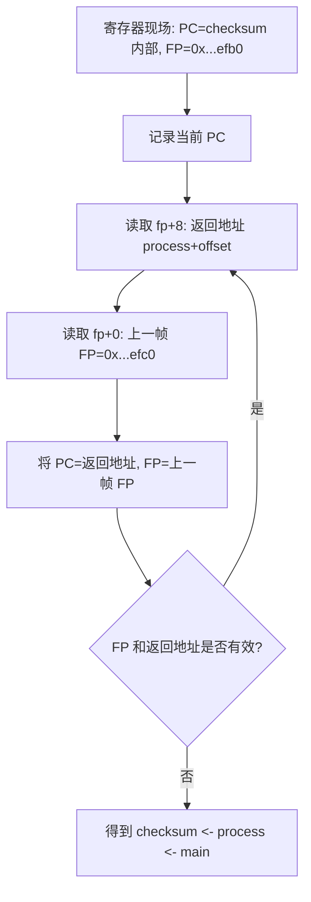
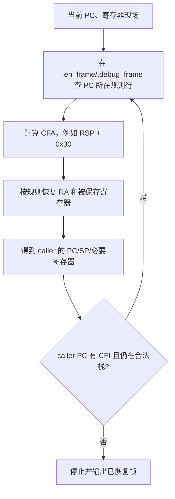
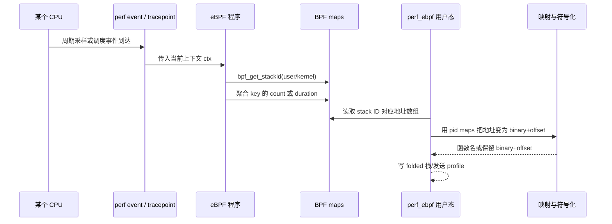

# 函数调用与栈回溯：从栈帧到 FP、DWARF 与 eBPF

> 本文以 Linux x86-64 的常见 ABI 为主线，因为它最适合把内存变化画清楚；AArch64/QNX 与它的基本思想一致，但保存返回地址的寄存器和具体指令不同。文中所有地址、汇编和栈内容都是教学用示例，真实数值会随编译器、优化等级、ASLR 和运行环境变化。

> **适用范围**：想理解 CPU profile、off-CPU profile、崩溃栈、`perf`、eBPF、`addr2line` 或 FlameCraft 中“调用栈从哪里来”的读者。看完本文再阅读 [从堆栈回溯到火焰图：perf_ebpf 与 FlameCraft 教学](../../../撷简台/2026-10-09%20从堆栈回溯到火焰图：perf_ebpf%20与%20FlameCraft%20教学.md)，可以把基础原理与项目实际数据链对应起来。

## 1. 先给出一个准确的全景模型

把“调用栈”想成一叠写有回程信息的便签并不算错，但不够准确。程序运行时，CPU 只持有寄存器和内存；函数名、源码行、调用关系都是我们根据这些原始状态恢复出来的解释。


这五层分别回答不同问题：

| 层次 | 典型问题 | 需要的材料 | 常见失败现象 |
| --- | --- | --- | --- |
| 函数调用 | 当前执行点如何回到调用者？ | ABI、寄存器、线程栈 | 返回后跳错位置，程序崩溃 |
| 栈回溯 | 此刻有哪些物理调用帧？ | PC、SP、FP 或 CFI | 只有一两层、栈中断、乱码地址 |
| 地址归属 | 地址属于哪个模块？ | `/proc/<pid>/maps`、ELF load segment | 只剩 `0x...`，找不到 `.so` |
| 符号化 | 该地址是什么函数、哪一行？ | `.symtab`/`.dynsym`/DWARF/debug info | `libfoo.so+0x1234`，没有函数名 |
| 聚合展示 | 哪条路径最重？ | 带权重的样本序列 | 火焰图宽度错误、方向颠倒 |

特别要牢记这一点：**回溯与符号化不是同一个动作。** 回溯先产出一串程序地址；即使地址一个不缺，二进制被 strip、映射找错或 debug info 缺失时，仍然无法得到源码函数名。

### 1.1 本文使用的名词

| 名词 | 含义 | 可以怎样直观理解 |
| --- | --- | --- |
| PC / IP | Program Counter / Instruction Pointer，当前正在执行的机器指令地址 | “你现在站在哪一页的哪一行” |
| SP | Stack Pointer，当前栈顶地址 | 当前这叠便签最上方的位置 |
| FP / BP | Frame Pointer / Base Pointer，当前栈帧的稳定锚点 | 当前便签的页眉，能找到上一张便签 |
| 返回地址，RA | 被调函数结束后，调用者继续执行的位置 | 返程票上的目的地 |
| 栈帧，frame | 一次函数调用在栈上的现场记录 | 一张便签：局部变量、保存寄存器、返回地址 |
| CFA | Canonical Frame Address，DWARF 用的“调用者栈顶基准” | 用统一坐标描述不同函数里的栈布局 |
| CFI | Call Frame Information，调用帧规则 | “本段指令中，怎样根据当前寄存器找回调用者” |
| ELF | Linux/QNX 常用可执行/共享库格式 | 装着机器码、符号、段和调试信息的文件容器 |
| ASLR | Address Space Layout Randomization | 同一个库每次运行被放到不同的虚拟地址 |

## 2. 从一个可复现实验开始

后面的全部图示都围绕同一个极小程序。它故意关闭内联、尾调用优化和帧指针省略，让每个源代码函数都有一个清晰可见的物理栈帧。

### 2.1 示例代码

将以下内容保存为 `stack_demo.c`：

```c
#include <stdio.h>

__attribute__((noinline))
static int checksum(int x) {
    volatile int local = x * 3;
    return local + 7;
}

__attribute__((noinline))
static int process(int x) {
    int result = checksum(x + 1);
    return result * 2;
}

int main(void) {
    int answer = process(10);
    printf("answer = %d\\n", answer);
    return 0;
}
```

当程序停在 `checksum()` 的 `return local + 7` 时，逻辑调用链为：

```text
_start -> libc_start_main -> main -> process -> checksum
```

通常分析业务代码时，我们关注 `main -> process -> checksum`；但一个真实进程并不是从 `main` 凭空开始，`_start` 和 C 运行时先建立初始环境，再调用 `main`。

### 2.2 为教学保留“可回溯形状”的编译配置

下面的配置适合学习、调试或需要高质量 profile 的目标，不是所有生产模块都应机械套用的默认配置：

```bash
gcc -O0 -g \
  -fno-omit-frame-pointer \
  -fno-optimize-sibling-calls \
  -fno-inline \
  -o stack_demo stack_demo.c
```

也可在 CMake 中对专门的诊断目标配置：

```cmake
target_compile_options(stack_demo PRIVATE
  -O0 -g
  -fno-omit-frame-pointer
  -fno-optimize-sibling-calls
  -fno-inline)
```

每个选项的作用不同：

| 配置 | 教学中得到什么 | 关闭它后可能看到什么 |
| --- | --- | --- |
| `-O0` | 指令和源码较接近，局部变量常留在栈中 | 重排、寄存器化、删除无用变量，布局变化很大 |
| `-g` | DWARF 调试信息，可还原文件/行号 | 仍可有函数名，但通常没有可靠源码行 |
| `-fno-omit-frame-pointer` | 生成可链式遍历的 FP | FP 回溯常只能得到当前帧或中断 |
| `-fno-optimize-sibling-calls` | 避免尾调用把一个调用帧“折叠掉” | 某个源码函数不形成物理栈帧 |
| `-fno-inline` | 避免函数直接嵌入调用者 | 调用关系仍可在 DWARF inline 信息中出现，但栈上没有独立帧 |

这里有一个工程取舍：帧指针会占用一个通用寄存器，关闭优化会严重影响性能，因此通常只在诊断构建、性能敏感度可接受的服务或特定模块启用。保留 `-g` 并不意味着必须把完整 debug info 装进最终镜像，可以按 Build ID 将 debug package 单独归档（具体操作见姊妹篇 [ELF 与符号化：从文件结构到运行时地址装载](./ELF与符号化：从文件结构到运行时地址装载.md) 第 6.3 节）。

### 2.3 先观察三种视角下的同一条调用链

同一时刻，调用链可以有三种等价但方向不同的表示：

```text
源码调用方向（外层调用内层）
main -> process -> checksum

栈回溯输出的自然方向（当前帧回到调用者）
checksum <- process <- main

pprof 的 Location 列表惯例（leaf first）
checksum, process, main
```

之后看到“反转调用栈”时，先问清楚是在适配哪一种表示，不能只凭“看起来反了”判断 bug。

## 3. 函数调用前，CPU 与调用者分别负责什么

以 Linux x86-64 System V ABI 为例。ABI 可以理解成编译器之间的合同：即使一个函数由 GCC 编译、另一个函数由 Clang 编译，只要都遵守合同，就能相互调用。

### 3.1 先认识出场的寄存器

在看“每条指令如何改变栈”之前，得先分清 CPU 手里有哪些状态。x86-64 有十几个通用寄存器，本文的故事只围绕其中一小部分。先记住一个总原则：**寄存器是 CPU 内部的存储格子，快但极少；栈是内存里的区域，大但慢。函数调用与返回，就是在寄存器和栈之间成对地“保存与恢复”。**

| 寄存器 | 全称与常见用途 | 在本文中的角色 |
| --- | --- | --- |
| RIP（PC） | Instruction Pointer，指向下一条要执行的指令 | CPU 的进度条。程序无法直接给它赋值，只有 `call`/`ret`/`jmp` 等控制流指令能改写它 |
| RSP | Stack Pointer，指向栈顶（当前最低的已占用地址） | 栈的游标。`push`/`pop`/`call`/`ret`/`leave` 都隐式移动它 |
| RBP | Base Pointer，本例中被当作帧指针（FP） | 当前帧的“页眉”：`[RBP]` 永远是上一帧 FP，`[RBP+8]` 永远是返回地址 |
| RAX | Accumulator，习惯存放函数返回值 | `checksum` 算完的结果 40 会放在这里，带回给 `process` |
| RDI | 第 1 个整型参数寄存器 | `checksum(11)` 的参数 11 出发时就放在这里 |

整型参数依次使用 `rdi, rsi, rdx, rcx, r8, r9`，第 7 个起才压栈；浮点参数走另一组 `xmm` 寄存器。本文只需要 `rdi` 和 `rax`。

比名字更重要的是**保存责任**。ABI 把寄存器分成两派，这是理解“栈帧里为什么有保存区”的关键：

| 派别 | 成员 | 合同条款 | 通俗理解 |
| --- | --- | --- | --- |
| caller-saved（易失） | `rax, rcx, rdx, rsi, rdi, r8-r11` | 调用者若在 `call` 之后还需要它，必须 `call` 前自己保存 | “借出去可能被弄脏，在乎就先抄一份” |
| callee-saved（非易失） | `rbx, rbp, r12-r15` | 被调者想用就必须先压栈备份、返回前恢复 | “动用先押金，用完要赎回” |
| 特殊 | `rsp` | 双方共同维护：进入与离开时必须复原 | “公共楼梯，谁走谁复原” |

这张合同直接决定了栈帧的内容：`rbp` 属于 callee-saved，所以每个想用 FP 的函数序言都要 `push rbp`；需要跨调用存活的 caller-saved 值会出现在调用者的帧里。**后文每个时刻的示意图，请随时回来对照这张表，看清楚动的是哪个格子。**

最后是栈本身。x86-64 的栈向低地址增长：

```text
高地址  ┌────────────────────────────┐
        │ 旧数据 / 外层帧            │
        ├────────────────────────────┤
        │      ↓ 压栈方向 ↓          │   push：先 RSP = RSP - 8，再写入
        ├────────────────────────────┤
        │ 新数据 / 内层帧            │ <- RSP
        └────────────────────────────┘
低地址
```

两个原语贯穿全文：

- `push src`：`RSP = RSP - 8`，然后把 `src` 写到 `[RSP]`。
- `pop dst`：先把 `[RSP]` 读到 `dst`，然后 `RSP = RSP + 8`。

### 3.2 调用前的约定

当 `process(10)` 调用 `checksum(11)` 时，调用者 `process` 大致要完成：

1. 将参数放到约定位置。第一个整型参数通常放入 `rdi`；浮点参数使用另一组寄存器。
2. 若寄存器参数不够，将额外参数放到栈上。
3. 按 ABI 保持栈对齐。x86-64 上，调用边界通常要求满足 16 字节对齐约束。
4. 将控制权交给 `checksum`，同时留下回来的位置。

被调函数 `checksum` 则需要：

1. 若使用了调用者期望保留的寄存器，先保存它们。
2. 为局部变量、临时值和进一步调用预留栈空间。
3. 算完结果后恢复现场，跳回返回地址。

不是所有寄存器都需要保存。ABI 会区分 caller-saved（调用者若在意，调用前自己保存）和 callee-saved（被调者若要改，必须恢复）。这个合同使函数可以独立编译，也使异常处理器、调试器和回溯器有共同规则可依。

把第 1 条约定落到寄存器上，就有了进入 `call` 之前的最后一个动作。从这里开始，本文用**编号时刻**逐帧跟踪一次完整调用，每个时刻都同时给出寄存器面板与栈图：

#### 时刻 0：装载参数（示意 `mov edi, 11`）

| 寄存器 | 执行前 | 执行后 | 说明 |
| --- | --- | --- | --- |
| RDI | 旧值 | 11 | 第 1 个整型参数就位（`x + 1` 的结果） |
| RIP | 指向本条 `mov` | 指向 `call checksum` | 顺序推进 |
| RSP / RBP | 不变 | 不变 | 装参数不需要动栈 |

栈此刻没有任何变化，但出发前的行囊已经收拾完：`RDI` 带着参数，`RIP` 指向即将执行的 `call`。

### 3.3 `call` 做了什么

在 x86-64 中，`call checksum` 的效果可以抽象为三步：

```text
1. RSP = RSP - 8
2. [RSP] = “call 指令之后那条指令的地址”
3. RIP = checksum 的入口地址
```

也就是说，`call` 自动把**返回地址**压入栈顶，再跳转。为了同时看到寄存器和栈的变化，先给出执行前的完整寄存器面板（此刻 `process` 已按 3.2 的约定把参数装好）：

```text
执行前寄存器面板：
  RIP = 0x4011DB    （process 中 call checksum 这条指令本身）
  RSP = 0x7fff_efc0 （process 栈帧的底部：局部空间分配完毕）
  RBP = 0x7fff_efd0 （process 的锚点，指向保存的 main.RBP）
  RDI = 11          （时刻 0 装好的第一个参数）
  RAX = 旧值        （caller-saved，call 之后随时可能被覆盖）
```

#### 时刻 1：执行 `call checksum`

寄存器面板逐项对照：

| 寄存器 | 执行前 | 执行后 | 变化说明 |
| --- | --- | --- | --- |
| RIP | 0x4011DB | 0x401130 | 跳入 checksum 入口 |
| RSP | 0x7fff_efc0 | 0x7fff_efb8 | 下移 8 字节：返回地址入栈 |
| RBP | 0x7fff_efd0 | 0x7fff_efd0 | 不变：checksum 还没有自己的锚点 |
| RDI | 11 | 11 | 不变：参数就位，等待被读取 |
| RAX | 旧值 | 旧值 | 不变：返回值要等函数体算完 |

此刻的栈，从 process 帧向下看：

```text
高地址
0x7fff_efd8  ┌─────────────────────────────────────┐
              │ 返回到 main 的地址 0x401220         │
0x7fff_efd0  ├─────────────────────────────────────┤ <- RBP = 0x7fff_efd0
              │ 保存的 main.RBP = 0x7fff_f000       │
0x7fff_efc8  ├─────────────────────────────────────┤
              │ process 的局部变量 result            │
0x7fff_efc0  ├─────────────────────────────────────┤
              │ 0x4011E0：返回到 process 的地址     │ <- RSP（call 刚写入的返程票）
              └─────────────────────────────────────┘
低地址
```

注意两点。第一，`RBP` 仍指向 process 帧：此刻还没有“完整的新栈帧”，只有一张关键的返程票已经压入栈中；是否建立稳定的 FP 链，要看被调函数的序言（prologue）。第二，若异步采样恰好发生在这里，回溯器仍然可以从栈顶拿到返回地址，但没有 `checksum.RBP` 可用；FP 回溯需要知道当前 PC 正处于 prologue 的哪个阶段，这正是 DWARF CFI 的价值之一。

### 3.4 典型函数序言如何建立栈帧

为了讲解清晰，假设 `checksum()` 生成如下近似汇编：

```asm
checksum:
    push   rbp              ; 保存 process 的帧指针
    mov    rbp, rsp         ; rbp 成为 checksum 栈帧的锚点
    sub    rsp, 0x20        ; 预留 32 字节局部空间
    ...                     ; 计算 local = x * 3
    leave                   ; mov rsp, rbp; pop rbp
    ret                     ; pop RIP，跳回 process
```

下面把序言拆成单步，每一步同时观察寄存器面板和栈。栈向低地址增长，因此图的下方是更新、更内层的栈内容。

#### 时刻 2：执行 `push rbp`

CPU 动作：`RSP = RSP - 8`，再把旧 `RBP`（0x7fff_efd0）写入新栈顶。这就是 3.1 合同的落实动作：`rbp` 属于 callee-saved，`checksum` 想拿它当锚点，必须先替 `process` 保住它的值。

| 寄存器 | 执行前 | 执行后 | 说明 |
| --- | --- | --- | --- |
| RSP | 0x7fff_efb8 | 0x7fff_efb0 | 下移 8 字节，saved FP 入栈 |
| RBP | 0x7fff_efd0 | 0x7fff_efd0 | 仍是 process 的；本步只是把它抄进栈 |
| RIP | - | 指向下一条 `mov rbp, rsp` | 顺序推进 |

```text
0x7fff_efb8  ┌─────────────────────────────────────┐
              │ 返回到 process 的地址 0x4011E0     │
0x7fff_efb0  ├─────────────────────────────────────┤ <- RSP（新）
              │ 保存的 process.RBP = 0x7fff_efd0   │ <- 本步新压入
              └─────────────────────────────────────┘
```

#### 时刻 3：执行 `mov rbp, rsp`

CPU 动作：`RBP = RSP`。只动一个寄存器，却是整个 FP 链的奠基一步：从这条指令起，`RBP = 0x7fff_efb0` 成为 `checksum` 栈帧的稳定锚点。此后无论 `RSP` 怎么移动，`[RBP]` 永远是上一帧 FP，`[RBP+8]` 永远是返回地址。

| 寄存器 | 执行前 | 执行后 | 说明 |
| --- | --- | --- | --- |
| RBP | 0x7fff_efd0 | 0x7fff_efb0 | 锚点切换：checksum.RBP 正式就位 |
| RSP | 0x7fff_efb0 | 0x7fff_efb0 | 不变 |
| RIP | - | 指向下一条 `sub rsp, 0x20` | 顺序推进 |

栈内容与时刻 2 完全相同，但 `RBP` 现在指向了栈中那行 saved FP：

```text
0x7fff_efb8  ┌─────────────────────────────────────┐
              │ 返回到 process 的地址 0x4011E0     │ <- [RBP + 8]
0x7fff_efb0  ├─────────────────────────────────────┤ <- RBP = RSP = 0x7fff_efb0
              │ 保存的 process.RBP = 0x7fff_efd0   │ <- [RBP + 0]
              └─────────────────────────────────────┘
```

经典 FP 链的两个格子就此就位。

#### 时刻 4：执行 `sub rsp, 0x20`

CPU 动作：`RSP = RSP - 0x20`。只为局部变量、溢出参数和后续调用预留空间，不写任何数据。`RBP` 纹丝不动。

| 寄存器 | 执行前 | 执行后 | 说明 |
| --- | --- | --- | --- |
| RSP | 0x7fff_efb0 | 0x7fff_ef90 | 下移 0x20，预留区开张 |
| RBP | 0x7fff_efb0 | 0x7fff_efb0 | 不变：锚点将贯穿整个函数 |
| RIP | - | 指向函数体第一条指令 | 序言结束 |

```text
高地址
0x7fff_efd8  ┌─────────────────────────────────────┐
              │ 返回到 main 的地址 0x401220         │
0x7fff_efd0  ├─────────────────────────────────────┤ <- process.RBP = 0x7fff_efd0
              │ 保存的 main.RBP = 0x7fff_f000       │
0x7fff_efc8  ├─────────────────────────────────────┤
              │ process 的局部变量 result            │
0x7fff_efc0  ├─────────────────────────────────────┤
              │ （process 预留区的下沿）             │
0x7fff_efb8  ├─────────────────────────────────────┤
              │ 返回到 process 的地址 0x4011E0     │
0x7fff_efb0  ├─────────────────────────────────────┤ <- RBP，整个函数期间保持稳定
              │ 保存的 process.RBP = 0x7fff_efd0   │
              ├─────────────────────────────────────┤
              │ checksum 新预留的 0x20 字节          │
0x7fff_ef90  └─────────────────────────────────────┘ <- RSP
低地址
```

严格来说，局部变量是否真的在栈上、具体偏移是多少，完全由编译器决定；`volatile` 和 `-O0` 只是让本教程中的情形更容易观察。

#### 时刻 5：函数体运行：写入 `local`，产出返回值

函数体不是一条指令，但对寄存器和栈的改动只有两类：往预留区写数据，以及把最终结果放进 `RAX`。设参数 `x = 11`：

| 寄存器 | 变化 | 说明 |
| --- | --- | --- |
| RDI | 11（读完即可复用） | 参数已抄写进栈，使命完成 |
| RSP | 0x7fff_ef90（不变） | 函数体内不再移动 |
| RBP | 0x7fff_efb0（不变） | 锚点稳定，回溯随时可用 |
| RAX | 旧值 → 40 | `local + 7` 的结果就位，等待返回 |
| RIP | 在 checksum 内逐条推进 | 此刻停在 `return local + 7` 对应的指令上 |

```text
0x7fff_efa8  ┌─────────────────────────────────────┐
              │ local = 33                          │ <- 函数体写入的数据（示意偏移）
              ├─────────────────────────────────────┤
              │ 其余预留区：参数副本、临时值等      │
0x7fff_ef90  └─────────────────────────────────────┘ <- RSP
```

此刻调用链 `main -> process -> checksum` 的每张便签都写好了。若采样发生在这里，寄存器面板是：`RIP = checksum + 0x18（示意）`、`RSP = 0x7fff_ef90`、`RBP = 0x7fff_efb0`、`RAX = 40`。第 5、6、7 节的三种回溯方法，都从这个面板出发。

回溯并不需要理解每个局部变量，它首先只需要能找回“上一帧在哪里”和“应该返回到哪条指令”。

### 3.5 返回过程：`leave; ret` 如何逐条撤销这一帧

返回是调用的镜像：`leave` 由两条指令组成，`ret` 再补一步。继续逐时刻观察。

#### 时刻 6：`leave` 第一步：`mov rsp, rbp`

CPU 动作：`RSP = RBP = 0x7fff_efb0`。一步把 `RSP` 拉回锚点，`checksum` 的整个预留区被“整体作废”——数据其实还在内存里，只是已退出栈的有效范围，后续的新调用会覆盖它们。

| 寄存器 | 执行前 | 执行后 | 说明 |
| --- | --- | --- | --- |
| RSP | 0x7fff_ef90 | 0x7fff_efb0 | 预留区坍缩，回到锚点 |
| RBP | 0x7fff_efb0 | 0x7fff_efb0 | 不变 |

```text
0x7fff_efb8  ┌─────────────────────────────────────┐
              │ 返回到 process 的地址 0x4011E0     │
0x7fff_efb0  ├─────────────────────────────────────┤ <- RSP = RBP
              │ 保存的 process.RBP = 0x7fff_efd0   │ <- 即将弹出
              └─────────────────────────────────────┘
```

#### 时刻 7：`leave` 第二步：`pop rbp`

CPU 动作：`RBP = [RSP]`（取回 `process` 的锚点），然后 `RSP = RSP + 8`。

| 寄存器 | 执行前 | 执行后 | 说明 |
| --- | --- | --- | --- |
| RBP | 0x7fff_efb0 | 0x7fff_efd0 | 归还：恢复为 process 的锚点 |
| RSP | 0x7fff_efb0 | 0x7fff_efb8 | 越过 saved FP，恰好停在返程票上 |

```text
0x7fff_efb8  ┌─────────────────────────────────────┐ <- RSP
              │ 返回到 process 的地址 0x4011E0     │ <- ret 的目标
              └─────────────────────────────────────┘
```

#### 时刻 8：`ret`

CPU 动作：`RIP = [RSP] = 0x4011E0`，然后 `RSP = RSP + 8`。

| 寄存器 | 执行前 | 执行后 | 说明 |
| --- | --- | --- | --- |
| RIP | `ret` 指令地址 | 0x4011E0 | 回到 process 中 call 之后 |
| RSP | 0x7fff_efb8 | 0x7fff_efc0 | 返程票出栈，栈回到 call 前的形状 |
| RAX | 40 | 40 | 返回值原地等待 process 读取 |

```text
0x7fff_efc0  ┌─────────────────────────────────────┐ <- RSP（与时刻 1 之后的 RSP 相同）
              │ 0x7fff_efb8 起的旧内容已失效       │
              └─────────────────────────────────────┘
RIP -> 0x4011E0：process 继续执行 result * 2，从 RAX 取走 40，得到 80。
```

对照时刻 1 的面板：`RSP` 与 `RBP` 精确回到了调用前的值，`RAX` 携带着结果。这就是“栈帧是严格后进先出（LIFO）”的含义：最后调用的 `checksum` 必须最先撤销；任何一步少弹或多弹 8 字节，返回后一切立即错位。

### 3.6 同样的概念在 AArch64 上有什么不同

不要把 x86 的 `call` 压栈行为误当成普遍规律。在 AArch64 上：

```text
bl checksum         把返回地址写进 x30（LR），跳转到 checksum
stp x29, x30, [sp,#-16]!   常见序言：同时压入旧 FP 和 LR
mov x29, sp         将 x29 设为当前 FP
```

因此 AArch64 的返回地址先在链接寄存器 `x30` 中，函数若还要调用别人或需要可回溯，通常会将 `x29/x30` 成对保存到栈。概念没有变：仍然需要保存调用者的恢复点和稳定锚点；只是由哪条指令、哪个寄存器完成不同。

## 4. 为什么“源码函数”不一定等于“物理栈帧”

初学时很容易期待一行源代码函数调用就增加一帧、函数返回就减少一帧。优化编译器会合法地打破这种直觉。

### 4.1 内联：源码有函数，机器码没有调用

若 `checksum()` 足够小，编译器可能直接把它的乘法和加法复制进 `process()`：

```text
源码：process -> checksum
机器码：process 内直接完成 x * 3 + 7
物理栈：只有 process，没有 checksum 帧
```

带完整 DWARF 的调试器仍可能把这段机器码解释为“逻辑上位于 `checksum`，并且它被内联进 `process`”，这叫 **inline frame**。它是调试信息推导出的逻辑帧，不是 CPU 栈上的独立物理帧。

### 4.2 尾调用：返回前直接跳进下一个函数

若函数最后的动作只是返回另一个函数的结果，例如：

```c
int relay(int x) {
    return checksum(x);
}
```

编译器可能把 `call checksum; ret` 优化成一次跳转：`jmp checksum`。这样 `checksum` 结束时会直接返回到 `relay` 的调用者，`relay` 的独立帧不存在。这叫尾调用优化。

### 4.3 结论：回溯是“当时真实机器状态”的证据

因此，看到某个源码函数不在 CPU profile 中，不能立即断言采集器漏帧。它可能被内联、尾调用消除、异常路径改写，或者处在异步信号/协程/语言运行时建立的非标准栈上。分析时应区分：

- **物理回溯**：实际栈和寄存器里可恢复的帧。
- **逻辑调用链**：结合 DWARF inline 信息、运行时信息后展示的源码层级。

接下来三种方法的差异，正是它们依赖哪些物理或逻辑证据来恢复这条链。

## 5. 方法一：帧指针（FP）链回溯

FP 回溯是最容易在纸上执行的方法。它不需要理解每一条机器指令，只依赖编译器保持一个约定俗成的链表形状。

### 5.1 FP 链的内存布局规则

继续使用第 3 节的 x86-64 示例。每个使用传统序言的帧都遵守：

```text
[当前 RBP + 0] = 上一帧的 RBP
[当前 RBP + 8] = 返回地址（调用者中 call 后的下一条指令）
```

把 `main -> process -> checksum` 停在 `checksum` 中的那一刻展开：

```text
地址              内容                              所属帧
────────────────────────────────────────────────────────────────────
0x7fff_efb0       0x7fff_efd0  = process.RBP       checksum: saved FP
0x7fff_efb8       0x0000004011e0 = 返回到 process  checksum: return address
                  ↑
                  checksum.RBP = 0x7fff_efb0

0x7fff_efc8       （process 的局部变量，不参与 FP 链）
0x7fff_efd0       0x7fff_f000  = main.RBP          process: saved FP
0x7fff_efd8       0x000000401220 = 返回到 main     process: return address

0x7fff_f000       0x00007fff_f120 = libc 的 FP      main: saved FP
0x7fff_f008       0x00007f... = 返回到 libc/start  main: return address
```

这不是“函数名字串”，而是一个单向链表。链表结点地址就是 FP 值，结点第一个字存 next 指针，第二个字存返回地址。

### 5.2 人工执行一次 FP 回溯

假设异步采样时寄存器现场是：

```text
RIP = 0x401148     （checksum 内部的一条指令）
RBP = 0x7fff_efb0
RSP = 0x7fff_ef90
```

回溯器按如下步骤工作：

1. **当前帧**：先把 `RIP=0x401148` 记录为第 0 帧。这个 PC 属于 `checksum`。
2. **读当前 FP**：`fp = RBP = 0x7fff_efb0`。
3. **读返回地址**：`ra = *(fp + 8) = *(0x7fff_efb8) = 0x4011e0`。这个地址属于 `process`。
4. **读上一帧 FP**：`next_fp = *fp = *(0x7fff_efb0) = 0x7fff_efd0`。
5. **推进**：把 `PC=ra`、`FP=next_fp`，重复第 2 到第 4 步。
6. 最终得到地址栈：`0x401148, 0x4011e0, 0x401220, ...`，再交给符号化阶段显示 `checksum, process, main, ...`。

伪代码如下。真实实现还必须检查内存可读性、地址对齐和边界：

```c
frames.push(current_rip);
for (fp = current_rbp; valid(fp); fp = *(uint64_t *)fp) {
    uint64_t return_address = *(uint64_t *)(fp + 8);
    if (!valid_code_address(return_address)) {
        break;
    }
    frames.push(return_address);
}
```



#### 逐步图示：游标如何沿链移动

把回溯器想象成一只手，它每推进一帧只做“两次读、一次跳”。下图把每一步的读取对象直接标在链上：

```text
步骤 1  游标就位：fp = RBP = 0x7fff_efb0
        读 [fp + 8]：得 0x4011e0            -> 记为下一帧的 PC（属于 process）

        0x7fff_efb0 ┌────────────────┐
                    │ 0x7fff_efd0    │ ----- 步骤 2 读它（next_fp）
                    ├────────────────┤
                    │ 0x0000004011e0 │ <--- 步骤 1 读它（ra）
                    └────────────────┘
                      fp = 0x7fff_efb0

步骤 2  读 [fp]：得 0x7fff_efd0              -> 下一帧的 FP

步骤 3  游标跳到 process 帧：fp = 0x7fff_efd0，PC = 0x4011e0
        重复“两次读”：ra = [fp+8] = 0x401220（属于 main）
                      next_fp = [fp] = 0x7fff_f000

        0x7fff_efd0 ┌────────────────┐
                    │ 0x7fff_f000    │ ----- main.RBP（下一个游标）
                    ├────────────────┤
                    │ 0x000000401220 │ <--- process 帧的 ra
                    └────────────────┘
                      fp = 0x7fff_efd0

步骤 4  游标跳到 main 帧：fp = 0x7fff_f000，PC = 0x401220
        继续同样两次读，直到某次读出的 FP 或返回地址无效为止。
```

三轮循环后，回溯器手里的地址序列是：

```text
0x401148（checksum+0x18，来自采样时的 RIP）
0x4011e0（process+0x30，来自 [fp+8]）
0x401220（main+0x20，来自 [fp'+8]）
```

整个过程没有读 `RSP`，没有读局部变量，也没有查任何表——FP 法的全部证据就是链上每个格子里并排存放的两个指针。这也是它“快”与“脆”同源的原因：读得少所以快；格子一旦被写坏，就没有第二份证据可校验。

### 5.3 FP 回溯为什么快

每一层只做两个固定偏移的内存读取：一个读上一个 FP，一个读返回地址。它不需要遍历大量规则，不需要解释函数中间任意位置的寄存器变化。因此：

- 适合低开销 profiler、崩溃处理器和受限运行环境。
- 适合在 eBPF 中作为用户栈 fallback 的概念基础。
- 对正常 C/C++ 业务代码，保留 FP 后通常稳定、速度很高。

但“快”来自于它假设所有函数都保持相同形状。一旦这个假设不成立，就会错。

### 5.4 FP 回溯会在哪里断掉

#### 情况 A：编译器省略帧指针

在 x86-64 优化构建中，编译器可能把 `rbp` 当普通寄存器用，而不是在入口生成：

```asm
push rbp
mov  rbp, rsp
```

此时 `rbp` 不再是“下一帧指针”，`[rbp]` 和 `[rbp+8]` 没有回溯语义。FP walker 若继续读，可能会得到随机局部数据，表现为异常大地址、调用链突然跳到无关库，或只剩当前一帧。

#### 情况 B：采样落在 prologue/epilogue 的中间

即使启用 FP，异步采样也可能发生在：

```text
call 后、push rbp 前
push rbp 后、mov rbp,rsp 前
leave 的两个子动作之间
```

此时新帧的 FP 链尚未完全建立，或已经开始拆除。可靠回溯器不能只看“函数入口/出口”，而要知道当前 PC 对应哪一种栈状态。DWARF CFI 能描述这种指令级变化。

#### 情况 C：栈损坏、栈切换或非标准运行时

递归越界、错误指针写入可能覆盖保存的 FP 或返回地址；协程、纤程、语言运行时也可能主动切换到另一块栈。此时链表可能不连续，或 `next_fp` 跳出线程栈的合法地址区间。健壮的实现应至少验证：

```text
next_fp > current_fp        （x86-64 向高地址回到外层帧）
next_fp 位于该线程的栈映射范围内
next_fp 按指针宽度对齐
return address 落在已执行代码映射中
```

### 5.5 应如何看待 `-fno-omit-frame-pointer`

它不是让程序“自动有完整调用栈”的魔法开关。它做的是让**编译器生成的普通函数**保留 FP 链，显著提高 FP 回溯的成功率。仍可能缺失：

- 内联或尾调用优化掉的逻辑函数。
- 未按该选项构建的第三方库。
- 信号 trampoline、JIT 代码、语言运行时或手写汇编。
- 栈已经损坏的异常现场。

所以生产 profiling 的常见策略是：优先使用 DWARF/CFI，FP 作为低成本回退；若系统只支持 FP 回溯，则对关键业务二进制统一开启 `-fno-omit-frame-pointer`。

## 6. 方法二：DWARF CFI 回溯

DWARF CFI 的核心思想与 FP 链完全不同。它不假定每个函数都使用相同布局，而是让编译器写下“在当前机器指令处，如何恢复调用者”的规则表。

### 6.1 为什么没有 FP 仍能回溯

看看一个省略 FP 的简化函数：

```asm
checksum:
    sub rsp, 0x28
    mov DWORD PTR [rsp+0x1c], edi
    ...
    add rsp, 0x28
    ret
```

这里没有 `rbp`，但 `ret` 仍必须能找到返回地址：它位于当前 `rsp + 0x28` 的位置。编译器比回溯器更清楚每条指令怎样改了 `rsp`，于是它可以在 `.eh_frame` 或 `.debug_frame` 写规则，例如：

```text
PC 范围 checksum+0x00 .. checksum+0x04：
  CFA = rsp + 8
  返回地址 RA 在 CFA - 8

PC 范围 checksum+0x04 .. checksum+0x30：
  CFA = rsp + 0x30
  返回地址 RA 在 CFA - 8
```

这里的 CFA 可以理解为“调用者在调用之前的栈顶基准”。函数把 `rsp` 减了 `0x28`，而 `call` 曾压入 8 字节返回地址，所以当前 `rsp + 0x30` 就回到了调用者的栈顶。

### 6.2 用 CFI 逐步回溯同一个例子

假设采样时：

```text
PC  = checksum + 0x18
RSP = 0x7fff_ef90
RBP = 某个普通工作寄存器，不可信
```

与 FP 法最大的不同从这里就能看出来：DWARF 方法**不使用 `RBP`**。它只信两样东西——PC（用来查规则表）和 RSP（用来定位栈）。`RBP` 哪怕正被拿去存中间计算结果，也丝毫不影响回溯。下面把一次完整回溯拆成三个步骤。

#### 步骤 1：用 PC 查规则表

CFI 在二进制里是一张按 PC 区间组织的规则表。真实的 `.eh_frame` 是压缩编码，这里展开成概念形态：

```text
.eh_frame 规则表（节选）
┌────────────────────────┬──────────────────┬───────────────┐
│ PC 区间                │ CFA 规则         │ 返回地址位置  │
├────────────────────────┼──────────────────┼───────────────┤
│ checksum+0x00 .. +0x04 │ CFA = rsp + 0x08 │ [CFA - 8]     │
│ checksum+0x04 .. +0x30 │ CFA = rsp + 0x30 │ [CFA - 8]     │ <- 命中
│ process+0x00 .. +0x04  │ CFA = rsp + 0x08 │ [CFA - 8]     │
│ process+0x04 .. +0x38  │ CFA = rsp + 0x28 │ [CFA - 8]     │
└────────────────────────┴──────────────────┴───────────────┘
```

`PC = checksum + 0x18` 落在第二行：此刻函数已完成栈调整，`CFA` 要按调整后的 `rsp` 反推。第一行对应“刚进入函数、栈还没动”的窗口期。**同一个函数在不同指令位置允许有不同规则**——这是 FP 法做不到的：FP 法只有一个静态假设，CFI 有逐指令的动态规则。

顺带一提，两个 `checksum` 区间的系数不同（+0x08 与 +0x30），对应 6.1 里 `sub rsp, 0x28` 前后的 `rsp` 位移；`rsp + 0x30` 恰好等于 CFA，是编译器逐条指令记录的结果，不是巧合。

#### 步骤 2：计算 CFA，在栈上定位返程票

把命中规则代入当前 `RSP`：

```text
CFA = RSP + 0x30 = 0x7fff_ef90 + 0x30 = 0x7fff_efc0
RA  = memory[CFA - 8] = memory[0x7fff_efb8] = 0x4011e0
```

把 CFA 画在栈上看得更清楚——它就是“调用发生前，调用者的栈顶”：

```text
高地址
0x7fff_efd8  ┌─────────────────────────────────────┐
              │ 返回到 main 的地址 0x401220         │
0x7fff_efd0  ├─────────────────────────────────────┤ <- process.RBP
              │ 保存的 main.RBP = 0x7fff_f000       │
0x7fff_efc8  ├─────────────────────────────────────┤
              │ process 的局部变量 result            │
0x7fff_efc0  ┝━━━━━━━━ CFA = 0x7fff_efc0 ━━━━━━━━━━┥ <- call 前 process 的 RSP
              │ 返回到 process 的地址 0x4011E0     │ <- [CFA - 8]，即 RA
0x7fff_efb8  ├─────────────────────────────────────┤
              │                                      │
              │ checksum 预留区（无 saved FP）      │
0x7fff_ef90  └─────────────────────────────────────┘ <- RSP = 0x7fff_ef90
低地址
```

于是恢复出上一帧的两个关键量：

```text
当前帧：checksum + 0x18
调用者 PC：0x4011e0（process）
调用者 RSP：CFA - 8 = 0x7fff_efb8（x86-64 的返回地址占 8 字节，弹出后才是 caller 视角的栈顶）
```

#### 步骤 3：以上一帧的输出为下一帧的输入，循环推进

`RA = 0x4011e0` 落在 `process` 的 PC 区间，于是改查 `process` 的规则行，用刚恢复的 `process.RSP` 重复步骤 1、2，得到 `main` 的返回地址，如此往复，直到某一帧没有 CFI 或到达栈底为止。



你会发现它从不依赖 `rbp` 是不是 FP；只要 CFI 正确，就能跨越不同函数各异的栈布局——甚至能自由穿过“一半函数保留 FP、另一半省略 FP”的混合栈。这个循环里每推进一帧，输入都换成上一帧的输出（新 PC 与新 RSP），规则表按帧所属函数轮换；“查表 → 计算 → 换输入”，就是 DWARF 回溯的全部。

### 6.3 `.eh_frame`、`.debug_frame` 与“DWARF 能做什么”

这几个概念容易混淆：

| 数据 | 常见位置 | 主要目的 | 没有它的后果 |
| --- | --- | --- | --- |
| `.eh_frame` | 可执行文件/共享库，常保留在 release | 异常展开、运行时回溯 | C++ 异常与可靠 runtime unwind 可能受影响 |
| `.debug_frame` | 通常在 debug info | 调试器的调用帧规则 | 调试/离线分析信息变少 |
| `.debug_info` / `.debug_line` | debug info | 函数、类型、源码行、inline 信息 | 可能仍能回溯 PC，但难以显示行号 |
| `.symtab` / `.dynsym` | ELF 符号表 | 名称与地址范围 | 可能只能显示 binary+offset |

严格地说，**CFI 负责“怎样回到调用者”**；而 **DWARF 的函数/行号信息负责“这个地址在人类看来叫什么”**。两者常一起被称为“DWARF”，实际职责不同。

### 6.4 DWARF 回溯的优点与代价

优点：

- 对省略帧指针、复杂栈调整、保存多个寄存器的优化代码更可靠。
- 可在函数 prologue/epilogue 的中间根据 PC 使用不同规则。
- 与异常处理、调试器、许多语言运行时的标准机制兼容。

代价：

- 规则是压缩的字节码/状态机，解析和执行都比读两个指针复杂。
- 在 eBPF 内核程序中会遇到验证器限制：循环、内存访问、程序大小和 map 交互都受约束。
- 目标二进制必须保存足够的 CFI，且采集器必须拿到与运行中模块匹配的映射/规则。
- JIT 代码、加载后生成的代码或已卸载模块仍需额外的运行时支持。

### 6.5 perf_ebpf 的对应实现

`perf_ebpf` 中的 `EnhancedUnwinder` 会读取目标进程映射，解析二进制的 EH frame/unwind delta，并同步到 BPF map；native unwinder BPF 在 perf event/调度事件上下文中根据这些规则展开，并通过 `nu_trace` 送回用户态。若 native/DWARF 展开得到的用户帧为空或很浅，`CPUTracker::processEnhancedTrace()` 会使用 `user_stack_id` 的 FP/stack-map 结果作为 fallback。

因此在该项目里，“DWARF 回溯”和“后端 FlameCraft 的符号化”也要分开：前者发生在采集端，用来从现场得到更多地址帧；后者消费已经写出的 `binary+offset`，尝试把它们变成人类可读的函数名。

## 7. 方法三：eBPF/perf 栈采样

第三种常见说法“eBPF 回溯”实际上要再拆开：BPF 程序通常不自己从头扫描用户内存，而是调用内核提供的 helper，由内核收集当前上下文的栈地址并存进 stack trace map。

### 7.1 最小 eBPF 栈采样模型

典型的 on-CPU BPF 逻辑是：

```c
int kstack_id = bpf_get_stackid(ctx, &stack_traces, 0);
int ustack_id = bpf_get_stackid(ctx, &stack_traces,
                                BPF_F_USER_STACK);
```

它返回的不是函数名，也通常不是地址数组本身，而是一个 stack ID。概念数据结构如下：

```text
stack_counts:
  (tgid, comm, user_stack_id, kernel_stack_id) -> count

stack_traces (BPF_MAP_TYPE_STACK_TRACE):
  user_stack_id   -> [0x7f..., 0x7f..., 0, ...]
  kernel_stack_id -> [0xffffffff..., 0xffffffff..., 0, ...]
```

用户态采集器稍后根据 stack ID 读取地址数组，结合 PID 的 `/proc/<pid>/maps` 和 ELF 才能显示为 `libfoo.so+0x1234 [u]` 或内核函数名。

### 7.2 这个方法与 FP/DWARF 的关系

`bpf_get_stackid()` 是一个**采集接口**，不是第四种独立的数学原理。底层能回溯出多深、如何处理用户栈，依赖内核、架构、当前上下文和实现能力；结果仍是一串地址。更准确的对比是：

```text
FP 回溯：       根据 FP 链，从用户态或采集器自己读取调用者。
DWARF 回溯：    根据 CFI 规则，从寄存器/栈恢复调用者。
bpf_get_stackid：请求内核在 BPF 上下文中帮忙捕获一个地址栈，并以 ID 保存。
```

在实际系统中，它们可以组合：采集器优先使用 native/DWARF 获得用户栈，失败时让 BPF stack map 提供 FP/内核栈 fallback；这正是 `perf_ebpf` 当前 on-CPU 主路径的策略。

### 7.3 eBPF 采样的一次完整生命周期



#### 逐步图示：数据形态的三次变化

与时序图对应，一次采样里的数据一共变形三次：从活内存变成地址数组，从地址数组变成 map 条目，再从 map 条目变成符号化的输入。

**第 1 变：内核展开——活栈凝固成地址数组。** 采样发生时，CPU 正在 `checksum` 里执行，栈和寄存器都是“活”的。内核 helper 在 perf event 上下文中把当前栈从栈顶向外层逐帧展开，只保留地址，丢弃其余一切：

```text
采样瞬间的栈（活内存）            展开后的地址数组（概念）
┌────────────────────┐
│  ... 内核栈帧 ...  │            [k] entry_SYSCALL_64+0x70
├────────────────────┤  ──内核展开──>  [u] 0x555555555148（checksum+0x18）
│  RA: 0x...5551e0   │               [u] 0x5555555551e0（process+0x30）
│  saved FP/局部值   │               [u] 0x555555555220（main+0x20）
│  （其余现场数据）  │               （以 0 终止，或按深度上限截断）
└────────────────────┘
```

**第 2 变：写入 BPF map——数组获得一个数字身份。** BPF 程序把数组交给 `BPF_MAP_TYPE_STACK_TRACE`，换回一个 stack ID；再在计数 map 里给这次的组合键 +1。注意 map 里没有任何函数名，也没有 `/proc` 路径：

```text
stack_traces:
  391 -> [0x555555555148, 0x5555555551e0, 0x555555555220, 0, ...]

stack_counts:
  key = (tgid=4242, comm="stack_demo", user_stack_id=391, kstack_id=...)  -> count++
```

**第 3 变：用户态解读——数字变回模块与符号。** 采集器稍后按 ID 取回数组，对每个地址查 `/proc/4242/maps` 做归属，再进入第 9 节的符号化流程（细节见姊妹篇 [ELF 与符号化：从文件结构到运行时地址装载](./ELF与符号化：从文件结构到运行时地址装载.md)）：

```text
0x555555555148 --maps--> stack_demo 的 r-xp 区间 --ELF--> checksum+0x18
0x5555555551e0 --maps--> stack_demo 的 r-xp 区间 --ELF--> process+0x30
0x555555555220 --maps--> stack_demo 的 r-xp 区间 --ELF--> main+0x20
```

三次变形各丢一部分信息：第 1 变丢掉寄存器与非地址数据，第 2 变把形状相同的栈折叠成同一个 ID 以省空间，第 3 变受制于 maps 与 ELF 是否还在、是否 strip。当 profile 出现“变浅、变乱、只剩 binary+offset”的现象时，应回到这三次变化里定位信息丢在哪一步。

### 7.4 深度限制和数据质量

`BPF_MAP_TYPE_STACK_TRACE` 有固定 value size。例如 perf_ebpf 的兼容 `profile.bpf.c` 设置 127 个 `u64` 地址。深度不是越大越好：内核有 `kernel.perf_event_max_stack` 限制，超过限制可能使 map 创建或采集失败。

另外，读取栈地址数组时不要只看到 `0` 才结束。有效帧后的 map 槽位在异常情况下可能留下非零垃圾；对 x86-64 还应校验 canonical address。用户地址通常不高于 `0x00007FFFFFFFFFFF`，内核地址通常不低于 `0xFFFF800000000000`；落在中间空洞的“大地址”不可能是合法指令地址，应在进入符号化前过滤。

### 7.5 on-CPU 与 off-CPU 如何分别使用它

| 场景 | 触发点 | 栈的意义 | 权重 |
| --- | --- | --- | --- |
| on-CPU | 每 CPU 的 `PERF_COUNT_SW_CPU_CLOCK` | CPU 被打断那一刻正在执行的路径 | 样本次数，后续乘采样 period 估算 CPU 时间 |
| off-CPU | `sched_switch` 保存睡眠起点，`sched_wakeup` 完成事件 | 线程进入等待时的路径；还可记录唤醒者路径 | `wakeup - sleep_start` 的等待时长 |

off-CPU 的一个特殊点是：必须在 `sched_switch` 时抓被切出线程的用户栈，因为那时它还是 current task，用户态上下文可用；等到它睡眠后再读取该用户栈，往往已经不可靠。

## 8. 三种方法的完整对比与选型

### 8.1 核心差异表

| 维度 | FP 链回溯 | DWARF CFI 回溯 | eBPF/perf stack capture |
| --- | --- | --- | --- |
| 直接依据 | 栈中的 saved FP + return address | CFI 规则 + 当前 PC/寄存器/栈 | 内核 helper 返回的 stack ID/地址数组，或 BPF native unwinder 输出 |
| 是否依赖 `-fno-omit-frame-pointer` | 强依赖 | 不依赖 FP | 取决于内核/采集器底层路径；FP 常是 fallback |
| 能否处理优化代码 | 经常较差 | 通常较好 | 取决于内核能力和是否整合 DWARF/native unwinder |
| 实现开销 | 每层两个读，极低 | 需要查表和执行规则，中等/高 | BPF 侧较低，但 map、用户态归属、符号化组成完整成本 |
| 适合何处 | crash handler、轻量 profiler、FP 保留的服务 | 调试器、离线分析、完整 profiler | 生产系统在线采样、内核/用户态联合观测 |
| 常见失败 | FP 被省略、栈损坏、prologue 中间 | CFI 缺失/不匹配、JIT/模块映射缺失 | 权限、深度上限、PID namespace、地址/栈 map 数据质量 |
| 能直接得到函数名吗 | 不能 | 不能；仍需符号化 | 不能；通常先得到地址或 binary+offset |

### 8.2 选型建议

```text
需要极低开销，且你能控制编译选项？
  -> 保留 FP，使用 FP 回溯；必要时加 DWARF 兜底。

需要在优化代码上尽量完整地调试/离线分析？
  -> 提供 .eh_frame / debuginfo，优先 DWARF CFI。

需要在线观测任意进程的 on-CPU/off-CPU 行为？
  -> eBPF/perf 做事件采集；用户栈采用 native/DWARF + FP fallback；服务端做映射和符号化。

需要源码文件和行号？
  -> 无论前面怎样回溯，都还需要匹配 Build ID 的 DWARF debug info。
```

最现实的工程答案往往是“组合”，不是三选一：保留关键服务的帧指针，采集器优先走 DWARF，无法展开时回退到 stack map/FP；同时将未 strip 二进制或独立 debuginfo 按 Build ID 保存，供后续符号化。

## 9. 回溯结束后：地址如何变成函数和源码行

回溯器输出的是 PC/返回地址序列，例如：

```text
0x0000555555555148
0x00005555555551e0
0x0000555555555220
```

它们在本次运行中可能对应 `checksum`、`process`、`main`，但 CPU 并不附带这些名字。符号化至少分成两个不可省略的计算：**找到地址所属映射**，再**转换到 ELF 的符号坐标系**。完整的过程要连闯五关：


这条解释链涉及四块背景知识：ELF 结构（节、`.symtab`/`.dynsym`、DWARF、程序头）、装载机制（`execve`、ASLR/load bias、`/proc/<pid>/maps`）、地址换算（三套坐标系与 `PT_LOAD` 归一化）与符号材料守护（strip、debuginfo 分包）。这些细节已拆分到独立的背景篇 **[ELF 与符号化：从文件结构到运行时地址装载](./ELF与符号化：从文件结构到运行时地址装载.md)**，那里按“先概念、再装载、再换算、再匹配”的顺序完整展开，并以 `stack_demo`/`libcalc.so`/`libstdc++.so.6` 三个贯穿始终的示例给出可复算的算例。

本文后续只用到背景篇的三个结论：

| 结论 | 一句话版本 | 背景篇 |
| --- | --- | --- |
| 文件偏移 | `file_offset = runtime_pc - map_start + mapping.file_offset`，`+ mapping.file_offset` 不能省 | 第 3.3 节 |
| 地址归一化 | `base = map_start - p_vaddr - (mapping.file_offset - p_offset)`，`symbol_address = runtime_address - base`；`.so`/PIE 必须做，`-no-pie` 程序 `base` 恒为 0 | 第 4.4 节 |
| 名字匹配 | 函数名来自 `.symtab`（回退 `.dynsym`）二分 + demangle；源码行需要 Build ID 匹配的 DWARF | 第 5 节 |

还有两个高频疑问，直接给答案：**stripped 不等于不能符号化**——`.dynsym` 与 `PT_LOAD` 都被 strip 保留，缺的只是 static 函数名；**debug info 可以且应该单独摘出来**——`objcopy --only-keep-debug` 抽取、按 Build ID 归档，运行镜像里不需要它（背景篇第 6 节）。

## 10. 把同一个现场分别交给三种回溯法

仍假设程序停在 `checksum` 内：

```text
PC  = checksum + 0x18 = 0x555555555148
SP  = 0x7fff_ef90
FP  = 0x7fff_efb0（仅 FP 未省略时有意义）
```

### 10.1 FP 方法看到的证据

```text
寄存器：FP = 0x7fff_efb0
内存：
  [0x7fff_efb0] = 0x7fff_efd0   -> 上一帧 FP
  [0x7fff_efb8] = 0x5555555551e0 -> process 的返回 PC

输出地址序列：
  checksum+0x18 <- process+0x30 <- main+0x20
```

它没有读取 `.eh_frame`，也没有读 `/proc/<pid>/maps`。它只依赖当前栈和 FP 链，因此最快，也最依赖编译器没有破坏这个形状。

### 10.2 DWARF 方法看到的证据

```text
寄存器：PC = checksum+0x18, SP = 0x7fff_ef90
.eh_frame 对 checksum+0x18 的规则：
  CFA = RSP + 0x30
  RA  = [CFA - 8]

计算：
  CFA = 0x7fff_efc0
  RA  = [0x7fff_efb8] = process+0x30

输出地址序列：
  checksum+0x18 <- process+0x30 <- main+0x20
```

这一次即使 `RBP` 被拿去存临时值，仍然可回溯，因为规则明确告诉了回溯器如何从 `RSP` 找到返回地址。

### 10.3 eBPF stack-map 方法看到的证据

```text
BPF helper 结果：
  user_stack_id = 391

stack_traces[391]：
  [0] = 0x555555555148
  [1] = 0x5555555551e0
  [2] = 0x555555555220
  [3] = 0

用户态再做：
  地址 -> /proc/4242/maps -> stack_demo+offset -> 符号化
```

这里 eBPF 程序本身只拿到了地址数组和 stack ID。它的优点是可以在 perf event、tracepoint 等内核观测点低侵入地收集大量样本；代价是仍要由用户态或服务端完成地址归属、符号化、聚合与质量过滤。

### 10.4 为什么三者会给出不同深度的栈

同一次采样出现以下现象是可能且正常的：

```text
FP：       checksum <- process
DWARF：    checksum <- process <- main <- libc_start_main
eBPF：     checksum <- process <- main（深度上限或内核策略截断）
```

它不自动说明其中某一个实现有 bug。首先检查：目标是否省略 FP、是否存在 CFI、采样时机是否在 prologue、是否达到 stack 深度上限、所用运行时是否有 JIT/协程栈、映射是否还可读。只有排除这些证据差异后，才应怀疑实现错误。

## 11. 与 perf_ebpf 和 FlameCraft 的精确对应

这一节把基础概念落回两个项目，帮助从源码验证前面的图不是抽象故事。

### 11.1 perf_ebpf 在哪里做了什么

| 项目位置 | 做的工作 | 对应本文哪一步 |
| --- | --- | --- |
| `bpf_common/profile.bpf.c` | `bpf_get_stackid()` 收集用户/内核 stack ID，并按 key 计数 | 第 7 节的最小 eBPF 栈采样 |
| `src/plugins/cputracker/cputracker_program.cc` | 每 CPU 创建 `PERF_COUNT_SW_CPU_CLOCK` perf event 并 attach BPF | on-CPU 的触发机制 |
| `src/plugins/cputracker/enhanced_unwinder.cc` | 同步进程 maps、解析/加载 unwind 信息、接收 `nu_trace` | DWARF/native 回溯的采集端实现 |
| `src/plugins/cputracker/cputracker.cc` 的 `processEnhancedTrace()` | 解码 frame data；DWARF 不足时读 `user_stack_id` fallback；写 on-CPU folded 行 | 地址栈 -> `binary+offset [u]` 文本 |
| `bpf_common/sched_tracker.bpf.c` | 在 `sched_switch` 保存睡眠起点/栈，在 wakeup 计算时长 | off-CPU 状态机 |
| `src/plugins/sched/sched_tracker.cc` | 读 stack map、生成 blocked/waker 或 DWARF 行 | off-CPU 文本输出 |

当前 on-CPU 主路径优先获得 native/DWARF frame data；当用户展开为空或很浅、而 `user_stack_id` 的 FP 栈更深时，才回退到 stack map。这正是“组合方案”的实际例子。

### 11.2 FlameCraft 在哪里做了什么

| 项目位置 | 做的工作 | 对应本文哪一步 |
| --- | --- | --- |
| `pkg/filereader/folded_parser.go` | 解析 on-CPU `process(pid);thread;frames count` | 文本调用栈 -> 结构化帧 |
| `pkg/filereader/offcpu_parser.go` | 解析扩展 blocked/waker 行与无前缀 DWARF 行；us 转 ns | off-CPU 语义与单位统一 |
| `pkg/binsymbolizer/symbolizer.go` | 找 ELF、查 `.symtab`/`.dynsym`、demangle | `binary+offset -> function+offset` |
| `pkg/symbolizer/normalize.go` | 用 mapping 与 ELF segment 归一化 runtime address | 处理 ASLR/ET_EXEC/ET_DYN |
| `pkg/symbol/addr2line/` | 用 DWARF/符号表还原函数、文件、行号 | 源码级符号化 |
| `pkg/query/flamegraph_arrow.go` | 合并相同调用路径，计算 cumulative/flat | 结构化 profile -> 火焰图 |

请特别注意方向约定：`cputracker.cc` 写 on-CPU folded 文本时从根到叶，所以 FlameCraft 导入 pprof 时需要反转为 leaf first；`sched_tracker.cc` 的 off-CPU stack map 帧是叶到根，FlameCraft 不应再反转。这里的“方向适配”完全独立于 FP/DWARF/eBPF 哪一种方法获得了地址。

## 12. 学习与排障时的检查清单

遇到“调用栈不完整”或“全是地址”时，按以下顺序检查，能避免把不同层的问题混到一起：

```text
1. 是否真的采到了样本/事件？
2. 回溯是从 PC/SP/FP/CFI 中得到几层地址？在哪一层断了？
3. 目标模块是否省略 FP、缺 CFI、被内联/尾调用，或使用非标准栈？
4. 地址是否能在同一进程、同一 PID namespace 的 maps 中找到？
5. file offset 是否包含 mapping 的 offset，并经过正确 ELF base 归一化？
6. ELF 是否与运行时 Build ID 匹配？有 `.symtab`、`.dynsym` 或 DWARF 吗？
7. 火焰图输入方向、单位和聚合权重是否符合该 profile 类型？
```

不要跳到第 6 步就断言“符号缺失”。如果第 2 步已经把一个错误进程的地址拿去查另一个进程的 maps，或者第 5 步漏掉 `mapping.file_offset`，再完整的 debug info 也会给出错误结果或完全无法命中。

## 13. 总结

函数调用的本质是保存恢复现场并跳转；栈帧是这些恢复信息与局部状态的组织方式。回溯的本质是从当前 PC 和寄存器出发，重复恢复调用者的 PC 与栈状态：

```text
FP 方法：    “上一帧 FP 和返回地址总在固定位置。”
DWARF 方法： “编译器告诉我，在当前 PC 处它们分别在哪里。”
eBPF 方法：  “在内核观测点，请内核把当前地址栈捕获下来。”
```

三种方法不是简单的谁替代谁：FP 给低成本稳定路径，DWARF 处理优化代码的复杂布局，eBPF 提供在线、低侵入的事件采样入口。之后的地址归属、ELF 符号查询、DWARF 源码行恢复和火焰图聚合，构成了另一条同样不能省略的解释链。

## 参考资料与源码入口

- System V AMD64 ABI: x86-64 参数、寄存器保存与栈对齐约定。
- DWARF Standard: Call Frame Information、CFA、`.eh_frame` 与调试信息语义。
- 姊妹篇《ELF 与符号化：从文件结构到运行时地址装载》：第 9 节符号化细节的完整展开（ELF 结构、装载、地址换算、strip 与 debuginfo 分包）。
- GNU Binutils: `objcopy --only-keep-debug`/`--add-gnu-debuglink`、`strip` 的符号与调试节语义；elfutils `eu-strip` 与发行版 debuginfo 分包实践。
- `/sandbox/platform/perf_ebpf/bpf_common/profile.bpf.c`
- `/sandbox/platform/perf_ebpf/src/plugins/cputracker/cputracker.cc`
- `/sandbox/platform/perf_ebpf/src/plugins/cputracker/enhanced_unwinder.cc`
- `/sandbox/platform/perf_ebpf/bpf_common/sched_tracker.bpf.c`
- `/sandbox/FlameCraft/pkg/binsymbolizer/symbolizer.go`
- `/sandbox/FlameCraft/pkg/symbolizer/normalize.go`
- `/sandbox/FlameCraft/pkg/symbol/addr2line/`
- `/sandbox/FlameCraft/pkg/query/flamegraph_arrow.go`
