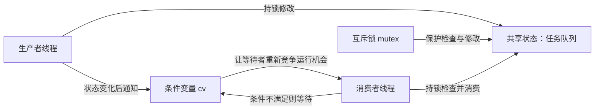
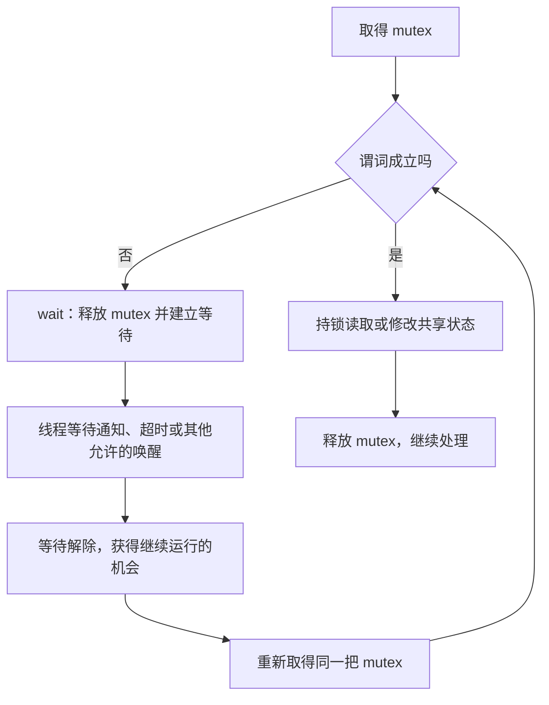
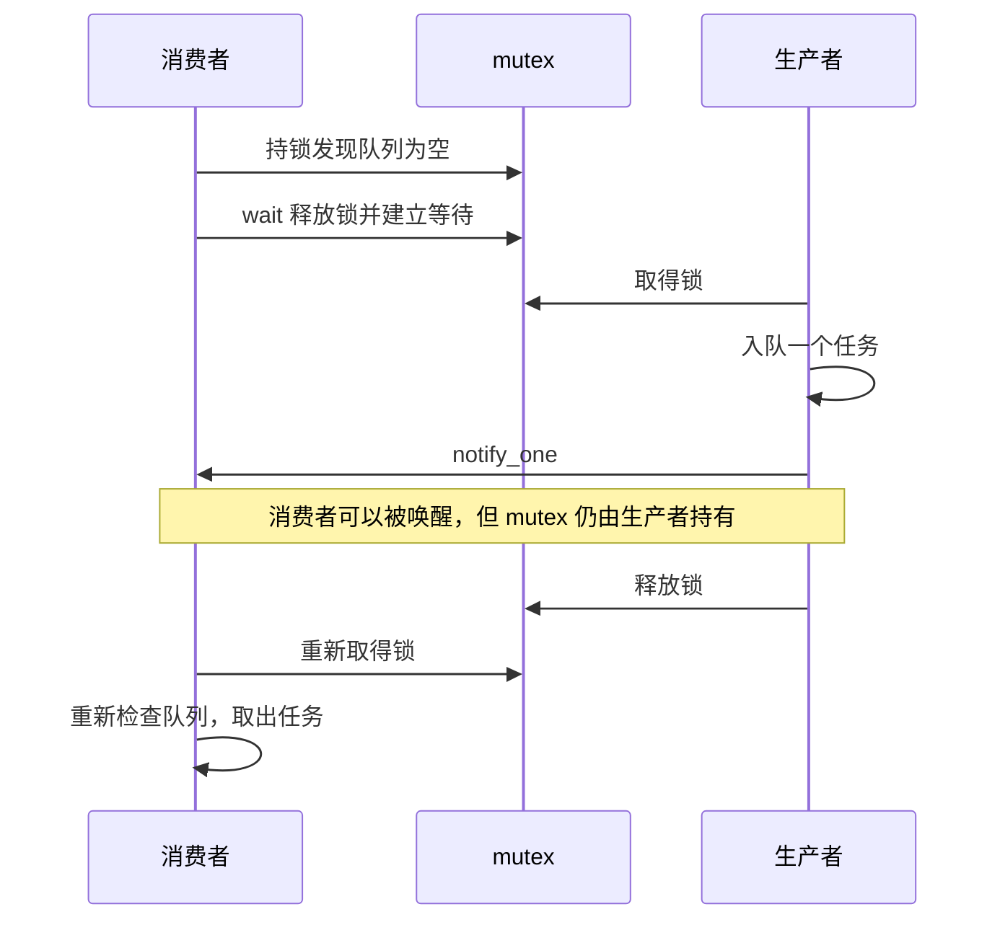
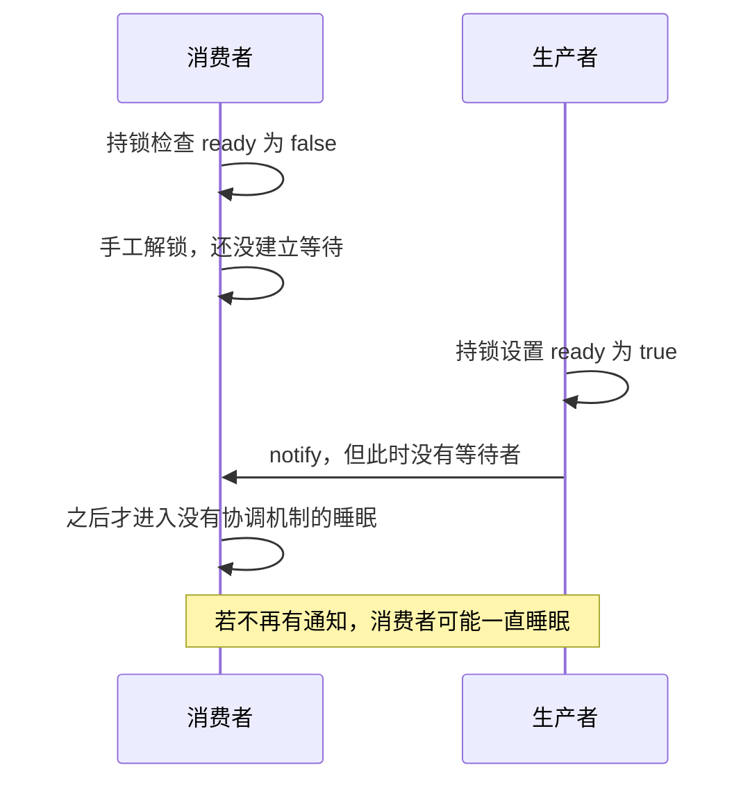
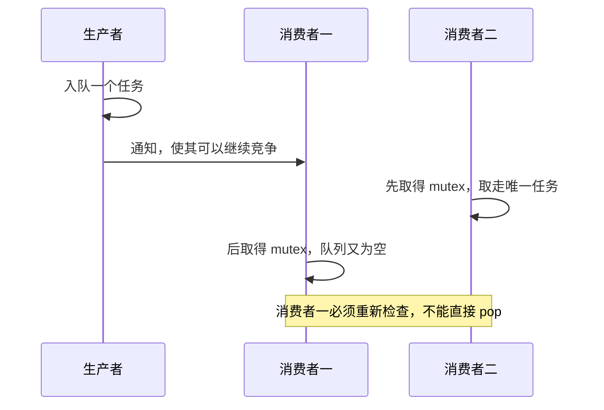
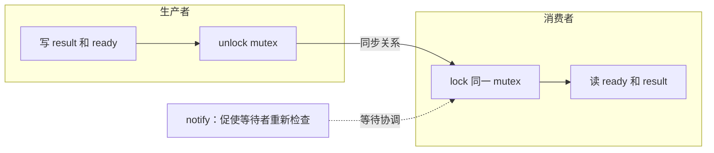
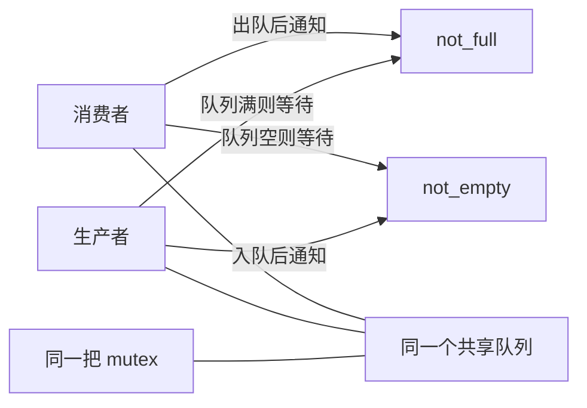
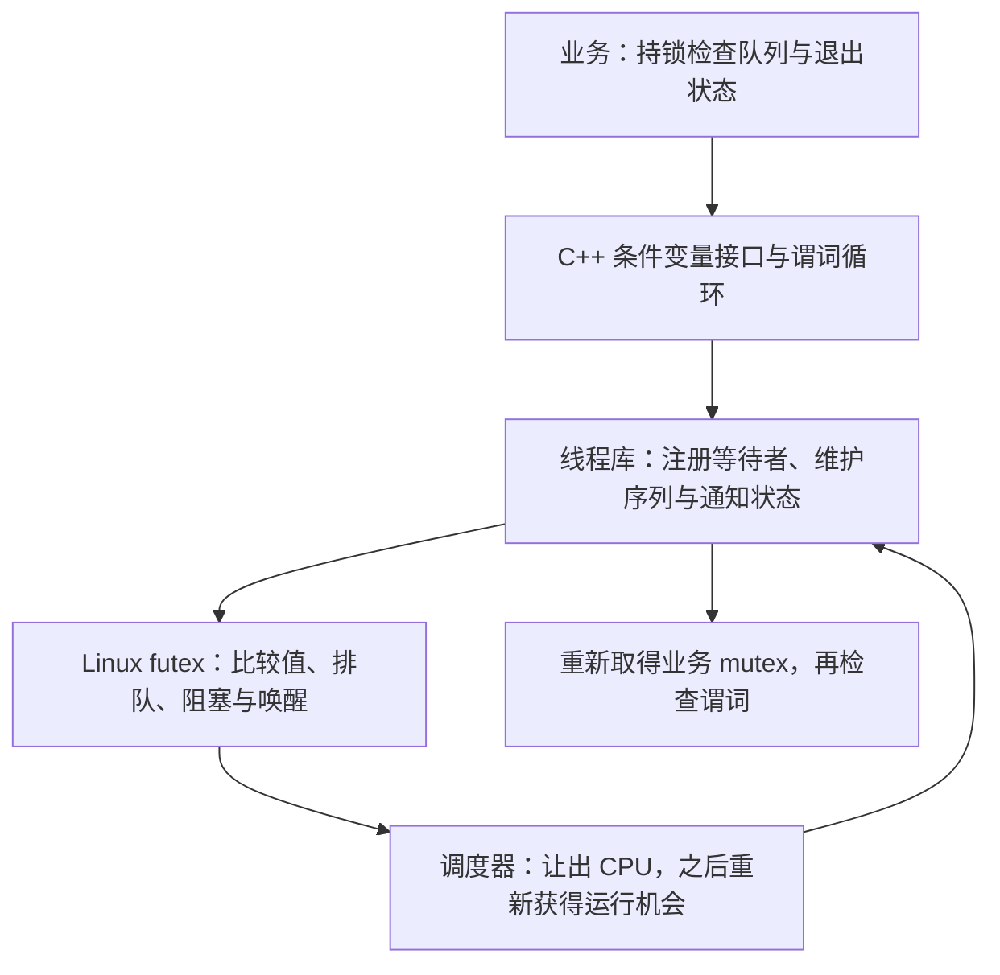
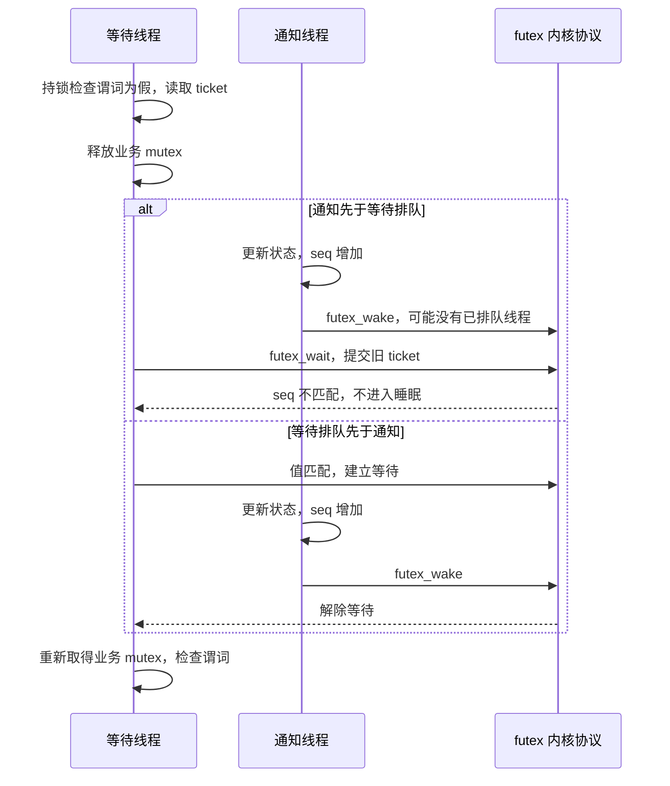
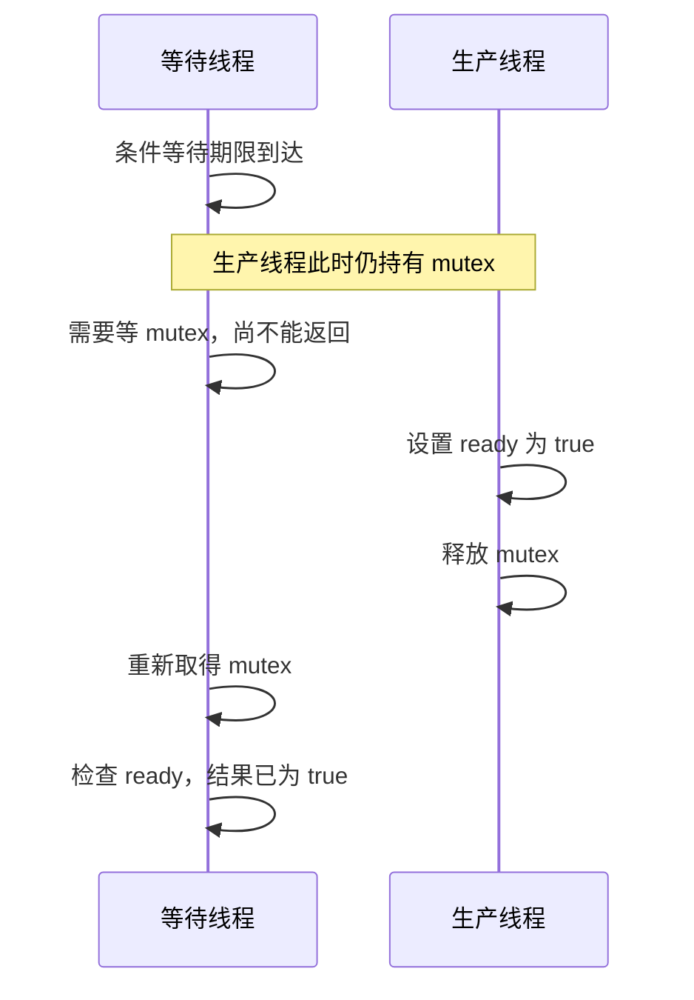

# 条件变量原理：从共享状态到等待与唤醒

条件变量解决的是这样一种协作需求：**线程发现某个条件尚未成立时，暂时停止占用 CPU；其他线程改变状态后，通知它重新检查。** 它把“等待某件事发生”从不断轮询，变成可以阻塞和唤醒的同步过程。

理解它，需要把三个角色始终放在一起：**共享状态保存事实，互斥锁保护事实，条件变量协调何时重新检查事实。** 线程能否继续，由共享状态决定；`notify` 只是一次重新检查的机会。

本文先讲通用语义，再用 Linux futex 解释一种底层实现。示例以 C++17 的 `std::condition_variable` 为主，POSIX 对应 `pthread_cond_*`；实现细节不应直接推广到所有操作系统。文中的教学模型会明确标注，相关源码片段作为原始文本材料随文保存，具体版本与校验值见[来源清单](./assets/condition_variable/provenance.txt)，阅读入口集中在[第 14 节](#reading-materials)。

读完通用原理后，可继续阅读 [QNX 条件变量空通知优化与公共封装修复记录](./QNX/2026-11-12_QNX条件变量空通知优化与公共封装修复记录.md)，了解相同语义在具体平台上如何转化为性能问题。

## 1. 背景：为什么已经有 mutex，还需要条件变量

假设一个线程生产任务，另一个线程从队列取任务。mutex 已经能防止两者同时修改队列；但当队列为空时，消费者应该做什么？

| 做法 | 消费者的行为 | 问题 |
| --- | --- | --- |
| 不断轮询 | 反复加锁、检查队列、解锁 | 队列长期为空时仍消耗 CPU，并争用 cache 与锁 |
| 定时轮询 | 检查后 `sleep` 一段时间 | 间隔短则开销高，间隔长则任务响应慢 |
| 持锁等数据 | 不放锁，直到队列不为空 | 生产者拿不到锁，无法入队，等待无法结束 |
| 条件变量 | 检查为空后，释放锁并进入等待 | 生产者可以入队，再通知消费者重新检查 |

mutex 解决的是**谁能访问共享状态**，条件变量解决的是**条件不满足时如何等待状态变化**。二者负责不同问题。



条件变量的“条件”通常是业务表达式，例如 `!queue.empty()`、`queue.size() < capacity`、`ready || closed`。这个表达式叫作**谓词（predicate）**。它不一定是某个单独的布尔成员，条件变量本身也不会自动读取它。

## 2. 最小正确模式：状态、锁、通知各做一件事

先看一个仅传递一次结果的例子。消费者必须看到生产者写入的字符串，不能提前读取。

```cpp
#include <condition_variable>
#include <mutex>
#include <string>

std::mutex mutex;
std::condition_variable cv;
bool ready = false;
std::string result;

// 生产者线程调用。
void Produce() {
  {
    std::lock_guard<std::mutex> lock(mutex);
    result = "done";
    ready = true;
  }
  cv.notify_one();
}

// 消费者线程调用。
std::string Consume() {
  std::unique_lock<std::mutex> lock(mutex);
  cv.wait(lock, [] { return ready; });
  return result;  // 此时仍持有 mutex。
}
```

这个例子的约束是一次性发布，所有线程结束前不销毁这些对象。若要反复传递结果或逐项分发任务，应使用后文的队列等状态模型。

`unique_lock` 在这里负责把锁的所有权交给等待操作管理：`wait` 需要临时解锁，返回前再重新加锁。普通 `lock_guard` 不提供这样的解锁、重新加锁接口。

对 `std::condition_variable`，同一时间在同一个 cv 上等待的线程必须使用同一把 mutex；不能让每个线程各拿一把自己的锁来等待同一个共享谓词。反过来，一把 mutex 可以保护多个谓词，并与多个条件变量配合使用。

生产者先执行也没有问题：它已把 `ready` 设为 `true`，后来才启动的消费者持锁看到条件成立，直接通过 `wait` 的谓词检查。**事实由 `ready` 和 `result` 保存，先前那次通知不需要被条件变量“存起来”。**

### 2.1 谓词版本实际做了什么

对业务使用者而言，下面两段等待的核心逻辑相同：

```cpp
cv.wait(lock, [] { return ready; });

// 展开后的逻辑：检查谓词时与 wait 返回时都持有 mutex。
while (!ready) {
  cv.wait(lock);
}
```

本地 libstdc++ 11 的谓词重载也是这种 `while (!predicate()) wait(lock)` 结构，见[标准库源码节选](./assets/condition_variable/libstdcxx-predicate-wait.h.txt)。谓词可能执行多次，应当快速完成，避免在其中做长耗时计算或取得难以分析的其他锁。

## 3. 一次 wait 的完整生命过程

一次原始等待包含三个逻辑阶段：**释放 mutex 并建立等待、解除条件等待、重新取得 mutex**。成功返回到调用者时，锁已经重新持有。



“建立等待”不能简单理解成“调用那一刻 CPU 已切换到别的线程”。实现可能在真正睡眠前发现状态或通知序列已经变化，直接回到重试路径；但对调用者来说，解锁与等待之间仍必须满足不丢失所需唤醒的协议。

### 3.1 notify 之后，等待者并没有立即得到锁



这类“通知后由等待者重新竞争锁、再检查条件”的方式，通常称为 **Mesa 风格语义**。POSIX/C++ 的常规使用应按这种方式理解，不能把 `notify` 当作立即转交锁或立即切换线程。

实际调度可能还有其他线程插入，底层也可能直接重排等待队列。上图描述的是逻辑依赖，不要求每个平台都经历相同的内核队列迁移。

## 4. 最危险的窗口：检查完条件，才准备睡眠

条件变量比普通的“先解锁，再睡眠”多出的核心能力，是把等待建立与通知协调起来。若自己拆成两个毫无协调的操作，就会出现丢失通知。

### 4.1 错误时序：条件已真，消费者却睡下去了



即使上图中的每次读写都加了锁，**把解锁和等待错误拆开**仍然可能挂住。问题是“检查结论已经过时，却按旧结论睡眠”，不是某个变量的读写不原子。

### 4.2 正确协议把生产者限制在两个安全分支

等待者持 mutex 检查条件，条件不满足时调用原生 `wait`；生产者也持同一把 mutex 修改条件：

| 先后关系 | 为什么安全 |
| --- | --- |
| 生产者先取得锁并修改状态 | 消费者后来取得锁，直接看到条件为真，不需要依赖历史通知 |
| 消费者先取得锁，看到条件为假 | 生产者必须等消费者释放锁后才能修改；条件变量协议保证这次解锁与等待建立之间不会漏掉对应通知 |

底层不一定靠“一条同时解锁业务 mutex 并睡眠的指令”实现这个保证。它可以组合等待者注册、序列状态和内核等待原语；第 8 节会解释 Linux 中这种组合如何工作。

### 4.3 把 ready 改成 atomic，为什么还不够

下面两件事不是同一个保证：

- atomic 让一次变量访问没有数据竞争，并能提供选定的内存序关系。
- 正确等待协议避免“检查结果与之后入睡之间”漏掉状态变化。

如果生产者不参与消费者使用的 mutex 协议，它仍可能在消费者检查 `atomic ready == false` 后、真正建立等待前设置 `ready=true` 并通知。消费者随后睡眠，atomic 不会自动再唤醒它。

最容易复核的使用方式是：**谓词的检查与修改都在同一把 mutex 下进行**。确实有需要时，也可使用带额外握手的专门算法，或 C++20 `atomic::wait/notify`；但它们有各自的协议，不能只替换变量类型就完成转换。

## 5. 为什么必须用 while：唤醒与条件成立是两件事

### 5.1 真正的虚假唤醒

条件变量允许等待在没有对应业务通知的情况下返回，这称为虚假唤醒。库与内核的实现、并发竞争或平台允许的中断处理，都可能使“原始等待返回”无法直接等价为“业务条件已成立”。具体原因依平台而异，不应把某个 Linux 或 QNX 行为当成通用规范。

循环重新检查谓词就能容纳这类返回：条件仍为假，就继续等待。

### 5.2 通知确实发生了，条件也可能已经被别人消耗

即使某个平台没有发生真正的虚假唤醒，也不能把 `while` 改成 `if`：



上图可以发生在消费者二原本就在运行、尚未进入等待的情况下；不要求同一次 `notify_one` 同时唤醒两个等待者。

**真实通知、线程被唤醒、业务谓词成立、成功消费资源，是不同的事件。** 谓词循环负责让这些事件最终与实际共享状态保持一致。

## 6. 数据为什么可见：发布关系来自 mutex

普通条件变量模式中，结果数据的可见性主要通过同一把 mutex 的解锁与后续成功加锁建立：



mutex 的同步关系加上线程内的先后顺序，使生产者在解锁前的写入 happens-before 消费者取得相应锁后的读取。`notify` 本身不会自动使任意不受保护的数据访问变得正确。

因此，“先写非原子结果，再不加锁通知，对方醒来后直接无锁读取”不是通用安全写法。使用其他 release/acquire 原语发布数据也可以，但需要独立证明完整的内存可见性与生命周期。

### 6.1 持锁通知还是解锁后通知

两种写法都可以正确，前提是业务状态先在 mutex 下更新，而且对象始终有效：

```cpp
// 持锁通知。
{
  std::lock_guard<std::mutex> lock(mutex);
  ready = true;
  cv.notify_one();
}

// 或：修改状态后解锁，再通知。
{
  std::lock_guard<std::mutex> lock(mutex);
  ready = true;
}
cv.notify_one();
```

持锁通知时，被唤醒者可能还需要等通知方释放 mutex。解锁后通知可能缩短这段竞争，但调度、库实现与实时约束都会影响结果，不能笼统断言永远更快。

还要检查解锁后的对象生命周期：如果其他线程可以在这段窗口销毁含有 cv 的对象，稍后的 `notify` 就可能访问失效对象。通知位置应与所有权协议一起决定。

## 7. notify_one 与 notify_all：选择谁重新检查

| 操作 | 一般语义 | 适用情形 |
| --- | --- | --- |
| `notify_one()` | 若有等待者，解除一个等待者的等待 | 等待者承担同一种消费职责，一份新增资源通常只需一个线程 |
| `notify_all()` | 解除所有当前等待者的等待 | 关闭、阶段切换、条件一次满足多个等待者，或必须让不同谓词各自检查 |

被通知不等于得到资源，通用接口也不承诺 FIFO、公平性或特定优先级顺序；QNX 的具体选择规则属于平台行为。

### 7.1 不同谓词混在一个条件变量上

有界队列中，生产者等待“队列未满”，消费者等待“队列非空”。如果它们都使用同一个 cv，却只 `notify_one`，就可能选中谓词仍为假的那类线程，而真正能推进的线程仍睡眠。

一种清晰的结构是：**同一把 mutex 保护队列，两个条件变量分别服务两类谓词**。



### 7.2 “只在空变非空时通知一次”不总适合多消费者

若两个消费者都在等待，生产者连续放入两个任务，却只在第一个任务使队列从空变非空时通知一次，那么第二个消费者可能继续睡眠。第一个消费者是否会再取第二项，取决于业务循环；不能自动依赖它替全部等待者推进。

因此，通知策略需要结合消费批次与线程数量设计。后文示例选择每次成功入队后通知一个消费者，便于建立清楚的对应关系。

### 7.3 notify_all 的成本来自重新竞争

若只增加一个任务，却唤醒许多消费者，它们都需要被调度、竞争 mutex、检查状态；多数线程最后仍会再次等待。这通常称为“惊群”。

不过，关闭时所有线程都需要退出，`notify_all` 就是必要动作。选择应基于状态变化能让多少线程推进，而不只是机械地减少通知数量。

## 8. 底层实现：Linux futex 如何支持等待与唤醒

### 8.1 条件变量、pthread 与内核不是同一层



Linux 上常见 pthread 条件变量实现使用 futex。线程库在用户态维护必要状态，确实需要阻塞或唤醒时再与内核交互。mutex 的重新获取也可能走用户态快速路径或另一次内核等待，不能把它们都算成“条件变量系统调用”。

### 8.2 futex 的核心：仅当值仍等于预期值时才睡眠

可以把 `FUTEX_WAIT(address, expected)` 理解为：在与对应唤醒操作协调的原子协议下，检查该地址的值；若不等于 `expected`，直接返回而不建立阻塞；若相等，才进入相应等待过程。

`FUTEX_WAKE(address, n)` 尝试唤醒该地址上的等待线程，它不会替业务更新队列，也不会替线程库增加通知序列。**先改变用户态同步状态，再适当 wake，是完整协议的一部分。**

本地 Linux 内核源码 `futex_wait_setup()` 在哈希桶锁保护下读取用户态值，不相等则返回 `-EWOULDBLOCK`；队列建立与调度发生在后续路径。相关注释明确说明了为什么比较与排队必须正确排序，见[内核源码节选](./assets/condition_variable/linux-futex-ordering.c.txt)。

### 8.3 教学模型：用序列值记住“准备等待之后发生过变化”

为了理解原理，可以暂时把条件变量内部状态抽象为原子序列 `seq`。下述是教学伪代码，不是 glibc 原样实现，也没有涵盖多个等待者的分配、溢出、超时、取消、对象销毁与全部内存序细节。

```text
等待方，已持有业务 mutex，且刚检查到谓词为假：
    ticket = 读取内部 seq
    解锁业务 mutex
    futex_wait(seq 的地址, ticket)
    // 若 seq 已变化则不睡；否则进入可被 wake 的等待。
    重新锁定业务 mutex
    重新检查谓词

通知方，在业务状态已按约定更新之后：
    原子增加内部 seq
    futex_wake(seq 的地址, 需要唤醒的数量)
```

`ticket` 必须在等待者仍持有业务 mutex 的阶段取得，不能在解锁后才去读取新序列、再按它入睡。否则仍可能错过生产者已经完成的那轮变化。



这解释了为什么“通知发生时，线程还没真正睡进内核”也可以安全：序列变化会使它之后的等待比较失败。实际 pthread 库通常需要更复杂的等待者序列、分组和信号记账，以满足多线程竞争等约束，不能把这个模型直接复制成生产条件变量。

### 8.4 为什么不是每次 wait 都一定切换线程

谓词已经满足时，带谓词的 wait 可以完全不进入底层等待；提交 futex 等待时发现值已变化，也可以直接返回。甚至在完成排队后、调度前，线程就可能已被唤醒，内核可以跳过实际睡眠。

本地 `futex_wait_queue_me()` 就包含检查等待项是否已经被移除、从而跳过调度的逻辑。**进入系统调用、线程阻塞、上下文切换和重新持锁，是需要分别观察的事件。**

### 8.5 QNX 的语义一致，成本结构可以不同

在随文 QNX 案例核验的 libc 样本中，通知经 `SyncCondvarSignal_r` 进入微内核，等待使用相应的原生同步机制。它不应被画成 Linux futex 的另一种名称。

两平台都需要保护谓词、处理重新持锁与循环检查，但无人等待时的通知是否仍进入内核、等待者如何选择、实时锁如何参与，都可能不同。这也是[QNX 空通知案例](./QNX/2026-11-12_QNX条件变量空通知优化与公共封装修复记录.md)需要独立分析的原因。

## 9. 超时：期限到达不等于函数立即返回

### 9.1 相对时长与绝对期限

`wait_for` 描述相对时长，`wait_until` 描述绝对期限。手写谓词循环时，应固定整次操作的 deadline：

```cpp
const auto deadline = std::chrono::steady_clock::now() + timeout;
while (!ready) {
  if (cv.wait_until(lock, deadline) == std::cv_status::timeout) {
    return ready;  // 重新持锁后，再检查最终状态。
  }
}
return true;
```

如果在每次被唤醒后都重新执行 `wait_for(lock, timeout)`，总等待时间就可能因连续的无效唤醒反复延长。直接使用标准库的带谓词 `wait_for(lock, timeout, predicate)`，也能表达整次等待的期限。

### 9.2 为什么超时后仍要检查谓词



超时限制的是等待协议中的计时条件，不是获取锁与得到 CPU 的硬实时上界。线程可能因重新竞争锁或调度而更晚返回；带谓词的 timed wait 需要用返回时持锁观察到的最终谓词决定 bool 结果。[标准库超时源码](./assets/condition_variable/libstdcxx-predicate-timeout.h.txt)也在超时分支中再次调用谓词。

### 9.3 不同 API 的返回值不能混用

| API | 不带谓词的 timed wait | 带谓词的 timed wait |
| --- | --- | --- |
| `std::condition_variable` | `std::cv_status`：超时或非超时 | `bool`：最终谓词值 |
| `pthread_cond_timedwait` | `int`：成功、`ETIMEDOUT` 或其他错误码 | 没有直接接收 C++ 谓词的重载，由调用方循环 |
| 公司 `base::ConditionVariable` 案例 | `bool`，原生返回码是否为零 | `bool`：最终谓词值 |

原始 timed wait 的“非超时”并不保证队列非空。对于错误码也不能一概当成正常超时，具体封装可能损失这部分区分能力。

### 9.4 单调时钟解决墙钟跳变，不能消除虚假唤醒

测量经过时长通常希望使用 `steady_clock` 或平台的 `CLOCK_MONOTONIC`，避免手动校时、时钟同步等墙钟变化影响期限。POSIX 条件变量的等待时钟可以通过属性等平台接口配置；C++ 标准库的底层适配也可能随版本变化。

必须让绝对期限与底层等待使用同一时间基准；不能直接把墙钟时间戳当成单调时钟期限。更不能因为选用了单调时钟，就省略谓词循环。

## 10. 完整例子：可以关闭的有界队列

下面的示例把几条原则放在一起：一把 mutex 保护状态，两类谓词分别使用条件变量，持锁更新、解锁后通知，关闭时唤醒两类等待者。

```cpp
#include <condition_variable>
#include <cstddef>
#include <mutex>
#include <optional>
#include <queue>
#include <stdexcept>
#include <utility>

template <typename T>
class BoundedQueue {
 public:
  explicit BoundedQueue(std::size_t capacity) : capacity_(capacity) {
    if (capacity == 0) {
      throw std::invalid_argument("capacity must be positive");
    }
  }

  // 成功入队返回 true；关闭后拒绝新任务。
  bool Push(T value) {
    std::unique_lock<std::mutex> lock(mutex_);
    not_full_.wait(lock, [&] {
      return closed_ || queue_.size() < capacity_;
    });
    if (closed_) {
      return false;
    }
    queue_.push(std::move(value));
    lock.unlock();
    not_empty_.notify_one();
    return true;
  }

  // 关闭后继续排空已有任务；关闭且为空时返回 nullopt。
  std::optional<T> Pop() {
    std::unique_lock<std::mutex> lock(mutex_);
    not_empty_.wait(lock, [&] { return closed_ || !queue_.empty(); });
    if (queue_.empty()) {
      return std::nullopt;
    }
    T value = std::move(queue_.front());
    queue_.pop();
    lock.unlock();
    not_full_.notify_one();
    return value;
  }

  void Close() {
    {
      std::lock_guard<std::mutex> lock(mutex_);
      closed_ = true;
    }
    not_empty_.notify_all();
    not_full_.notify_all();
  }

 private:
  const std::size_t capacity_;
  std::mutex mutex_;
  std::condition_variable not_empty_;
  std::condition_variable not_full_;
  std::queue<T> queue_;
  bool closed_ = false;
};
```

这里的 `closed_` 不需要是 atomic，因为相关访问已经使用同一把锁。示例假定元素满足业务所需的移动与异常约束，未扩展成包含取消、超时、公平性和强异常保证的通用生产队列。

`Close()` 的作用是改变共享状态并促使等待者检查退出条件；它没有等待其他线程实际结束。队列必须存活到全部 `Push`、`Pop` 和 `Close` 调用结束，不能把析构函数简单写成一次 `Close()` 就认为生命周期已安全。

## 11. 退出与销毁：通知之后还要有人收尾


这些步骤的具体组合由系统所有权决定。例如上节的 `Close()` 可以先唤醒正在阻塞的生产者，再等待它们返回；不能先 join 一个永远等不到空位的生产者，之后才想起关闭队列。

对工程使用者，最容易复核的边界是：**所有使用该同步对象的线程已经结束相关访问，再销毁它。** 某些底层标准针对原始条件等待允许更精细的销毁时机，但用户封装可能在 backend 返回后还访问成员，带谓词的循环也可能继续使用对象，不能照搬那些特殊条件。

以下问题尤其容易导致退出挂住：

- 只修改停止标志，没有通知实际正在等待的那个 cv。
- 谓词只检查“有任务”，没有包括关闭或停止状态。
- 修改了 atomic 停止标志，却没有关闭检查与入睡之间的竞态。
- 发出通知后立即释放对象，等待者还在抢 mutex 或执行外层返回逻辑。

若退出来源是异步信号或中断，不能自动把普通 C++ 条件变量操作当作可在该上下文调用的接口。应使用平台支持的信号、中断到工作线程的转交通道，再在合适的线程上下文完成关闭协议。

## 12. 性能与排查：等待不一定贵，通知也不一定便宜

| 观察到的现象 | 优先检查什么 |
| --- | --- |
| CPU 高，队列却常空 | 是否忙轮询、超时轮询过密、反复惊群或错误的立即返回循环 |
| CPU 低，任务响应慢 | 是否没有通知正确的 cv、通知选错等待者、锁竞争、优先级或调度延迟 |
| 通知次数很高，有效唤醒少 | 消费者是否一直在处理任务、平台是否会过滤空通知 |
| `notify_all` 后大量线程短暂运行又睡眠 | 是否只有很少资源，唤醒范围是否过大 |
| 退出时 join 永久等待 | 关闭状态、谓词、通知目标与所有权顺序是否闭环 |
| 超时远大于设定值 | 是否反复重置相对期限，或在等待结束后长期抢不到 mutex |

分析时应把等待时间拆开：条件未满足的时间、已被通知但尚未调度的时间、重新获取 mutex 的时间，以及真正处理业务的时间。一次 `wait` 的墙钟耗时不能全部算成库函数消耗的 CPU 时间。

同样，无人等待的 `notify` 在语义上可以没有效果，但成本取决于实现。它可能在用户态快速返回，也可能仍需要系统调用。QNX 专项案例中的 waiter 计数正是针对后者；计数本身有原子操作与缓存竞争成本，不能把它直接推广为所有平台都应增加的优化。

## 13. 和其他同步原语相比，什么时候该用条件变量

| 原语 | 保存或保护什么 | 更适合的需求 |
| --- | --- | --- |
| mutex | 临界区访问权 | 保护共享结构与多个字段之间的不变量 |
| 条件变量加 mutex | 业务状态由调用者保存，cv 协调等待者重查 | 等待由多个字段决定的条件、队列、关闭与容量联动 |
| 计数信号量 | 可获取的许可数量 | 每次生产增加一个许可，消费减少一个许可 |
| C++20 `atomic::wait/notify` | 等待原子值不同于给定旧值 | 一个原子状态足以描述进度或状态转换 |
| future/promise | 一次计算的结果或异常与就绪状态 | 一次性异步结果交付 |
| latch/barrier | 到达数量或阶段进度 | 一次性汇合或多轮并行阶段同步 |

信号量可以保存尚未被消费的许可，而条件变量不会替应用保存通知次数；这是二者的重要差别。条件变量内部虽然也可能有序列或信号记账，但它们服务于等待协议，不是对未来业务 `wait` 承诺的许可。

`atomic::wait` 也不是逐次事件日志：原子值若从 A 变成 B 又变回 A，某个等待者可能观察不到中间变化；当业务需要记录每次任务或事件时，仍应显式保存队列、计数或足够的版本状态。

## 14. 阅读与复核入口 {#reading-materials}

本文用三个层次描述条件变量：

| 层次 | 内容 | 阅读材料 |
| --- | --- | --- |
| 通用使用语义 | 持锁检查、等待释放与重新加锁、谓词循环、超时后复查 | 本文第 2–7、9 节；[C++ 实现节选](./assets/condition_variable/libstdcxx-predicate-wait.h.txt) |
| 具体实现证据 | libstdc++ 的谓词循环、Linux futex 的比较、队列与调度顺序 | [来源清单](./assets/condition_variable/provenance.txt)、[futex 比较与排队](./assets/condition_variable/linux-futex-wait-setup.c.txt)、[排队后的调度](./assets/condition_variable/linux-futex-schedule.c.txt) |
| 平台案例 | QNX 空通知成本、实时 mutex、公共封装的 waiter 注册与生命周期 | [QNX 专项分析](./QNX/2026-11-12_QNX条件变量空通知优化与公共封装修复记录.md)中的[原始材料索引](./QNX/2026-11-12_QNX条件变量空通知优化与公共封装修复记录.md#local-materials) |

第 8.3 节的单序列模型用于解释竞态如何被关闭，其伪代码不是完整实现。本文其余图中的队列与线程状态也用于表达逻辑顺序，不要求各平台具有相同内部数据结构。源码与平台材料均作为正文直接链接的原始附件保存，阅读不依赖外部仓库或原始开发环境。
