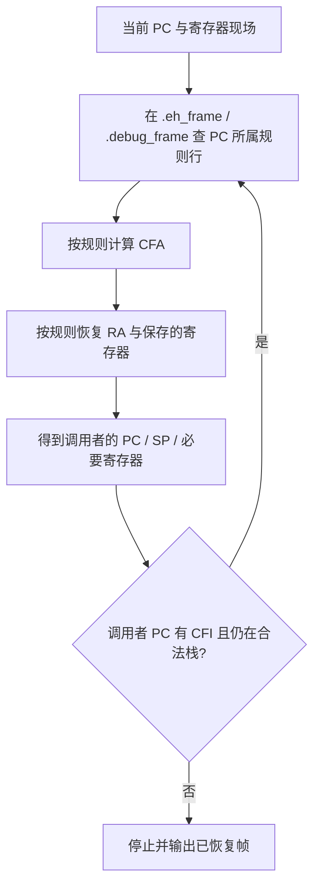
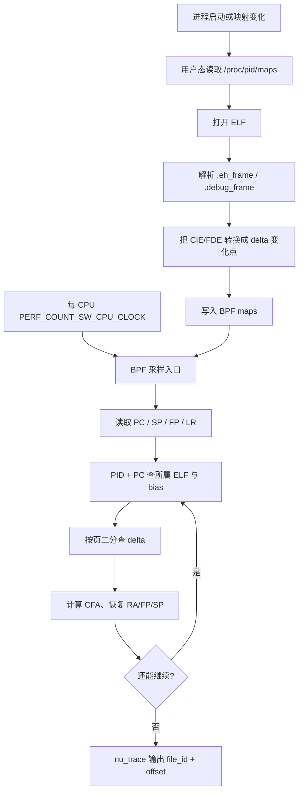

# DWARF-CFI回溯：编译器写下的恢复说明书

> 本文是「栈回溯」系列方法篇之二，也是本系列的重点：`perf_ebpf` 的 CPU 用户栈主路径正是「用户态预解析 CFI + BPF 内轻量化逐帧回溯」。
>
> 前置知识：[函数调用与返回：AArch64栈帧与寄存器的逐步变化](../函数调用与返回：AArch64栈帧与寄存器的逐步变化.md)；方法全景：[三种栈回溯方法总览](./三种栈回溯方法总览.md)。本文示例沿用前置篇 `stack_demo` 的同一套现场数据。

## 1. 为什么没有 FP 也能回溯

[FP帧指针链回溯](./FP帧指针链回溯.md) 假定「所有函数形状一致」。优化编译器完全不尊重这个假定。看一个省略帧指针、但保存了 LR 的 AArch64 函数：

```asm
checksum:
    sub  sp, sp, #32
    str  x30, [sp, #24]        ; 保存 LR（自己要调用别人）
    ...                        ; 函数体，局部变量占 [sp+0..24)
    ldr  x30, [sp, #24]        ; 恢复 LR
    add  sp, sp, #32
    ret
```

这里没有 `x29`，但 `ret` 仍然必须能找到返回地址：它就在 `[SP + 24]` 的位置——因为 `ldr` 正是从那里恢复 LR 的。**编译器比回溯器更清楚每条指令怎样改了 SP**，于是它可以把这份「怎样恢复调用者」的知识写进二进制：

```text
PC 落在函数体内（帧空间已分配）：
  CFA = SP + 32              ; 调用者调用前的栈顶
  返回地址 RA = [CFA - 8]    ; 即 [SP + 24]，保存的 LR
```

回溯器只要会读这张规则表，就能在**完全没有帧指针**的情况下恢复调用者。这个「编译器当向导」的方案就是 DWARF CFI。

## 2. CFI 总模型：查规则 → 计算 → 恢复 → 换输入

DWARF（Debugging With Attributed Record Formats）是一整套描述程序与机器码关系的格式：函数、类型、源码行、内联关系、变量位置……本文只取其中一小块：**Call Frame Information（CFI，调用帧信息）**。

“使用 DWARF CFI 回溯”不是说采集器读遍了所有调试信息，而是说它使用了 DWARF 体系中专管「调用帧恢复」的那部分规则。整个算法是一个稳定的四步循环：



与 FP 法的最大区别：**它从不假设 `[FP+8]` 里有什么**。每一帧恢复所需的全部信息，都来自「当前 PC 对应的规则行」。这带来两个能力：

- 能自由穿过「一半函数有 FP、一半没有」的混合栈；
- 能处理采样恰在 prologue/epilogue 中间的场景（规则按 PC 区间细分）。

## 3. `.eh_frame`、`.debug_frame` 与相邻节的职责

规则表通常存放在两个节里，采集器一般先找 `.eh_frame`，找不到再退到 `.debug_frame`。与经常一起出现的邻居节对照：

| 数据 | 常见位置 | 主要目的 | 没有它的后果 |
| --- | --- | --- | --- |
| `.eh_frame` | 可执行文件/共享库，常保留在 release | 异常展开、运行时回溯 | C++ 异常与可靠 runtime unwind 可能受影响 |
| `.debug_frame` | 通常在 debug info | 调试器的调用帧规则 | 调试/离线分析信息变少 |
| `.debug_info` | debug info | 函数、类型、变量、inline 信息 | 可能仍能回溯 PC，但难以显示源码行 |
| `.debug_line` | debug info | 地址到源码行的映射 | 无法显示行号 |
| `.symtab` / `.dynsym` | ELF 符号表 | 名称与地址范围 | 可能只能显示 binary+offset |

严格地说：**CFI 负责「怎样回到调用者」；DWARF 的函数/行号信息负责「这个地址在人类看来叫什么」**。两者常被一起称为“DWARF”，实际职责不同——回溯只需要前者，符号化才需要后者（详见 [ELF与符号化：从文件结构到运行时地址装载](../ELF与符号化：从文件结构到运行时地址装载.md)）。

## 4. 规则表如何组织：CIE、FDE 与 delta

`.eh_frame` 不是一张简单的「地址 → 规则」数组，而是由两类记录组成：

```text
.eh_frame
├── CIE  # Common Information Entry，公共初始规则模板
│   ├── code alignment factor     （指令对齐，如 1 或 4 字节）
│   ├── data alignment factor     （数据对齐，如 -8）
│   ├── return address register   （AArch64 上通常是 x30）
│   └── 初始 CFI 规则（如 CFA = SP + 0）
│
├── FDE  # Frame Description Entry，某个函数/地址范围的规则
│   ├── pc_begin / pc_range       （本记录覆盖的代码范围）
│   └── CFI 指令序列              （在范围内规则如何逐步变化）
│
├── FDE
└── FDE
```

可以这样类比：**CIE 是「默认规则模板」，FDE 是「函数 foo 在地址范围 A–B 内的具体变化过程」**。解析一行 FDE 的方法是：从 CIE 的初始规则出发，从函数起始地址开始逐条执行 CFI 指令，每遇到规则变化就产出一条记录。

### 4.1 逐 PC 区间的规则行（概念形态）

把 `stack_demo` 的 `checksum`（按 [函数调用与返回](../函数调用与返回：AArch64栈帧与寄存器的逐步变化.md) 第 3.3 节的序言）展开成一张概念形态的规则表：

```text
PC 区间                     CFA 规则          返回地址（RA）规则
checksum+0x00 .. +0x04     CFA = SP + 0      RA = LR（仍在寄存器中）
checksum+0x04 .. +0x08     CFA = SP + 16     RA = [CFA - 8]
checksum+0x08 .. +0x30     CFA = x29 + 16    RA = [CFA - 8]          <- 采样命中
```

三行的含义完全不同：

- **第一行**（刚进入函数、`stp` 还没执行）：SP 还是调用者的栈顶，所以 `CFA = SP + 0`；LR 也还没被保存，返回地址直接读 `x30` 寄存器（`SAME_VALUE` 规则）；
- **第二行**（`stp` 已执行、`mov x29, sp` 还没执行）：SP 刚减掉 16，但规则知道这个位移，`CFA = SP + 16` 仍指向调用前的栈顶；
- **第三行**（帧建立完成，也是绝大多数采样命中的区间）：锚点切到 `x29`，`CFA = x29 + 16`。

**同一个函数在不同指令位置允许有不同规则**——这是 FP 法做不到的（FP 法只有一个静态假设，CFI 有逐指令的动态规则）。采样发生在序言中间也不怕，只要 PC 落在哪一行就用哪一行。

### 4.2 为什么叫 delta

同一个函数的规则通常只在少数几个位置变化：

```text
函数地址：  A -------- B -------- C -------- D
规则：      R0         R1         R2         R2
```

不需要为每条机器指令复制一份完整规则，只保存**规则变化点**：

```text
delta 0: 从 A 开始使用 R0
delta 1: 从 B 开始使用 R1
delta 2: 从 C 开始使用 R2
```

采样时给定 PC，只要找到「不超过当前 PC 的最后一个 delta」，就得到当前适用的规则。这种「变化点列表 + 二分查找」的结构，是后面在 BPF 里高效执行的关键。

## 5. CFA：所有恢复动作的统一参考点

CFA（Canonical Frame Address，规范帧地址）的定义可以背下来：

> **CFA = 调用者在执行调用指令之前的栈指针值。**

它不是「当前的 SP」，也不是「当前的 FP」，而是一个由 CFI 规则**计算出来**的稳定参考点。为什么非要它？因为函数执行过程中 SP 会移动、FP 可能根本不存在，而「调用者的栈顶」是唯一稳定的坐标系原点：

```text
当前 SP / x29 随函数实现变化
        |
        v
CFI 规则计算出统一参考点 CFA
        |
        +-- 返回地址在 CFA - 8
        +-- 保存的 FP 在 CFA - 16
        +-- 其他保存寄存器在 CFA + 偏移
```

对 `checksum` 的采样现场（PC = checksum+0x18 命中的第三行规则），把 CFA 画在栈上：

```text
高地址
0x7fff_eff8  ┌──────────────────────────────────────┐
             │ 返回 main 的地址 0x401220            │
0x7fff_eff0  ├──────────────────────────────────────┤ <- process.FP = 0x7fff_eff0
             │ 保存的 main.FP = 0x7fff_f120         │
             ├──────────────────────────────────────┤
             │ process 帧：result 等局部数据        │
0x7fff_efd0  ┝━━━━━ CFA = 0x7fff_efd0 ━━━━━━━━━━━━━━┥ <- 调用前 process 的 SP
             │ 保存的 LR = 0x4011e0                 │ <- [CFA - 8]，即要恢复的 RA
0x7fff_efc8  ├──────────────────────────────────────┤
             │ 保存的 process.FP = 0x7fff_eff0      │ <- [CFA - 16]
0x7fff_efc0  ├──────────────────────────────────────┤ <- x29 = 0x7fff_efc0
             │ （checksum 局部数据，不参与规则）    │
0x7fff_efb0  └──────────────────────────────────────┘ <- SP = 0x7fff_efb0
低地址
```

两条等价写法在这里都对：函数体期间 `CFA = x29 + 16`，也等于 `SP + 0x20`。CFI 记录哪个由编译器决定，回溯器无差别使用。

**AArch64 的一个便利**：恢复「调用者的 SP」时，直接 `caller_SP = CFA` 即可——AArch64 的调用不把返回地址压栈，CFA 本身就是调用者的栈顶。而在 x86-64 上返回地址占 8 字节且由 `call` 压在栈里，`caller_SP = CFA - 8`。这是换成 x86 视角时最容易错的一处。

## 6. CFI 的几类规则

一条规则行里，每个寄存器（包括返回地址寄存器）都各自有一条「恢复方式」。常见类型：

| 规则 | 通俗含义 | 本文示例 |
| --- | --- | --- |
| `UNDEFINED` | 该寄存器无法从当前帧恢复 | 某些临时寄存器 |
| `SAME_VALUE` | 调用者的值仍在当前寄存器里，原样沿用 | 第一行的 `RA = LR` |
| `OFFSET` | 调用者的值保存在 `[CFA + 偏移]` 的内存中 | 第三行的 `RA = [CFA - 8]` |
| `VAL_OFFSET` | 值等于 `CFA + 偏移`（不是从内存取，直接算） | 少见于典型代码 |
| `REGISTER` | 调用者的值在另一个寄存器里 | AArch64 特有的 `RA = x29` 编码 |
| `EXPRESSION` | 需要执行一段 DWARF 表达式才能得到 | 复杂场景，受限环境常放弃 |

FP 链方法可以看作 CFI 的一个特例：FP 规则（`CFA = FP + const`、`RA = [CFA - 8]`）恰好每帧都成立，于是退化成「沿 FP 走链表」。

## 7. 用 CFI 逐步回溯同一个现场

采样现场（与 [FP帧指针链回溯](./FP帧指针链回溯.md) 第 3 节完全相同的输入）：

```text
PC  = checksum + 0x18 = 0x401148
SP  = 0x7fff_efb0
x29 = 0x7fff_efc0（在本方法中只是普通寄存器，可用可不用）
LR  = 0x4011e0
```

### 步骤 1：用 PC 查规则表

`PC = checksum + 0x18` 落在第三行区间：

```text
PC 区间                     CFA 规则          返回地址（RA）规则
checksum+0x00 .. +0x04     CFA = SP + 0      RA = LR
checksum+0x04 .. +0x08     CFA = SP + 16     RA = [CFA - 8]
checksum+0x08 .. +0x30     CFA = x29 + 16    RA = [CFA - 8]          <- 命中
```

### 步骤 2：计算 CFA，在栈上定位返程票

```text
CFA = x29 + 16 = 0x7fff_efc0 + 16 = 0x7fff_efd0
RA  = memory[CFA - 8] = memory[0x7fff_efc8] = 0x4011e0   （属于 process）
保存的 FP = memory[CFA - 16] = memory[0x7fff_efc0] = 0x7fff_eff0
caller_SP = CFA = 0x7fff_efd0
```

注意这一次回溯完全**不需要 `x29` 是帧指针**——它只是恰好可以拿来算 CFA 的普通寄存器。即使编译器把 `x29` 拿去存临时值，只要 CFI 用 `CFA = SP + 0x20` 表达了同样的事实，回溯照样正确。

### 步骤 3：以上一帧的输出为下一帧的输入，循环推进

`RA = 0x4011e0` 落在 `process` 的 PC 区间，于是改查 `process` 的规则行，用刚恢复的 `process.SP = 0x7fff_efd0`（以及对应的保存寄存器）重复步骤 1、2，得到 `main` 的返回地址，如此往复：

```text
帧 0：PC = checksum+0x18（采样现场），SP = 0x7fff_efb0
帧 1：PC = 0x4011e0（process+0x30），SP = 0x7fff_efd0
帧 2：PC = 0x401220（main+0x20），SP = 0x7fff_f000
...
直到某一帧没有 CFI 规则、或到达栈底为止。
```

这个循环里每推进一帧，输入都换成上一帧的输出（新 PC 与新 SP），规则表按帧所属函数轮换。**「查表 → 计算 → 换输入」就是 DWARF 回溯的全部。**

## 8. 优点与代价

优点：

- 对省略帧指针、复杂栈调整、保存多个寄存器的优化代码更可靠；
- 可在 prologue/epilogue 的中间根据 PC 使用不同规则，不惧「采样落在序言里」；
- 与异常处理、调试器、许多语言运行时的标准机制兼容；
- 目标二进制的 `.eh_frame` 通常随 release 一起发布，无需额外部署。

代价：

- 规则是压缩的字节码/状态机（CFI 指令），解析与执行都比读两个指针复杂；
- 在 eBPF 内核程序中会遇到 verifier 限制：循环必须有界、内存访问要安全、程序大小与 map 交互都受约束；
- 目标二进制必须保存足够的 CFI，且采集器必须拿到与运行中模块匹配的规则；
- JIT 代码、运行时生成的代码或已卸载模块仍需额外的运行时支持。

## 9. perf_ebpf 如何落地：把「理解」和「执行」分家

`perf_ebpf` 的选择是：**规则准备放在用户态（低频、不受限），逐帧执行留在 BPF（高频、受限）**。原因很直接——采样点的 BPF 程序运行在内核上下文，不能打开 ELF 文件、不能分配动态内存、不能解析复杂二进制、循环必须有界。

```text
用户态：做复杂的、低频的准备工作
    - 读 /proc/<pid>/maps
    - 打开 ELF
    - 解析 .eh_frame / .debug_frame
    - 把规则压缩后写入 BPF map

BPF：做高频的、受限的采样工作
    - 读现场寄存器（PC / SP / FP / LR）
    - 查询 PID + PC 所属映射
    - 查询当前 PC 适用的规则
    - 计算 CFA、读取少量用户栈内存
    - 更新状态、循环推进、输出一条 trace
```

工程思想一句话：

```text
把「理解规则」放到采样前，把「执行规则」留在采样点。
```

完整数据流（概念级）：



这套机制的每一步实现细节——四类 BPF map 的分工、delta 如何压缩、`unwind_one_frame()` 的完整流程、`nu_trace` 如何传回用户态——都在撷简台 [perf_event 与 BPF 内轻量化 DWARF CFI 堆栈回溯](../../../../撷简台/2026-10-12%20perf_event与BPF内轻量化DWARF-CFI堆栈回溯通俗教程.md) 的第 7–11 节展开（该文第 4 节的 CFI 概念速览与本文对应）。

还有两点务必分清：

1. **回溯与符号化是两件事**。BPF 输出的是 `file_id + offset` 形式的调用地址序列；把它们变成 `checksum`、`main` 这样的函数名，是后端（FlameCraft）用 ELF 符号表完成的，见 [ELF与符号化](../ELF与符号化：从文件结构到运行时地址装载.md)。
2. **DWARF 失败时不等于没有栈**。当 native/DWARF 展开得到的用户帧为空或很浅时，`perf_ebpf` 会回退到 `bpf_get_stackid()` 的 stack map 结果（见 [eBPF栈采样](./eBPF栈采样.md)）；这正是三种方法组合使用的实例。

## 10. 小结

```text
CFI = 编译器写下的「在不同 PC 处，怎样恢复调用者」的规则表。
CFA = 调用前调用者的 SP，是所有恢复动作的统一坐标原点。
回溯循环 = 查规则 → 算 CFA → 恢复 RA/FP → 换输入，直到无规则或到栈底。
perf_ebpf = 用户态预解析规则（CIE/FDE → delta → map）+ BPF 内执行逐帧回溯。
```

下一站：[eBPF栈采样](./eBPF栈采样.md)，看另一条「委托内核」的采集路径；或回到 [三种栈回溯方法总览](./三种栈回溯方法总览.md) 对照三种方法的取舍。

## 参考资料

- DWARF Standard: Call Frame Information（CIE/FDE、CFA 与规则编码的权威定义）。
- LSB / Itanium C++ ABI 中的 `.eh_frame` 运行时展开惯例。
- AAPCS64：AArch64 上返回地址寄存器（x30）与 CFI 的配合方式。
- 撷简台《perf_event 与 BPF 内轻量化 DWARF CFI 堆栈回溯》：本方法的工程实现细节（四类 map、delta 压缩、BPF 内逐帧流程）。
