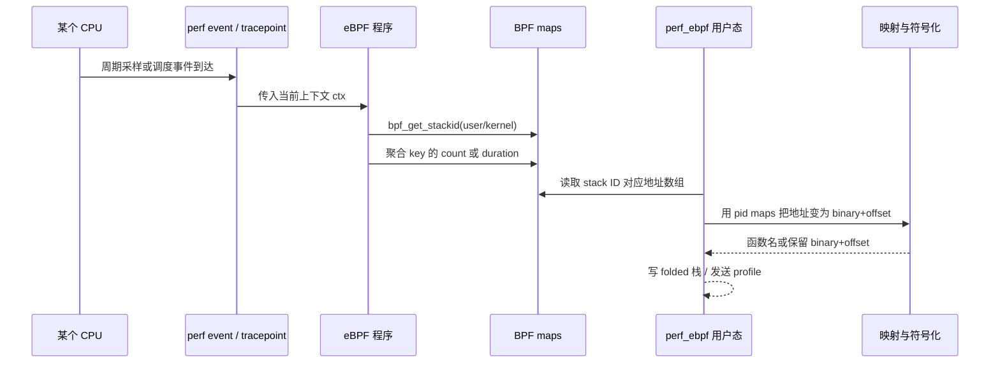

# eBPF栈采样：让内核帮忙抓栈

> 本文是「栈回溯」系列方法篇之三。FP 链与 DWARF CFI 都是「自己去读栈」的方法；第三种常见说法「eBPF 回溯」其实要再拆开：BPF 程序通常不自己从头扫描用户内存，而是**调用内核提供的 helper**，由内核收集当前上下文的栈地址并存进 stack trace map。
>
> 方法全景见 [三种栈回溯方法总览](./三种栈回溯方法总览.md)；采样现场示例沿用 [函数调用与返回：AArch64栈帧与寄存器的逐步变化](../函数调用与返回：AArch64栈帧与寄存器的逐步变化.md)。

## 1. 委托模型：谁跑到采样点，谁决定怎么抓

先厘清三个角色：

```text
BPF 程序（在采样点被内核触发）
    职责：发出请求、聚合计数、把结果写入 map
    限制：内核上下文，verifier 约束，不能随意遍历用户内存

内核 helper（bpf_get_stackid）
    职责：在内核的实现里展开当前栈，把地址数组存进 STACK_TRACE map
    特点：具体展开算法由内核决定，调用方不感知

用户态采集器（如 perf_ebpf）
    职责：按 ID 读回地址数组，做地址归属、符号化、聚合输出
```

用一句话概括这种分工：**BPF 侧只负责「要一张栈」，至于这张栈怎么展开、能有多深，交给内核。** 这与 [DWARF-CFI回溯](./DWARF-CFI回溯.md) 中「用户态预解析规则、BPF 执行展开」的分工恰好相反——那里展开算法由项目自己掌控，这里展开算法由内核黑盒提供。

## 2. 最小 eBPF 栈采样模型

在 on-CPU 的 BPF 程序里，最典型的取栈代码只有两行：

```c
int kstack_id = bpf_get_stackid(ctx, &stack_traces, 0);
int ustack_id = bpf_get_stackid(ctx, &stack_traces, BPF_F_USER_STACK);
```

返回值不是函数名，也不是地址数组本身，而是一个**stack ID**（一个整数；失败时返回负值）。常见 flags 有：

| flag | 含义 |
| --- | --- |
| `BPF_F_USER_STACK` | 收集用户态栈（不传则收集内核态栈） |
| `BPF_F_REUSE_STACKID` | 哈希冲突时允许复用已有 ID |
| `BPF_F_FAST_STACK_CMP` | 用更快但更粗的比较方式判断栈是否重复 |

它背后的数据结构由两个 map 组成：

```text
stack_counts（计数 map，key 是采样上下文）:
  (tgid, comm, user_stack_id, kernel_stack_id) -> count

stack_traces（BPF_MAP_TYPE_STACK_TRACE，ID 到地址数组）:
  user_stack_id   -> [0x401148, 0x4011e0, 0x401220, 0, ...]
  kernel_stack_id -> [0xffff..., 0xffff..., 0, ...]
```

也就是说：**地址数组与「哪个进程/线程、多少次」是分开存的**。相同形状的栈只存一份地址数组、共用一个 ID；计数 map 用 ID 做 key 累积样本数。这就是它在高频率采样下仍然节省空间的原因。

## 3. 一次采样的生命周期



与时序图对应，一次采样里的数据一共**变形三次**。当 profile 出现「变浅、变乱、只剩 binary+offset」时，正是回到这三步定位信息丢在哪一步：

**第 1 变：内核展开——活栈凝固成地址数组。** 采样发生时，CPU 正在 `checksum` 里执行，栈和寄存器都是「活」的。内核 helper 在 perf event 上下文中把当前栈从栈顶向外层逐帧展开，只保留地址，丢弃其余一切：

```text
采样瞬间的栈（活内存）            展开后的地址数组（概念）
┌────────────────────┐
│  ... 内核栈帧 ...  │            [k] 内核返回地址
├────────────────────┤  ──内核展开──>  [u] 0x401148（checksum+0x18）
│  RA: 0x4011e0      │                 [u] 0x4011e0（process+0x30）
│  saved FP/局部值   │                 [u] 0x401220（main+0x20）
│  （其余现场数据）  │                 （以 0 终止，或按深度上限截断）
└────────────────────┘
```

**第 2 变：写入 BPF map——数组获得一个数字身份。** BPF 程序把数组交给 `BPF_MAP_TYPE_STACK_TRACE`，换回一个 stack ID；再在计数 map 里给这次的组合键 +1。注意 map 里没有任何函数名，也没有 `/proc` 路径：

```text
stack_traces:
  391 -> [0x401148, 0x4011e0, 0x401220, 0, ...]

stack_counts:
  key = (tgid=4242, comm="stack_demo", user_stack_id=391, kstack_id=...)  -> count++
```

**第 3 变：用户态解读——数字变回模块与符号。** 采集器稍后按 ID 取回数组，对每个地址查 `/proc/<pid>/maps` 做归属，再进入符号化流程（细节见 [ELF与符号化：从文件结构到运行时地址装载](../ELF与符号化：从文件结构到运行时地址装载.md)）：

```text
0x401148 --maps--> stack_demo 的 r-xp 区间 --ELF--> checksum+0x18
0x4011e0 --maps--> stack_demo 的 r-xp 区间 --ELF--> process+0x30
0x401220 --maps--> stack_demo 的 r-xp 区间 --ELF--> main+0x20
```

## 4. 它与 FP、DWARF 的关系

`bpf_get_stackid()` 是一个**采集接口，不是第四种独立的数学原理**。底层能回溯出多深、如何处理用户栈，依赖内核版本、架构、当前上下文和实现能力；结果仍然是一串地址。更准确的对比是：

```text
FP 回溯：        根据 FP 链，从用户态或采集器自己读取调用者。
DWARF 回溯：     根据 CFI 规则，从寄存器/栈恢复调用者。
bpf_get_stackid：请求内核在 BPF 上下文中帮忙捕获一个地址栈，并以 ID 保存。
```

在实际系统中，它们组合使用：采集器优先用 native/DWARF 获得用户栈，失败时让 stack map 提供 FP/内核栈 fallback。这正是 `perf_ebpf` 当前 on-CPU 主路径的策略（见下节）。

## 5. 在 perf_ebpf 中的位置

在 `perf_ebpf` 的 CPU 链路里，这个接口出现在三个位置：

1. **内核栈采集**：用户态与内核态栈都要记录时，内核栈主要依赖 stack map 路径；
2. **用户栈 fallback**：当 native/DWARF 展开得到的用户帧为空或很浅、而 stack map 里的用户栈更深时，采集器回退使用后者；
3. **输出标签 `[u/fp]`**：fallback 的用户栈行会被标记为 `[u/fp]`——这只是项目约定的输出标签，表示「这份用户栈来自 stack map 路径」，**不等于**项目在用户态手写了 FP 循环（对照 [FP帧指针链回溯](./FP帧指针链回溯.md) 第 8 节）。

对应实现与决策细节见撷简台 [perf_event 与 BPF 内轻量化 DWARF CFI 堆栈回溯](../../../../撷简台/2026-10-12%20perf_event与BPF内轻量化DWARF-CFI堆栈回溯通俗教程.md) 第 5 节对比表与第 12.1、12.2 节。

## 6. 深度限制与数据质量

`BPF_MAP_TYPE_STACK_TRACE` 的 value size 是固定的，这就是它能存多少层。例如 `perf_ebpf` 的兼容路径 `profile.bpf.c` 设置 127 个 `u64` 地址槽位；内核侧还有 `kernel.perf_event_max_stack` 这个上限，超过它可能导致 map 创建或采集失败。要点：

```text
深度不是越大越好：
  - map value 固定大小，越大越耗内存
  - 内核需要克隆栈内容，深层展开成本高
  - 超过 kernel.perf_event_max_stack 可能直接失败
```

另外，读取地址数组时不要只认 `0` 为终止。有效帧之后的槽位在异常情况下可能留下非零垃圾；健壮的消费方应该：

- 以进程实际可执行映射为最终判据：合法指令地址必须落在某个 `r-x` 映射内；
- 对经典的高位边界做快速过滤（用户地址必须落在用户地址段，内核地址必须落在内核地址段；具体分界随架构与 VA 位宽配置变化，例如 48 位 VA 的 AArch64 用户地址上限约为 `0x0000_FFFF_FFFF_FFFF` 量级，x86-64 类似配置约为 `0x0000_7FFF_FFFF_FFFF`）；
- 读到明显不符合任何映射的「大地址」时，在符号化之前就丢弃。

## 7. on-CPU 与 off-CPU 如何分别使用它

| 场景 | 触发点 | 栈的意义 | 权重 |
| --- | --- | --- | --- |
| on-CPU | 每 CPU 的 `PERF_COUNT_SW_CPU_CLOCK` | CPU 被打断那一刻正在执行的路径 | 样本次数，后续乘采样周期估算 CPU 时间 |
| off-CPU | `sched_switch` 保存睡眠起点，`sched_wakeup` 完成事件 | 线程进入等待时的路径；还可记录唤醒者路径 | `wakeup - sleep_start` 的等待时长 |

off-CPU 有一个特殊点：**必须在 `sched_switch` 时就抓被切出线程的用户栈**，因为那一刻它还是 current task，用户态上下文仍可用；等它真正睡下之后再读取，栈往往已经不可靠。off-CPU 的完整状态机与方向约定（写出的栈是叶到根）见撷简台 [从堆栈回溯到火焰图：perf_ebpf 与 FlameCraft 教学](../../../../撷简台/2026-10-09%20从堆栈回溯到火焰图：perf_ebpf%20与%20FlameCraft%20教学.md)。

## 8. 小结

```text
bpf_get_stackid = 「请内核代抓一张栈」的接口，返回的是 stack ID。
地址数组放在 STACK_TRACE map，计数/上下文放在联动 map；
用户态按 ID 取回数组，再做映射归属与符号化。
它的深度与质量由内核决定；在 perf_ebpf 中主要承担内核栈与用户栈 fallback。
```

三篇方法文档到这里全部结束。回看全景：[三种栈回溯方法总览](./三种栈回溯方法总览.md)；继续符号化链路：[ELF与符号化：从文件结构到运行时地址装载](../ELF与符号化：从文件结构到运行时地址装载.md)。

## 参考资料

- 内核文档 `bpf-helpers(7)`：`bpf_get_stackid()` 的参数、flags 与返回值语义。
- BPF 与 perf 事件：`PERF_COUNT_SW_CPU_CLOCK`、`sched_switch`/`sched_wakeup` tracepoint。
- `kernel.perf_event_max_stack`：栈采集深度的内核上限。
- 撷简台《从堆栈回溯到火焰图：perf_ebpf 与 FlameCraft 教学》与《perf_event 与 BPF 内轻量化 DWARF CFI 堆栈回溯》：本项目内的完整数据链。
