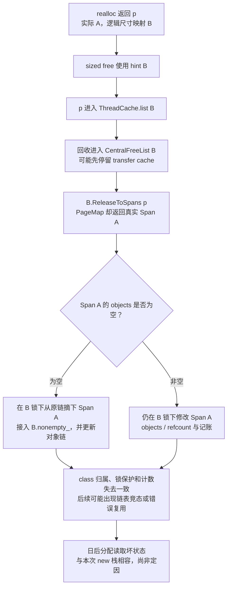

# dr_perception CentralFreeList 崩溃与 sized-free 错配排查记录

本次已确认：`dr_perception` 在申请一个 48B 对象时，tcmalloc 从 `nonempty_` 链上选中的地址读取到了空的对象链首指针，随即读地址 0 并触发 SIGSEGV。**sized-free 错配是与现场相容、且具备部分触发条件的候选原因；尚未证明这次历史崩溃由它引起。**

本文是截至 2026-10-22 的排查快照，存档位置不代表问题已闭环。普通小对象的完整数据结构和申请、释放流程见 [tcmalloc 小对象申请与释放流程图解](../撰修司/内存分配器/tcmalloc小对象申请与释放流程图解.md)，这里重点记录证据、候选因果链和下一步判据。

## 1. 背景与问题演变

此前排查中，用户提供过两个都落在 `CentralFreeList::FetchFromOneSpans+0x40` 的案例：一个申请约 1792B、上游线程涉及 Qualcomm OpenCL 编译，另一个申请约 48B、上游涉及 farseer/protobuf。不同分配尺寸、不同业务调用者出现相似 allocator 故障，使“分配器共享状态被提前破坏”成为重点方向。

这些信息不能单独证明系统性 allocator bug，也不能排除多个业务内存问题。此前提及的 `0924`、`1021` 是讨论中的案例标签；本次实际核验材料来自 **2026-09-17 的行程**，资料目录名为 `1022_tcmalloc_crash`。不把目录名、案例标签当作实际崩溃日期。

前期还讨论过业务越界写/UAF、DMA buffer、QNX 系统内存释放等方向。关于 DMA 使用 pmem、`TCMalloc_SystemRelease` 被 stub 的结论来自前期背景，本次没有对车端库的全部相关路径重新核实；不能将其扩大成“已排除所有业务越界写”或“已排除所有 allocator 竞态”。

随后发现上游修复 `868a588ad8afd5e6c9b795363a83fea282ecd491`（`unbreak interaction of realloc and free_sized`），以及内部 backport `46a74bef20ef898742f976ebfa23a63e3acfbc8c`。修复明确指出：旧 realloc 的保留缩容和增长补齐策略，会让调用者提供的新尺寸与实际 size class 不一致，从而与使用尺寸 hint 的释放路径冲突。

ASan 方案尚未跑通，因此采用“保留旧 realloc 行为，在错误对象进入缓存前核对 class 并 abort”的诊断方案。该检查已存在于本地源码提交 `0b07e0cf56fd09037bb7220a28343d82103249f1`，但它不是本次历史现场使用的二进制。

## 2. 输入材料、身份与证据等级

本地材料根目录：`/sandbox/temp/1022_tcmalloc_crash`。

| 材料 | 路径或标识 | 本文用途 |
| --- | --- | --- |
| 已恢复现场 | `crash_tombstone_out/dr_perception_2637940_crash_report.md` | 汇总寄存器、反汇编、函数级符号化结果 |
| 原始解析证据 | `crash_tombstone_out/evidence/parsed.txt` | 信号、PC、寄存器和模块映射 |
| 行程 | `YR-LPD19A-CMKpMVAD98BW_20260917_060846` | DEM 启动命令、元信息和进程日志 |
| 原始 dump | 行程内 `perception/tombstones/tombstone_dr_perception.dump.log.INFO.2637940.20260917.060859.150514` | 约 9KB 的 tombstone，不是全进程 core |
| 运行包 | `driver` | 检查真正发布的 ELF，而非用本地重编库替代 |
| 软件版本 | `1.0.50442136`，release `159478` | 来源为行程 `dem/ADS.METADATA` |
| 发布分支 | `release_candidate/prod_159478_Release_LP_8797_0912` | 记录来源，不据此推断 allocator 源码 SHA |
| 主程序 | `driver/opt/deeproute/perception/bin/mainboard` | Build ID `bd6724103a98e24759ff4f3af15f4c68` |
| allocator | `driver/opt/deeproute/common/lib/libtcmalloc_minimal.so.10` | Build ID `c662d6f027c193ab2881e77a1dc20164` |
| 源码参考 | `/sandbox/google-gperftools`，`0b07e0cf…` | 解释机制和描述诊断补丁；不是车端二进制身份证明 |

全文使用三个等级：**事实**来自本次文件、符号或反汇编；**机制推导**来自已检查的源码；**假设**仍需对象级或运行时证据。

## 3. 现场究竟在哪一步出错

### 3.1 调用路径与寄存器

```text
PredictionProcessorCalculator::Process
  → prediction::Processor::Process
  → fs::Runner::AsyncRun
  → fs::FillJunctionReferenceLineToObstacles
  → perception::base_proto::Corners::MergeImpl
  → RepeatedPtrFieldBase::MergeFromInnerLoop<Point3D>
  → 申请 48B 对象（调用点反汇编确认）
  → ThreadCache::FetchFromCentralCache
  → CentralFreeList::RemoveRange
  → CentralFreeList::FetchFromOneSpans
  → SIGSEGV
```

函数级符号化足以定位上述路径；原始展开里 `RemoveRange+0x…` 有重复帧，不把它据为递归证据。`operator new` 的分配行为由调用点分析确认，不要求 tombstone 中有一个独立的 new 栈帧。

| 项目 | 现场值 |
| --- | --- |
| PID / TID | `2637940 / 19` |
| 信号 / code | `SIGSEGV (11)` / `SEGV_MAPERR (1)` |
| fault address | `0x0` |
| PC | `libtcmalloc_minimal.so.10+0x12770`，即 `FetchFromOneSpans+0x40` |
| `x21`，本次 central 对象地址 | `0x0000004f3a799800` |
| `x22`，从 `nonempty_.next` 取出的值 | `0x00000011dc71ce70` |
| `x0` / `x20` | 均为 `0` |
| `w19`，本次取链计数 | `1` |

运行库自己的指令为：

```asm
0x12748: ldr x22, [x21, #80]     // nonempty_.next
...
0x12760: ldr x0,  [x22, #32]     // 按 Span 布局读取 objects
0x1276c: mov x20, x0
0x12770: ldr x4,  [x20]          // 第一个空闲对象的 next；实际访问地址 0
```

**事实：这次在对象链第一步读取时就遇到空链首，不是遍历了几个对象才遇到后续坏 next。** 这与函数偏移、`x20=0`、fault address 0 相互吻合。

### 3.2 能确认的状态，和不能确认的 Span 身份

按正常结构，`nonempty_` 上真实 Span 的 `objects` 应非空。现场因此说明这一预期已不成立，或者 `nonempty_.next` 根本不是正确的 Span。

这里需要保留一个重要边界：`ldr [x22+0x20]` 成功，只能说明那次读取可完成且读到 0，**不能证明 x22 是仍然有效、属于本 class 的 Span 描述符**。被覆盖的链接也可能恰好落在可读地址上。现有 dump 未提供足够的目标内存，无法核对其完整 `start/length/next/prev/sizeclass/refcount` 和 PageMap 身份。

因此本次结论不能写成“已证明 x22 是正常 Span，仅 objects 被改坏”，也不能写成“已证明 x22 是野指针”。两种可能都需后续元数据证据区分。

## 4. 为什么错误释放会在 new 中暴露

分配器的空闲对象链可以保存很久，错误释放和故障读取之间没有必须紧邻的关系。其正常工作方式详见原理文档；本案例只需记住：业务释放 → ThreadCache → transfer cache 或 Span freelist → 日后的分配。


图中 T0～T2 是候选时序，不是从本次 dump 还原出的历史记录。T3 的分配栈已确认，但不能反推更早出错的也是 Point3D、同一个线程或同一业务模块。

即使是业务 UAF/OOB，首次错误写也可能落在仍映射、可写的页中。OS 不知道那个地址对应的 C++ 对象是否已经销毁；换成系统 malloc 同样不保证第一次错误写就触发段错误。

## 5. realloc × sized free：成立需要哪些条件

### 5.1 旧 realloc 真正做了什么

旧 `do_realloc_with_callback` 用实际可用大小 `old_size` 判断是否移动。其原地保留区间是：

```text
old_size / 2 <= new_size <= old_size
```

对于 `old_size < new_size < old_size + old_size/4` 的小幅增长，它不是原地保留，而是尝试按约 `1.25 × old_size` 分配新块。因此**缩容保留旧块、增长时补齐到更大块**都可能让新逻辑尺寸对应的 class 与实际块 class 不同；不能把整个 `[old/2, old+old/4)` 都描述成“原地保留”。整数截断、溢出保护及分配失败回退以源码为准。

例如 `realloc(p, 160)` 前实际块为 256B：调用可能原址返回，真实 Span 仍为 256B class，而调用方按 160B 记录逻辑大小。只有 class 不同才是本问题关注的错配，尺寸数值不同但映射到同一 class 不构成此类错配。

### 5.2 释放入口必须作用在同一个指针上

要由该已知缺陷触发，至少需要：

1. 运行的 realloc 具有旧行为，某次成功 realloc 后，真实 class 与新尺寸对应 class 不同。
2. **这次 realloc 返回的同一个分配**，之后进入使用新尺寸 hint 的 `free_sized` / sized-delete 路径。
3. hint 被实际采用，没有被 hooks、采样/页对齐处理或大尺寸等路径回退为普通 free。
4. 此前没有诊断检查或修复把错配阻断。

只有“进程里有 realloc”和“进程里有 sized delete”两个独立事实，不能证明第二项。

`--enable-sized-delete` 的作用是把相应 C++ 全局 sized delete 重载接到 tcmalloc 的 sized 释放实现。编译器/库可能选择 `operator delete(p, size)`，即使业务没有写 `free_sized`。`-std=c++17` 只说明语言模式，具体生成行为还与编译器、flags、类型和重载选择有关；本次应优先用 ELF 符号核对，而不是仅凭语言标准猜测。

**普通 `free(p)` 不会因为 C++17 就自动变成 sized delete。标准容器也不会自动接管任意 realloc 返回的内存。** 标准 vector、string 等常见扩容并不等价于 C realloc；将 malloc/realloc 内存直接交给普通 delete/delete[] 还可能本身就是分配释放 API 不匹配。若涉及 placement new、自定义容器或 allocator，必须逐项检查其分配和释放契约。

### 5.3 从错 class 回收到 Span 的真实破坏机制

下面是源码允许的候选演化过程。A 为实际 class，B 为 hint class：



`DLL_Remove(span)` 根据 Span 的 `prev/next` 修改原链，不会检查原链归属。B 的锁不保护 A 的 central 链；两个 class 的代码可能同时操作同一个 Span 或它的邻居，进而造成摘链/插链丢失、旧节点仍被引用等异常。这是能够从“放错对象缓存”发展到“Span 链表出问题”的关键。

还要限定两点：

- 单线程、结构仍完好的执行中，`ReleaseToSpans` 会完成必要的摘链/接链和对象插入；一次错配**不必然**立刻留下 `nonempty_ + objects=NULL`。要解释本次现场，还需竞争、失效节点或其他后续状态破坏的证据。
- `FetchFromOneSpans` 沿已有 next 取对象，不会按 B 的步长把 A Span 重新切一遍。因此不能断言“256B Span 一进 160B class 就必然错位分配并覆盖相邻前 8B”。错误大小重用可能在特定条件下引起覆盖，但不是已核实的必经步骤。

这类错误起初是**错误归类/契约破坏**，不能未经证据直接命名为 UAF；后续可能演化为重复分配、失效引用等内存破坏。

## 6. 从运行包找到了哪些入口

### 6.1 allocator 接管与 sized delete

DEM 启动日志记录 `dr_perception` 命令含：

```text
env LD_PRELOAD=/opt/usr/oem/opt/deeproute/common/lib/libtcmalloc_minimal.so.10 .../dr_perception ...
```

与 tombstone 的 allocator 模块映射和栈一致。环境里虽有 jemalloc 格式的 `MALLOC_CONF`，不能据此认为该进程实际用了 jemalloc。

运行包 `mainboard` 的 `.dynsym` 有以下未定义符号：

```text
UND realloc
UND operator delete(void*, unsigned long)
UND operator delete[](void*, unsigned long)
```

allocator 库则把以下符号导出在同一地址 `0xd080`：

```text
operator delete(void*, unsigned long)
operator delete[](void*, unsigned long)
tc_delete_sized / tc_deletearray_sized / tc_free_sized / free_sized
```

这证明二进制有这些链接入口。在 LD_PRELOAD 配置下，它们具有进入 tcmalloc 的条件；尚没有当时 GOT 实际绑定值或调用轨迹，不能把“可链接到”扩大成“此次每个调用必定绑定到”。

### 6.2 realloc 引用范围与局限

| 检查对象 | 已确认的静态证据 | 能说明什么 |
| --- | --- | --- |
| perception `mainboard` | `realloc` 的 UND 动态符号；`0x4958510` 为 `R_AARCH64_JUMP_SLOT realloc`，另有 ABS64 引用 | 存在可供调用/函数指针使用的入口，可能来自静态链接进来的三方代码 |
| `libgomp.so.1` | UND `realloc`；tombstone 映射有该库 | 属于现场已映射且具有 realloc 入口的依赖，未证明何时调用 |
| 随包 `libtiff`、`libcares` | UND `realloc` | 包内具有入口，不能据此说这次 perception 已加载 |
| 随包 QNN GPU/CPU、Genie 等组件 | 多个 AArch64 ELF 有 UND `realloc` | 说明潜在库路径；各库是否加载/执行需独立确认 |
| 现场 `libllvm-qcom-full.so` 等 BSP 库 | tombstone 列为已映射，但当前 driver 包中未提供对应文件 | 本轮未完成这些库的 realloc 调用点审计，不能用“未搜到”排除 |
| Hexagon DSP 库 | 包内存在 `__wrap_realloc` 引用 | 与 AArch64 perception 进程的地址空间、allocator 不可直接混为一谈 |

因此，“perception 中是否存在 realloc 引用”的答案是**有**；“它在哪个源码函数中实际执行、对哪个对象执行、之后由谁 sized free”的答案仍未知。单独的 UND 符号或重定位不等于已找到一条执行过的调用指令，也可能只是函数地址被保存。

包内没有独立的 `perception/lib` 目录不代表无依赖；主程序可以静态链接大量库，并使用 common/BSP 路径的共享库。不能将整个 driver 包里搜到的所有库都算入 perception 的运行依赖。

## 7. 修复、诊断版本与历史包不能混用证据

| 对象 | 内容 | 当前证据边界 |
| --- | --- | --- |
| 上游 `868a588ad8afd5e6c9b795363a83fea282ecd491` | 移除不兼容 sized free 的 realloc 缩容保留/增长补齐；仅新尺寸对应可用大小相同时原地保留 | 缺陷机制和修复源码已核对 |
| 内部 `46a74bef20ef898742f976ebfa23a63e3acfbc8c` | backport 上述修复 | 提交内容已核对，不证明旧运行包已包含它 |
| 本地 `0b07e0cf56fd09037bb7220a28343d82103249f1` | 保留旧 realloc；hint class 与实际 Span class 不同则 stderr 日志并 SIGABRT | 诊断实现已核对；不是业务现场已跑过的证明 |
| 车端 allocator Build ID `c662d6…` | 本次历史崩溃实际库 | 尚未建立与源码/构建输入的完整对应，也未在本轮完整反汇编其 realloc 来证明保留了旧策略 |

前期用户判断“问题版本没有带修复”，应作为待核对的版本线索。修复日期早于 driver 打包日期不证明补丁被打入；本地分支没有修复，也不自动证明旧包的具体源码状态。

诊断检查在 `src/tcmalloc.cc:1550` 之后，对实际采用小对象 hint 的路径读取 PageMap，比较 `span->sizeclass` 与 hint class。异常输出 `ptr`、`size_hint`、`hint_class`、`actual_class`、`span`、`page_id` 并 `abort()`，在进入 ThreadCache 前阻断，不主动修正 class。

当前补丁没有保存 realloc 历史。**即使新运行捕获 class mismatch，也首先只证明“当时该释放的 hint 与元数据不一致”**；还需区分真实 realloc 后错配、调用者传错 size、无效指针、生命周期错误或此前 Span 元数据已损坏。日志和 abort 栈是定位入口，不应直接当作 realloc 根因的充分证明。

## 8. 竞争假设与下一步验证判据

| 假设 | 与本次现场的关系 | 最有价值的新增证据 |
| --- | --- | --- |
| 旧 realloc 后同一分配进入错误 sized free | 机制相容，静态入口存在 | 同一分配的 realloc 前后 class、返回指针和释放 hint/调用栈 |
| 调用方直接传错 sized hint，或分配释放 API 混用 | 同样能错误归类，不必经过 realloc | abort 栈、对象所有权和释放参数的来源 |
| 业务 OOB / UAF / double free | 可直接破坏对象链，或间接破坏更高层结构 | 首次异常写、重复释放轨迹、目标地址所属区域 |
| allocator 锁/Span 生命周期等其他缺陷 | 可能表现为 nonempty 中空/失效节点 | central class 与 Span class、双向链接和并发操作轨迹 |

建议按以下顺序补证：

1. **锁定运行输入。** 记录诊断库 Build ID、SHA256、构建 flags、driver 版本，并确认目标进程 preload 的实际文件；用同输入回灌。Linux UT、交叉构建结果不能代替目标机复现。
2. **运行已有 class mismatch 诊断。** 保存完整 stderr、SIGABRT tombstone 和匹配符号。若仍是原来的 SIGSEGV，先核实库是否实际加载、日志是否保存、错误路径是否被检查覆盖。
3. **触发 mismatch 后追踪对象来源。** 将 realloc 的返回指针、请求大小、前后实际 class、调用点与释放事件配对；地址可能被复用，要区分分配代次，不能只凭一次地址相同认定同一生命周期。高频路径记录避免动态分配递归，采用有界记录，不无差别打印每次分配。
4. **必要时增加 central 入口检查。** 在改链前验证 `ReleaseToSpans` 的 central class 与 PageMap 的 Span class；在取链前检查 `nonempty_` 节点身份及 `objects`。这能缩短发现时间，但发现“不一致”仍不等于定位第一次破坏者。
5. **继续业务内存检查。** 根据对象/Span 地址区分用户堆和元数据，检查写边界、并发所有权与重复释放；没有 mismatch 不能立即排除业务或其他 allocator 问题。

若同一分配的轨迹完整显示“旧 realloc 造成 class 不一致 → 正确逻辑大小的 sized 释放 → 诊断中止”，可证实已知缺陷在该运行中实际触发。要进一步归因为本次历史 crash，仍需控制变量复现、损坏链条或有力对照；修复后短期不崩不能单独证明历史根因。

## 9. 日志和 dump 的边界

本次只在 perception 目录发现非零 tombstone，其余列出的模块文件为 0B；这不等于系统其他模块从未发生异常。perception 日志末尾的 watchdog/channel timeout 可以是崩溃后果，无法解释谁修改了 allocator 指针。

DEM 后续发 SIGINT、再发 SIGKILL，最终退出码 137，不会否定 tombstone 捕获到的 SIGSEGV；进程退出过程和首次异常现场是不同事件。tombstone 的 `CLOCK_MONOTONIC` 数值也不能直接当成进程运行时长加到启动墙钟时间上。

两个 ELF 保留 `.symtab` 但没有所需 DWARF，能得到函数和指令级证据，无法可靠恢复源码局部变量。原始 dump 不包含整个 central cache、PageMap 和堆；不能凭缺失的内存内容计算 Span 的实际 class，也不能把其他 Build ID 的 DWARF 套到这个现场。

## 10. 复查命令和源码依据

以下命令只读现有文件，不修改运行包；从 `/sandbox/temp/1022_tcmalloc_crash` 执行。主程序较大，优先限制输出范围。

```bash
llvm-readelf -n driver/opt/deeproute/perception/bin/mainboard
llvm-readelf -n driver/opt/deeproute/common/lib/libtcmalloc_minimal.so.10

llvm-readelf --dyn-syms driver/opt/deeproute/perception/bin/mainboard \
  | c++filt | rg 'realloc|operator delete.*unsigned long'
llvm-readelf -r driver/opt/deeproute/perception/bin/mainboard | rg 'realloc'
llvm-nm -D -C driver/opt/deeproute/common/lib/libtcmalloc_minimal.so.10 \
  | rg 'realloc|free_sized|delete.*sized|operator delete'

llvm-objdump -d -C --start-address=0x12730 --stop-address=0x127b8 \
  driver/opt/deeproute/common/lib/libtcmalloc_minimal.so.10

rg -n 'perception.*Execute command' \
  YR-LPD19A-CMKpMVAD98BW_20260917_060846/dem/dem.log.*
```

源码与修复依据：

- [旧 realloc 及当前诊断分支源码：tcmalloc.cc:1630](https://code.deeproute.ai/third-party-repos/google-gperftools/-/blob/0b07e0cf56fd09037bb7220a28343d82103249f1/src/tcmalloc.cc#L1630)。
- [进入缓存前的 hint class 诊断：tcmalloc.cc:1550](https://code.deeproute.ai/third-party-repos/google-gperftools/-/blob/0b07e0cf56fd09037bb7220a28343d82103249f1/src/tcmalloc.cc#L1550)。
- [ReleaseToSpans：central_freelist.cc:92](https://code.deeproute.ai/third-party-repos/google-gperftools/-/blob/0b07e0cf56fd09037bb7220a28343d82103249f1/src/central_freelist.cc#L92)。
- [上游修复 868a588](https://github.com/gperftools/gperftools/commit/868a588ad8afd5e6c9b795363a83fea282ecd491)。
- [内部 backport 46a74be](https://code.deeproute.ai/third-party-repos/google-gperftools/-/commit/46a74bef20ef898742f976ebfa23a63e3acfbc8c)。

本记录只归档已取得的分析证据；未声明该车端包根因已证实、诊断库已上线或问题已修复闭环。
