# 抓包为什么会卡住自动驾驶：TPACKET_V3 从应用到内核的完整讲解

车辆正在自动泊出，突然提示定位时间戳异常并退出。沿着日志向上查，定位在等 IMU，IMU 数据在等网络，而网络线程最后竟然在等“抓包副本复制完成”。一个本来用于记录现场的诊断功能，进入了业务网络的关键路径。

本文围绕 **Tag 288303130、行程 `YR-C01-88_20261020_054144`**，解释这条链为什么成立，以及两版候选内核补丁分别改变了什么。阅读不要求提前理解 Linux 网络栈或实时内核；遇到函数名时，可以先看旁边的中文含义，再回头对照代码。

::: tip 阅读路线
第一次阅读建议按顺序读第 1～8 节，建立业务、内存和并发三个层面的图景；再读第 9～11 节理解修复。第 12 节集中澄清原资料中容易误读的说法，第 13～15 节用于复核与查词。
:::

::: info 资料与结论的范围
本文完整读取了用户提供的专项诊断 [S1]、方案评审页 [S2]，以及关联初诊 [S3]、两版补丁、补丁分析与验证记录 [S4～S6]；另外核对了 **Linux v5.15.122** 的实现和官方文档 [S7～S11]，并阅读本地应用代码。

本文没有重新下载现场全量日志和 bag，没有在 Orin 上运行候选内核。现场数值来自报告；补丁测试成绩来自方案作者的验证记录；本文独立核实的是源码机制、补丁控制流与这些结论之间的关系。下文分别说明观测、源码推导和待验证项。
:::

## 1. 先认识这辆车的数据链路

### 1.1 自动泊出依赖的是一条持续更新的数据流

自动驾驶系统不能只知道“曾经收到过数据”，还必须知道“现在收到的数据够不够新”。

IMU 提供加速度、角速度等惯性测量；车辆状态提供车速、转向等信息；定位模块据此持续估计车辆的位置、姿态和运动状态，输出 `pose`。控制模块结合这些状态和规划结果产生控制指令。Safety 监测异常，BLC 负责本案例中的泊车功能状态与中止动作。

下面按本案例的相关数据流绘制，省略不影响理解的模块；它不是整车所有通信连接的完整拓扑。

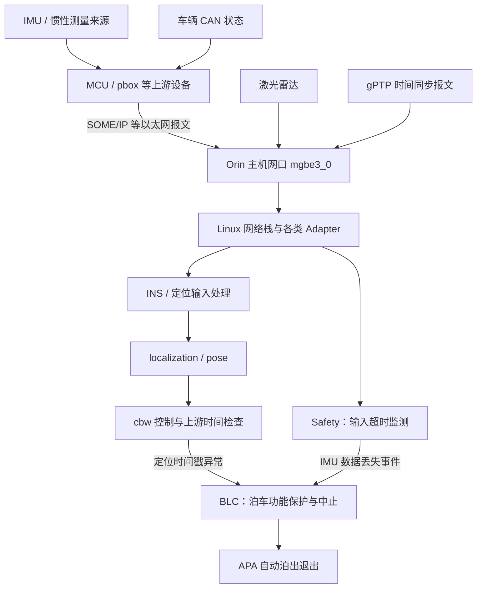

**SOME/IP** 可以先理解为“车载以太网上承载服务和数据的一套通信协议”；**gPTP** 用于设备间时间同步。本次不需要先学会它们的报文格式，只需知道：这些不同种类的数据共享 `mgbe3_0` 这一段主机网络处理路径。

因此，IMU、CAN 状态、雷达和时间同步同时超时，优先提示的是**公共路径发生停顿**。不能仅凭最后出现的 `CONTROL_LOCALIZATION_TIMESTAMP_INVALID`，就把故障定位到 control 或 localization。

### 1.2 为什么晚到的数据仍然会触发保护

假设正常每 10ms 来一次 IMU 数据。主机 356ms 没有把新报文送到应用，约相当于连续 **36 个 10ms 周期**没有及时更新。随后数据集中到达，也无法补回控制环在过去那段时间所缺失的实时输入。

可以把它想成驾驶员的挡风玻璃短暂变黑：恢复时看到更多历史画面，也不能让那段盲区中的实时判断重新发生。

这里至少有三种时间，必须区分：

| 时间 | 含义 | 停顿时可能怎样变化 |
| --- | --- | --- |
| 测量时间 | 传感器实际测量、数据所对应的时刻 | 仍可能连续或单调递增 |
| 主机网络时间戳 | 主机在网络处理的某个阶段给报文记录的时间 | 受时间戳采集位置影响 |
| 应用接收/发布时间 | Adapter、定位或 recorder 收到/发布数据的时间 | 可以长时间无更新，恢复后集中出现 |

这就是为什么“序号连续、测量时间没有回退”和“实时业务已经超时”可以同时成立。**可靠保留历史数据与及时交付实时数据，是两项不同要求。**

### 1.3 本次到底观察到了什么

下表取自专项诊断，时间统一为 **2026-10-20 UTC**。[S1]

| 时刻 | 事件 | 与故障的关系 |
| --- | --- | --- |
| 07:28:27.428606 | 抓包记录中，长间隔前的最后一个报文时间戳 | 网络停顿窗口的一端 |
| 07:28:27.629 | IMU 输入报告约 200ms 未更新 | 上游断供已经超过保护阈值 |
| 07:28:27.674718 | Safety 记录 IMU raw data lost，事件 57511 | 保护链开始动作 |
| 07:28:27.784467 | 长间隔后的第一个报文时间戳 | 两端相差 **355.861ms** |
| 07:28:27.78～27.82 | 短时间出现数千包积压回灌 | 支持主机处理延迟的解释 |
| 07:28:27.805 | 定位 pose 恢复发布，接收断档约 0.37s | 定位是下游受影响者 |
| 07:28:27.825638 | cbw 检查到 `time_gap=0.33s`，阈值为 0.3s | 上游检查触发异常 |
| 07:28:27.928425 | `BLC_FEATURE_AUTO_ABORT_EVENT` | 自动中止泊车功能 |
| 07:28:30.023 | 状态进入 `APA_SYSTEM_FAILURE` | 用户感知到的功能退出结果 |

注意：`355.861ms` 的抓包时间戳间隔、约 `355ms` 的 IRQ 等待、约 `0.37s` 的 pose 断档属于不同观测，不能当成同一个计时器的读数。它们在同一窗口中相互支持；原诊断的个别起点表述也不完全一致，本文不把它们强行拼成微秒级全量调度轨迹。

## 2. 为什么车上要抓包，以及抓包运行在哪里

### 2.1 pcap_capture 是一位“通信记录员”

`pcap_capture` 记录选定网口上的报文，用于事后诊断：报文有没有到、先后顺序如何、当时携带了什么字段。其数据还可以打包为 `/pcap_capture/packet_array`，由 recorder 写入 bag。

从用户态看，处理层次大致如下：

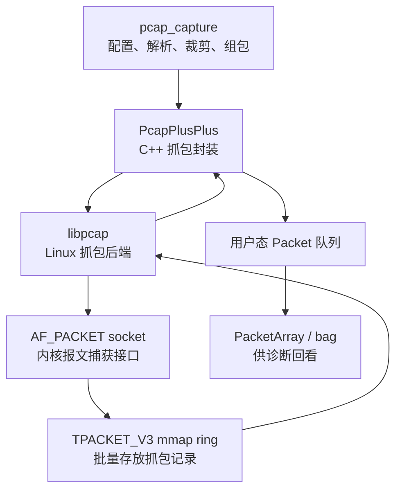

这里的 **AF_PACKET** 是 Linux 提供的链路层报文接口，区别于业务常用的 UDP/TCP socket。`pcap_capture` 不必代替 IMU 接收服务处理原报文，而是拿到一份用于观察的捕获副本。

**TPACKET_V3** 是这个接口的一种内核与用户态之间的存储、交付格式。它不是新的车载网络协议，线上发送的也不是“TPACKET_V3 报文”。

### 2.2 最关键的区别：配置抓包的线程，不一定是执行复制的线程

直觉上容易认为：既然是 `pcap_capture` 抓包，开销和等待就都在它的线程里。Linux 的实际处理不是这样。

`pcap_capture` 负责创建 socket、配置 ring、设置过滤器，并读取已完成的 block。**把网络报文复制进 ring 的 `tpacket_rcv()`，却由网络路径同步调用。**

| 工作 | 常见执行上下文 | 本案例中的角色 |
| --- | --- | --- |
| 创建、配置、读取抓包 socket | 抓包进程用户态线程 | `pcap_capture` |
| 对入站报文执行捕获与复制 | RX 网络处理上下文，RT 平台可涉及 IRQ 线程/softirq | `irq/46-mgbe3_0` 等 |
| 对出站报文执行捕获与复制 | 调用发送接口的业务线程，或后续发送上下文 | 现场唤醒链中的 `McuLogService` |
| block 超时检查与回收 | 内核 timer 回调 | 不依赖用户态主动读包 |

应用线程执行 `sendto()` 后会进入内核；此时线程名仍然可能是 `McuLogService`，但正在运行的是网络栈和抓包代码。因此，“一个 MCU 日志服务怎么会持有抓包锁”并不矛盾。

**把 pcap_capture 的用户态线程移出某个 CPU，并不能同步把 RX/TX 中的所有抓包复制也移走。**

### 2.3 入站和出站如何交汇到同一个抓包 ring

下面针对本次基线 Linux 5.15 的普通网络路径，省略 GRO、VLAN 等细节。XDP、特殊卸载和其他内核版本应另行核对。[S7、S8] 图较宽，可横向滚动查看。

<div style="overflow-x: auto;">

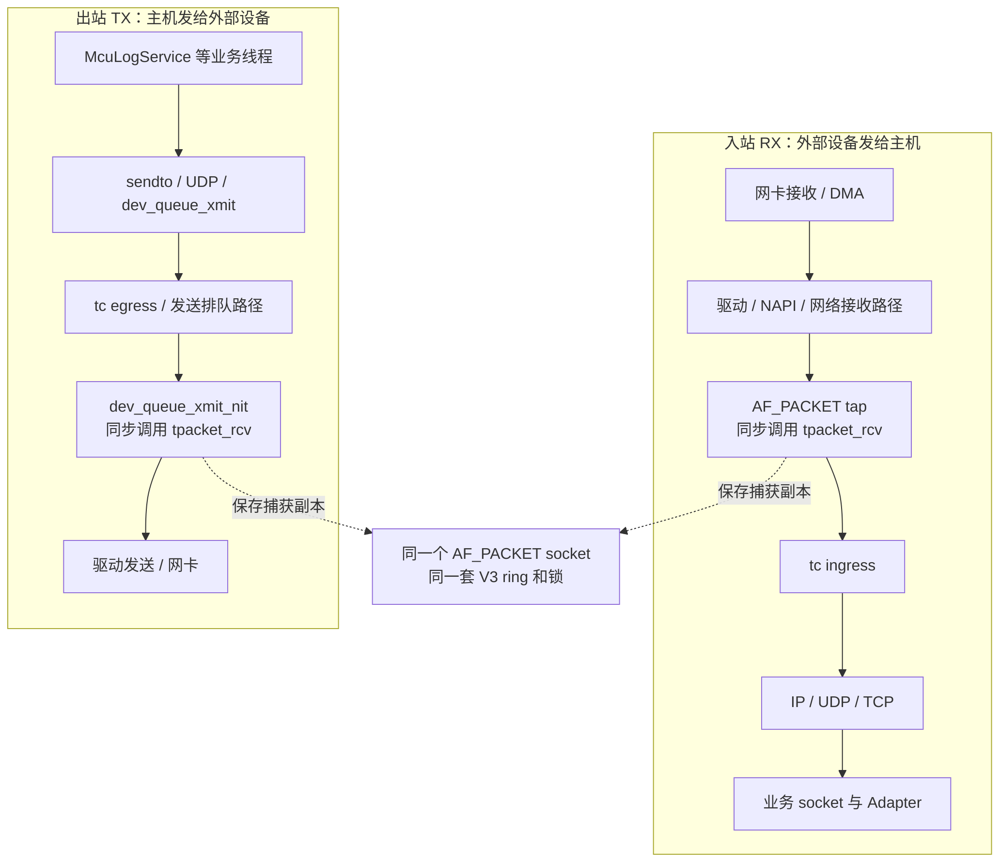

</div>

图中虚线表示副本存储关系，**不表示一个与业务线程完全隔离的后台任务**。调用者必须等 `tpacket_rcv()` 返回，才能继续原来的网络处理。

入站抓包点位于同接口的 tc ingress 之前；出站 tap 位于正常发送路径的驱动发包之前。因此同一个捕获 socket 既可能被 RX 线程写，也可能被 TX 线程写。该 socket 的 `rx_ring` 中的“rx”，指的是**向抓包 socket 交付的接收环**，它也可以装来自网卡发送方向的 `PACKET_OUTGOING` 记录。

这不是 `PACKET_TX_RING` 的主动发包功能，二者不要混淆。

## 3. 从 skb 到 mmap：到底复制了什么

### 3.1 三种“缓冲区”不是同一个东西

排查这类问题，先分清以下三处存储：

| 对象 | 谁管理 | 装什么 | 本次是否正在等它的空间 |
| --- | --- | --- | --- |
| 网卡硬件 RX ring / DMA 缓冲 | 网卡和驱动 | 网卡接收描述符及报文数据 | 不是被定位的直接等待资源 |
| `sk_buff`，简称 skb | Linux 网络栈 | 内核中的报文元数据与数据引用 | 是抓包复制的来源 |
| TPACKET mmap ring | AF_PACKET socket | 给抓包程序读取的报文记录 | 本次锁等待发生在它的 block 完成同步上 |

`struct sk_buff` 可以想成一张“报文说明卡”：描述长度、协议、接口、校验和、时间戳，并引用实际字节。报文字节不一定都连续存放，`skb_copy_bits()` 用来把其中指定范围复制到目标内存。

`skb_clone()` 通常克隆元数据并共享底层报文字节，不等于立刻深拷贝整个 payload。**把字节写入 TPACKET ring 的 `skb_copy_bits()`，则是实实在在的数据复制。**

### 3.2 mmap 为什么没有消除这次复制

`mmap()` 把内核分配的抓包 ring 映射到抓包进程的地址空间。内核写好后，用户态可以直接读取这片内存，减少逐包 `recv()` 和额外搬运。

但 skb 原来引用的存储，与抓包 ring 是不同的存储。标准 AF_PACKET V3 接收路径依然执行：

```c
skb_copy_bits(skb, 0, h.raw + macoff, snaplen);
```

其中 `h.raw` 是本次预留的记录起始地址，`macoff` 指向该记录内的链路层数据，`snaplen` 是实际保留的字节数。[S7，`tpacket_rcv()`]

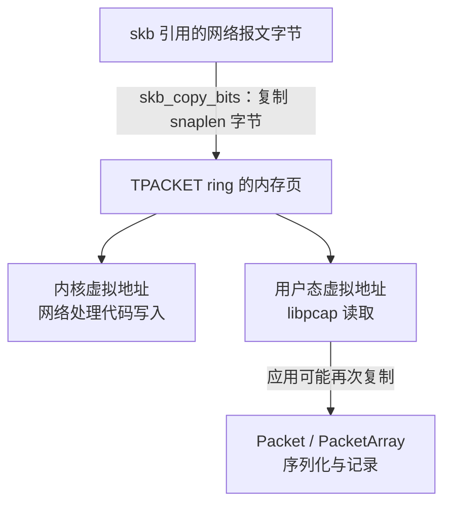

同一片 ring 内存页可以有两个虚拟地址视图；这不代表网卡最初就直接把数据 DMA 到了这套抓包 ring，也不代表后面的应用组包完全没有复制。

### 3.3 snaplen、原始长度、用户态裁剪

例如原报文有 1500 字节：

| 操作 | 在哪里发生 | ring 中可能写入多少字节 | 主要节省什么 |
| --- | --- | --- | --- |
| 捕获 snaplen 设为 256 | 内核复制之前 | 最多 256 字节报文数据，另有元数据/对齐开销 | ring 带宽、容量、复制工作量 |
| 内核 socket BPF 拒绝该包 | ring 预留之前 | 不为该包写入记录 | 预留、复制和后续处理 |
| 用户态 `payload_strip` 只保留头部 | libpcap 已交付之后 | 已发生的 ring 写入不会被撤销 | 后续应用内存、序列化和存储 |

`tp_len` 表示原报文长度，`tp_snaplen` 表示实际捕获长度，二者可以不同。不能把“最终 bag 里 payload 很短”直接当成“内核当时只复制了这么短”。

## 4. TPACKET_V3 的数据结构：一圈箱子，每箱装多包

### 4.1 ring、block、packet record 三层关系

**ring** 是固定容量的环形缓冲；它分成多个 **block**；一个 block 中又打包多个可变长度的 **packet record**。可以类比为循环使用的一圈货箱，每个箱子装若干件货物。

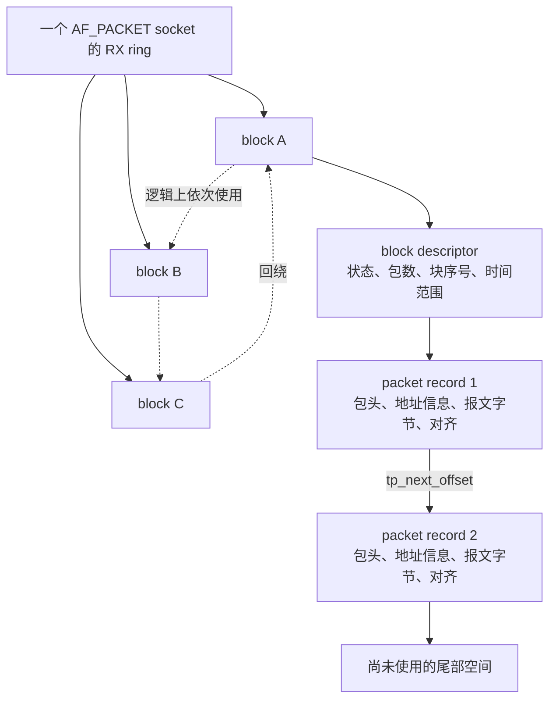

block 是内核与用户态交接的批次单位。V3 不需要每写完一个包就把整块交出去，这能摊薄通知和系统调用成本；但相应地，必须知道**整块中所有已预留记录是否真的完成**。

### 4.2 只保留与本次问题有关的字段

以下是概念摘录，省略了 ABI 中的其他字段，不能拿它替代真实系统头文件。[S9]

```c
// 映射给用户态的 block 描述信息
struct tpacket_hdr_v1 {
    __u32 block_status;        // 当前由内核还是用户态持有
    __u32 num_pkts;            // 该块记录数
    __u32 offset_to_first_pkt; // 第一条记录距 block 起点的偏移
    __u32 blk_len;             // 已使用的有效范围，包含相关对齐开销
    __aligned_u64 seq_num;     // block 的序号
    // ts_first_pkt、ts_last_pkt 等
};

// 每个 packet record 的头部
struct tpacket3_hdr {
    __u32 tp_next_offset;      // 到下一条记录的字节偏移
    __u32 tp_sec, tp_nsec;     // 这条记录的时间戳
    __u32 tp_snaplen;          // 实际保留的报文字节数
    __u32 tp_len;              // 原报文长度
    __u32 tp_status;           // 校验和、VLAN、时间戳来源等标志
    __u16 tp_mac, tp_net;      // 链路层、网络层数据的位置
    // VLAN / rxhash / padding 等
};
```

遍历时，先根据 `offset_to_first_pkt` 找第一条记录，再根据每条记录的 `tp_next_offset` 找下一条。最后一条记录的 `tp_next_offset` 在交付时收尾为 0。

**包头中的 `tp_status` 和 block 的 `block_status` 不应混为一谈。**V3 的用户态读取流程首先看 block 是否已经交接，不能因为某条记录的头部已经有字段，就提前读取尚未发布的整个 block。

### 4.3 用户态可见的所有权协议

在这里，`TP_STATUS_KERNEL` 表示由内核管理，`TP_STATUS_USER` 位表示已交给用户态读取。

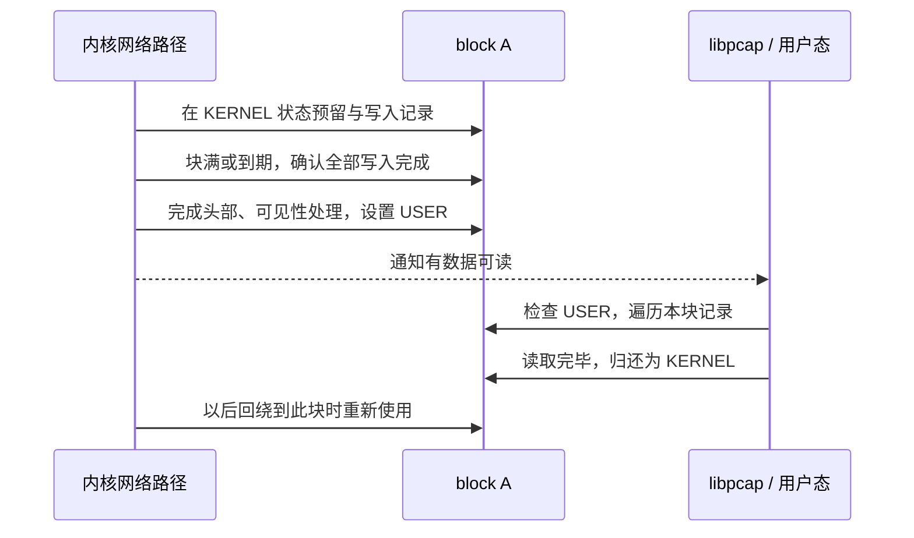

交接不只是改一个数字。内核必须先保证数据和元信息对用户态可见，再发布状态；特定架构还涉及 cache 维护。用户态也必须遵循对应的读取与归还约定。**状态位是所有权协议的一部分，不能脱离同步顺序单独理解。**

### 4.4 “块满”和“超时”为什么都要回收

如果只在块满时交付，低流量时一个 block 可能很久填不满，用户态迟迟读不到已经到达的包。因此 V3 有 block 退休超时 `tp_retire_blk_tov`，到期时可以交付部分填充的块。

这里的 retire 可以译成“停止使用当前写入块并准备交付”，原资料也叫“回收”。它**不等于释放物理内存**，更不等于马上把旧块清空重用。

需要区分四个动作：

1. **预留**：给某个包划出独占的记录范围。
2. **封口**：停止向这个 block 分配新记录。
3. **发布**：确认已有记录全部完成，把 block 交给用户态。
4. **复用**：用户态归还后，未来再次打开并写入该 block。

原实现把其中一些动作紧密串在一起。第二版补丁的核心，就是把封口与发布进一步拆开。

### 4.5 20MB 是总仓库容量，不是每只箱子的容量

总 ring 容量大致为：

```text
ring_bytes = tp_block_size × tp_block_nr
```

本例应用配置的 `packet_buffer_size_m: 20` 经本地代码转换为 `20 × 1024 × 1024` 字节，传给抓包库；实际 block 大小和数量还由 libpcap 后端等决定。现场报告没有给出完整 `tpacket_req3` 参数，不能据此认定“每块就是 20MB”。

这一区别关系到调参效果：增加 block 数量主要增加总缓冲时间；增加单块容量才直接改变在相同捕获字节率下的块满频率。

## 5. 为什么复制阶段拿的是“读锁”

### 5.1 两个锁各自保护什么

原实现有两道关键同步：[S7]

| 锁 | 本文简称 | 保护目标 | 关键持有范围 |
| --- | --- | --- | --- |
| `sk_receive_queue.lock` | Q：队列锁 | 分配记录、推进当前 block、修改 ring 管理状态 | 预留和回收阶段 |
| `blk_fill_in_prog_lock` | F：复制完成读写锁 | 让发布方确认没有未完成 copier | 复制者跨越 payload 和包头写入持读锁；回收方取写锁等待 |

Q 防止两个 CPU 把同一段空间分给不同报文；F 防止回收方把“已经分配但尚未写完”的记录交给用户态。

**已经预留空间 ≠ 内容已经完成。**`num_pkts` 在预留阶段就会增加，因此“包数非零”也不能证明复制已经完成。

### 5.2 读锁并不是“只读报文字节”的意思

普通读写锁允许多个读锁持有者并存，写锁则必须独占。这里借用了这个并发关系：

- 每个 copier 拿一把读锁，相当于登记“我还在写自己那一段记录”。
- 不同 copier 的记录范围已由 Q 分开，所以可以同时写不同位置。
- 回收方取写锁，相当于请求“我要确认所有在途 copier 都已退出”。

所以，**这些所谓 reader 实际在写 ring 的报文字节**。“读者/写者”只是 F 这把同步锁的角色，与“抓包进程读取数据”和“内核写报文”不是同一套命名。

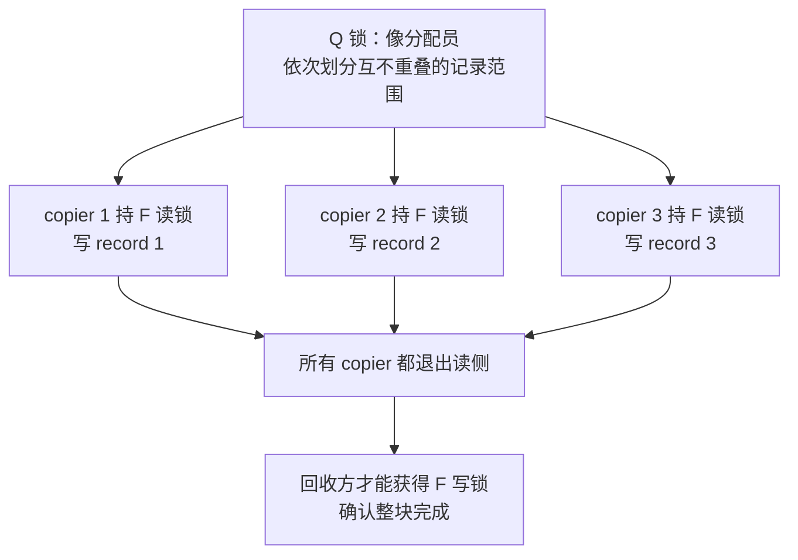

### 5.3 正常路径刻意把大段复制放在 Q 锁外

下面是原实现的逻辑简写，省略错误处理、时间戳细节和架构分支：

```c
// tpacket_rcv()：当前 RX/TX 网络上下文执行
if (socket_filter_rejects(skb))
    return;                         // 不保存捕获副本

lock(Q);
record = reserve_record_in_current_block();
read_lock(F);                       // 实际在 prb_fill_curr_block() 中
unlock(Q);

skb_copy_bits(..., record, snaplen); // 可以与其他 copier 并行
write_packet_header_and_timestamp(record);

read_unlock(F);                     // prb_clear_blk_fill_status()
```

如果一直拿着 Q 做 payload copy，多个 CPU 就必须串行复制全部报文。因此“先锁内预留、再锁外复制”的设计有合理的吞吐考虑。

它同时引入一个并发窗口：**Q 已释放，F 的读锁还没有释放。**其他 CPU 可以在这段时间进入 Q，并发现当前 block 已经没有足够空间。

### 5.4 问题就发生在“当前块放不下下一包”的时候

原来的块满路径可简化为：

```c
lock(Q);
if (current_block_cannot_fit_packet) {
    write_lock(F);       // 等全部在途复制者退出
    write_unlock(F);
    close_current_block_and_publish_USER();
    open_next_block();
}
unlock(Q);
```

获得 F 写锁后立刻释放，并不是没有意义：**“曾经成功独占”本身就证明旧 copier 全部退出了**。在此期间 Q 仍由回收方持有，不会有新的记录预留者进入并登记 reader，所以可以安全收尾、发布。

这套协议在内容完整性上有明确目的。风险出在等待方式：回收方**持着 Q 等 F**，而 F 读侧的完成时间可能取决于另一个线程何时继续运行。

## 6. 从一名慢 copier 扩大成网络停顿

### 6.1 一个最小例子

假设 block A 只剩足够容纳一包的空间：

1. CPU0 上的 `McuLogService` 正在发 UDP，出向 tap 为该包预留 A 的最后一条记录。
2. 它拿着 F 读锁，放开 Q，开始复制；随后其完成被延迟。
3. CPU1 的 RX 路径要保存下一个包，拿到 Q，发现 A 放不下了。
4. RX 路径为了发布 A，申请 F 写锁，等待 CPU0 的 copier。
5. Q 被这个等待者一直持有；其他 RX/TX 捕获调用也需要 Q，只能排队。

下面是机制示意，不是现场逐 CPU 的精确排程；尤其没有把 CPU0/CPU1 对应为某两个已证实的现场核号。时序图可横向滚动查看。

<div style="overflow-x: auto;">

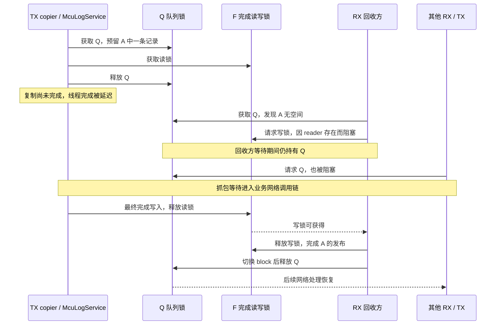

</div>

现场支持这一机制的关键观测是：`irq/46-mgbe3_0` 的等待栈落在 `prb_retire_current_block()`，而唤醒链来自 `McuLogService → UDP 发送 → tpacket_rcv → rt_read_unlock`。[S1、S2]

### 6.2 等待依赖图比“CPU 很忙”更能说明问题

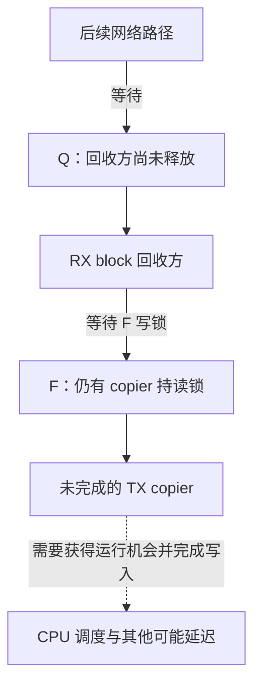

这是 **lock convoy**，可以译成“锁等待队列被一个慢环节拖住”，原报告称“锁护航”。不必存在锁依赖环，因而不应直接叫作死锁。copier 最终释放读锁后，队列仍可恢复。

也不能把 355ms 直接解释为“复制这些字节本身用了 355ms”。它是**完成墙钟时间**：可能包含实际执行、抢占、迁移以及其他等待。短小代码段只要可被延迟，也可能成为长时间依赖。

### 6.3 为什么更多网卡线程和 socket 调用也会受影响

除了同 socket 的 Q，网络路径还涉及 bottom half，简称 BH，即软中断相关处理。在 PREEMPT_RT 平台，BH 的并发保护与普通内核的简单直觉不同，可能通过每 CPU 的可阻塞同步实现。

专项诊断中，部分其他 IRQ、`ksoftirqd` 和 socket 调用的等待栈落在 `__local_bh_disable_ip()`。这支持“抓包等待经由更外层网络/BH 同步扩散”的解释。报告还记录 `mgbe3_0` 的五个队列 IRQ 集中在 CPU9，容易扩大同一处理核停顿的影响。[S1]

但要分清两类说法：

- **机制确定**：Q 和 F 属于该 packet socket 的 ring 管理，不是全系统所有网卡共用的一把抓包锁。
- **现场范围**：同一窗口中多个网络线程和多路业务同时受影响；评审页重点列出 IRQ 45～48，专项报告还列出 IRQ44 等 BH 等待者。

因此，“mgbe3_0 相关数据面出现广泛停顿”比“Linux 所有网卡、所有 socket 无例外被冻结”更准确。不要把某个 CPU 的 BH 等待解释为所有核共用同一把 BH 锁；每条传播关系仍应结合线程栈与 CPU 归属核对。

## 7. PREEMPT_RT 为什么会放大这个窗口

### 7.1 什么是实时内核

实时系统重视的是任务能否在期限内得到执行，而不只是平均吞吐。PREEMPT_RT 把许多原本不可抢占的内核活动改成可以调度的执行上下文，使高优先级任务更容易及时运行。

但它不意味着“凡是有锁就不会发生长延迟”。锁类型与调度策略必须一起分析。

| 概念 | 非 RT 内核中的常见行为 | PREEMPT_RT 下与本文有关的变化 |
| --- | --- | --- |
| `spinlock_t` | 忙等，并限制抢占 | 使用基于 RT mutex 的实现，可以阻塞等待 |
| `rwlock_t` | 自旋型读写锁 | 使用 RT 专门实现，允许相关临界区被抢占 |
| 中断处理 | 许多工作不能按普通线程调度 | 许多中断处理线程化 |
| `raw_spinlock_t` | 原始自旋锁 | 仍保留原始自旋性质，不应和 `spinlock_t` 混用理解 |

以上是与本例有关的概括，具体约束见官方锁文档 [S10]。将所有 RT 锁简单说成“都变成同一种 rt_mutex”会遗漏读写锁的特殊语义。

### 7.2 优先级反转与优先级继承

设高优先级网络任务 H 等低优先级任务 L 释放资源；中等优先级任务 M 不断抢占 L，H 就会间接被 M 拖住。这叫**优先级反转**。

普通单 owner mutex 可以通过**优先级继承 PI**缓解：H 等 L 时，临时提升 L，让它尽快完成并释放资源。

但 F 是读写锁，可能同时存在多个 reader。官方文档明确说明：RT `rwlock_t` 的 writer 不能像单 owner mutex 那样把优先级传给所有 reader；一个被抢占的低优先级 reader 仍可能让高优先级 writer 长时间等待。[S10]

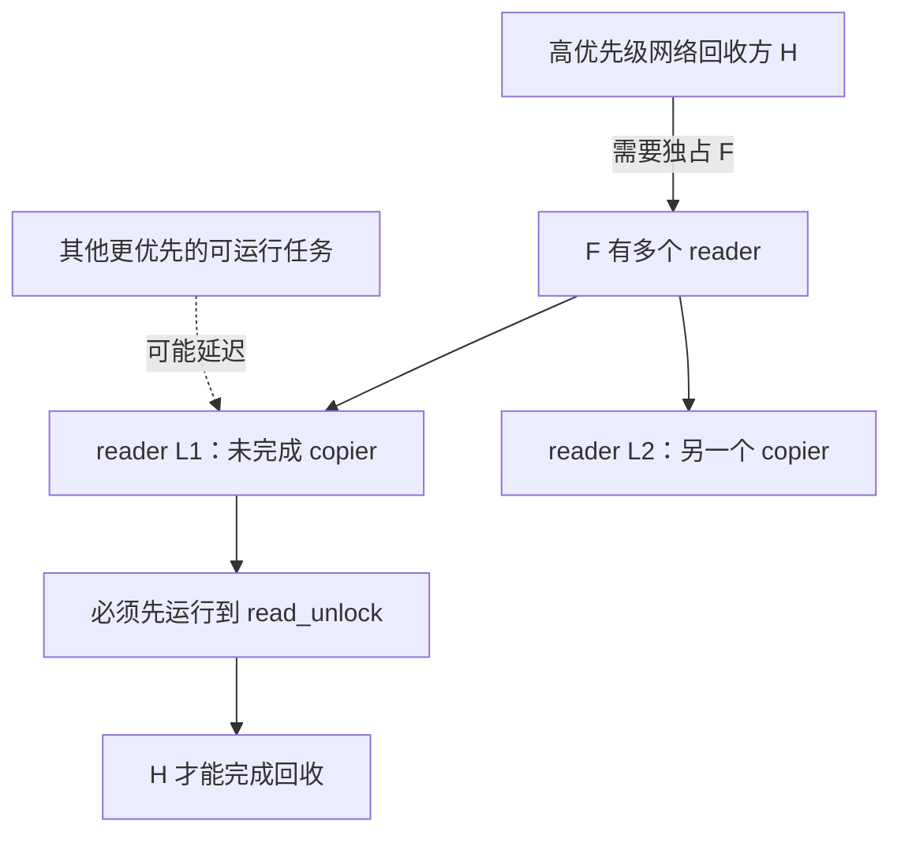

该图解释可能的放大机制，并不声称本次已找到图中 M 对应的线程。

### 7.3 本次已证实和未证实的边界

| 层次 | 能说到什么程度 |
| --- | --- |
| 现场报告中的观测 | 网络 IRQ 在回收路径长时间等锁；McuLogService 的读锁释放位于唤醒链中；业务收发存在约 350ms 延迟 |
| 源码可以证明的机制 | 回收持 Q 等 F；copier 跨越复制持 F 读锁；RT reader 被延迟可拖住 writer，并扩散到后续网络调用 |
| 合理推断 | RT 调度竞争、低优先级 reader 得不到及时运行，是放大延迟的重要候选解释 |
| 仍缺证据 | 哪个任务在何 CPU 上抢占了谁、持续多久；McuLogService 是否在完整 350ms 内一直持锁且未运行；是否有其他延迟来源 |

**没有出现在 D 状态采样中，不能反证某线程一定连续处于 runnable，也不能证明它整段时间只是被 RT 任务抢占。**需要完整调度与锁持有轨迹才能回答。

### 7.4 D 状态不等于磁盘 IO

很多人看到 D 状态就先查硬盘。D 常用于表示不可中断等待，但等待对象可以是锁，并不一定是磁盘。

本例诊断器记录的多数相关等待带有 `TASK_RTLOCK_WAIT`，栈上是 `rt_read_unlock`、`prb_retire_current_block`、`__local_bh_disable_ip` 等线索。应该根据**状态值、栈和唤醒者**识别等待对象，不能仅凭界面显示的字母归因。

### 7.5 为什么不能把旧忙等代码恢复回来

2020 年上游提交 `632ca50f2cbd`，就是把这处 atomic counter 忙等改成 rwlock。[S11]

原因是：高优先级回收任务如果在同核忙等，可能持续占 CPU，让被它抢占的低优先级 copier 永远没有机会完成，形成活锁。

因此，第二版补丁虽然重新使用完成计数，却不是回到旧逻辑：**它看到未完成计数后立即返回，不循环等待计数归零。**“使用计数”与“忙等计数”是两回事。

## 8. 如何从证据走到根因，而不过度推断

### 8.1 三条证据需要一起看

| 证据 | 它支持什么 | 单独不能证明什么 |
| --- | --- | --- |
| 多个 Adapter、IMU、LiDAR、gPTP 同窗超时 | 共享网络上游出现异常 | 不能区分线路、驱动、协议栈还是应用调度 |
| 抓包长间隔后集中回灌，网口错误/丢弃计数无明显异常 | 主机处理停顿、积压后恢复很有解释力 | 不能严格证明线上每个包都没丢，也不能定位积压的准确队列 |
| `prb_retire_current_block` 等待栈及 `rt_read_unlock` 唤醒链 | 具体等待落到抓包 block 的完成同步 | 不能单独还原 copier 整个延迟期间的调度史 |

把三者叠起来，才从“网络有问题”收敛到“AF_PACKET V3 的完成等待阻塞网络路径”。

### 8.2 回灌数量为什么有帮助

常态约 9000pps，停顿约 0.356s，则期间对应流量规模为：

```text
9000 包/秒 × 0.356 秒 ≈ 3200 包
```

专项报告称恢复后的短窗口中出现约数千包回灌，数量级相符。这支持上游仍发送、主机没有及时推进处理的解释。

但这不是逐包核账：捕获流量和接口流量的方向、过滤范围、采样窗口未必一致，报文可能积压在不同层。应该写“支持积压恢复”，不应只靠这个乘法宣称“所有线路报文已证明一包未丢”。

同理，`pcap packetsDrop=0` 不能证明实时性健康：**零丢包可以伴随严重迟到**，而不同统计项覆盖的丢弃位置也不同。

### 8.3 抓包时间戳不是用户态读包时间，也未必是线缆到达时间

应用的 `PacketUtils::populatePacket()` 把 `RawPacket` 的时间戳写进 `Packet.timestamp`；在 V3 中，每包记录有自己的 `tpacket3_hdr.tp_sec/tp_nsec`。libpcap 使用的每包时间戳，不应笼统称作“block 头的时间戳”。

内核 `tpacket_rcv()` 会优先使用 skb 中已有的合适时间戳，否则在捕获处理时取系统时间。因此：

1. 用户态晚 100ms 读取已完成 block，不会自动把其中每包时间戳都改成读取时刻。
2. 报文在更早的硬件/内核队列中积压时，具体时间戳能否体现积压，取决于采集位置和配置。
3. 本次“主机网络处理停顿”的结论还依赖线程等待栈、业务超时与 TX 延迟，不能只看抓包时间轴。

这也解释了初诊为何后来被补充：原始 `.pcap` 文件缺失，不代表完全没有报文级证据，Light bag 中仍可存在 `PacketArray`。

### 8.4 原始 trace 与重建 sidecar 的区别

评审页指出该 trip 没有原始 trace-cmd `.dat`，相关 sidecar 是依据 scheduler、network、lock、memory 等记录重建的。[S2]

这类重建有助于关联已有观测，不能恢复未采到的 `sched_switch`，也不能替代完整的锁获取/释放历史。本例的证据足以解释具体阻塞链；“谁精确抢占 copier 多久”仍是独立待闭环问题。

## 9. Patch 1：拿不到完成锁，就放弃本次捕获并稍后重试

### 9.1 修复目标与基本取舍

第一版保留 Q、F 和原有 block 同步模型，只改变回收方拿不到 F 写锁时的动作：**不阻塞等候，返回失败**。[S4]

块满时，当前包的捕获副本可以不保存；原业务报文的网络处理继续。这里接受诊断数据不完整，换取业务收发继续推进。

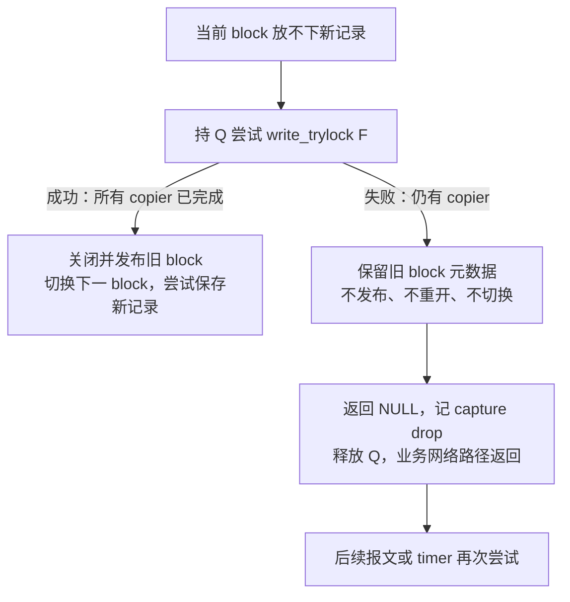

`trylock` 的关键是拿不到锁就快速返回，而不是换个地方反复循环。

### 9.2 为什么不是替换两行代码就完事

原来的 `prb_retire_current_block()` 返回 `void`，调用者默认它已经完成回收，接着调用 `prb_dispatch_next_block()`。

如果仅把 `write_lock()` 改为 `write_trylock()`，失败时直接从 retire 函数返回，调用者仍可能继续打开当前块；因为 block 编号还未推进，可能重置尚未写完的块，覆盖在途数据。

完整修改必须包含：

| 修改点 | 为什么必须一起做 |
| --- | --- |
| retire 改为返回 `bool` | 让调用方知道本次并未完成回收 |
| caller 收到失败后返回 `NULL` | 阻止继续 dispatch / open |
| 使用既有 capture drop 记账路径 | 释放 Q 并统计此次未保存的捕获副本 |
| timer 失败时跳到 `refresh_timer` | 释放锁、重新挂 timer，保持未来重试机会 |
| 失败前不改变 block 的交付状态与游标 | 保证半写入数据不会被发布或重用 |

可以把关键控制流读成：

```c
// 块满调用者，概念摘录
if (!prb_retire_current_block(pkc, po, 0))
    return NULL;
return prb_dispatch_next_block(pkc, po);

// 非空块的 timer 回调，概念摘录
if (!write_trylock(&pkc->blk_fill_in_prog_lock))
    goto refresh_timer;
write_unlock(&pkc->blk_fill_in_prog_lock);
```

### 9.3 为什么不会把半包交给用户态

成功拿到 F 写锁，说明旧 reader 全部退出；此时 Q 仍被持有，不会有新记录预留。因此仍沿用原锁协议保证完整发布。

失败时，旧块保持未发布状态，不设 `TP_STATUS_USER`，也不进行重置。正确性要求是“等待中的数据留在原处”，不是“抓不到锁就跳过安全检查”。

### 9.4 它解决什么，又留下什么

假设 A 有一个 copier 被延迟 350ms，B 仍空闲：

- Patch 1 不让回收方在 F 上睡眠等待，Q 可以释放，网络路径可以返回。
- 但 A 没有完成回收，写入游标仍无法正常切到 B。
- 这段时间遇到块满的后续捕获请求可能连续失败，造成抓包副本丢弃。
- copier 完成后，下一个包或 timer 可以继续完成 A。

它消除的是这条**回收等待 copier 的阻塞边**，并没有消除所有 Q 竞争、驱动等待或其他网络延迟。抓包完整性与交付延迟还必须实测。

## 10. Patch 2：把“停止写 A”和“交付 A”分成两个动作

### 10.1 为什么需要第二版

第一版优先让业务网络继续，但 A 慢时 B 也用不上。第二版希望进一步利用剩余 ring 容量：**A 不再接受新记录，但可以等它自己的 copier；同时把新记录写入 B。**[S5、S6]

这里的“异步回收”不等于把所有 payload copy 都搬到 workqueue。报文复制仍在对应网络调用中、Q 锁外执行；被拆开的是 block 的封口、完成检测与按序发布。

### 10.2 每块增加一份内核私有状态

补丁在 `internal.h` 中引入：

```c
enum prb_block_phase {
    PRB_BLOCK_FREE,
    PRB_BLOCK_ACTIVE,
    PRB_BLOCK_SEALED,
    PRB_BLOCK_USER,
};

struct prb_block_state {
    enum prb_block_phase phase;
    unsigned int in_flight;
    struct tpacket3_hdr *last_pkt;
    unsigned int retire_status;
};
```

这些字段放在内核私有管理结构中，不塞进 mmap 的报文布局。因此用户态 ABI 不需要新增 `SEALED` 状态；现有程序仍按 USER/KERNEL 所有权读取和归还。

| 字段 | 直观含义 | 解决的问题 |
| --- | --- | --- |
| `phase` | 这块是空闲、正在分配、已封口、还是交给用户态 | 不能仅凭 KERNEL 位认定可以覆盖 |
| `in_flight` | 本块尚未完成的复制数量 | 不等待锁，也能知道是否可以发布 |
| `last_pkt` | 最后一个预留记录的位置 | 当前写块已变为 B 时，仍能正确收尾 A |
| `retire_status` | 块满/超时等退休标志 | 延迟发布后保留原来的交付语义 |

原来一把跨 copy 的 F 被移除。Q 继续保护分配、状态、计数和发布；**计数更新本身在 Q 下完成，不是凭一个裸整数消除同步**。

### 10.3 状态机：SEALED 是这个设计的关键

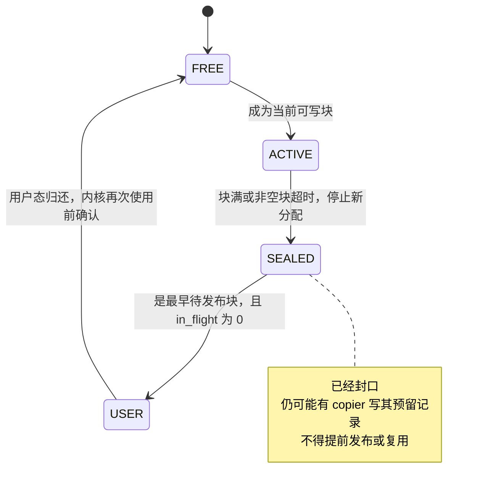

图中的 `USER → FREE` 表示可复用语义。实际补丁并不需要在用户态归还时收到一次专门回调、立即改写私有 phase：`prb_block_reusable()` 也接受“私有 phase 为 USER，但共享 block 已被归还为 KERNEL”的情况，后续打开时再转 ACTIVE。

此外，空块超时主要刷新 timer，不必交付一个空批次。

### 10.4 两个游标：写到哪里，与交到哪里

原实现中，关闭当前块、交给用户态、推进当前块关联很紧。第二版需要区分：

- **写游标 `kactive_blk_num`**：下一次应该向哪块分配新记录。邻接块不可用时，可能停在候选位置且暂时没有 ACTIVE 块。
- **发布游标 `publish_blk_num`**：最早尚未完成发布的封口块是哪一块。

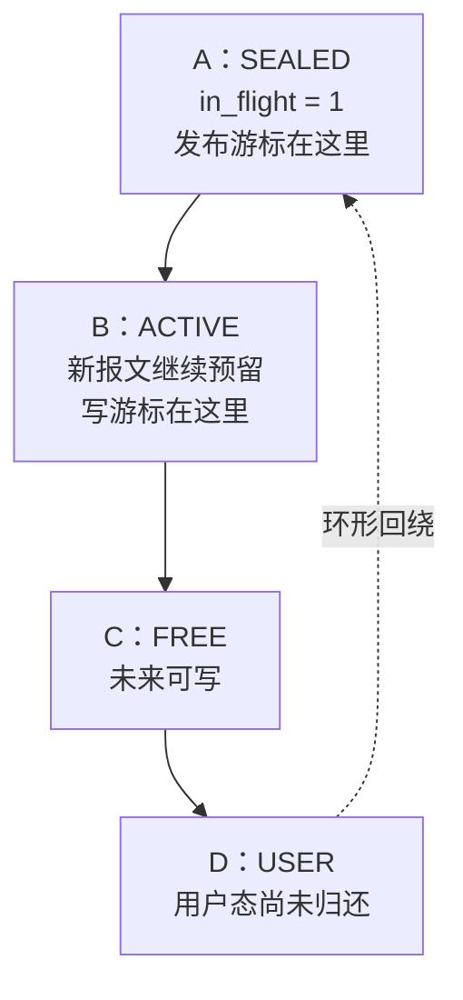

发布必须按顺序：B 即使先完成，也不能越过尚未完成的 A。这样保持现有用户态顺序遍历 block 的约定和块序列交付顺序。

**允许写入继续，不代表允许越序交付。**这是第二版同时保留吞吐能力和顺序语义的关键取舍。

### 10.5 完成时必须找回自己原来的 block

每次成功预留后，copier 保存它所属 block 的句柄 `copy_block`。流程简化为：

```text
预留阶段（持 Q）：
    为当前 ACTIVE 块分配记录
    所属块.in_flight += 1
    保存 copy_block = 所属块
    释放 Q

复制阶段（不持 Q）：
    写 payload、包头、时间戳等

完成阶段（重新持 Q）：
    copy_block.in_flight -= 1
    尝试按序发布已完成的封口块
    释放 Q
```

不能在完成时查询“当前 ACTIVE”再减计数：写游标可能已经从 A 移到 B，甚至 C。如果 A 的 copier 错减 B 的计数，就会导致 A 永远未完成、B 提前发布或计数下溢等问题。

### 10.6 一步步看 A 慢、B 先完成的情况

以下计数和步骤是教学示例，不是现场录制值。

| 步骤 | A | B | 写入侧 | 用户态可见结果 |
| --- | --- | --- | --- | --- |
| 1 | ACTIVE，`in_flight=1` | FREE | A 有一条记录复制未完 | A 不可读 |
| 2 | SEALED，`in_flight=1` | ACTIVE | A 放不下，封口 A，开始使用 B | A 仍不可读 |
| 3 | SEALED，`in_flight=1` | SEALED，`in_flight=0` | B 先写完并封口 | B 也不能越过 A 发布 |
| 4 | SEALED，`in_flight=0` | SEALED，`in_flight=0` | A 最后一个 copier 返回 | A、B 依次满足发布条件 |
| 5 | USER | USER | 若后续有可用块则继续写 | 用户态按 A、B 顺序读取 |
| 6 | 用户归还 | 用户归还 | 环回时才可复用 | 不覆盖用户仍在读的块 |

这与原实现的区别是：步骤 2～4 的等待留在 **A 的状态里**，无需让网络线程原地等 A。

### 10.7 封口和完成两边都尝试发布，防止漏掉最后通知

并发中有两种先后顺序：

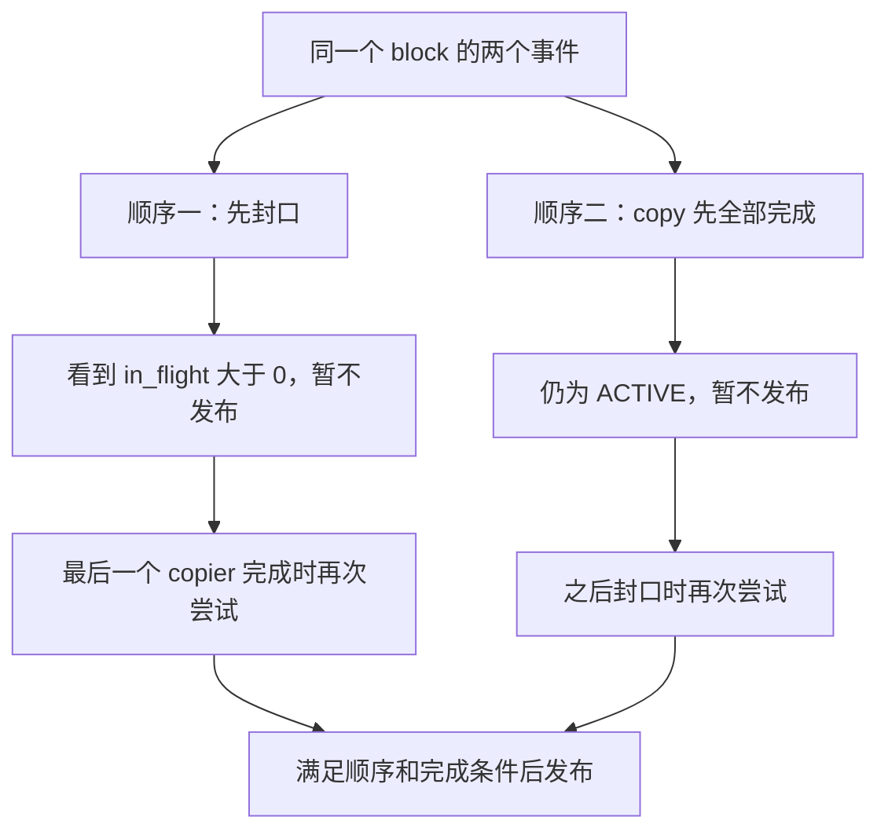

如果只靠后续新报文触发，流量停止时可能没有下一包来帮忙推进。第二版让封口和复制完成两侧都在 Q 内调用发布检查，避免把已完成块遗留到无限远的未来。

### 10.8 发布条件与内存可见性

最早待发布块必须同时满足：

```text
phase == SEALED
in_flight == 0
该块位于 publish cursor
```

然后才能收尾最后一包的 offset、填块的时间范围、执行所需 cache/同步操作、设置 USER、通知用户态并推进发布游标。

计数归零不只是数字条件：所有 copier 先写数据、再在 Q 下登记完成；发布者同样在 Q 下检查，从而把完成登记与数据可见性关联起来。跨架构 cache 维护仍必须正确。

补丁因此还把 flush 的终点改为**被发布旧块自己的地址范围**。若沿用“当前写块的末尾”，A 发布时游标已经在 B，可能维护错误的内存范围。

### 10.9 workqueue 为什么只做有限的发布工作

如果许多封口块在 A 完成后一起满足条件，一次拿着 Q 发布大量块，会造成新的长临界区。第二版设置 `PRB_PUBLISH_BUDGET=8`：一次持锁最多发布 8 块；剩余就绪块交给每 ring 的一个 worker，分批继续，并在批次间释放 Q、允许调度。

worker 遇到未完成块时立即退出，**不等待 copier，不做忙等**。因此不能把这版方案概括成“把原来的阻塞 write_lock 原样搬进工作线程”。

8 是块数预算，不是时间上限。不同 block 大小、cache 维护成本和平台实现仍会影响实际持锁时间，必须测量尾延迟。

### 10.10 ring 满了怎么办

如果 A 的 copier 一直不完成，而 B、C 都逐渐封口，有限 ring 终究会耗尽。发布顺序仍被 A 挡住，后续捕获副本就会丢弃。

这叫**抓包分配冻结**，与原实现中“网络线程持锁睡眠等待”不是同一件事。第二版希望达到的是：

```text
抓包容量不足 → 不保存这次捕获副本 → 网络调用继续返回
```

而不是：

```text
抓包容量不足 → 网络调用等待某个 copier 恢复
```

实现还坚持只检查邻接的下一块，不跳过 USER/SEALED 块去扫描更远的空块。单块 ring 尤其没有 B 可继续使用，但仍应避免回到原来的完成锁等待。

### 10.11 为什么还要改 poll、错误路径和关闭流程

这种修改不是只增加一个 counter，还改变了对象生命周期和“最新可读块”的含义：

| 配套修改 | 原因 |
| --- | --- |
| `poll()` 看最后已发布块 | 写游标前进不再等于旧块已经可读 |
| room/fanout 判断排除 SEALED 块 | KERNEL 状态可能只是尚未发布，不能当作可写空闲块 |
| 预留前检查 virtio header 错误 | 避免错误包已占记录、增加计数却无法正确完成 |
| 保存每块最后记录和退休标志 | 当前 ACTIVE 已改变，不能再引用全局当前值收尾旧块 |
| 停止网络 hook 并同步在途网络回调 | 防止释放 ring 时仍有 copier 使用旧内存 |
| 设置停止标志，取消 timer 和 worker | 防止释放后又异步访问元数据 |
| 不持 Q 做同步取消等待 | worker 可能需要 Q，错误锁序会引入新的死锁 |

所以第二版比第一版更充分地利用容量，也承担了更大的并发验证成本。

## 11. 应用侧缓解：哪些有效，作用在哪一层

### 11.1 socket BPF：在付出复制成本之前做选择

这里的 BPF 是 **AF_PACKET socket filter**：用户态通过 libpcap 等下发过滤规则，在内核 `tpacket_rcv()` 的 `run_filter()` 中执行。它可以返回 0 表示不保留，或返回允许保留的长度。

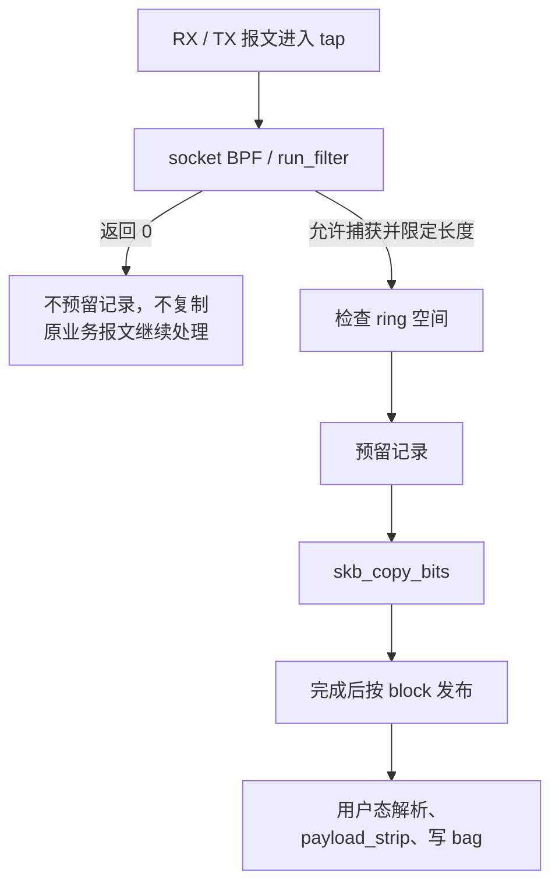

过滤发生在 room check、记录预留和 payload copy 之前，因而能减少 ring 占用与 copier 数量。它仍需要执行过滤代码；只要有通过的包，原内核完成等待风险仍可能存在。

这是**降低触发概率和资源消耗**，不能替代内核根因修复。

### 11.2 本例不是“还没加 BPF”

专项报告已有大范围 BPF 配置。本地应用配置也包含 `bpf_filter`，`BaseCapture::initializeDevice()` 在打开设备后调用 `device_->setFilter(bpf_filter_)`。

因此落地任务应是：核实目标版本过滤器确实安装成功，审查和收窄匹配集合，而不是笼统要求“增加 BPF 功能”。本地代码还没有检查 `setFilter()` 的返回结果，这提示需要确认失败处理；本文没有据此推断现场过滤器安装失败。

本地 `onPacketArrives()` 先收到 `RawPacket`，之后才执行 `filterAndProcessPacket()` 与 payload 裁剪。这些后处理不能降低已发生的 ring 复制成本。

过滤策略应从诊断必需数据倒推：方向、协议、端口、地址、VLAN、是否需要 payload。不能直接照抄评审页的示例端口作为车辆正式配置，也不能只测 CPU 而不测丢弃率和诊断可用性。

### 11.3 为什么调大总 ring、调长超时并不等于根治

需要同时考虑三个量：

```text
捕获写入字节率 ≈ 通过过滤的 pps × 每包实际记录字节数
单块填满时间   ≈ 单块可用字节数 ÷ 捕获写入字节率
总缓冲时间     ≈ ring 总可用字节数 ÷ 捕获写入字节率
```

例如，**仅用于算数示意**：假设记录占用平均 1024 字节，9000pps 写入约 9.216MB/s；20MiB 的总 ring 约对应 2.28s 的名义容量。这个数并不意味着单 block 能连续写 2.28s，也不意味着可以避免一个 copier 导致的同步停顿。

更重要的是，v5.15.122 的 timer 回调在非空块上本来就会获取 F 写锁。`prb_retire_current_block(..., TP_STATUS_BLK_TMO)` 跳过内部那次写锁，是因为 timer **已在更外层完成了等待**。[S7]

所以原诊断中“超时 retire 不走写锁，调长超时可以避开”的理解不完整。增大缓冲和改变超时可能改变频率与批处理行为，也可能增加交付延迟；必须按真实 block 参数和负载实测。

### 11.4 IRQ 亲和与抓包线程亲和分别影响什么

| 调整 | 可能收益 | 局限 |
| --- | --- | --- |
| 分散网口 IRQ / 合理设置 RPS | 减轻单核集中和部分 BH 竞争 | 多个核仍可能共用同一捕获 socket 的 Q/F |
| 调整 pcap 用户态线程亲和 | 改善用户态消费、减少同核干扰 | 不会自动搬走 IRQ 与 TX 线程执行的 `tpacket_rcv()` |
| 隔离或调整相关业务线程与 RT 负载 | 减少 copier 完成被延迟的概率 | 依赖完整调度分析，不能只提高某个进程优先级 |

这些是平台调度与容量优化，应与根因补丁互补。

### 11.5 tc ingress drop 为什么不能保护同接口的入向抓包

在本次基线普通 RX 路径中，AF_PACKET tap 在 tc ingress 前；源码还会在执行 ingress 分类前处理待交付的 tap。因此同接口上的 ingress drop/police 生效时，捕获复制成本可能已经付出。[S8]

此外，tc drop 可能丢业务报文，而 socket filter 的拒绝只是不保留该捕获副本。二者的目的和业务影响不同。

XDP 的位置又更早，但它不是评审页所说的 pcap socket BPF；不能因为名字都带 BPF 就混为同一个方案。

### 11.6 mirror 到 veth：移走压力点，不自动获得执行隔离

评审页讨论了在 `mgbe3_0` 做 tc 分类和镜像，然后只在 veth 上抓包的部署方案：

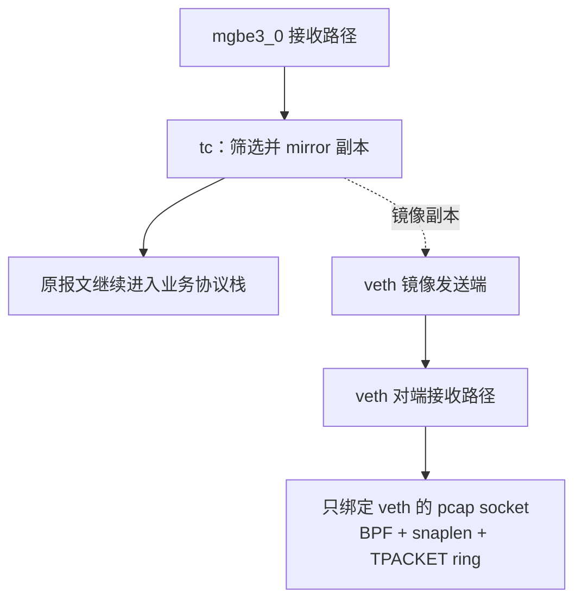

前提是生产接口上不再保留原来的高压力捕获 socket，否则原问题点仍在。

这个方案将 ring 所属设备路径迁到镜像链路，但原接口仍承担分类、clone 和注入成本。**软件镜像不等于硬件隔离，也不天然保证不同 CPU 或完全异步执行**；实际是否经 backlog/NAPI 解耦、在哪个 CPU 消费，以及 RX/TX 双方向如何覆盖，取决于配置和内核路径。

dummy 与 veth 也不能简单互换：veth 有对端接收路径；dummy 常见为发送后消耗报文，其发送 tap 可能仍在调用链中。应明确拓扑和执行路径，再在目标 RT 内核上验证原接口的尾延迟。评审页的部署建议应作为候选缓解，而不是“任意 mirror 到虚拟口就已证明不会卡业务”。

### 11.7 各层方案如何配合

| 方案 | 直接改变什么 | 预期收益 | 主要代价或边界 |
| --- | --- | --- | --- |
| 按需启动抓包 | 降低生产热路径暴露时间 | 未启用时去掉该捕获路径成本 | 可能缺少故障前历史数据 |
| 收窄 socket BPF | 减少进入 ring 的包 | 降低包速率、复制量与竞争概率 | 诊断覆盖缩小；仍有残余风险 |
| 限制 snaplen | 减少每包复制字节数 | 降低带宽和容量消耗 | 可能失去必要 payload |
| 用户态 payload_strip | 减少已捕获数据的保存量 | 节省应用内存和记录存储 | 无法消除前面的内核复制 |
| 调整 ring/block/timeout | 改变容量、块满频率和批处理 | 负载相关的缓解 | 不移除完成等待；可能增加交付延迟 |
| IRQ / 线程调度优化 | 改变任务获 CPU 和竞争情况 | 降低单核瓶颈与调度延迟 | 同 socket 依赖仍存在 |
| Patch 1 | F 写锁等待改为非阻塞失败 | 小改动阻断这条完成等待 | A 慢时后续捕获可能持续丢弃 |
| Patch 2 | 按块计数，拆分封口与发布 | A 慢时 B 可继续写，按序交付 | 状态和生命周期更复杂；有限容量 |
| 镜像链路 | 改变捕获所在设备/执行路径 | 可减少直接生产口 ring 压力 | 额外处理成本，隔离效果须实测 |

## 12. 把两份原资料中容易误读的说法放在一起

这不是否定诊断主链，而是避免把摘要中的简写当成完整机制。

| 容易形成的理解 | 更精确的理解 | 核对依据 |
| --- | --- | --- |
| 9000pps 说明 10GbE 跑满线速 | pps 不能单独换算带宽，需要包长；应理解为捕获覆盖范围广、包速率接近观测流量 | 专项报告计数与基本带宽关系 |
| 20MB 就是单 block 大小 | 是应用请求的总缓冲容量；block 的实际大小和数量需另外确认 | 本地 BaseCapture 与 `tpacket_req3` |
| 超时回收不等复制 | timer 已在外层对非空块等待 F 写锁 | v5.15.122 timer 与 retire 函数 |
| 拿“读锁”的是 libpcap 读包线程 | 这里 reader 是向 ring 写自己的记录的内核 copier | `prb_fill_curr_block()` / `tpacket_rcv()` |
| mmap 抓包已经完全零复制 | skb 到 ring 仍有 `skb_copy_bits()` | `tpacket_rcv()` |
| payload_strip 会缩短内核 copy | 本地代码在用户态收到 RawPacket 后才裁剪；需内核 snaplen 才直接减少前面的复制 | 应用调用顺序 |
| 车辆还没有 BPF，需要新增 | 配置已有 BPF；重点是确认生效并收窄，且检查所有实际启用的捕获 socket | 专项报告与本地应用代码 |
| McuLogService 350ms 一直被某个 RT 任务抢占，已证实 | 唤醒链和等待成立；完整持锁区间、抢占者和原因仍待调度 trace 确认 | 评审页与 patch 分析的证据边界 |
| 所有 Linux 网络共用这把 ring 锁 | 锁按 packet socket 管理；现场通过相关 tap、BH 和 CPU 布局广泛扩散 | `packet_sock` / `tpacket_kbdq_core` |
| 没丢包就没有故障 | 实时系统中，迟到本身就足以触发保护；统计也不覆盖所有丢弃位置 | 业务时间轴 |
| Patch 2 可保证永不丢包、按固定期限交付 | 有限容量且按序发布；最老块永久未完成时仍会 capture drop | 补丁状态机与验证记录 |
| 单测和 ARM64 编译通过就能量产 | 它们不能替代目标 Orin 多核 PREEMPT_RT 上机验收 | 验证记录的未完成项 |

还有两点值得保留：一是最初指向“链路/交换/驱动”的诊断后来被专项定位细化到主机抓包完成等待；二是更早的 planning 空轨迹、epoll/hrtimer 等待窗口有各自时序，不应因为都出现卡顿就并入本次同一因果链。[S1、S3]

## 13. 当前修复走到哪一步，怎样才算验证有效

### 13.1 原实现、两版候选的直观对比

| 对比项 | 原实现 | Patch 1：trylock | Patch 2：逐块异步回收 |
| --- | --- | --- | --- |
| 回收方是否等未完成 copier | 等 F 写锁 | 不等，失败返回 | 不等，检查块状态与计数 |
| A 未完成时能否写 B | 不能 | 通常不能 | 邻接 B 可用时可以 |
| 是否可把未完成 A 发布给用户 | 不允许 | 不允许 | 不允许 |
| B 能否越过 A 先发布 | 不允许 | 不允许 | 不允许 |
| ring 耗尽的处理目标 | 既有满环丢弃；另有本次完成锁阻塞风险 | 丢弃捕获副本 | 丢弃捕获副本 |
| 实现复杂度 | 既有基线 | 较小 | 更高，需要完整状态与生命周期管理 |
| 用户态 mmap ABI | 既有 V3 | 保持 | 保持 |

### 13.2 方案作者记录的已完成验证

截至所读的 2026-10-22 材料：[S4、S6]

| 候选 | 已记录的检查 | 证明范围 |
| --- | --- | --- |
| Patch 1 | 控制流 harness、补丁应用检查、SDK ARM64 RT 配置对象编译、checkpatch | 失败传播、重试等局部控制流及构建兼容性 |
| Patch 2 | 15 项 KUnit 通过；候选 UML 内核中 `psock_tpacket`、`psock_fanout` 通过；SDK ARM64 RT 配置对象编译；补丁应用检查 | 状态转换、顺序、payload、poll、部分生命周期等功能路径 |

Patch 2 的 UML 是单 CPU、非 PREEMPT_RT 配置，使用真实内核锁和 worker，但没有复现目标多核 RT 的优先级反转。`psock_fanout` 的 ring 用例使用 V2，单 CPU 时还会跳过 CPU1 分支。记录中存在候选与原版都出现的间歇性 RCU 启动自检 warning，因此也不能称为“完整内核启动零警告验收”。

这些限制并不抹去测试价值，而是明确它们各自回答了什么。

### 13.3 真正有区分力的目标机试验

最有价值的场景不是“跑了很久没复现”，而是**可控地延迟一个已预留记录的 copier**，观察系统还能否保持关键不变量。

| 场景 | 原版预期风险 | Patch 1 应观察到 | Patch 2 应观察到 |
| --- | --- | --- | --- |
| A 有慢 copier，下一包使 A 退休 | 回收等 F，并拖住后续网络 | 快速失败，不错误推进 | 封口 A，B 继续接受 |
| B 比 A 先完成 | 原模型中写入并行受限 | 不提前发布 A | B 不越序，A 完成后依次发布 |
| 流量停止，只剩 A 在途 | timer 可能参与等待 | 重试不丢失，完成后最终交付 | 完成侧主动尝试发布 |
| 用户态长期不消费 | 满环后 capture drop | 继续正确记账、不覆盖 | 不覆盖 USER/SEALED，不跳块扫描 |
| socket 关闭/重建与 worker 并发 | 涉及既有生命周期 | 保持原资源安全性 | 无 timer/work/copy 访问已释放内存 |

并行记录业务 UDP/IMU 接收间隔、网络发送耗时、Q/F 或对应发布临界区时延、capture drop、捕获交付延迟、吞吐和 CPU。

对比必须使用同一负载、同一过滤器、包长分布、ring 参数和调度配置。P99/P99.9、最大值与长停顿次数比单一平均值更能说明实时性改善。

### 13.4 不能只用“等待计数变零”验收

有效修复同时需要三个维度：

1. **业务推进**：网络收发不再因旧 copier 的完成等待出现同类长停顿。
2. **数据正确性**：不提前 USER、不覆盖未完成块、不越序、不重复交付、报文长度和内容正确。
3. **代价可接受**：捕获丢弃率、交付延迟、CPU 与吞吐变化符合诊断需求。

因此不应靠放宽 cbw 的 0.3s 阈值来宣布问题解决。它没有改变底层依赖，且本次还有独立的 Safety IMU 丢失保护链。

## 14. 带着一个问题回看整条链

最值得记住的问题是：**如果某份诊断记录迟迟没写完，为什么业务必须等它？**

原实现为了保证抓包内容完整，要求旧块发布前所有 copier 完成；问题不在这个完整性要求本身，而在于持网络路径所需的 Q 原地等待完成。

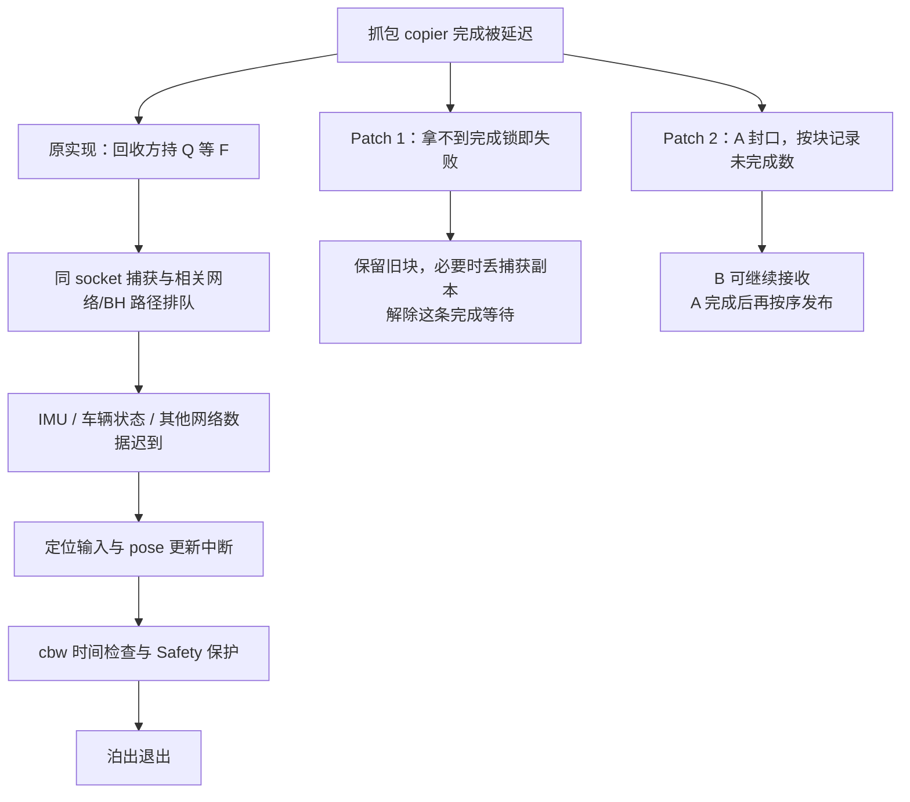

两版修复都保留“用户态只能看到完整 block”的要求。第一版改变等待失败策略；第二版进一步改变组织方式，让未完成状态留在旧块中，并利用剩余容量。有限内存、顺序交付与目标机实时性验证仍是它们必须面对的约束。

## 15. 术语和资料索引

### 15.1 术语速查

| 术语 | 在本文中的意思 |
| --- | --- |
| APA | 本案例中的自动泊车/泊出功能 |
| MCU / pbox | 报告中的上游控制器/惯性数据相关设备；不等于 Orin 上的抓包进程 |
| IMU / INS | 惯性测量单元 / 惯性导航相关处理 |
| pose | 车辆位置、姿态等状态估计输出 |
| cbw | control-by-wire，执行控制和上游状态检查的相关模块 |
| Safety / BLC | 本案例中监测异常、组织保护和中止泊车的相关模块 |
| `mgbe3_0` | 现场 Orin 主机上的相关以太网接口名 |
| RX / TX | 对网卡而言的接收 / 发送方向 |
| DMA | 设备向内存搬运数据的机制，不等于本次被等待的抓包完成锁 |
| NAPI | Linux 驱动按预算轮询处理网络收包的一套机制 |
| softirq / BH | 内核延后处理工作及其并发控制相关概念，网络收发大量使用 |
| tap | 网络路径上的观察/分发挂点，不特指名为 TAP 的虚拟网卡 |
| AF_PACKET | Linux 的链路层报文 socket 接口 |
| libpcap / PcapPlusPlus | 抓包库 / C++ 抓包封装 |
| skb | `sk_buff`，内核报文对象，含元数据和数据引用 |
| mmap | 把内存页映射到进程地址空间 |
| ring / block / record | 环形缓冲 / 批次块 / 单包记录 |
| retire / seal / publish / reuse | 退休 / 停止新预留 / 向用户交付 / 归还后重用 |
| copier / reader | 本文特指写入捕获记录、在原实现中持 F 读锁的内核执行者 |
| in-flight | 已预留但尚未全部完成的工作 |
| snaplen | 捕获最多保留的报文字节数 |
| socket BPF | 附着在捕获 socket 的内核过滤程序，区别于 tc BPF 和 XDP |
| PREEMPT_RT | Linux 的实时抢占配置/补丁体系 |
| PI | priority inheritance，优先级继承 |
| convoy | 等待队列被一个慢锁持有者/依赖环节拖住，不要求发生死锁 |
| workqueue | 内核异步工作执行机制；本补丁用它分批继续发布就绪块 |
| ABI | 内核与用户态间对结构、字段和行为的约定 |
| KUnit / UML | 内核单元测试框架 / 让 Linux 内核运行于用户态宿主环境的测试方式 |

### 15.2 原始资料与阅读用途

| 编号 | 资料 | 本文主要使用内容 |
| --- | --- | --- |
| S1 | [perf_analyzer 专项诊断 tag 288303130](https://rqk9rsooi4.feishu.cn/wiki/A5Few715Qi4bJhkdHcNcw4ILnne) | 现场时间轴、D 状态栈、唤醒链、抓包与业务统计、应用配置 |
| S2 | [TPACKET_V3 完成等待：故障链与两版内核修复评审](https://webfile.deeproute.cn/jingxuanxie/tpacket-v3-copy-wait-review/) | 修复目标、两个候选的取舍、BPF/镜像建议、证据边界 |
| S3 | [关联初诊：泊出异常退出](https://rqk9rsooi4.feishu.cn/wiki/IpPSwNfaSiUnybk0UqYcU5wcnLf) | 应用保护链、pose/IMU 延迟、早期归因及其后续修正 |
| S4 | [Patch 1 分析](https://webfile.deeproute.cn/jingxuanxie/tpacket-v3-copy-wait-review/assets/patch-1-analysis.md)、[Orin 5.15 补丁](https://webfile.deeproute.cn/jingxuanxie/tpacket-v3-copy-wait-review/assets/patch-1-trylock-orin.patch)、[net 基线补丁](https://webfile.deeproute.cn/jingxuanxie/tpacket-v3-copy-wait-review/assets/patch-1-trylock-net.patch) | 失败传播、timer 重试、完整性依据、局部验证 |
| S5 | [Patch 2 完整补丁](https://webfile.deeproute.cn/jingxuanxie/tpacket-v3-copy-wait-review/assets/patch-2-async-retire.patch) | 状态机、计数、双游标、发布 budget、poll、teardown、KUnit |
| S6 | [Patch 2 验证记录](https://webfile.deeproute.cn/jingxuanxie/tpacket-v3-copy-wait-review/assets/patch-2-verification.md) | 15 项测试、UML/ARM64 编译范围和目标机未验收项 |
| S7 | [Linux v5.15.122 af_packet.c](https://github.com/gregkh/linux/blob/v5.15.122/net/packet/af_packet.c)、[internal.h](https://github.com/gregkh/linux/blob/v5.15.122/net/packet/internal.h) | `tpacket_rcv`、预留、完成、块满/timer 回收、socket 私有结构 |
| S8 | [Linux v5.15.122 net/core/dev.c](https://github.com/gregkh/linux/blob/v5.15.122/net/core/dev.c) | `dev_queue_xmit_nit`、RX tap、tc ingress/egress 顺序 |
| S9 | [if_packet.h](https://github.com/gregkh/linux/blob/v5.15.122/include/uapi/linux/if_packet.h)、[5.15.122 packet_mmap 文档](https://github.com/gregkh/linux/blob/v5.15.122/Documentation/networking/packet_mmap.rst)、[现行官方文档](https://docs.kernel.org/networking/packet_mmap.html) | mmap 布局、所有权、V3 读取、字段与时间戳 |
| S10 | [5.15.122 锁类型文档](https://github.com/gregkh/linux/blob/v5.15.122/Documentation/locking/locktypes.rst)、[现行官方锁文档](https://docs.kernel.org/locking/locktypes.html) | PREEMPT_RT、spinlock/rwlock、PI 限制 |
| S11 | [2020 年提交：replace busy-wait loop](https://github.com/torvalds/linux/commit/632ca50f2cbd8809a2fc1934b4b2c9c49bd55e98) | 历史忙等的 RT 活锁风险，以及为何不能直接恢复 |

### 15.3 版本与本地应用代码核对说明

现场报告列出的平台是 NVIDIA Orin、Linux `5.15.122-rt-tegra`。方案作者记录 DriveOS SDK 中 `af_packet.c`、`internal.h` 与上游 `v5.15.122` 一致。本文下载该 tag 的两份源码，核对 SHA-256 与其记录一致：

```text
af_packet.c
e97dc7dae54a345d72d0367982f003fe9c788701f6a5e98810a286d1937518d7

internal.h
5ce1a3264958563ffc7620efab46918b742a6d6df8778baea53bb34fe6654ff4
```

一致范围是这两个文件，并不意味着整个厂商 RT 内核与上游完全一致。本文没有拿本机其他版本的 `/sandbox/linux_kernel` 工作区来冒充现场基线。

应用代码阅读位置如下，均为只读核对：

| 本地位置 | 用于理解什么 |
| --- | --- |
| `/sandbox/onboard_application/pcap_capture/src/pcap_capture/base_capture.cc` | 缓冲大小换算、open、setFilter、抓包队列和统计 |
| `/sandbox/onboard_application/pcap_capture/src/pcap_capture/configurable_capture.h` | 收到 RawPacket 后再解析、过滤、决定保留长度 |
| `/sandbox/onboard_application/pcap_capture/src/pcap_capture/device_capture_packet_processor.cc` | payload 裁剪发生在用户态后处理 |
| `/sandbox/onboard_application/pcap_capture/src/pcap_capture/packet_utils.cc` | 从 RawPacket 取时间戳并写入 Packet |
| `/sandbox/onboard_application/pcap_capture/src/pcap_capture/pcap_capture.cc` | 启动捕获与约 500ms 批量发布 PacketArray |
| `/sandbox/onboard_application/pcap_capture/config/c01_m8/pcap_capture_config.pb.txt` | mgbe3_0、已有 BPF、20MiB 请求、100ms 超时等配置形态 |
| `/sandbox/driver/config/dem/c01-pt/pcap_capture.jsonnet` | `kStartUp`、调度与 CPU 配置形态 |

本机应用 checkout 为 `pcap_capture@f172e43`、`driver@0a47dac7f2`；现场报告标注的是 `pcap_capture@90f4583`、`driver@44a1f838`。前者本机缺少现场 commit 对象，故本文把本地阅读用于说明应用机制，不宣称逐行重现现场应用版本。现场实际配置和统计以 S1 为来源，正式改造仍应回到车辆对应发布包核对。
