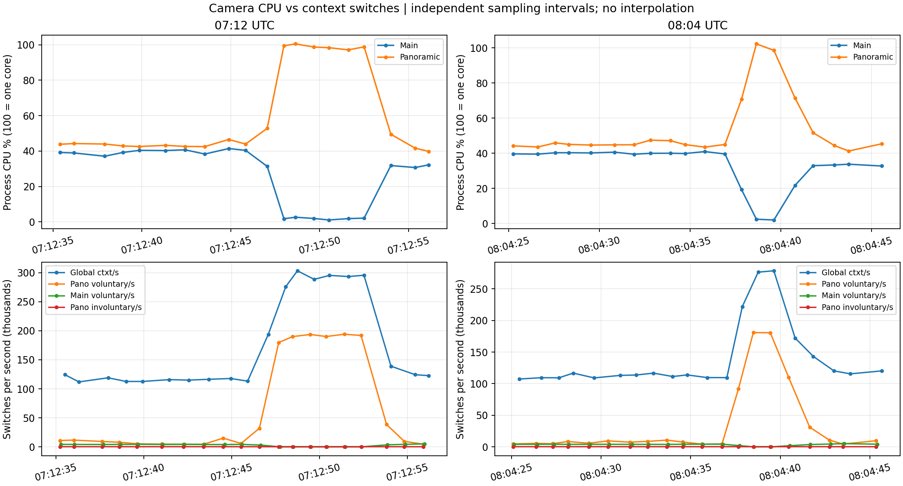
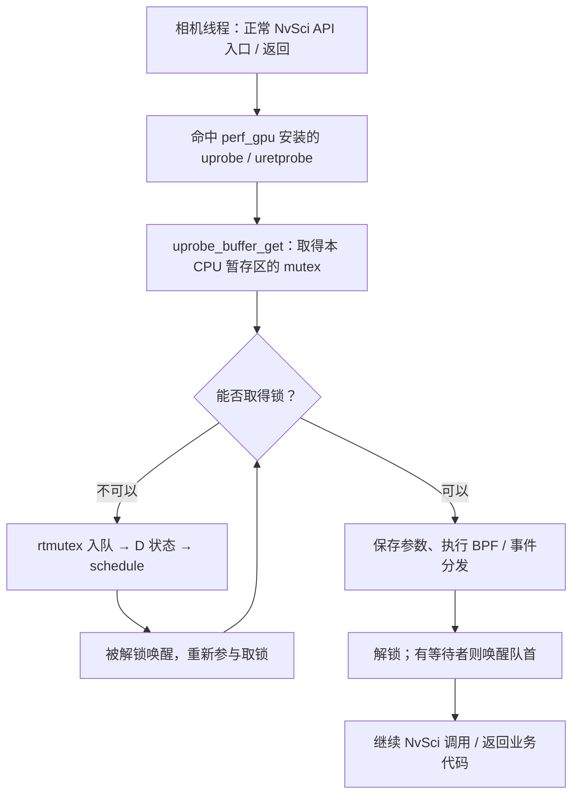
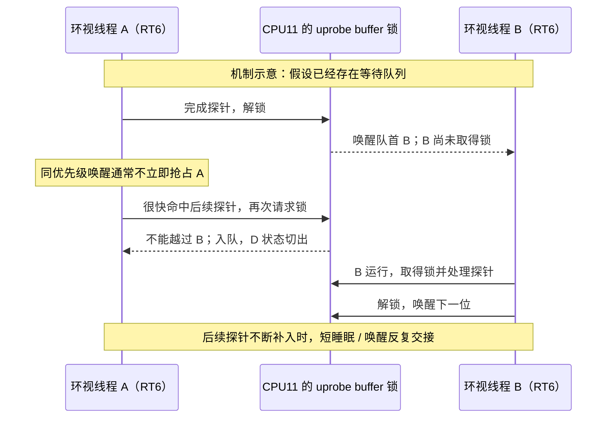
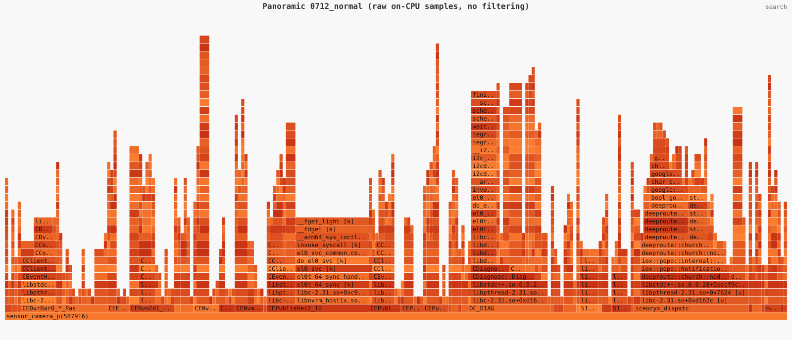
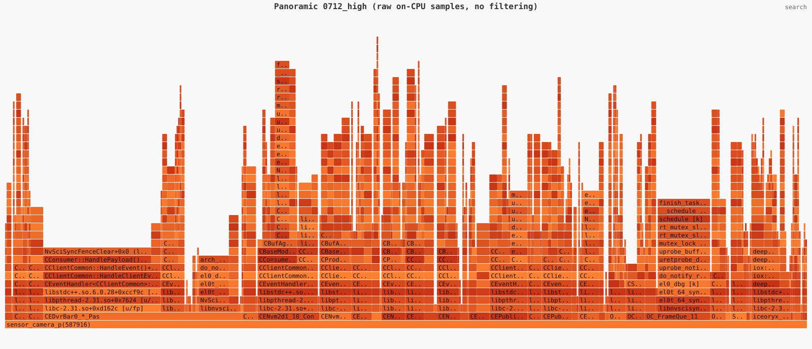
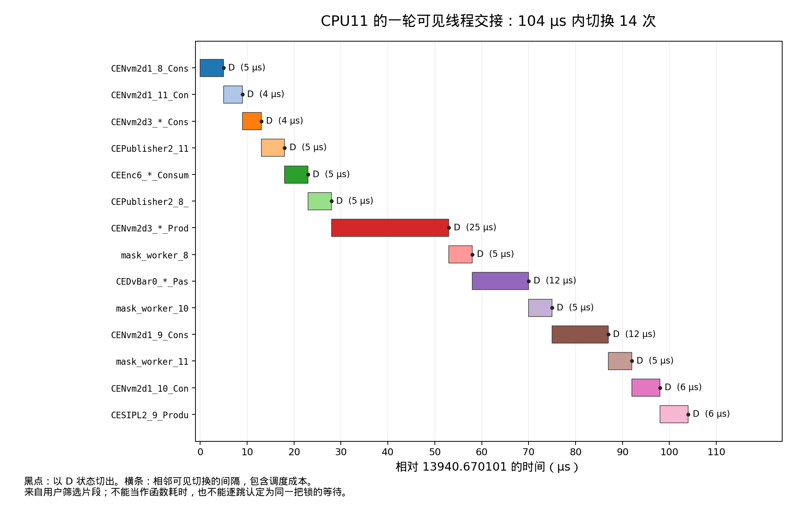
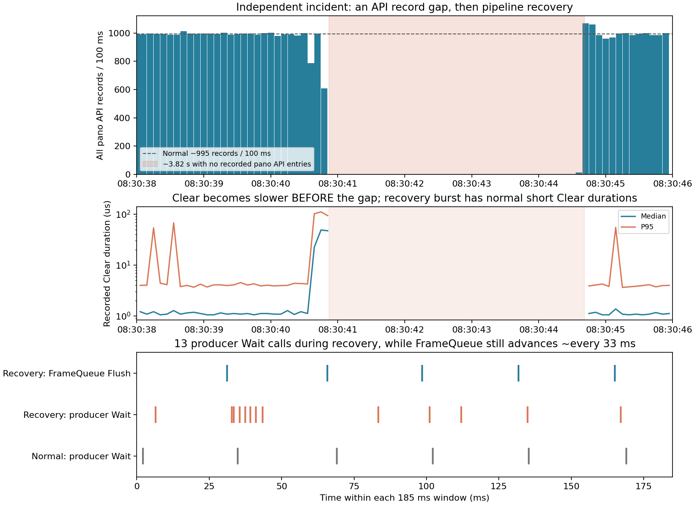

<script setup>
import normalFlameUrl from './assets/2026-11-03_camera_uprobe/0712_normal.svg?url'
import highFlameUrl from './assets/2026-11-03_camera_uprobe/0712_high.svg?url'
</script>

# 环视相机为什么突然占满 CPU：从 uprobe 到 RT mutex 的锁交接

行程中，环视相机的 CPU 数次从约半核升至接近一核，主相机同期降到很低，甚至出现数秒出流停顿。顺着火焰图追查，增加的主要是内核执行时间：相机线程反复进入 **uprobe 探针缓冲区锁的等待、解锁唤醒和调度路径**。

目前证据最充分的解释是：**性能采集器本应排除环视进程，却因进程名匹配缺陷装上了 NvSci 探针；正常帧流水线频繁命中探针，异常期间锁等待队列与同核实时调度相互作用，产生大量短睡眠和唤醒，消耗 CPU，并挤压优先级较低的主摄。**

本文记录已定位的缺陷、可复核的现象与底层机制。尚未完成去探针 A/B，也未捕获首次形成等待队列的完整事件；因此，**异常如何放大已有较强证据，为什么恰好在某一秒开始、又在某一秒结束，仍未完全闭环。**

## 1. 现场：环视 CPU 升高，主摄与出流一起下降

| 项目 | 本次现场 |
| --- | --- |
| 行程 | `YR-C01-77_20261029_053323` |
| 软件 | `Release_GWM_Share_From_SM4.1`，driver `1.0.54174258` |
| 环视 | `sensor_camera_panoramic`，PID `587916`；采样名称截断为 `sensor_camera_p` |
| 主摄 | `sensor_camera`，PID `592004` |
| 关键线程部署 | 环视主要线程绑定 CPU11，`SCHED_RR` 优先级 6；主摄关键线程同核、优先级 5 |
| 内核 | `5.15.122-rt-tegra`，PREEMPT_RT；启动参数含 `isolcpus=11` |
| 分析窗口 | 重点对照 07:12:48、08:04:38，并核查 07:27:45 附近 |

文中时间统一为 **2026-10-29 UTC**。相机业务日志中的 15:12、16:04 分别对应 UTC 07:12、08:04。CPU 的 100% 表示占用一个逻辑核；进程包含其他核上的少数线程，因此总值可能略超 100%。



*图 1：上排为进程 CPU，下排为每秒上下文切换次数。Panoramic 为环视，Main 为主摄；voluntary 为主动切换，involuntary 为非主动切换。各采集源的统计区间独立，未做插值对齐。*

两次异常都有同一组特征：环视接近满核，主摄明显下降，整机 `ctxt/s` 与环视**主动切换**同时陡升；环视非主动切换没有相应增长。

| UTC 统计窗口 | 整机切换/s | 环视主动切换/s | 环视非主动切换/s | 环视 usr / sys CPU% |
| --- | ---: | ---: | ---: | ---: |
| 07:12:36–43，正常 | 115,149 | 7,151 | 415 | 23.64 / 19.62 |
| 07:12:47–53，异常 | 273,831 | 189,690 | 382 | 25.21 / 67.05 |
| 08:04:26–32，正常 | 111,693 | 7,011 | 390 | 19.20 / 25.65 |
| 08:04:37–41，异常 | 204,518 | 139,308 | 399 | 21.70 / 64.08 |

08:04 的异常窗口含起落沿，纯高位的环视主动切换约为 18 万次/s。这里的“主动”是内核对阻塞切出的统计分类，并非业务主动调用了 `sched_yield()`。进程日志中的 `cs/ics` 是区间次数，表中已除以实际采集间隔；不能把它们当累计值再做差分。CPU 与切换指标采样相位不同，表内数值不作严格守恒分解。

业务影响也有日志支持：07:12:52.620，主摄 `camera_3` 的统计为 `period=6280ms, enq=0, done=1, max_work=6238ms`，同窗其他路出现数秒 PTS 延迟。**6238ms 是墙钟耗时，包含等调度、等队列或硬件的时间，不能解释为连续计算了 6 秒。**

## 2. 环视当时在做什么：正常帧处理命中了不该安装的探针

### 2.1 NvSci 调用本身是正常业务

环视的基本路径是：SIPL 完成帧 → 提交 NvSciStream packet → consumer 获取输入、插入 prefence → 2D 处理/合成 → 打码或发布 → 归还 packet。这里的 fence 可以理解为“硬件操作何时完成”的同步凭据；创建、传递、清理 fence 都属于正常生命周期。

在行程版本源码和采样栈中，相关线程分布如下：

| 线程组 | 正常工作及命中 NvSci 的位置 |
| --- | --- |
| `OC_FrameQue_*` | SIPL 取帧，`OnFrameAvailable → MultiPost`，提交 packet 及处理 fence |
| `CENvm2d*_*_Cons/Prod` | 获取输入/输出 packet，`AcquirePacket`、`InsertPrefence`、2D 处理、`ReleasePacket` |
| `CESIPL2_*_Prod`、`CEPublisher2_*` | 获取可用 packet、处理 prefence、发布和回收下游归还的 packet |
| `CEDataMask2_*`、`mask_worker_*` | 打码/编码、过滤与归还 packet，涉及 NvSciBuf 和 fence 清理 |
| `CEDvrBar0_*_Pas` | DVR 图层合成与 packet 归还 |

因此，多种线程都能到达 `NvSciSyncFenceClear`，不能看到这个函数就认定进入了特殊故障分支。Publisher 日志也未显示吞吐暴增：代表窗口约为 150 帧/5s 变为 132–149 帧/5s。

一个关键校正是：实车 ELF 中 `CSiplModule::OnFrameAvailable+0xa68` 对应 **调用 `CProducer::MultiPost` 后的返回地址**，已用虚表槽及目标符号核验。它不能用来指认“异常时临时开启 profiling”；源码虽然另有 profiling 分支，但没有证据证明它在尖峰时被切换。

### 2.2 配置说排除了环视，实际却装上了探针

`perf_gpu` 用 uprobe/uretprobe 记录 NvSci API 的入口与返回。可以把它理解为：在被观察函数边界安放断点，命中时先进入内核执行采集，再继续原调用。这部分工作发生在**被探测的相机线程上下文**，CPU 成本也记在相机进程上。

配置的排除列表已有 `sensor_camera` 和 `sensor_camera_panoramic`，但启动日志在 **05:33:25** 明确记录对环视 PID 安装了 **14/14 个 NvSciSync/NvSciBuf API 的入口/返回探针对**。缺陷来自三种名称不一致：

```text
启动逻辑名 / 软链接：sensor_camera_panoramic → sensor_camera
/proc/PID/comm：     sensor_camera_p       （最多 15 字符）
/proc/PID/exe 名称： sensor_camera         （解析软链接后的实际文件）
```

行程版 `procNameMatches()` 对短名称直接比 `comm`，对长名称先比截断前缀、再用 `exe` 全名确认：

- 排除 `sensor_camera`：与环视的 `comm=sensor_camera_p` 不相等。
- 排除 `sensor_camera_panoramic`：前缀通过，但 `exe=sensor_camera` 不等于长名称。

两个条件都失败，环视被漏排。源码、运行包软链接、实际 attach 日志与本地匹配复现相互吻合。**探针从启动就存在，并非尖峰那一刻才装上；它是持续存在的风险前提，还需要解释锁为何偶发进入高竞争。**

## 3. 底层第一层：RT mutex 为什么会以 D 状态睡眠

PREEMPT_RT 的目标之一是约束实时任务被低优先级工作拖住的时间。普通 mutex 的 RT 实现基于支持**优先级继承**的 rtmutex：若高优先级任务等低优先级 owner，内核可以暂时提升 owner 的有效优先级，让它尽快运行、释放资源。等待者按优先级排队；同优先级的一般 mutex 请求不能随意越过队首。

取不到锁时，内核登记等待者，条件允许时可短暂乐观自旋，仍无法取得则调用 `schedule()` 让出 CPU。锁释放时选择队首等待者唤醒；这不是不断空转重试，也不是一次唤醒整队的“惊群”。

普通 `mutex_lock()` 的接口决定了这里为什么显示 D。Linux v5.15.122 参考 RT 实现为：

```c
void __sched mutex_lock(struct mutex *lock)
{
    __mutex_lock_common(lock, TASK_UNINTERRUPTIBLE, 0, NULL, _RET_IP_);
}
```

`TASK_UNINTERRUPTIBLE` 对应调度 trace 的 **D**；`mutex_lock_interruptible()` 才选择对应 **S** 的 `TASK_INTERRUPTIBLE`。D 的意思是“不以普通信号打断这次等待”，**仍可在锁释放时被正常唤醒，也不表示一定在等磁盘 I/O**。正常唤醒使用的状态集合 `TASK_NORMAL` 同时包含 S 和 D。

这项设计让普通 `mutex_lock()` 正常返回时已拿到锁，调用方可直接访问受保护数据。把 D 改为 S 需要配套处理中断失败，且不会消除锁交接成本，不能据此作为修复。

## 4. 底层第二层：uprobe 为什么也要拿这把锁

内核 uprobe 分发需要暂存参数与事件数据。参考实现为每个 CPU 准备一个缓冲区，用 mutex 保护：

```c
struct uprobe_cpu_buffer {
    struct mutex mutex;
    void *buf;
};

/* uprobe_buffer_get()，省略无关代码 */
cpu = raw_smp_processor_id();
ucb = per_cpu_ptr(uprobe_cpu_buffer, cpu);
mutex_lock(&ucb->mutex);
```

入口与返回 dispatcher 都取这个锁，保存参数、执行 trace/perf/BPF 分发，最后 `uprobe_buffer_put()` 解锁。因此，不同 API、不同相机线程只要走到对应 CPU 的这套设施，就可能竞争同一个暂存区。**它是内核按 CPU 共享的暂存锁，既不是每个 NvSci API 各自一把锁，也不是 perf_gpu 用户态日志队列的锁。**



perf_gpu 的 **BPF 输出 ring buffer 是另一层**。行程代码中 reserve 失败会记录丢失并返回，不是在此睡眠等待用户态消费者。BPF 内提前过滤也不能免去外层已经发生的断点异常和 buffer 加锁；本案修复应使目标 PID 在 attach 阶段真正不安装探针。

内核解释的版本边界是：实车为 `5.15.122-rt-tegra`，本文核对的是 upstream stable **v5.15.122** 的 RT 路径，并用实车栈验证关键函数吻合；尚未取得完全一致的 NVIDIA vendor patch/config。本地 `/sandbox/linux_kernel` 是 5.11 generic，不能替代实车 RT 实现。

## 5. 为什么睡眠唤醒反而造成高 CPU，而且只是偶发

### 5.1 通常：没有队列，锁走快路径

单核同一时刻只执行一条线程。如果 A 取得暂存锁、完成短探针、释放锁，之后 B 才执行，就不会产生等锁切换。每帧命中很多探针，可以增加基础成本，却不必形成高频阻塞。

RT mutex 快路径要求 owner 字段为 `NULL`，也就是**既无持有者，也无排队者**。所以同一段业务代码，能因锁当时的队列状态不同而付出完全不同的成本。

### 5.2 进入：需要一次持锁期间的线程交错

要建立竞争，必须有一次 **A 尚未解锁，B 就获得运行机会并尝试同一锁**。单核也可能出现，因为整个 buffer 临界区并非始终禁止调度：参考实现只在 BPF 调用周围 `preempt_disable()`，随后 `preempt_enable()` 发生在外层 buffer 解锁之前。

例如，RR 时间片恰在该窗口到期，可以让 B 运行并等锁；owner 在锁内遇到其他等待也是候选。**这是源码允许的起始时序，尚未在实车定位首个 owner/首个 waiter。** 普通中断打断 A、随后直接返回 A，并不足以建立竞争；不能凭 trace 中出现 `arch_timer` 就确定首因。

### 5.3 维持：唤醒队首后，当前线程的下一次探针又排到队尾

最容易忽略的细节是：有 waiter 时，解锁并不立即把锁变回完全空闲。参考实现保留如下状态：

```c
/* waiter stays queued on the lock until it gets the lock */
lock->owner = (void *) RT_MUTEX_HAS_WAITERS;
rt_mutex_wake_q_add(wqh, waiter);
```

被唤醒者在真正拿到锁之前仍排着队。此时即便没有实际 owner，新到的同优先级请求也不能越过队首。

环视关键线程同为 RT6、单核绑定。A 唤醒同优先级的 B，通常不会仅因此立刻被 B 抢占；A 可能先继续跑几步，又命中下一次 API 入口或返回探针。B 尚在队列，于是 A 自己必须排队并以 D 状态切出，B 才得到运行机会：



一个 NvSci API 同时有入口和返回探针，一个 packet 又含多次 fence 操作，具备快速补入队列的条件。**不需要某个线程长期持锁，也不需要图像处理量暴增，就可能产生密集交接。** 优先级继承能帮助 owner 推进，无法消除这组同优先级线程的交接成本。

睡眠期间线程不消耗 CPU；消耗 CPU 的是反复入队、锁管理、唤醒、调度、恢复执行和探针处理。on-CPU 栈中的 `schedule/finish_task_switch` 表示采到了切换路径的执行，不能把整段睡眠时长算成 CPU。

### 5.4 恢复：队列获得排空机会，再回到快路径

如果后续探针暂未补入，例如线程转去等待新帧、硬件或正常工作队列，剩余 waiter 就可能处理完，锁回到“无 owner、无 waiter”，原业务继续走快路径。

所以，**误挂探针是静态缺陷，是否形成并持续维持等待队列是动态条件**，两者共同解释“业务一直运行、异常却间歇出现”。队列形成、补入、排空是可检验的机制模型；本次尚未逐事件确认每次尖峰的首次触发和退出原因，不能写成已证明必然自维持的状态。

日志也未提供共同的业务开关：08:04 的 DVR 状态变化晚于负载上升，07:12 没有同类变化；dts timeout 与 RT throttling 值得关联，但未证明是首因。07:12 的 throttle 内核时间约对齐 07:12:47.662，不能拿稍晚的 syslog 写出时间当发生时间，也缺少耗尽者与 CPU 信息。

## 6. 火焰图与 kernel trace 怎样支撑这条解释

### 6.1 增长集中在探针、等锁和唤醒侧

下面两张是环视进程的完整 on-CPU 火焰图，未删除内核或探针样本。宽度表示各自窗口内的采样占比，颜色仅用于区分栈帧；跨窗口比较需结合分母。

**正常窗口：07:12:36–43，245 样本。**



<a :href="normalFlameUrl" target="_blank" rel="noopener">打开正常原图，悬停查看函数名</a>

**异常窗口：07:12:47–53，505 样本。**



<a :href="highFlameUrl" target="_blank" rel="noopener">打开异常原图，悬停查看函数名</a>

*图 2、3：可打开图片查看完整函数名。异常时多组线程上出现 `uprobe_buffer_get → mutex_lock → schedule` 与解锁唤醒分支；下表补充量化，避免仅凭图形面积判断。*

| 窗口 | 总样本 | 探针相关路径¹ | buffer_get 后 schedule | 探针解锁唤醒 |
| --- | ---: | ---: | ---: | ---: |
| 07:12 正常 | 245 | 27（11.0%） | 0 | 1 |
| 07:12 异常 | 505 | 286（56.6%） | 129 | 56 |
| 08:04 正常 | 314 | 30（9.6%） | 6 | 2 |
| 08:04 异常 | 323 | 203（62.8%） | 132 | 51 |
| 07:27 正常 | 249 | 14（5.6%） | 3 | 0 |
| 07:27 异常 | 340 | 120（35.3%） | 49 | 51 |

¹ 复算口径为栈含 `uprobe` 或 `el0_dbg`；其余两列为更具体路径。各列为 inclusive 计数，有包含/重叠，**不可相加**。窗口为左闭右开；07:27 正常/异常分别取 07:27:30–36、07:27:43–49。

08:04 的代表等待栈（35 个样本，省略通用线程启动帧）：

```text
OC_FrameQue_8
  CSiplModule::FrameQueueThread+0x45c
  CSiplModule::OnFrameAvailable+0xa68
  NvSciSyncFenceClear+0x0
  el0_dbg → uprobe_notify_resume → uprobe_dispatcher
  uprobe_buffer_get → mutex_lock → rt_mutex_slowlock
  rt_mutex_slowlock_block → schedule → __schedule → finish_task_switch
```

独立的解锁唤醒栈（7 个样本）：

```text
CENvm2d1_11_Con
  CConsumer::HandlePayload → CConsumer::AcquirePacket
  libnvscistream → NvSciSyncFenceClear
  uprobe_dispatcher → mutex_unlock → rt_mutex_slowunlock
  wake_up_q → try_to_wake_up
```

第一条保留了采样缺帧，不把 `OnFrameAvailable → FenceClear` 当作已证明的直接调用；MultiPost 调用点已另用 ELF 核验。两条栈证实等待侧与唤醒侧都有开销，但不能证明后者恰好唤醒前者。

### 6.2 104 微秒内的真实交接片段

用户提供了 07:27:47 前筛选出的 CPU11 kernel trace。中段 `13940.670101–13940.670205` 时间与线程衔接一致：**104μs 内有 14 次可见切换，经过 14 个线程后回到起点，相邻可见切换间隔中位数 5μs。**



*图 4：根据用户筛选片段绘制。各段末尾均以 D 状态切出；横条包含调度等成本，并非各业务函数的纯执行时间。局部密度不能外推成整秒平均。*

代表事件是：

```text
13940.670104  CENvm2d1_8_Cons  唤醒 CENvm2d1_11_Con
13940.670106  CENvm2d1_8_Cons  [93] D → CENvm2d1_11_Con [93]
13940.670108  CENvm2d1_11_Con  唤醒 CENvm2d3_*_Cons
13940.670110  CENvm2d1_11_Con  [93] D → CENvm2d3_*_Cons [93]
...
13940.670203  CESIPL2_9_Produ  唤醒 CENvm2d1_8_Cons
13940.670205  CESIPL2_9_Produ  [93] D → CENvm2d1_8_Cons [93]
```

中段有 12 组“唤醒下一位、当前线程 D 切出”的配对，其中 11 组相隔 2–3μs。**睡眠唤醒机制确实在工作，但整个线程组在密集交接。** `[93]` 是有效内核优先级，对应普通 RT6 的 `99−6`；单纯 RR 时间片到期不会把任务改为 D，这些切换不能解释为每几微秒一次的普通时间片轮转。

邻近监控也吻合：07:27:44.565 环视/主摄 CPU 为 47.42%/33.88%；07:27:45.323 变为 **100.38%/2.61%**，其中环视 sys 为 **81.89%**；07:27:47.473 回落至 46.55%/34.37%。

这段 trace 没有锁地址和每次切换栈，因而不能逐跳认定都是同一 mutex。片段外围有时间倒序、疑似 TID 缺位，定量只使用上述一致中段；没有 `trace_clock`，绝对 UTC 仅能由 dts 邻近锚点估算约 07:27:45.366。同窗 `OC_DIAG` 另有 I²C completion 等待栈，其 D 不应并入探针锁。**强证据是高频阻塞交接、热点栈与源码机制相互吻合，边界是没有逐锁事件闭环。**

## 7. 为什么主摄下降：高优先级线程组持续占核

环视 RT6 高于主摄 RT5。一个环视线程睡下时，只要刚唤醒的另一个 RT6 已可运行，调度器仍优先选择环视，主摄不会自动得到“公平的一份”。图 4 的连续交接正展示了这种条件。

因此可以形成：**环视在内核里频繁交接、sys CPU 升高 → CPU11 持续存在更高优先级就绪任务 → 主摄获得的运行时间减少 → 获取/处理/发布不及时，出流下降。** 主摄 CPU 变低，反而可能意味着它没能及时推进业务。

这是证据较强的解释，但还不能说主摄停顿全部由优先级挤压造成。需要主摄完整的 wakeup、runnable 与 off-CPU 轨迹，才能区分等 CPU、等上游 packet、等驱动/fence 或 RT 预算的贡献。主摄同窗没有采到同类 uprobe 锁热点，也没有证据表明它直接在等环视的业务锁。

后续补查主摄取帧诊断：07:12:52.630，多路相邻已交付帧的采集 TSC 只差约 **33.3ms**，但 `OnFrameAvailable` 内两次诊断的 steady-clock 间隔达 **6.20–6.22s**；恢复后又出现约 6 秒的采集 PTS 跳跃和丢帧告警。07:27 也出现约 1.6 秒的同类处理停顿，随后在约 130μs 内连续经过六张旧帧的过滤诊断点。这支持“处理停顿、旧帧滞留、随后丢帧”的流水线解释。它不能单独区分首次停顿是调度、等锁还是驱动导致，也不能把整段低 CPU 都解释成 buffer 空。

环视自身另有放大因素：行程版 `CBufAggregator::DoWork` 已把完整 2D 合成/等待移到 `m_packetMutex` 外，但认领输入时仍**持锁调用 `InsertPrefence`**。若它命中探针后睡眠，会延长业务锁持有的墙钟时间，拖住其他环视线程。这是进程内锁，不能据此说它跨进程直接锁住主摄，也不能套用旧版“整个 DoWork 均持锁”的结论。

## 8. 修复与验证：先消除误挂，再追首次触发

**首项应修复 perf_gpu 的进程身份匹配，使环视实际不安装这些探针。** 短期可针对现场实际 `comm=sensor_camera_p` 验证排除；正式实现应识别逻辑启动身份，覆盖长名称、软链接别名、进程重启与 PID 复用，避免仅以 `exe` 名称确认逻辑进程。验收依据应是实际 PID 的 attach 结果，而不只是配置中出现了名字。

| 步骤 | 要验证的结果 |
| --- | --- |
| 去误挂探针的对照实验 | 环视实际无目标 entry/return link；在覆盖原先偶发条件的同业务运行中，sys CPU、主动切换尖峰与主摄停流是否共同消失 |
| 记录正常→异常→恢复边界 | 定向记录 CPU11 sched/wakeup、锁地址、owner/waiter、调用栈及 RR/RT 预算；找到第一次“owner 未解锁，另一线程入队”，并观察何时排空 |
| 再评估业务持锁区 | 在 buffer 生命周期、错误回收及并发安全成立的前提下，评估持锁调用 InsertPrefence 的放大影响 |

目前这些修复与车端 A/B **尚未执行**。不应删除必要的 FenceClear、把 D 改为 S，或只提高主摄优先级来代替消除误挂探针；它们没有针对已确认的缺陷。

本次可落地的结论分三层：**排除失效和实际挂载已确认；探针锁竞争与高频调度是异常 CPU 的重要来源，有监控、栈、trace 和源码共同支持；首次触发、恢复条件及主摄停顿的完整分解仍待定向验证。**

## 9. 后续现场：集中调用主要发生在 packet 回收，因果顺序仍须区分

2026-11-06 补充分析了用户提供的另一个同类现场 `output-083038-083102.perfetto-trace`。内置时钟映射为 **2026-11-05 08:30:38–08:31:02 UTC**，目标窗口为 08:30:40–45；环视 PID 207183、主摄 PID 211269。**这不是原行程，文件也不含本现场构建号、CPU 栈或 sched 事件**，以下用来核查“停顿后 NvSci 集中爆发”的业务含义，不替代原行程的锁与 CPU 证据。



*上排是环视所有已记录 API 的数量；中排是 Clear 的墙钟耗时；下排比较单个 producer 的 Wait 与取帧线程 Flush 的节奏。调用区间与 CPU 时间不是同一指标。*

### 9.1 先变慢、再空档，恢复时出现局部集中回收

| 阶段（UTC） | 环视全部 API 记录/s | Clear 中位 / P95 |
| --- | ---: | ---: |
| 08:30:38–40，正常 | 9,950 | 1.120 / 4.800μs |
| 约 08:30:40.600–40.867，空档前 | 8,963 | **43.328 / 106.048μs** |
| 约 08:30:44.680–44.865，恢复 185ms | 9,427，按区间折算 | 1.120 / 4.064μs |
| 恢复后第 1 秒 | 9,857 | 1.088 / 5.664μs |

环视相邻已记录 API 入口在 **40.866233–44.684798** 间出现 **3.819s** 空档，主摄 CUDA 同步记录同期也有 **4.142s** 空档。期间 perception 仍有 11,398 条 CUDA API，说明不是全文件同时空白。主摄本文件只有 CUDA 同步轨道，不能据此认定它没有调用 NvSci。

用户观察的 **185ms 内 62 次 Clear、13 次 Wait 已复现**，分别出现在 `CESIPL2_8_Produ`、`CESIPL2_9_Produ`、`CESIPL2_11_Prod` 三个线程；正常每线程为 150 次 Clear/s、30 次 Wait/s。恢复时这些线程的 Wait 频率约为正常的 2.34 倍，但**环视全进程 API 总频率接近正常**，不能把单线程 burst 扩大解释为整个进程调用量暴增。

Clear 的明显变慢发生在空档**之前**；这批集中回收发生时 Clear 耗时已恢复正常。文件没有同期 CPU/调度证据，因而不能确定“集中回收先触发 CPU 尖峰”；它也可能是前一次停顿解除后的结果。墙钟耗时包含等待，约 39 倍的中位耗时增长也不能换算成 39 倍 CPU。

### 9.2 producer 在回收 packet，不等于相机集中采集新帧

按已核验的原行程实现，SIPL producer 的路径为：

```text
PacketReady → CProducer::HandlePayload
  → ProducerPacketGet → 查询下游 prefence → Wait / Clear
  → 放回可用 packet 队列 → CSiplModule::OnPacketGotten
  → SIPL buffer Release，允许采集端复用
```

这里 producer 的 PacketReady 表示 packet 可归还给生产端。事件已积压时，处理成功直接继续循环，就会集中回收；一次回收还涉及多次库内及显式 fence 清理，**5 次 Clear 不代表 5 张图像**。

同一恢复窗口，`OC_FrameQue_8` 只有 **5 次 Flush、35 次 Clear**，Flush 仍约每 33ms 一次；producer 却在其中约 10.7ms 内连续开始 7 次 Wait。这更符合下游归还/回收的积压，不能解释成相机同样密集地产生新帧。新 trace 没有 packet index、frame sequence 和 PTS，因此“13 次 Wait=13 张不同旧帧”仍不是直接事实；新现场具体源码版本也尚未对齐。

### 9.3 “buffer 没数据”要区分 ready 与 free

consumer 没有 **ready packet** 会等输入；producer 没有 **free packet** 则无法继续复用 buffer，上游背压也会使后续 ready 输入减少。下游等锁、等硬件或得不到调度，都可能先阻止 packet 归还，形成这条反馈。旧像素仍留在内存中，不意味着拥有可合法反复发布的帧。

原版本单池主摄通常 9/10 个 packet、环视 14 个，只是约 0.3/0.33/0.47 秒的 30fps 单池容量量级，不能直接当成整条多级流水线的缓存上限，也不能用“13 接近 14”推断该现场池已满。

补充证据定位了**恢复时在集中回收什么**。首次触发仍需在同一时钟下关联 CPU11 调度、探针锁 owner/waiter、RT 预算，以及 packet 的 acquire/present/release 和 ready/free/held。验证应区分“探针竞争先造成停顿”和“其他停顿恢复后放大探针竞争”，并继续优先做去误挂探针的 A/B。

### 9.4 数秒空白：已定位的阻塞点，与尚未定位的整段停顿

回查原行程 07:12，CPU 与业务进度呈现以下时序。CPU、主动切换为各进程自己的采样区间值，采样结束时间略有差异，不能当作逐事件时间线。

| UTC 时间 / 窗口 | 环视 | 主摄 |
| --- | --- | --- |
| 07:12:45.55 / 45.60 附近 | CPU 43%，主动切换约 6,009/s | CPU 40% |
| 07:12:46.59 / 46.66 附近 | CPU 52%，主动切换约 32,124/s，已开始上升 | CPU 31% |
| 07:12:47.69–52.41 附近 | CPU 97–100%，主动切换约 18–19.4 万/s | CPU 1–2%，主动切换约 132–140/s |
| 07:12:52.630 | 业务仍有推进 | 多路取帧诊断恢复：相邻帧采集时间差约 33.3ms，处理间隔却达 6.20–6.22s |
| 07:12:53.82 / 53.88 附近 | CPU 回落至 49% | CPU 恢复至 31% |

**原现场有直接栈证据的阻塞位置是探针层，而非已经进入 NvSci API 后的一次长等待。** `OC_FrameQue_8 → FrameQueueThread → OnFrameAvailable → MultiPost → libnvscistream → NvSciSyncFenceClear+0 → uprobe_dispatcher → uprobe_buffer_get → mutex_lock → rt_mutex_slowlock_block → schedule` 表明取帧提交线程已经尝试调用 Clear，却先睡在探针缓冲区锁上。`CESIPL2_9_Produ → HandlePayload` 的回收路径、consumer 的 `ReleasePacket` 路径也采到同类等待。on-CPU 栈只能定位这些切换发生在哪里，不能测出某次睡眠长达数秒。

其业务影响可以沿源码追到：producer 的 `HandlePayload` 完成 fence 处理后，才调用 `CSiplModule::OnPacketGotten`，后者才 `Release()` SIPL buffer。**若归还/回收推进受阻，可复用 buffer 会减少，上游可能背压，随后下游又缺 ready 输入。** 解除停顿后，事件循环直接连续处理已就绪的 PacketReady，于是短时间集中出现 Wait/Clear。这解释了积压如何释放，但现有数据未记录池首次耗尽，不能把这条反馈写成已发生的唯一原因。

必须保留两个现场的区别：原 07:12 环视一路在 47.015714–52.021271 的约 5 秒内仍发布 **132 帧**，其他路同期统计为 135–149 帧，且有多个业务日志落在高 CPU 窗口中。它支持“环视运行低效、主摄长停顿”，不支持“环视所有线程连续数秒完全停止”。5 秒汇总也无法排除某条路径的短暂停顿。原行程可取得的 API 文件未覆盖 07:12 核心窗口；平台目录同样缺少轮转段 `071102.708764–071303.957689`，这个文件缺口不能当作调用空白。

新现场的 3.819 秒则首先是 **API 记录空档**。按原采集实现，观测顺序为：

```text
命中 API 入口断点
  → 等 uprobe buffer mutex       ← 这里尚未执行 BPF 入口时间戳
  → BPF 记录入口时间
  → API 本体
  → 返回探针、配对输出事件
```

因此，入口探针锁等待可以不显示为长 API；丢失或未配对也可能使调用不可见。新 trace 没有一条已记录的相机 API 横跨整段空档；原业务的 FenceWait 参数为 100ms，也没有发现“正常主动睡 3.8 秒再批处理”的代码。**但持续的微秒级锁交接本应让回调不断推进，不能单独解释整个进程数秒零记录。** 要归因整段空白，还必须确定是否出现共同的调度停顿、某个 owner 长时间不能推进、未探测路径阻塞，或采集丢失。当前文件无 sched/off-CPU/锁地址及可靠丢失计数，尚不能在这些解释中定唯一根因；新现场构建版本也未核验。

原行程约 07:12:47.662 还有 RT throttling 记录，值得追查，但主动切换在此之前已经升高，且日志没有 CPU、任务、预算与解除时刻，不能直接把它当成首次触发者或将数秒停顿解释为一次固定冷却。当前更有依据的因果链是：**环视探针锁交接开销升高 → 同核主摄受到调度挤压、流水线推进中断 → 恢复后处理旧帧并伴随丢帧**；其中主摄各类等待的占比、第一次进入竞争及新现场全进程记录空白的直接阻塞者，仍未闭环。

## 复核资料

业务代码按行程版本核验，不能直接使用工作区当前 HEAD 替代：

| 仓库 / 版本 | 关键文件与复核位置 |
| --- | --- |
| mediaserver `71d6d5cac9c71e4949fb0096ae87c84e897c01bd`，GWM_M8 | `camera/modules/src/CSiplModule.cpp`：OnFrameAvailable / FrameQueueThread；`camera/core/src/CProducer.cpp`：MultiPost；`CConsumer.cpp`：AcquirePacket / InsertPrefence / ReleasePacket；`CBufAggregator.cpp`：DoWork 认领区与锁外处理 |
| platform `c98d415b295c66c6aed9a5d03a1e6eb4a2fc7f55` | perf_gpu 的 `cuda_tracker.cc:215`：procNameMatches；`:810`：attach；`cuda_tracker.bpf.c:194–200`：ringbuf reserve 失败处理 |
| [Linux stable v5.15.122](https://github.com/gregkh/linux/tree/v5.15.122)（参考实现） | [trace_uprobe.c](https://github.com/gregkh/linux/blob/v5.15.122/kernel/trace/trace_uprobe.c#L924)：buffer_get、入口/返回分发、BPF 前后抢占控制；[rtmutex_api.c](https://github.com/gregkh/linux/blob/v5.15.122/kernel/locking/rtmutex_api.c#L540)：mutex_lock 的等待状态 |
| 同版本内核锁与调度 | [rtmutex.c](https://github.com/gregkh/linux/blob/v5.15.122/kernel/locking/rtmutex.c#L1220)：mark_wakeup_next_waiter，另见 rt_mutex_steal / try_to_take_rt_mutex / 慢路径；[rt.c](https://github.com/gregkh/linux/blob/v5.15.122/kernel/sched/rt.c#L1523)：同优先级唤醒、单核绑定与抢占判断 |

完整本地排查资料位于 `/sandbox/temp/1102_camera_cpu_overflow`。主要来源为 `logs_extra/logs/perf_collector/.../thread_logs`、`logs/system_monitor`、perf_gpu 启动 attach 日志与相机业务日志；07:27 时间锚来自 `logs_extra/logs/dts/dts.log.INFO.589074.20261029.063431.648200:7089`。关键数据、代表调用栈和调度片段已摘录于正文，配图随文保存；不附原始数据包，阅读正文不依赖临时目录。
